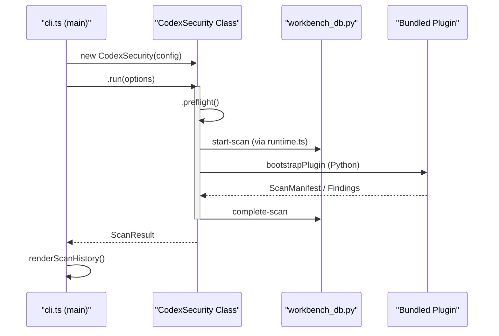
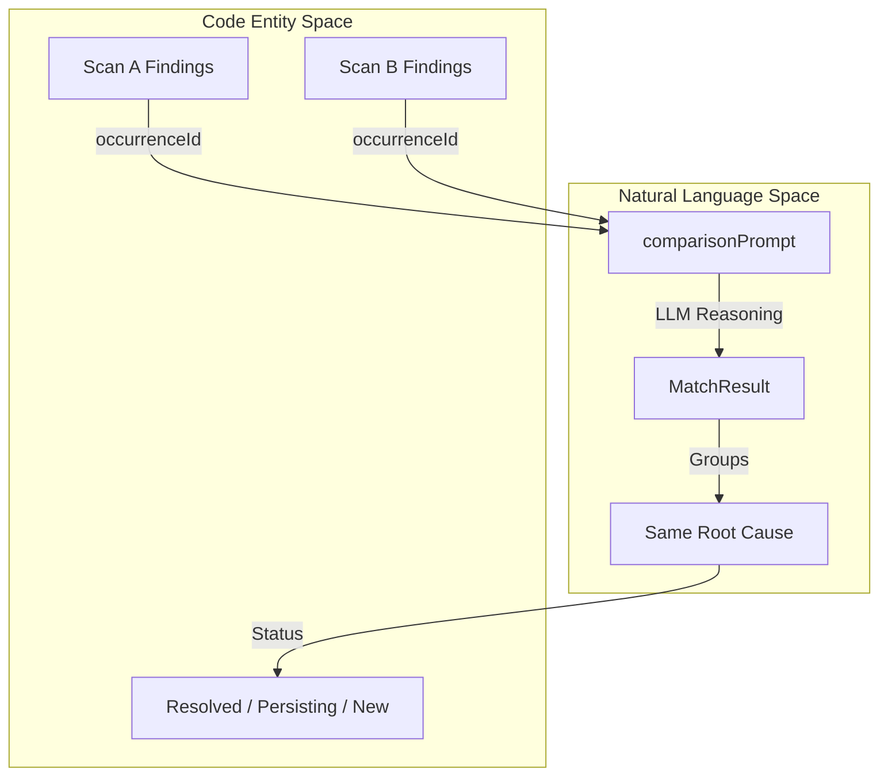

<!-- source: DeepWiki mcp.deepwiki.com · repo openai/codex-security · page 2.1 Scan Commands · fetched 2026-10-26 -->

# Scan Commands

Relevant source files

The following files were used as context for generating this wiki page:

- [sdk/typescript/src/cli.ts](sdk/typescript/src/cli.ts)
- [sdk/typescript/src/scan-comparison.ts](sdk/typescript/src/scan-comparison.ts)
- [sdk/typescript/src/scan-history-renderer.ts](sdk/typescript/src/scan-history-renderer.ts)
- [sdk/typescript/src/targets.ts](sdk/typescript/src/targets.ts)
- [sdk/typescript/tests-ts/cli.test.ts](sdk/typescript/tests-ts/cli.test.ts)
- [sdk/typescript/tests-ts/config.test.ts](sdk/typescript/tests-ts/config.test.ts)
- [sdk/typescript/tests-ts/contract.test.ts](sdk/typescript/tests-ts/contract.test.ts)
- [sdk/typescript/tests-ts/scan-comparison.test.ts](sdk/typescript/tests-ts/scan-comparison.test.ts)
- [sdk/typescript/tests-ts/scan-history-renderer.test.ts](sdk/typescript/tests-ts/scan-history-renderer.test.ts)
- [sdk/typescript/tests-ts/targets.test.ts](sdk/typescript/tests-ts/targets.test.ts)

The `codex-security` CLI provides a suite of commands for executing and managing security scans. These commands interface with the `CodexSecurity` SDK class to perform repository analysis, vulnerability discovery, and results management.

## Primary Scan Execution

The `scan` command is the primary entry point for analyzing a repository. It supports full repository scans, targeted path scans, and differential scans (Git diffs).

### Scan Targets and Modes

The CLI determines the scan scope based on the provided arguments and flags:

| Target Type | Command Pattern | Implementation Detail |
| :--- | :--- | :--- |
| **Full Repository** | `codex-security scan [repo]` | Scans all files within the repository root [sdk/typescript/src/targets.ts:165-167](). |
| **Path-limited** | `codex-security scan [repo] --path <file>` | Restricts analysis to specific files or directories [sdk/typescript/src/targets.ts:230-260](). |
| **Diff (Refs)** | `codex-security scan [repo] --diff <base>...<head>` | Scans the delta between two Git references [sdk/typescript/src/targets.ts:193-207](). |
| **Working Tree** | `codex-security scan [repo] --working-tree` | Scans uncommitted changes against a base (default `HEAD`) [sdk/typescript/src/targets.ts:209-216](). |

**Modes:**
*   `standard`: Optimized for speed and coverage of common vulnerabilities [sdk/typescript/src/cli.ts:160]().
*   `deep`: Performs multi-pass analysis for complex logic flaws [sdk/typescript/src/cli.ts:160]().

### Key Flags

*   `--knowledge-base <path>`: Provides supplementary documentation (e.g., threat models, architecture docs) to the LLM to improve context [sdk/typescript/src/cli.ts:155]().
*   `--max-cost <usd>`: Sets a hard limit on the scan cost. The process will terminate if polling indicates the budget is exceeded [sdk/typescript/src/cli.ts:169]().
*   `--fail-on-severity <level>`: Returns exit code `1` if findings at or above the specified severity (`critical`, `high`, `medium`, `low`) are discovered [sdk/typescript/src/cli.ts:168]().
*   `--mode <standard|deep>`: Sets the analysis depth [sdk/typescript/src/cli.ts:160]().

**Sources:** [sdk/typescript/src/cli.ts:152-173](), [sdk/typescript/src/targets.ts:158-217]()

---

## Scan Lifecycle and Data Flow

The following diagram illustrates the transition from a CLI command invocation to the execution of the underlying SDK and plugin logic.

### CLI to SDK Bridge

**Sources:** [sdk/typescript/src/cli.ts:235-243](), [sdk/typescript/src/api.ts:32-36](), [sdk/typescript/src/runtime.ts:65-67]()

---

## The `scans` Subcommand Group

The `scans` command provides management and historical analysis of previous scan results stored in the local SQLite workbench.

### Commands

| Subcommand | Purpose | Key Flags |
| :--- | :--- | :--- |
| `list` | Displays a table of historical scans for a repository [sdk/typescript/src/cli.ts:135](). | `--format json`, `--scan-root` |
| `show` | Provides detailed findings and metadata for a specific `scanId` [sdk/typescript/src/cli.ts:136](). | `--format json` |
| `rerun` | Re-executes a previous scan using the exact same configuration [sdk/typescript/src/cli.ts:137](). | N/A |
| `match` | Semantically matches findings between two scans to identify persisting issues [sdk/typescript/src/cli.ts:138](). | `--all` |
| `compare` | Renders a visual diff between two scans, highlighting new and resolved findings [sdk/typescript/src/cli.ts:141](). | N/A |

### Semantic Matching Implementation

The `scans match` and `scans compare` commands utilize an LLM-backed matching engine. This engine identifies if a finding in a "before" scan is the same root cause as a finding in an "after" scan, even if the code location or wording has shifted.

**Sources:** [sdk/typescript/src/scan-comparison.ts:69-72](), [sdk/typescript/src/scan-comparison.ts:124-135](), [sdk/typescript/src/scan-history-renderer.ts:16-23]()

---

## Bulk Scanning

The `bulk-scan` command facilitates scanning multiple repositories in parallel. It is designed for large-scale security audits and CI/CD environments.

*   **Discovery**: Can discover repositories via GitHub GraphQL API or a `repositories.csv` file [sdk/typescript/tests-ts/cli.test.ts:44-72]().
*   **Execution**: Spawns a worker pool to process repositories. It maintains a ledger to support resumability in case of interruption [sdk/typescript/src/cli.ts:57]().
*   **Wizard**: If run without arguments, it initiates an interactive wizard to configure the bulk scan [sdk/typescript/src/cli.ts:39]().

**Sources:** [sdk/typescript/src/cli.ts:38-41](), [sdk/typescript/src/multiscan.ts:57]()

---

## Configuration and Overrides

Scan behavior can be fine-tuned using TOML configuration or CLI overrides.

*   **Codex Overrides**: The `--codex` flag allows passing raw TOML strings to the underlying Codex engine (e.g., `--codex 'model_reasoning_effort="high"'`) [sdk/typescript/src/cli.ts:166]().
*   **Config Merging**: The CLI merges `DEFAULT_CODEX_CONFIG` with any local `codex-security.toml` and CLI overrides [sdk/typescript/src/config.ts:44-49]().
*   **Validation**: Overrides are validated to prevent illegal operations like disabling the multi-agent system or modifying protected plugin paths [sdk/typescript/tests-ts/config.test.ts:98-113]().

**Sources:** [sdk/typescript/src/cli.ts:166-167](), [sdk/typescript/src/config.ts:43-49](), [sdk/typescript/tests-ts/config.test.ts:31-48]()

---

