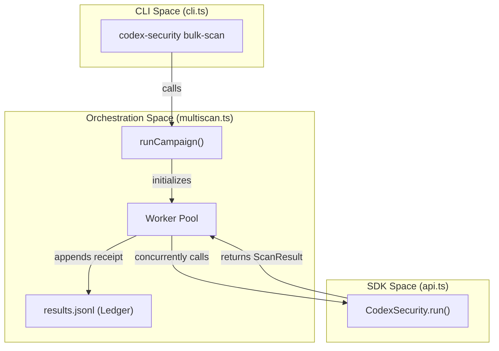
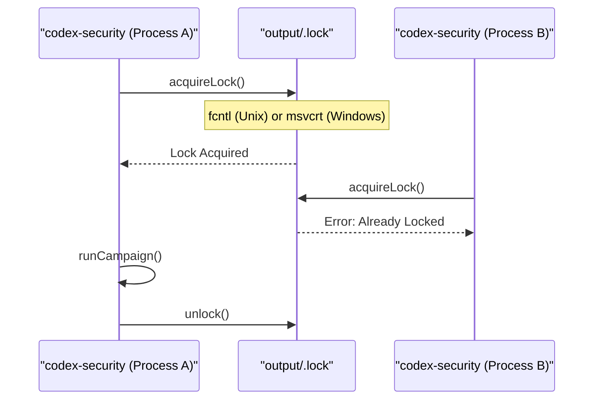

<!-- source: DeepWiki mcp.deepwiki.com · repo openai/codex-security · page 2.3 Bulk Scan and Multi-Repository Scanning · fetched 2026-10-26 -->

# Bulk Scan and Multi-Repository Scanning

Relevant source files

The following files were used as context for generating this wiki page:

- [sdk/typescript/pnpm-lock.yaml](sdk/typescript/pnpm-lock.yaml)
- [sdk/typescript/src/bulk-scan-discovery.ts](sdk/typescript/src/bulk-scan-discovery.ts)
- [sdk/typescript/src/cli.ts](sdk/typescript/src/cli.ts)
- [sdk/typescript/src/multiscan.ts](sdk/typescript/src/multiscan.ts)
- [sdk/typescript/tests-ts/bulk-scan-discovery.test.ts](sdk/typescript/tests-ts/bulk-scan-discovery.test.ts)
- [sdk/typescript/tests-ts/multiscan.test.ts](sdk/typescript/tests-ts/multiscan.test.ts)

The `bulk-scan` capability provides a high-throughput orchestration layer for running security scans across multiple repositories. It automates the discovery of repositories via the GitHub GraphQL API, manages a local inventory, and executes scans in parallel using a resumable worker pool architecture.

## Repository Discovery and Wizard

The `runBulkScanWizard` function provides an interactive CLI experience for selecting targets when no inventory is provided [sdk/typescript/src/bulk-scan-discovery.ts:130-133](). It leverages the GitHub CLI (`gh`) for authentication and uses the `@octokit/core` library to query the GitHub GraphQL API [sdk/typescript/src/bulk-scan-discovery.ts:96-126]().

### Discovery Data Flow
1.  **Authentication**: The system attempts to resolve a trusted `gh` executable and retrieves an OAuth token for the specified host (defaulting to `github.com`) [sdk/typescript/src/bulk-scan-discovery.ts:108-125]().
2.  **Owner Selection**: Fetches organizations the user belongs to or defaults to the personal account [sdk/typescript/src/bulk-scan-discovery.ts:195-216]().
3.  **GraphQL Query**: Executes `GITHUB_REPOSITORIES_QUERY` to find non-archived, non-fork repositories pushed within the last 90 days [sdk/typescript/src/bulk-scan-discovery.ts:14-33]().
4.  **Inventory Creation**: Discovered repositories are written to a `repositories.csv` file in the specified output directory [sdk/typescript/src/bulk-scan-discovery.ts:181-191]().

**Sources:** [sdk/typescript/src/bulk-scan-discovery.ts:14-33](), [sdk/typescript/src/bulk-scan-discovery.ts:96-126](), [sdk/typescript/src/bulk-scan-discovery.ts:130-193]()

## Inventory Management (`repositories.csv`)

The inventory is a CSV file that defines the worklist for the bulk scan. It supports standard CSV formatting, including quoted fields and embedded delimiters [sdk/typescript/tests-ts/multiscan.test.ts:183-189]().

| Column | Description |
| :--- | :--- |
| `id` | A unique identifier for the repository (used for directory naming). |
| `repository` | The URL or local path to the repository. |
| `revision` | The specific git commit OID to scan. |
| `scope` | (Optional) A subdirectory within the repository to restrict the scan. |
| `mode` | (Optional) The scan mode (`standard` or `deep`). |

**Sources:** [sdk/typescript/src/multiscan.ts:31-37](), [sdk/typescript/tests-ts/multiscan.test.ts:183-189]()

## Parallel Execution and Worker Pool

The `runMultiscan` function manages the execution of the inventory using a worker pool pattern [sdk/typescript/src/multiscan.ts:75-77]().

### Implementation Details
-   **Parallelism**: Controlled by the `--workers` flag. The system spawns a set of asynchronous worker loops that pull tasks from a shared `pending` queue [sdk/typescript/src/multiscan.ts:138-144]().
-   **Isolation**: Each worker creates a dedicated checkout directory under `checkouts/<id>` for every task [sdk/typescript/src/multiscan.ts:162-163]().
-   **Cleanup**: Repositories are removed from the local disk immediately after the scan completes or fails [sdk/typescript/src/multiscan.ts:195-195]().
-   **Signal Handling**: Workers monitor an `AbortSignal` to stop execution gracefully if the user interrupts the process [sdk/typescript/src/multiscan.ts:142-142]().

### Multi-Scan System Interaction

**Sources:** [sdk/typescript/src/multiscan.ts:75-98](), [sdk/typescript/src/multiscan.ts:138-221](), [sdk/typescript/src/cli.ts:57-57]()

## Ledger-Based Resumability

Bulk scans are designed to be resumable. Progress is tracked in a `results.jsonl` ledger located in the output directory [sdk/typescript/src/multiscan.ts:105-105]().

1.  **Receipts**: Every successful or failed scan attempt is appended to the ledger as a `MultiscanReceipt` [sdk/typescript/src/multiscan.ts:39-45]().
2.  **State Recovery**: Upon startup, `runCampaign` reads the ledger to determine which repositories have already been successfully scanned [sdk/typescript/src/multiscan.ts:109-113]().
3.  **Artifact Verification**: A scan is only considered "completed" and skipped if its `results.jsonl` entry exists AND the required artifacts (`findings.json`, `coverage.json`, etc.) are present on disk [sdk/typescript/src/multiscan.ts:114-121]().

**Sources:** [sdk/typescript/src/multiscan.ts:24-29](), [sdk/typescript/src/multiscan.ts:105-124](), [sdk/typescript/src/multiscan.ts:198-208]()

## Retry Logic and Error Handling

The system implements a retry mechanism to handle transient failures (e.g., network issues during checkout or API timeouts).

-   **Attempts**: The `--max-attempts` flag controls how many times a worker will try to scan a single repository [sdk/typescript/src/multiscan.ts:146-146]().
-   **Error Redaction**: Error messages are passed through `redactError` to remove sensitive path information before being logged to the ledger [sdk/typescript/src/multiscan.ts:193-193]().
-   **Completeness Guard**: If a scan finishes but the coverage report indicates it is not "complete", it is treated as a failure to trigger a retry [sdk/typescript/src/multiscan.ts:188-190]().

**Sources:** [sdk/typescript/src/multiscan.ts:146-219](), [sdk/typescript/src/multiscan.ts:188-190]()

## Locking and Concurrency Safety

To prevent multiple CLI instances from corrupting the same output directory, the system implements a file-based locking mechanism.

### Multi-Process Locking

The implementation uses `acquireLock` at the start of `runMultiscan`, which creates a `.lock` file in the output directory [sdk/typescript/src/multiscan.ts:92-92]().

**Sources:** [sdk/typescript/src/multiscan.ts:92-97](), [sdk/typescript/src/multiscan.ts:75-98]()

---

