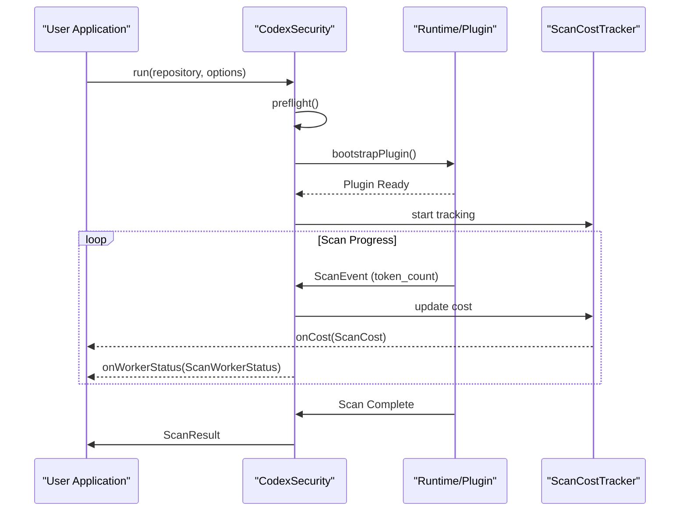

<!-- source: DeepWiki mcp.deepwiki.com · repo openai/codex-security · page 3 TypeScript SDK · fetched 2026-10-26 -->

# TypeScript SDK

<details>
<summary>Relevant source files</summary>

The following files were used as context for generating this wiki page:

- [sdk/typescript/src/api.ts](sdk/typescript/src/api.ts)
- [sdk/typescript/src/errors.ts](sdk/typescript/src/errors.ts)
- [sdk/typescript/src/index.ts](sdk/typescript/src/index.ts)
- [sdk/typescript/tests-ts/api.test.ts](sdk/typescript/tests-ts/api.test.ts)

</details>


The `@openai/codex-security` SDK provides a high-level TypeScript API for orchestrating security scans. It manages the lifecycle of the bundled Python plugin, handles authentication, tracks scan costs in real-time, and enforces security boundaries for scan artifacts. The SDK is designed to be used both by the official CLI and as a library for custom integrations.

### Core Architecture

The SDK is centered around the `CodexSecurity` class [sdk/typescript/src/api.ts:210-210](), which acts as the primary entry point for all operations. It bridges the gap between the high-level scan requests and the underlying `Codex` agentic runtime.

The following diagram illustrates the relationship between the SDK's public API surface and the internal execution entities.

**SDK to Code Entity Mapping**
```mermaid
graph TD
    subgraph "Natural Language Space"
        User["User Application / CLI"]
        ScanRequest["Scan Request"]
        ScanResult["Scan Result"]
    end

    subgraph "Code Entity Space (TypeScript SDK)"
        CS["CodexSecurity Class"]
        SO["ScanOptions Interface"]
        RT["runtime.ts (Plugin Bootstrap)"]
        CT["ScanCostTracker"]
        WS["ScanWorkerStatus"]
    end

    subgraph "Execution Space"
        BP["_bundled_plugin (Python)"]
        CA["Codex Agent Runtime"]
    end

    User -->|instantiates| CS
    User -->|provides| SO
    CS -->|calls run()| RT
    RT -->|launches| BP
    CS -->|monitors| CT
    CS -->|emits| WS
    BP -->|executes via| CA
    CS -->|returns| ScanResult
```
Sources: [sdk/typescript/src/api.ts:210-242](), [sdk/typescript/src/runtime.ts:50-69](), [sdk/typescript/src/cost.ts:22-22](), [sdk/typescript/src/worker-progress.ts:45-47]()

---

### Main API Surface

The SDK exports a set of core classes and types from its entry point [sdk/typescript/src/index.ts:1-74]().

| Entity | Role |
| :--- | :--- |
| `CodexSecurity` | Main orchestrator for scans and authentication. |
| `ScanOptions` | Configuration for a specific scan (targets, modes, hooks). |
| `ScanResult` | Container for scan findings, coverage, and metadata. |
| `CodexLoginHandle` | Manages active authentication sessions (API key or ChatGPT). |
| `ScanCost` | Real-time breakdown of token usage and USD estimates. |

For a deep dive into the primary orchestrator, see [CodexSecurity Class and Scan Lifecycle](#3.1).

---

### Execution and Environment

The SDK does not perform analysis itself; instead, it bootstraps a specialized environment for the `_bundled_plugin`. This involves:
1.  **Plugin Resolution**: Locating the bundled Python plugin or extracting it from a zip.
2.  **Runtime Validation**: Ensuring a compatible Python 3.10+ interpreter is available.
3.  **Isolation**: Creating a `CODEX_HOME` directory and ensuring scan outputs are placed outside of protected repository roots.

For details on how the environment is prepared, see [Runtime and Plugin Bootstrap](#3.2).

---

### Configuration and Targets

Scanning supports various `ScanTarget` types, including local paths, full git repositories, and specific diffs (e.g., comparing a branch to the working tree) [sdk/typescript/src/targets.ts:78-78](). Configuration is managed via a hierarchy of defaults, TOML files, and runtime overrides.

For details on target normalization and configuration merging, see [Scan Targets and Configuration](#3.3).

---

### Monitoring and Cost Control

Because scans utilize LLMs, the SDK provides robust mechanisms to track and limit costs. The `ScanCostTracker` polls session logs to aggregate token usage across all agent threads [sdk/typescript/src/cost.ts:22-22]().

**Scan Execution Flow**

Sources: [sdk/typescript/src/api.ts:237-330](), [sdk/typescript/src/cost.ts:22-22](), [sdk/typescript/src/worker-progress.ts:45-47]()

For details on cost estimation and progress tracking, see [Cost Tracking and Worker Progress](#3.4).

---

### Authentication

The SDK supports multiple authentication flows, including OpenAI API keys and ChatGPT device-based login [sdk/typescript/src/auth.ts:9-14](). Credentials can be imported from the ambient environment or persisted locally.

For details on authentication handles and flows, see [Authentication](#3.5).

---

### Error Hierarchy

All SDK errors inherit from `CodexSecurityError` [sdk/typescript/src/errors.ts:4-9](). The hierarchy allows for precise handling of common failure modes:

*   `AuthenticationRequiredError`: Triggered when no valid credentials are found.
*   `ScanCostLimitExceededError`: Raised if the estimated USD cost exceeds the user-defined `maxCostUsd` [sdk/typescript/src/errors.ts:41-41]().
*   `OutputInsideProtectedRootError`: A security guard preventing artifacts from being written into the source repository [sdk/typescript/src/errors.ts:19-19]().
*   `PluginPythonUnavailableError`: Raised if a valid Python interpreter cannot be found during bootstrap.

For the full schema of results and error details, see [Data Models and Contracts](#3.6).

---
**Sources:**
- [sdk/typescript/src/api.ts:210-330]()
- [sdk/typescript/src/index.ts:1-74]()
- [sdk/typescript/src/errors.ts:1-58]()
- [sdk/typescript/src/runtime.ts:50-69]()
- [sdk/typescript/src/targets.ts:78-81]()

---

