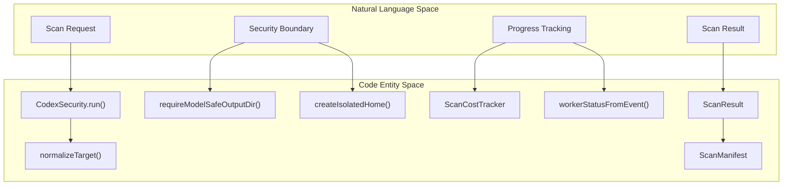
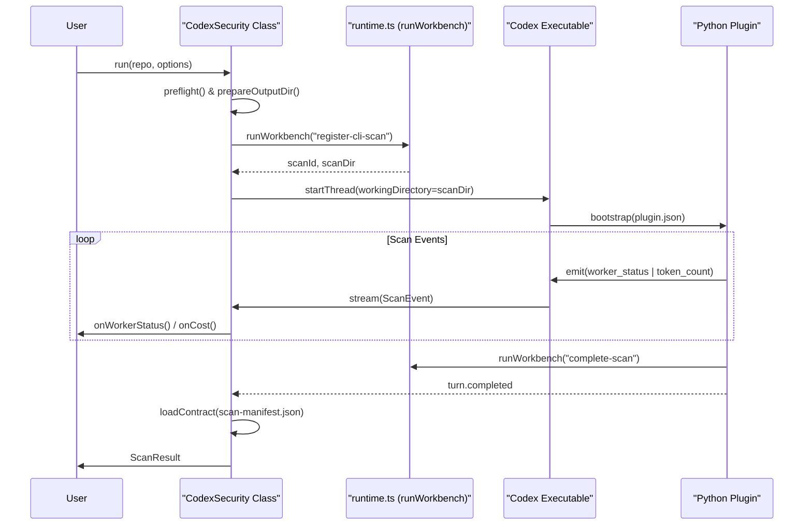

<!-- source: DeepWiki mcp.deepwiki.com · repo openai/codex-security · page 3.1 CodexSecurity Class and Scan Lifecycle · fetched 2026-10-26 -->

# CodexSecurity Class and Scan Lifecycle

Relevant source files

The following files were used as context for generating this wiki page:

- [sdk/typescript/src/api.ts](sdk/typescript/src/api.ts)
- [sdk/typescript/src/result.ts](sdk/typescript/src/result.ts)
- [sdk/typescript/tests-ts/api-events.test.ts](sdk/typescript/tests-ts/api-events.test.ts)
- [sdk/typescript/tests-ts/api-integration.test.ts](sdk/typescript/tests-ts/api-integration.test.ts)
- [sdk/typescript/tests-ts/api.test.ts](sdk/typescript/tests-ts/api.test.ts)
- [sdk/typescript/tests-ts/result.test.ts](sdk/typescript/tests-ts/result.test.ts)
- [sdk/typescript/tests-ts/support/api-events.ts](sdk/typescript/tests-ts/support/api-events.ts)

The `CodexSecurity` class is the primary entry point for the TypeScript SDK, providing a high-level API to orchestrate security scans. It manages the lifecycle of a scan—from environment preflight and output directory isolation to real-time event monitoring and final result collection.

### Overview

The `CodexSecurity` class encapsulates the complexity of the underlying `codex` executable and the bundled Python plugin. It handles authentication, cost tracking, and provides hooks for observing scan progress.

The core execution flow is encapsulated in the `run()` method, which performs a sequence of validation and execution steps to ensure scan integrity and security.

### Scan Execution Pipeline

The scan lifecycle follows a strict sequence to maintain the "Protected Root" security model and ensure all dependencies (Python, Codex, and Plugins) are correctly configured.

#### Logic Flow: `run()`

1.  **Validation**: Validates the repository path and scan mode [sdk/typescript/src/api.ts:249-251]().
2.  **Runtime Preparation**: Resolves the Python interpreter, bootstraps the security plugin, and prepares the isolated `CODEX_HOME` [sdk/typescript/src/api.ts:253-254]().
3.  **Output Directory Setup**: Creates a private, isolated directory for scan artifacts, ensuring it is not inside the scanned repository [sdk/typescript/src/api.ts:260-264]().
4.  **Workbench Registration**: Initializes the SQLite workbench for the new scan [sdk/typescript/src/api.ts:278-282]().
5.  **Thread Execution**: Starts a Codex thread and streams events from the plugin [sdk/typescript/src/api.ts:311-320]().
6.  **Result Collection**: Finalizes the scan contract, estimates costs, and returns a `ScanResult` object [sdk/typescript/src/api.ts:322-337]().

#### Data Flow: Natural Language Space to Code Entities

The following diagram maps high-level scan concepts to their specific implementation classes and functions.

Title: Mapping Scan Concepts to Code Entities

**Sources:** [sdk/typescript/src/api.ts:237-242](), [sdk/typescript/src/targets.ts:73-73](), [sdk/typescript/src/runtime.ts:53-69](), [sdk/typescript/src/cost.ts:22-22](), [sdk/typescript/src/worker-progress.ts:45-45](), [sdk/typescript/src/result.ts:30-30]().

---

### The `CodexSecurity` Class

#### Constructor and Configuration
The constructor accepts an optional `CodexSecurityConfig` which allows overriding default behaviors like model selection or sandbox permissions [sdk/typescript/src/api.ts:228-235]().

#### `preflight()`
The `preflight()` method allows callers to inspect the scan configuration (target resolution, authentication status, and estimated model usage) without actually starting the scan [sdk/typescript/src/api.ts:244-247](). It returns a `ScanPreflight` object containing:
*   Resolved `NormalizedTarget`.
*   Authentication method used (API Key vs. Stored Credentials).
*   Selected model and reasoning effort.
*   Calculated output and archive directories [sdk/typescript/src/api.ts:164-175]().

#### `run()`
The primary execution method. It takes a repository path and `ScanOptions`. It is wrapped in `#trackOperation` to prevent concurrent operations on a single class instance [sdk/typescript/src/api.ts:237-242]().

#### `close()`
Performs cleanup of temporary resources, including the `bootstrapWorkspace` and any active login handles [sdk/typescript/src/api.ts:365-385]().

**Sources:** [sdk/typescript/src/api.ts:210-385]().

---

### ScanOptions and Event Hooks

The `ScanOptions` interface allows consumers to react to the scan's progress in real-time through various callbacks.

| Hook | Description |
| :--- | :--- |
| `onCost` | Triggered when token usage is updated; provides `ScanCost` (USD estimate) [sdk/typescript/src/api.ts:124-124](). |
| `onWorkerStatus` | Reports the current phase of the scan (e.g., `discovery`, `analyzing`, `finalizing`) [sdk/typescript/src/api.ts:134-134](). |
| `onReconnect` | Fired if the Codex stream encounters a network or rate-limit error and attempts to resume [sdk/typescript/src/api.ts:129-133](). |
| `onAuthentication` | Reports which credential source is being used for the scan [sdk/typescript/src/api.ts:127-127](). |
| `onOutputDirReady` | Provides the absolute path to the isolated directory where artifacts are being written [sdk/typescript/src/api.ts:126-126](). |

**Sources:** [sdk/typescript/src/api.ts:114-137]().

---

### Scan Lifecycle Sequence

The following diagram illustrates the interaction between the `CodexSecurity` SDK, the `Codex` CLI executable, and the Python `plugin`.

Title: Scan Lifecycle Execution Sequence

**Sources:** [sdk/typescript/src/api.ts:237-340](), [sdk/typescript/src/runtime.ts:63-63](), [sdk/typescript/src/worker-progress.ts:45-47](), [sdk/typescript/src/result.ts:30-46]().

---

### Result Collection and `ScanResult`

Upon successful completion, the SDK aggregates data from the output directory to construct a `ScanResult` object [sdk/typescript/src/api.ts:335-337]().

*   **Manifest**: Loaded from `scan-manifest.json`, containing scan metadata [sdk/typescript/src/result.ts:79-81]().
*   **Findings**: Loaded from `findings.json` [sdk/typescript/src/result.ts:83-85]().
*   **Coverage**: Loaded from `coverage.json` [sdk/typescript/src/result.ts:87-89]().
*   **Cost**: Calculated using `estimateScanCost` based on final token usage [sdk/typescript/src/result.ts:47-50]().
*   **SARIF**: Automatically discovers `exports/results.sarif` if it exists [sdk/typescript/src/result.ts:54-68]().

**Sources:** [sdk/typescript/src/result.ts:30-109]().

---

