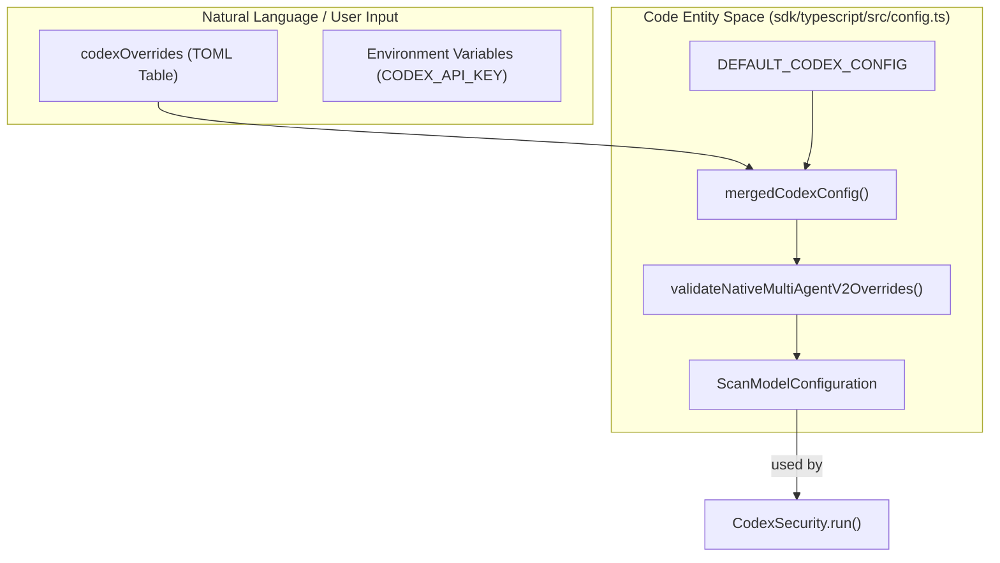
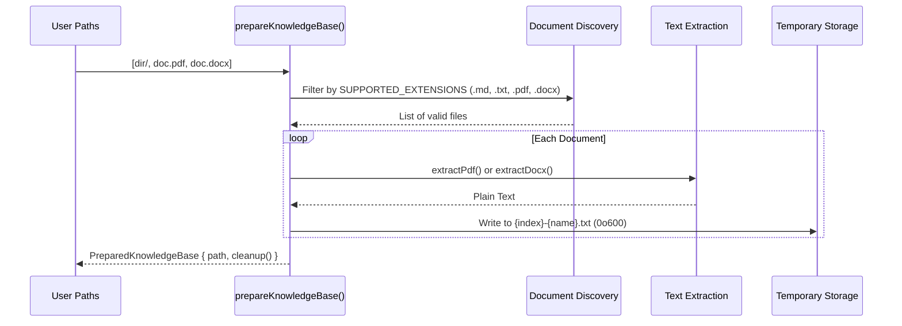

<!-- source: DeepWiki mcp.deepwiki.com · repo openai/codex-security · page 3.3 Scan Targets and Configuration · fetched 2026-10-26 -->

# Scan Targets and Configuration

Relevant source files

The following files were used as context for generating this wiki page:

- [sdk/typescript/_bundled_plugin/.mcp.json](sdk/typescript/_bundled_plugin/.mcp.json)
- [sdk/typescript/src/config.ts](sdk/typescript/src/config.ts)
- [sdk/typescript/src/knowledge-base.ts](sdk/typescript/src/knowledge-base.ts)
- [sdk/typescript/src/targets.ts](sdk/typescript/src/targets.ts)
- [sdk/typescript/tests-ts/config.test.ts](sdk/typescript/tests-ts/config.test.ts)
- [sdk/typescript/tests-ts/contract.test.ts](sdk/typescript/tests-ts/contract.test.ts)
- [sdk/typescript/tests-ts/knowledge-base.test.ts](sdk/typescript/tests-ts/knowledge-base.test.ts)
- [sdk/typescript/tests-ts/targets.test.ts](sdk/typescript/tests-ts/targets.test.ts)

This section details how Codex Security defines, validates, and normalizes the subjects of a security scan, alongside the configuration system that governs the behavior of the underlying AI agents.

## Scan Targets

A `ScanTarget` represents the scope of analysis. The SDK supports three primary categories of targets: full repositories, specific file paths, and Git-based differences.

### ScanTarget Types

| Type | Description | Code Entity |
| :--- | :--- | :--- |
| **Repository** | Scans the entire directory content. | `"repository"` |
| **Paths** | Scans a specific subset of files or directories. | `readonly string[]` |
| **DiffTarget** | Scans changes between refs or the working tree. | `DiffTarget` class |

### Target Normalization
The `normalizeTarget` function [sdk/typescript/src/targets.ts:158-162]() is responsible for converting raw user input into a `NormalizedTarget`. This process ensures that all paths are relative to the repository root and that Git references are resolved to immutable commit SHAs.

1.  **Repository Validation**: The root directory is resolved via `realpath` and checked for existence [sdk/typescript/src/targets.ts:98-119]().
2.  **Path Sanitization**: For path-based targets, the system rejects empty paths or paths that escape the repository boundary [sdk/typescript/src/targets.ts:238-255]().
3.  **Git Ref Resolution**: For `DiffTarget`, the system executes `git rev-parse` to bind human-readable refs (like `HEAD` or `main`) to specific commit IDs [sdk/typescript/src/targets.ts:192-216]().

### DiffTarget Specifications
The `DiffTarget` class [sdk/typescript/src/targets.ts:30-80]() provides two primary modes:
*   **Refs**: Compares two specific Git references (e.g., `base: "main"`, `head: "feature-branch"`).
*   **Working Tree**: Compares a base reference against the current uncommitted state of the filesystem.

**Sources:** [sdk/typescript/src/targets.ts:21-96](), [sdk/typescript/tests-ts/targets.test.ts:112-198]()

---

## Configuration System

Codex Security uses a hierarchical configuration system that merges internal defaults with user-provided overrides.

### Data Flow: Natural Language to Code Entity Space

The following diagram illustrates how configuration flows from raw TOML/JSON overrides into the structured `ScanModelConfiguration` used by the SDK.

**Sources:** [sdk/typescript/src/config.ts:24-72](), [sdk/typescript/tests-ts/config.test.ts:30-48]()

### CodexSecurityConfig and Overrides
The `CodexSecurityConfig` interface [sdk/typescript/src/config.ts:13-17]() accepts `codexOverrides`, which are deep-merged with `DEFAULT_CODEX_CONFIG`.

*   **Default Model**: The system defaults to `gpt-5.6-sol` with `xhigh` reasoning effort [sdk/typescript/src/config.ts:24-36]().
*   **Validation**: Overrides are strictly validated to prevent prototype pollution [sdk/typescript/src/config.ts:109-121]() and to ensure that internal plugin loading logic is not subverted by the user [sdk/typescript/src/config.ts:123-139]().
*   **Multi-Agent V2**: The system enforces the use of the `multi_agent_v2` feature set. Attempts to disable this or use legacy `agents.max_threads` settings result in a `ConfigurationError` [sdk/typescript/src/config.ts:169-201]().

### Atomic Configuration Writing
When the SDK needs to persist configuration (e.g., for the bundled plugin), it uses `writeCodexConfig` [sdk/typescript/src/config.ts:74-107](). This function ensures:
1.  **Atomicity**: Writes to a temporary file and uses `rename` to prevent partial writes.
2.  **Security**: Files are created with `0o600` permissions (read/write by owner only) [sdk/typescript/src/config.ts:91-94]().

**Sources:** [sdk/typescript/src/config.ts:61-107](), [sdk/typescript/tests-ts/config.test.ts:158-175]()

---

## Knowledge Base Feature

The Knowledge Base allows users to provide supplementary documentation (e.g., architecture docs, threat models) to the AI agents to improve scan context.

### Document Processing Pipeline

**Sources:** [sdk/typescript/src/knowledge-base.ts:29-112](), [sdk/typescript/tests-ts/knowledge-base.test.ts:78-106]()

### Implementation Details
*   **Supported Formats**: `.md`, `.markdown`, `.txt`, `.pdf`, `.docx` [sdk/typescript/src/knowledge-base.ts:15-21]().
*   **Extraction**:
    *   **PDF**: Uses `pdfjs-dist` to iterate through pages and join text items [sdk/typescript/src/knowledge-base.ts:142-172]().
    *   **DOCX**: Unzips the archive, extracts `word/document.xml`, and strips XML tags while preserving tabs and newlines [sdk/typescript/src/knowledge-base.ts:174-204]().
*   **Isolation**: The prepared knowledge base is stored in a unique temporary directory with restricted permissions [sdk/typescript/src/knowledge-base.ts:67-97]().

**Sources:** [sdk/typescript/src/knowledge-base.ts:15-112](), [sdk/typescript/tests-ts/knowledge-base.test.ts:108-122]()

---

## Scan Modes

The `ScanMode` [sdk/typescript/src/targets.ts:21]() determines the depth of analysis:

1.  **Standard**: A single-pass scan focused on immediate vulnerability discovery.
2.  **Deep**: A multi-pass analysis that includes more exhaustive reasoning and cross-file data flow tracking.

**Sources:** [sdk/typescript/src/targets.ts:21](), [sdk/typescript/tests-ts/contract.test.ts:89-100]()

---

