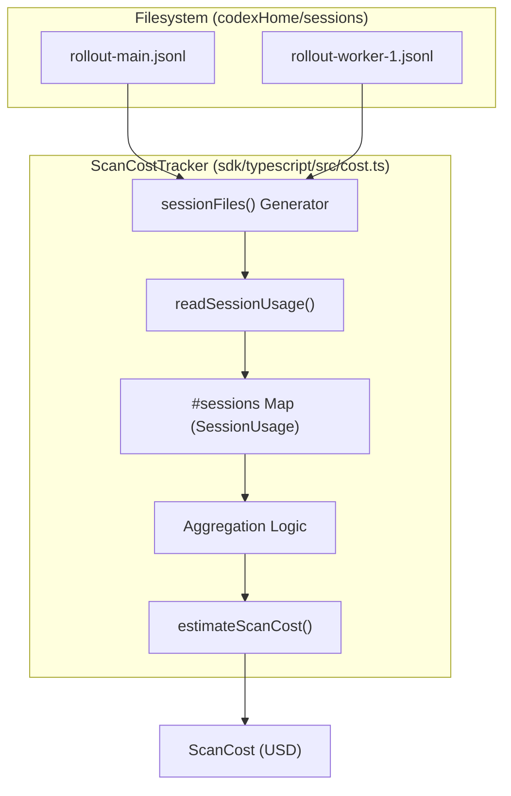
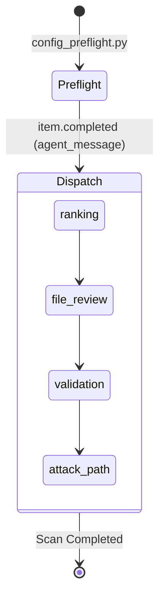

<!-- source: DeepWiki mcp.deepwiki.com · repo openai/codex-security · page 3.4 Cost Tracking and Worker Progress · fetched 2026-10-26 -->

# Cost Tracking and Worker Progress

Relevant source files

The following files were used as context for generating this wiki page:

- [sdk/typescript/src/cost.ts](sdk/typescript/src/cost.ts)
- [sdk/typescript/src/worker-progress.ts](sdk/typescript/src/worker-progress.ts)
- [sdk/typescript/tests-ts/cost.test.ts](sdk/typescript/tests-ts/cost.test.ts)
- [sdk/typescript/tests-ts/worker-progress.test.ts](sdk/typescript/tests-ts/worker-progress.test.ts)

This section details the mechanisms used by the Codex Security SDK to monitor the financial cost of scans and the operational progress of delegated workers. These systems rely on real-time polling of session artifacts and parsing of agent execution events to provide feedback to users and enforce safety limits.

## Cost Tracking Architecture

The `ScanCostTracker` class is responsible for aggregating token usage and estimating USD costs during a scan. It operates by polling JSONL session files generated by the underlying execution engine.

### Implementation and Data Flow

The tracker monitors the `sessions` directory within the `codexHome` directory [sdk/typescript/src/cost.ts:112](). It identifies the primary scan thread and recursively discovers all child threads spawned by delegated workers to provide a comprehensive cost view [sdk/typescript/src/cost.ts:128-143]().

#### Token Aggregation Logic
1.  **File Polling**: The tracker scans for `.jsonl` files in the sessions directory [sdk/typescript/src/cost.ts:180-182]().
2.  **Incremental Reading**: Files are read using an offset to avoid re-processing the same data [sdk/typescript/src/cost.ts:117-207]().
3.  **Thread Linking**: It parses `session_meta` events to build a tree of `threadId` and `parentThreadId` relationships [sdk/typescript/src/cost.ts:239-251]().
4.  **Token Summation**: It aggregates `input_tokens`, `cached_input_tokens`, `cache_write_input_tokens`, and `output_tokens` across all related threads [sdk/typescript/src/cost.ts:145-154]().

**Scan Cost Data Flow**

Sources: [sdk/typescript/src/cost.ts:60-166](), [sdk/typescript/src/cost.ts:168-184](), [sdk/typescript/src/cost.ts:186-227]()

### Pricing and Estimation

The system uses a hardcoded pricing table for USD estimation. If a model is not found in the table, or if usage data is incomplete, the estimation returns `null` [sdk/typescript/src/cost.ts:316-339]().

| Model | Input (per 1M) | Cached Input (per 1M) | Cache Write (per 1M) | Output (per 1M) |
| :--- | :--- | :--- | :--- | :--- |
| `gpt-5.6` / `-sol` | $5.00 | $0.50 | $6.25 | $30.00 |
| `gpt-5.6-terra` | $2.50 | $0.25 | $3.125 | $15.00 |
| `gpt-5.6-luna` | $1.00 | $0.10 | $1.25 | $6.00 |

Sources: [sdk/typescript/src/cost.ts:50-55](), [sdk/typescript/tests-ts/cost.test.ts:73-80]()

### Cost Limits

If `maxCostUsd` is provided in the `ScanCostTrackerOptions` [sdk/typescript/src/cost.ts:40](), the tracker polls every 100ms [sdk/typescript/src/cost.ts:57](). While the tracker itself does not throw the error, the `CodexSecurity` class uses these snapshots to enforce limits and throw `ScanCostLimitExceededError` if the estimate exceeds the user-defined threshold.

## Worker Progress Tracking

The worker progress system tracks the lifecycle of a scan from preflight capability checks to the dispatch of specific analysis phases.

### ScanWorkerStatus

The `ScanWorkerStatus` type represents the current state of the scan engine's workers [sdk/typescript/src/worker-progress.ts:18-29]().

*   **`preflight`**: Reports if delegated workers are available and how many slots are configured [sdk/typescript/src/worker-progress.ts:20-23]().
*   **`dispatch`**: Reports the active analysis phase and the ratio of `started` vs `planned` worker tasks [sdk/typescript/src/worker-progress.ts:25-29]().

### Event Processing

The function `workerStatusFromEvent` parses events of type `item.completed` from the scan stream [sdk/typescript/src/worker-progress.ts:31-41]().

1.  **Preflight Status**: Parsed from the output of `config_preflight.py`. It extracts the `delegated_workers` capability and `usable_worker_slots_X` counts [sdk/typescript/src/worker-progress.ts:43-100]().
2.  **Dispatch Status**: Parsed from `agent_message` items containing the `CODEX_SECURITY_WORKER_STATUS` prefix [sdk/typescript/src/worker-progress.ts:102-139]().

**Worker Phase Transition Diagram**

Sources: [sdk/typescript/src/worker-progress.ts:5-16](), [sdk/typescript/src/worker-progress.ts:31-41]()

### Phase Definitions

The following phases are tracked during the `dispatch` kind:
*   **`ranking`**: Prioritizing candidates for review [sdk/typescript/src/worker-progress.ts:6]().
*   **`file_review`**: Workers performing deep analysis of specific files [sdk/typescript/src/worker-progress.ts:7]().
*   **`validation`**: Confirming findings and checking for false positives [sdk/typescript/src/worker-progress.ts:8]().
*   **`attack_path`**: Generating attack graphs for validated findings [sdk/typescript/src/worker-progress.ts:9]().

Sources: [sdk/typescript/src/worker-progress.ts:12-16](), [sdk/typescript/tests-ts/worker-progress.test.ts:103-111]()

---

