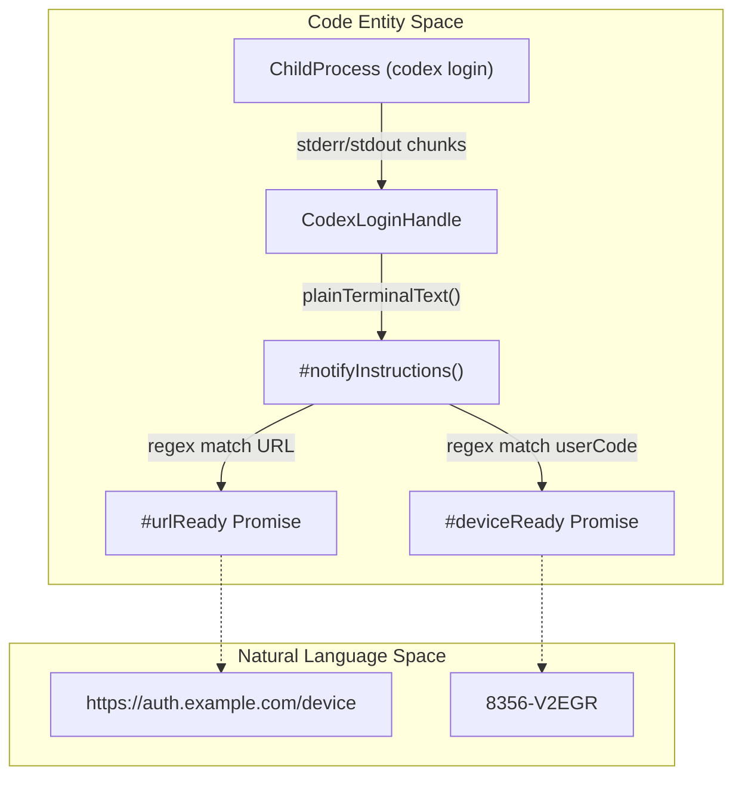
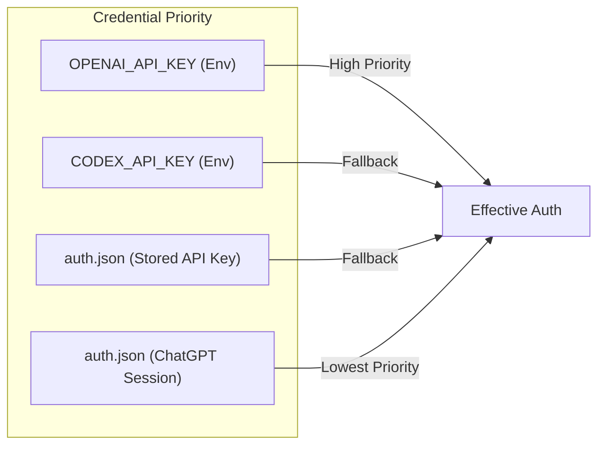

<!-- source: DeepWiki mcp.deepwiki.com · repo openai/codex-security · page 3.5 Authentication · fetched 2026-10-26 -->

# Authentication

Relevant source files

The following files were used as context for generating this wiki page:

- [.github/workflows/container-ci.yml](.github/workflows/container-ci.yml)
- [.github/workflows/node-ci.yml](.github/workflows/node-ci.yml)
- [sdk/typescript/_bundled_plugin/scripts/generate_rank_input.py](sdk/typescript/_bundled_plugin/scripts/generate_rank_input.py)
- [sdk/typescript/_bundled_plugin/scripts/normalize_candidates.py](sdk/typescript/_bundled_plugin/scripts/normalize_candidates.py)
- [sdk/typescript/_bundled_plugin/scripts/rank_preview.py](sdk/typescript/_bundled_plugin/scripts/rank_preview.py)
- [sdk/typescript/src/auth.ts](sdk/typescript/src/auth.ts)
- [sdk/typescript/tests-ts/auth.test.ts](sdk/typescript/tests-ts/auth.test.ts)
- [sdk/typescript/tests-ts/cli-authentication.test.ts](sdk/typescript/tests-ts/cli-authentication.test.ts)

The Codex Security SDK and CLI manage authentication by delegating to the underlying Codex engine. It supports both long-lived API keys (via environment variables or local storage) and interactive ChatGPT device-code flows.

## Overview of Authentication Flows

Authentication is handled through the `auth.ts` module, which wraps the execution of the `codex` binary for all credential-related operations [sdk/typescript/src/auth.ts:1-5]().

The system supports three primary authentication methods:
1.  **Ambient API Keys**: Credentials imported from `OPENAI_API_KEY` or `CODEX_API_KEY` environment variables [sdk/typescript/tests-ts/cli-authentication.test.ts:48-52]().
2.  **Stored API Keys**: Keys provided via `login --with-api-key` and persisted in the `CODEX_HOME` directory [sdk/typescript/tests-ts/cli-authentication.test.ts:139-142]().
3.  **Interactive Device Auth**: A ChatGPT-based flow where the user is provided a URL and a one-time code [sdk/typescript/src/auth.ts:107-122]().

### Authentication Process Boundary
The `CodexLoginHandle` class manages the lifecycle of an interactive login process, providing promises that resolve when authentication instructions (URLs/Codes) are ready [sdk/typescript/src/auth.ts:18-48]().

| Feature | Description |
| :--- | :--- |
| **API Key Login** | `loginApiKey` pipes the key to `stdin` of `codex login --with-api-key` [sdk/typescript/src/auth.ts:185-201](). |
| **Device Auth** | `CodexLoginHandle` parses `stdout`/`stderr` for URLs and codes [sdk/typescript/src/auth.ts:107-122](). |
| **Status Check** | `accountStatus` queries `codex login status` and parses the result [sdk/typescript/src/auth.ts:203-223](). |
| **Logout** | `logout` executes `codex logout` to clear local sessions [sdk/typescript/src/auth.ts:225-242](). |

**Sources:** [sdk/typescript/src/auth.ts:1-242](), [sdk/typescript/tests-ts/cli-authentication.test.ts:48-142]()

---

## Interactive Login: CodexLoginHandle

The `CodexLoginHandle` is designed for interactive environments (like IDEs or CLIs) where the user must be prompted to visit a URL.

### Data Flow: Instruction Extraction
The handle monitors the child process output in real-time to extract authentication metadata.

**Sources:** [sdk/typescript/src/auth.ts:57-64](), [sdk/typescript/src/auth.ts:107-122](), [sdk/typescript/src/auth.ts:141-154]()

### Stderr Draining and Process Handling
To ensure all error messages are captured, especially on Windows where process exit and stream closure can be decoupled, the SDK implements specific draining logic:
*   **Windows Exit Delay**: On Windows, the SDK waits up to 1,000ms after the `exit` event to ensure `stdout`/`stderr` streams have fully flushed before resolving the completion promise [sdk/typescript/src/auth.ts:92-99]().
*   **Instruction Waiters**: `waitForInstructions()` allows callers to block until the URL or device code is parsed from the stream, rather than waiting for the process to exit [sdk/typescript/src/auth.ts:128-132]().

**Sources:** [sdk/typescript/src/auth.ts:92-100](), [sdk/typescript/src/auth.ts:128-132](), [sdk/typescript/tests-ts/auth.test.ts:130-152]()

---

## API Key vs. Device Auth Flows

The SDK distinguishes between programmatic API key injection and interactive user flows.

### API Key Flow (`loginApiKey`)
This flow is non-interactive. The SDK spawns `codex login --with-api-key`, writes the key to `stdin`, and closes the stream immediately [sdk/typescript/src/auth.ts:54](), [sdk/typescript/src/auth.ts:198]().

### Ambient Credential Import
The CLI automatically detects and reports when environment variables override stored credentials. It prioritizes `OPENAI_API_KEY` over `CODEX_API_KEY` [sdk/typescript/tests-ts/cli-authentication.test.ts:87-115](). If an environment key is present, the CLI emits a warning to `stderr` to inform the user that their stored ChatGPT session is being ignored [sdk/typescript/tests-ts/cli-authentication.test.ts:63-68]().

**Sources:** [sdk/typescript/tests-ts/cli-authentication.test.ts:48-71](), [sdk/typescript/tests-ts/cli-authentication.test.ts:87-115]()

---

## Technical Implementation Details

### CodexCommand and Runtime
Authentication functions require a `CodexCommand` object, which defines the absolute path to the `codex` executable and any required prefix arguments (e.g., `node codex.js`) [sdk/typescript/src/auth.ts:34](), [sdk/typescript/src/runtime.ts:4-5]().

### Credential Storage (`CODEX_HOME`)
Credentials are saved in a location determined by the `CODEX_HOME` environment variable. If not set, it defaults to `~/.codex` [sdk/typescript/tests-ts/cli-authentication.test.ts:151-161](). The SDK ensures that `auth.json` is stored within this isolated directory and not inside the scanned repository [sdk/typescript/tests-ts/cli-authentication.test.ts:181-183]().

### Process Sanitization
When running authentication commands, the SDK:
1.  **Hides Windows Windows**: Uses `windowsHide: true` to prevent console windows from popping up during background auth checks [sdk/typescript/src/auth.ts:52]().
2.  **Redacts Secrets**: The CLI logic ensures that synthetic secrets or actual API keys are never printed to `stdout` or `stderr` during status reports [sdk/typescript/tests-ts/cli-authentication.test.ts:69]().

**Sources:** [sdk/typescript/src/auth.ts:33-56](), [sdk/typescript/tests-ts/cli-authentication.test.ts:139-183]()

---

