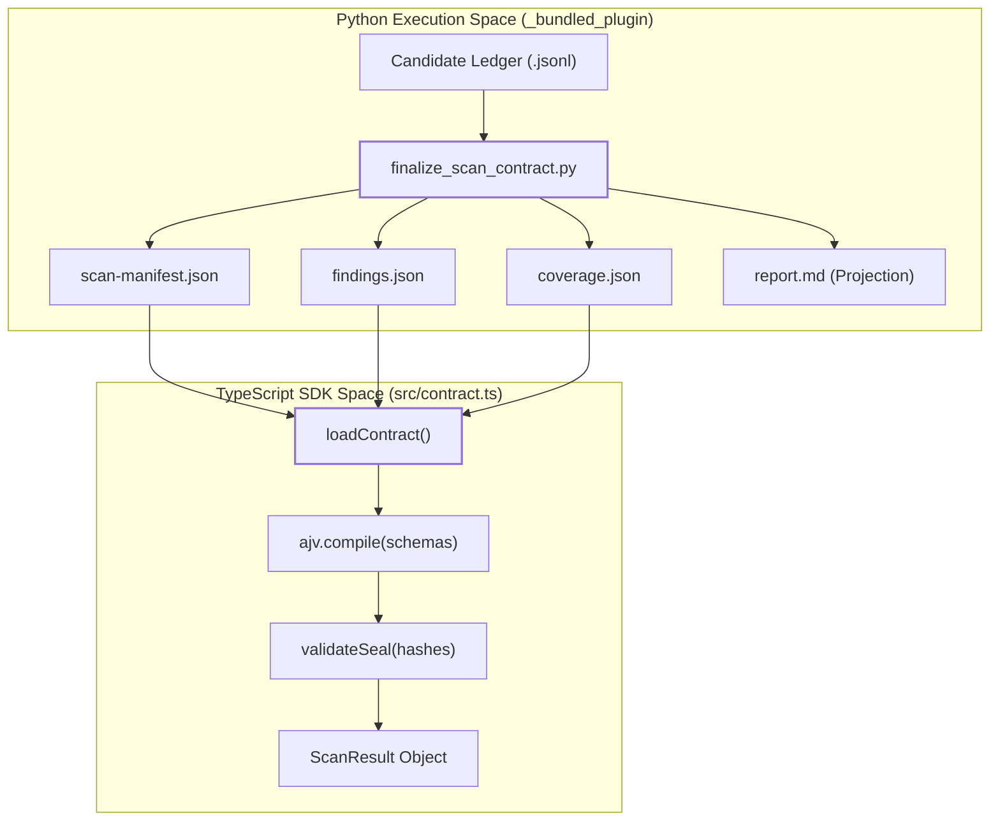

<!-- source: DeepWiki mcp.deepwiki.com · repo openai/codex-security · page 3.6 Data Models and Contracts · fetched 2026-10-26 -->

# Data Models and Contracts

Relevant source files

The following files were used as context for generating this wiki page:

- [sdk/typescript/_bundled_plugin/references/final-report.md](sdk/typescript/_bundled_plugin/references/final-report.md)
- [sdk/typescript/_bundled_plugin/references/scan-contract.md](sdk/typescript/_bundled_plugin/references/scan-contract.md)
- [sdk/typescript/src/contract.ts](sdk/typescript/src/contract.ts)
- [sdk/typescript/src/models.ts](sdk/typescript/src/models.ts)
- [sdk/typescript/src/result.ts](sdk/typescript/src/result.ts)

This section documents the canonical JSON schemas and data structures that define a completed Codex Security scan. These contracts ensure interoperability between the Python-based execution engine (the plugin), the TypeScript SDK, and downstream consumers like the CLI or Workbench.

## Overview of Canonical Documents

A completed scan bundle is defined by three primary JSON documents located in the `<scan_dir>`. These documents are immutable once the scan is finalized and sealed [sdk/typescript/_bundled_plugin/references/scan-contract.md:7-11]().

| Document | Purpose | Size Limit |
| :--- | :--- | :--- |
| `scan-manifest.json` | Immutable receipt containing scan metadata, target snapshots, and artifact hashes. | 16 MiB |
| `findings.json` | Semantic security finding records including evidence, attack paths, and remediation. | 128 MiB |
| `coverage.json` | Structured summary of reviewed surfaces and inventory strategies. | 32 MiB |

**Sources:** [sdk/typescript/_bundled_plugin/references/scan-contract.md:7-13](), [sdk/typescript/src/contract.ts:28-32]()

### The Scan Contract Lifecycle

The following diagram illustrates how raw scan data is transformed into the canonical contract through the `finalize_scan_contract.py` script and validated by the SDK's `loadContract` function.

**Scan Finalization and Validation Flow**

**Sources:** [sdk/typescript/_bundled_plugin/references/final-report.md:21-23](), [sdk/typescript/src/contract.ts:88-191]()

---

## Data Models (TypeScript)

The SDK provides TypeScript interfaces generated from the JSON schemas to ensure type safety when interacting with scan results [sdk/typescript/src/models.ts:1-2]().

### ScanManifest
The `ScanManifest` records the environment and parameters of the scan. It includes the `target` (e.g., `git_revision`, `git_diff`), the `scope` (included/excluded paths), and a list of `artifacts` with their SHA-256 hashes [sdk/typescript/src/models.ts:3-66]().

### FindingsDocument
Contains an array of `findings`. Each finding is uniquely identified by a `findingId` derived from a primary fingerprint [sdk/typescript/src/models.ts:68-164](). Key fields include:
*   **Severity & Confidence**: Categorization and rationale [sdk/typescript/src/models.ts:88-101]().
*   **Taxonomy**: Mapping to CWEs and internal categories [sdk/typescript/src/models.ts:102-106]().
*   **Locations**: Array of affected file paths and line ranges [sdk/typescript/src/models.ts:110-116]().
*   **Code Evidence**: Snippets of code demonstrating the vulnerability [sdk/typescript/src/models.ts:121-132]().
*   **Remediation**: Markdown instructions for fixing the issue [sdk/typescript/src/models.ts:142]().

### CoverageDocument
Records the scan `mode` (e.g., `deep_repository`, `working_tree`) and `surfaces`. Surfaces track the disposition of specific code areas (e.g., `reported`, `no_issue_found`, `rejected`) [sdk/typescript/src/models.ts:166-220]().

**Sources:** [sdk/typescript/src/models.ts:3-220]()

---

## ScanResult Class

The `ScanResult` class is the primary container for a completed scan within the SDK. It aggregates the three canonical documents and provides helper methods for path resolution and cost estimation [sdk/typescript/src/result.ts:30-39]().

### Key Properties and Methods
*   `manifest`, `findings`, `coverage`: The parsed JSON documents [sdk/typescript/src/result.ts:31-33]().
*   `cost`: A `ScanCost` object estimated based on model usage [sdk/typescript/src/result.ts:37](), [sdk/typescript/src/result.ts:47-50]().
*   `reportPath`: Returns the path to the generated `report.md` [sdk/typescript/src/result.ts:71-73]().
*   `toJSON()`: Serializes the result for API responses or logging [sdk/typescript/src/result.ts:95-108]().

**Sources:** [sdk/typescript/src/result.ts:30-109]()

---

## Finding Identity and Fingerprinting

Codex Security uses a stable identity system to track findings across multiple scans.

### Fingerprint Components
The `fingerprints.primary` value is derived during finalization from:
1.  **Target ID**: Stable repository or workspace identity [sdk/typescript/_bundled_plugin/references/scan-contract.md:41-43]().
2.  **Rule ID**: Vulnerability class (e.g., `sql-injection.query-builder`) [sdk/typescript/_bundled_plugin/references/scan-contract.md:49]().
3.  **Anchor**: A semantic root-control anchor, avoiding line numbers to remain stable across code shifts [sdk/typescript/_bundled_plugin/references/scan-contract.md:50-59]().
4.  **Instance**: An optional slug for independently attackable sibling instances [sdk/typescript/_bundled_plugin/references/scan-contract.md:51-52]().

**Sources:** [sdk/typescript/_bundled_plugin/references/scan-contract.md:45-64]()

---

## Contract Validation Logic

The `loadContract` function in `sdk/typescript/src/contract.ts` enforces strict validation rules to ensure the integrity of the scan data.

### Validation Steps
1.  **Size Checks**: Rejects documents exceeding byte limits (e.g., 128 MiB for findings) [sdk/typescript/src/contract.ts:28-32]().
2.  **Schema Validation**: Uses `Ajv2020` to validate documents against the plugin's JSON schemas [sdk/typescript/src/contract.ts:124-152]().
3.  **Cross-Document Integrity**: Verifies that `scanId` matches across all three documents and that `includePaths`/`excludePaths` in coverage match the manifest [sdk/typescript/src/contract.ts:156-173]().
4.  **Seal Verification**: Re-calculates SHA-256 hashes of the findings and coverage documents and compares them against the `artifacts` record in the manifest [sdk/typescript/src/contract.ts:177-185]().
5.  **Sanitization**: Ensures `remote` URLs do not contain credentials or fragments [sdk/typescript/src/contract.ts:197-236]().

**Sources:** [sdk/typescript/src/contract.ts:28-236]()

---

## Target and Snapshot Contracts

Codex defines specific requirements for identifying the code being scanned, categorized by the `TargetKind` [sdk/typescript/src/models.ts:229]().

| Kind | Required Fields | Description |
| :--- | :--- | :--- |
| `git_revision` | `revision` | An exact immutable Git tree. |
| `git_worktree` | `revision`, `snapshotDigest` | A checked-out Git workspace. |
| `git_diff` | `snapshotDigest`, `baseRevision` | A Git-backed change set. |
| `directory_snapshot` | `snapshotDigest` | A non-Git directory. |

**Snapshot Digests**: Calculated as `codex-security-snapshot/v1:sha256:<hex>` from a deterministic representation of the content [sdk/typescript/_bundled_plugin/references/scan-contract.md:43]().

**Sources:** [sdk/typescript/_bundled_plugin/references/scan-contract.md:31-43](), [sdk/typescript/src/models.ts:18-27]()

---

