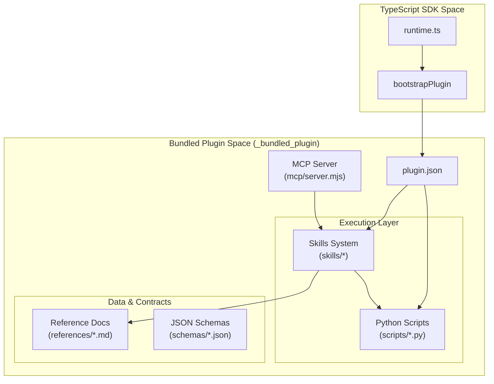
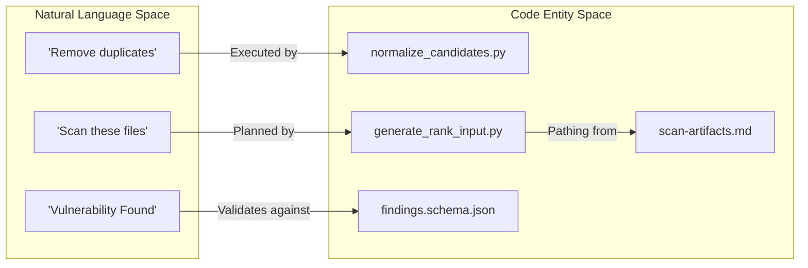

<!-- source: DeepWiki mcp.deepwiki.com · repo openai/codex-security · page 4 Bundled Plugin Architecture · fetched 2026-10-26 -->

# Bundled Plugin Architecture

Relevant source files

The following files were used as context for generating this wiki page:

- [sdk/typescript/_bundled_plugin/.codex-plugin/plugin.json](sdk/typescript/_bundled_plugin/.codex-plugin/plugin.json)
- [sdk/typescript/_bundled_plugin/mcp/mcp-app.html.br](sdk/typescript/_bundled_plugin/mcp/mcp-app.html.br)
- [sdk/typescript/_bundled_plugin/mcp/server.mjs.br.part-000](sdk/typescript/_bundled_plugin/mcp/server.mjs.br.part-000)
- [sdk/typescript/_bundled_plugin/mcp/server.mjs.br.part-001](sdk/typescript/_bundled_plugin/mcp/server.mjs.br.part-001)
- [sdk/typescript/_bundled_plugin/skills/security-scan/references/scan-artifacts-and-ledger.md](sdk/typescript/_bundled_plugin/skills/security-scan/references/scan-artifacts-and-ledger.md)
- [sdk/typescript/plugin-files.json](sdk/typescript/plugin-files.json)

The `_bundled_plugin` is the core Python-based execution engine for Codex Security. It implements the domain logic for security scanning, vulnerability analysis, and finding remediation. While the TypeScript SDK manages the high-level scan lifecycle and process orchestration, the bundled plugin contains the specialized "skills" (agent workflows) and helper scripts that perform the actual code analysis.

The plugin is structured as a self-contained unit defined by a manifest [sdk/typescript/_bundled_plugin/plugin.json:1-41](), which registers its skills, applications, and Model Context Protocol (MCP) server integration.

### Core Components

| Component | Description |
| :--- | :--- |
| **Skills System** | A collection of YAML-configured agents and Markdown-based contracts (`SKILL.md`) defining specific security tasks. |
| **Python Scripts** | Specialized utilities for data normalization, worklist generation, and scan artifact finalization. |
| **Reference Documents** | Canonical definitions for artifact layouts, finding schemas, and security guidance used by agents. |
| **MCP Server** | A Model Context Protocol implementation providing a standardized interface for tools and resources. |

**Sources:** [sdk/typescript/_bundled_plugin/plugin.json:1-41](), [sdk/typescript/plugin-files.json:1-101]()

---

### Scan Skills and Workflows
The plugin defines a variety of security-focused skills, ranging from broad repository scans to specific triage and patching tasks. Each skill follows a strict contract defined in a `SKILL.md` file and is powered by an agent configuration (e.g., `openai.yaml`).

Key workflows include:
*   **Exhaustive Scanning**: `security-scan` for full repositories and `security-diff-scan` for PRs/commits.
*   **Analysis & Validation**: `validation`, `attack-path-analysis`, and `threat-model`.
*   **Remediation**: `fix-finding` and `propose-security-hardening`.

For details on skill contracts and agent dispatch, see [Scan Skills and Workflows](#4.1).

**Sources:** [sdk/typescript/plugin-files.json:61-99](), [sdk/typescript/_bundled_plugin/skills/security-scan/references/scan-artifacts-and-ledger.md:21-33]()

---

### Python Plugin Scripts
A suite of Python scripts handles the "heavy lifting" of data processing between agent turns. These scripts ensure that the natural language outputs of LLMs are transformed into structured, validated code entities.

*   **`normalize_candidates.py`**: Validates CWEs and deduplicates findings [sdk/typescript/plugin-files.json:37-37]().
*   **`generate_rank_input.py`**: Creates sharded worklists for parallel execution [sdk/typescript/plugin-files.json:36-36]().
*   **`finalize_scan_contract.py`**: Seals the scan results and exports SARIF/CSV reports [sdk/typescript/plugin-files.json:34-34]().

For details on script logic and CLI utilities, see [Python Plugin Scripts](#4.2).

**Sources:** [sdk/typescript/plugin-files.json:30-60]()

---

### Scan Artifact Conventions and Reference Documents
The architecture relies on a rigid directory structure and set of reference documents to maintain state across complex, multi-pass scans. This ensures that agents can reliably find "Seed Research," "Work Ledgers," and "Raw Candidates" [sdk/typescript/_bundled_plugin/skills/security-scan/references/scan-artifacts-and-ledger.md:1-10]().

*   **`scan-artifacts.md`**: The source of truth for all file paths within a scan directory [sdk/typescript/plugin-files.json:22-22]().
*   **`finding-detail-fields.md`**: Defines the required fields for a valid security finding [sdk/typescript/plugin-files.json:20-20]().

For details on the artifact layout and capability profiles, see [Scan Artifact Conventions and Reference Documents](#4.3).

**Sources:** [sdk/typescript/plugin-files.json:18-26](), [sdk/typescript/_bundled_plugin/skills/security-scan/references/scan-artifacts-and-ledger.md:7-9]()

---

### MCP Server Integration
The plugin includes a Model Context Protocol (MCP) server, allowing the security tools to be exposed to any MCP-compliant client. The server is provided as a compressed bundle (`server.mjs.br`) and includes a web-based UI for interaction [sdk/typescript/plugin-files.json:13-16]().

*   **Tools**: Interface for running scans and triaging findings.
*   **Resources**: Access to scan history and artifact data.

For details on the JSON-RPC interface and server configuration, see [MCP Server Integration](#4.4).

**Sources:** [sdk/typescript/_bundled_plugin/plugin.json:20-20](), [sdk/typescript/plugin-files.json:8-16]()

---

### Natural Language to Code Entity Mapping

The following diagram illustrates how natural language security concepts are mapped to concrete code entities and scripts within the bundled plugin.

**Sources:** [sdk/typescript/plugin-files.json:22-37](), [sdk/typescript/_bundled_plugin/skills/security-scan/references/scan-artifacts-and-ledger.md:3-8]()

---

