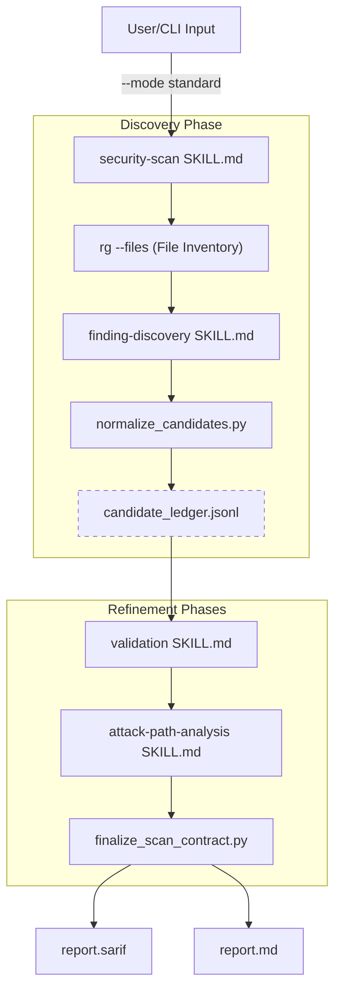
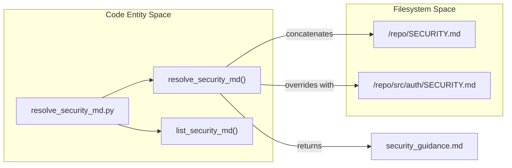

<!-- source: DeepWiki mcp.deepwiki.com · repo openai/codex-security · page 4.1 Scan Skills and Workflows · fetched 2026-10-26 -->

# Scan Skills and Workflows

Relevant source files

The following files were used as context for generating this wiki page:

- [sdk/typescript/_bundled_plugin/references/scan-artifacts.md](sdk/typescript/_bundled_plugin/references/scan-artifacts.md)
- [sdk/typescript/_bundled_plugin/references/shared-hard-rules.md](sdk/typescript/_bundled_plugin/references/shared-hard-rules.md)
- [sdk/typescript/_bundled_plugin/references/static-finding-assessment.md](sdk/typescript/_bundled_plugin/references/static-finding-assessment.md)
- [sdk/typescript/_bundled_plugin/scripts/resolve_security_md.py](sdk/typescript/_bundled_plugin/scripts/resolve_security_md.py)
- [sdk/typescript/_bundled_plugin/skills/attack-path-analysis/SKILL.md](sdk/typescript/_bundled_plugin/skills/attack-path-analysis/SKILL.md)
- [sdk/typescript/_bundled_plugin/skills/attack-path-analysis/references/severity-policy.md](sdk/typescript/_bundled_plugin/skills/attack-path-analysis/references/severity-policy.md)
- [sdk/typescript/_bundled_plugin/skills/deep-security-scan/SKILL.md](sdk/typescript/_bundled_plugin/skills/deep-security-scan/SKILL.md)
- [sdk/typescript/_bundled_plugin/skills/define-security-policy/SKILL.md](sdk/typescript/_bundled_plugin/skills/define-security-policy/SKILL.md)
- [sdk/typescript/_bundled_plugin/skills/define-security-policy/agents/openai.yaml](sdk/typescript/_bundled_plugin/skills/define-security-policy/agents/openai.yaml)
- [sdk/typescript/_bundled_plugin/skills/finding-discovery/SKILL.md](sdk/typescript/_bundled_plugin/skills/finding-discovery/SKILL.md)
- [sdk/typescript/_bundled_plugin/skills/security-diff-scan/SKILL.md](sdk/typescript/_bundled_plugin/skills/security-diff-scan/SKILL.md)
- [sdk/typescript/_bundled_plugin/skills/security-scan/SKILL.md](sdk/typescript/_bundled_plugin/skills/security-scan/SKILL.md)
- [sdk/typescript/_bundled_plugin/skills/security-scan/references/repository-wide-scan.md](sdk/typescript/_bundled_plugin/skills/security-scan/references/repository-wide-scan.md)
- [sdk/typescript/_bundled_plugin/skills/validation/SKILL.md](sdk/typescript/_bundled_plugin/skills/validation/SKILL.md)

The Codex Security bundled plugin implements a suite of specialized security analysis capabilities known as **Skills**. Each skill is a self-contained agentic workflow defined by a `SKILL.md` contract and an `openai.yaml` configuration. These skills orchestrate the transition from raw source code to validated, triaged security findings.

## The Skill Contract (SKILL.md)

Every skill in the `_bundled_plugin/skills/` directory follows a strict execution contract defined in its `SKILL.md` file. This file serves as the "system prompt" extension for the agent, defining:
*   **Objective**: The specific security goal (e.g., discovery, validation).
*   **Artifact Resolution**: Path conventions for reading inputs and writing outputs based on `references/scan-artifacts.md`.
*   **Workflow**: The step-by-step procedure the agent must follow.
*   **Hard Rules**: Mandatory constraints to ensure scan integrity and prevent resource exhaustion.

**Sources:** `[sdk/typescript/_bundled_plugin/skills/security-scan/SKILL.md:1-22]()`, `[sdk/typescript/_bundled_plugin/references/shared-hard-rules.md:1-16]()`.

## Primary Scan Workflows

Codex Security provides three primary entry-point workflows depending on the scan target and depth required.

### 1. Standard Scan (`security-scan`)
The default workflow for auditing an entire repository or a scoped path. It uses a single-pass approach designed for efficiency.
*   **Phase 1: Threat Model**: Loads or generates a repository-wide threat model.
*   **Phase 2: Discovery**: Reviews every file in scope, generating a `candidate_ledger.jsonl`.
*   **Phase 3: Compact Validation**: A single pass over the ledger to add `validation` records to every row.
*   **Phase 4: Compact Attack-Path**: A final pass to add `attack_path` records to reportable candidates.

**Sources:** `[sdk/typescript/_bundled_plugin/skills/security-scan/SKILL.md:6-36]()`, `[sdk/typescript/_bundled_plugin/skills/security-scan/references/repository-wide-scan.md:1-49]()`.

### 2. Deep Scan (`deep-security-scan`)
A multi-pass workflow used for complex repositories. Unlike the standard scan, it uses:
*   **Ranking**: Shards the repository and ranks files by security interest using `generate_rank_input.py`.
*   **Fan-out**: Uses worker assignments to parallelize deep review.
*   **Per-Finding Reports**: Generates individual narrative reports and receipts for every candidate.

**Sources:** `[sdk/typescript/_bundled_plugin/references/scan-artifacts.md:52-75]()`.

### 3. Diff Scan (`security-diff-scan`)
Targeted at Pull Requests, commits, or working-tree changes.
*   **Anchoring**: Stays strictly anchored to changed code and direct supporting files.
*   **Diff Ranking**: Uses `generate_rank_input.py make-diff-rank-input` to identify relevant files for review.

**Sources:** `[sdk/typescript/_bundled_plugin/skills/finding-discovery/SKILL.md:23-33]()`.

## Technical Data Flow: Natural Language to Code Entities

The following diagram illustrates how natural language goals (e.g., "Scan this PR") are translated into specific Python script executions and filesystem artifacts.

### Scan Execution Pipeline

**Sources:** `[sdk/typescript/_bundled_plugin/skills/security-scan/SKILL.md:23-36]()`, `[sdk/typescript/_bundled_plugin/skills/security-scan/references/repository-wide-scan.md:9-28]()`.

## Core Analysis Skills

### Finding Discovery
Investigates code for technically plausible vulnerabilities.
*   **Role Identification**: Locations are tagged as `entrypoint`, `source`, `root_control`, `sink`, or `evidence`.
*   **Normalization**: The `normalize_candidates.py` script merges duplicate findings and assigns stable `candidate_id` values.

**Sources:** `[sdk/typescript/_bundled_plugin/skills/finding-discovery/SKILL.md:8-11]()`, `[sdk/typescript/_bundled_plugin/skills/security-scan/references/repository-wide-scan.md:30-41]()`.

### Validation
Produces evidence-backed assessments of candidates.
*   **Methods**: Prioritizes dynamic execution (unit tests, PoCs, debugger traces) over static code tracing.
*   **Static Fallback**: Uses `references/static-finding-assessment.md` when runtime environment is unavailable.

**Sources:** `[sdk/typescript/_bundled_plugin/skills/validation/SKILL.md:8-10]()`, `[sdk/typescript/_bundled_plugin/skills/validation/SKILL.md:29-36]()`.

### Attack Path Analysis
Turns validated findings into attacker stories.
*   **Counterevidence**: Explicitly searches for repository evidence that defeats a finding (e.g., `admin-only`, `internal-only`).
*   **Severity Calibration**: Uses `references/severity-policy.md` to map impact to `critical`, `high`, `medium`, or `low`.

**Sources:** `[sdk/typescript/_bundled_plugin/skills/attack-path-analysis/SKILL.md:8-10]()`, `[sdk/typescript/_bundled_plugin/skills/attack-path-analysis/SKILL.md:58-82]()`.

## Policy and Governance Skills

### Define Security Policy
Manages the `SECURITY.md` files that guide the scanner.
*   **Policy Resolution**: The `resolve_security_md.py` script concatenates policies from the root to the leaf directory, with the leaf taking precedence.
*   **Guidance**: Defines system boundaries, threat models, and out-of-scope components.

**Sources:** `[sdk/typescript/_bundled_plugin/scripts/resolve_security_md.py:68-113]()`, `[sdk/typescript/_bundled_plugin/skills/define-security-policy/SKILL.md:28-33]()`.

### Entity Mapping: Policy Resolution

**Sources:** `[sdk/typescript/_bundled_plugin/scripts/resolve_security_md.py:37-65]()`, `[sdk/typescript/_bundled_plugin/scripts/resolve_security_md.py:68-113]()`.

## Artifact Conventions

All skills adhere to the directory structure defined in `references/scan-artifacts.md`:

| Directory | Purpose | Key Artifacts |
| :--- | :--- | :--- |
| `01_context` | Scan inputs | `threat_model.md`, `security_guidance.md` |
| `02_discovery` | Finding candidates | `candidate_ledger.jsonl`, `in_scope_files.txt` |
| `05_findings` | Refined analysis | `validation_report.md`, `attack_path_analysis_report.md` |
| `scan_dir` | Final output | `report.md`, `findings.json`, `scan-manifest.json` |

**Sources:** `[sdk/typescript/_bundled_plugin/references/scan-artifacts.md:16-21]()`, `[sdk/typescript/_bundled_plugin/references/scan-artifacts.md:43-48]()`.

---

