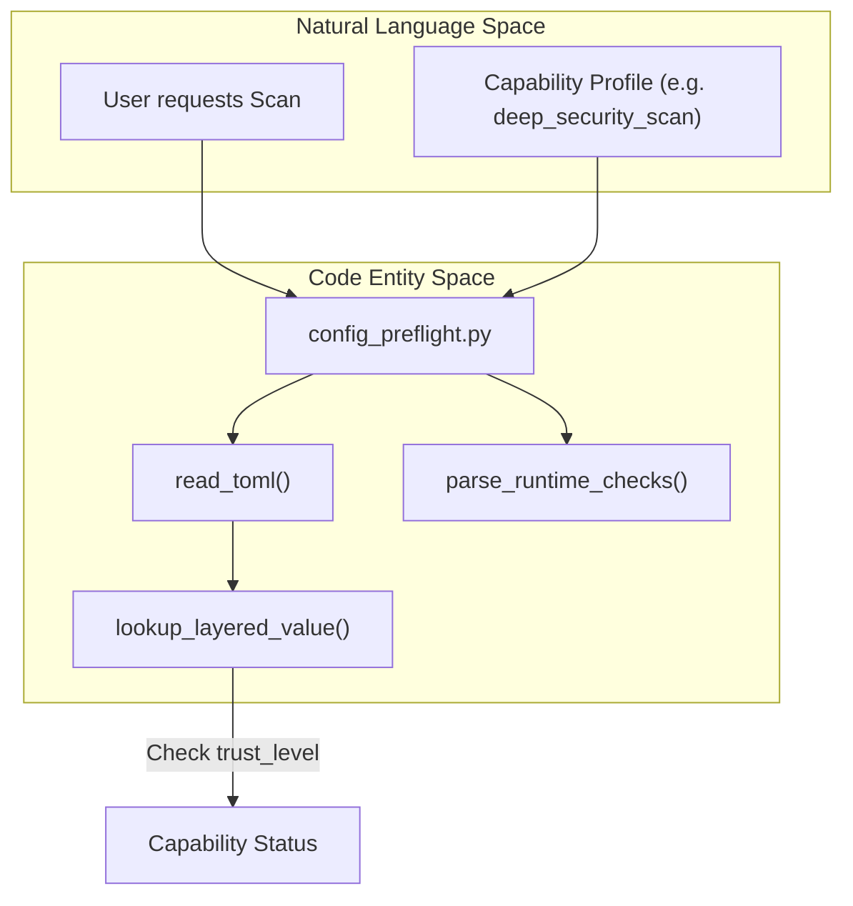
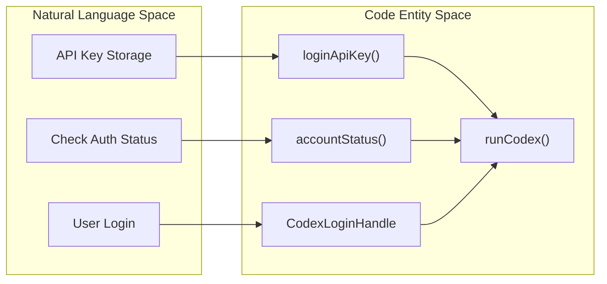

<!-- source: DeepWiki mcp.deepwiki.com · repo openai/codex-security · page 4.2 Python Plugin Scripts · fetched 2026-10-26 -->

# Python Plugin Scripts

Relevant source files

The following files were used as context for generating this wiki page:

- [.github/workflows/container-ci.yml](.github/workflows/container-ci.yml)
- [.github/workflows/node-ci.yml](.github/workflows/node-ci.yml)
- [sdk/typescript/.prettierignore](sdk/typescript/.prettierignore)
- [sdk/typescript/_bundled_plugin/references/config-preflight.md](sdk/typescript/_bundled_plugin/references/config-preflight.md)
- [sdk/typescript/_bundled_plugin/references/sarif-adapter.md](sdk/typescript/_bundled_plugin/references/sarif-adapter.md)
- [sdk/typescript/_bundled_plugin/scripts/config_preflight.py](sdk/typescript/_bundled_plugin/scripts/config_preflight.py)
- [sdk/typescript/_bundled_plugin/scripts/finalize_scan_contract.py](sdk/typescript/_bundled_plugin/scripts/finalize_scan_contract.py)
- [sdk/typescript/_bundled_plugin/scripts/generate_rank_input.py](sdk/typescript/_bundled_plugin/scripts/generate_rank_input.py)
- [sdk/typescript/_bundled_plugin/scripts/normalize_candidates.py](sdk/typescript/_bundled_plugin/scripts/normalize_candidates.py)
- [sdk/typescript/_bundled_plugin/scripts/rank_preview.py](sdk/typescript/_bundled_plugin/scripts/rank_preview.py)
- [sdk/typescript/src/auth.ts](sdk/typescript/src/auth.ts)
- [sdk/typescript/tests-ts/auth.test.ts](sdk/typescript/tests-ts/auth.test.ts)

Python helper scripts serve as the execution engine for the Codex Security bundled plugin. They handle data normalization, worklist generation, shard management, and the finalization of scan contracts into standardized formats like SARIF and CSV.

## Data Normalization and Validation

The normalization layer ensures that all findings and candidates produced by LLM-based skills adhere to the strict schema requirements of the TypeScript SDK and the workbench database.

### Candidate Normalization (`normalize_candidates.py`)

`normalize_candidates.py` is responsible for validating security-scan candidates, deduplicating them, and filtering based on the defined scan scope. It converts raw model outputs into deterministic JSONL files.

**Key Implementation Details:**
*   **CWE Validation:** Validates CWE IDs against a regex `CWE-(\d+)` and ensures they are positive integers [sdk/typescript/_bundled_plugin/scripts/normalize_candidates.py:15-57]().
*   **Path Safety:** Enforces repository-relative POSIX paths, rejecting absolute paths, directory traversals (`..`), or paths resolving outside the `--repo-root` [sdk/typescript/_bundled_plugin/scripts/normalize_candidates.py:60-80]().
*   **Location Sorting:** Locations are normalized and sorted based on a predefined role hierarchy (e.g., `entrypoint` > `source` > `sink`) [sdk/typescript/_bundled_plugin/scripts/normalize_candidates.py:16-24, 127-135]().
*   **Scope Filtering:** Uses `read_scope` to determine which files are within the allowed scan boundaries, handling cross-platform line endings (CRLF/LF) to prevent ambiguous path resolution [sdk/typescript/_bundled_plugin/scripts/normalize_candidates.py:138-188]().

### Worklist Generation (`generate_rank_input.py`)

This script manages the transition from raw file discovery to prioritized worker tasks. It partitions the scan area into manageable units for the ranking subagents.

**Key Functions:**
*   **`make-repo-rank-input`**: Creates the initial JSONL worklist of files or scoped paths [sdk/typescript/_bundled_plugin/scripts/generate_rank_input.py:6-7, 133-154]().
*   **`make-diff-rank-input`**: Specifically for PR/Diff scans, it generates inputs based on Git changed paths, supporting both committed revisions and local working-tree patches [sdk/typescript/_bundled_plugin/scripts/generate_rank_input.py:8-10, 164-184]().
*   **Sharding and Planning**: `make-rank-shards` partitions inputs into deterministic shards (default 150 rows), and `make-rank-pool-plan` assigns these to a worker pool (capped at 6 slots) using a round-robin strategy [sdk/typescript/_bundled_plugin/scripts/generate_rank_input.py:11-13, 186-210, 122-123]().
*   **Validation**: Includes `validate-rank-shard` and `validate-rank-pool` to ensure worker outputs match the assigned inputs before the coordinator accepts them [sdk/typescript/_bundled_plugin/scripts/generate_rank_input.py:14-18, 212-220]().

### Source Previewing (`rank_preview.py`)

To provide context to ranking agents without exhausting token limits, `rank_preview.py` generates deterministic structural previews of source files.

**Implementation Logic:**
*   **Language Detection:** Supports a wide range of extensions including C-style, Python, and JavaScript [sdk/typescript/_bundled_plugin/scripts/rank_preview.py:15-59]().
*   **Structural Outlining:** For Python, it uses the `ast` module to extract function decorators, arguments, and class definitions [sdk/typescript/_bundled_plugin/scripts/rank_preview.py:145-197]().
*   **Smart Truncation:** If a file is too large, it selects the head lines and samples the remainder, fitting the result within a byte limit (default 1024 bytes) [sdk/typescript/_bundled_plugin/scripts/rank_preview.py:11, 98-110, 113-142]().

**Sources:**
* `sdk/typescript/_bundled_plugin/scripts/normalize_candidates.py`
* `sdk/typescript/_bundled_plugin/scripts/generate_rank_input.py`
* `sdk/typescript/_bundled_plugin/scripts/rank_preview.py`

---

## Scan Contract Finalization

The finalization process "seals" the scan results, ensuring they are immutable and validated against size and schema constraints.

### Contract Sealing (`finalize_scan_contract.py`)

`finalize_scan_contract.py` is the final step in the scan lifecycle. It validates the additive contract artifacts (`scan-manifest.json`, `findings.json`, `coverage.json`) and exports them to consumer-friendly formats.

**Validation Logic:**
*   **Size Limits:** Enforces strict byte limits: 16MB for manifest, 128MB for findings, and 32MB for coverage [sdk/typescript/_bundled_plugin/scripts/finalize_scan_contract.py:64-68]().
*   **JSON Integrity:** Implements `_require_json_nesting` to prevent stack overflows by limiting JSON depth to 256 levels [sdk/typescript/_bundled_plugin/scripts/finalize_scan_contract.py:71, 185-207]().
*   **Deterministic Fingerprinting:** Computes a semantic fingerprint for each finding using the `codex-security/v1` algorithm [sdk/typescript/_bundled_plugin/scripts/finalize_scan_contract.py:28]().

### Export Formats
The script supports three primary exports [sdk/typescript/_bundled_plugin/scripts/finalize_scan_contract.py:88-92]():
1.  **SARIF:** Emits SARIF 2.1.0, mapping categorical severities to SARIF levels (e.g., `critical` -> `error`) and preserving repository-relative POSIX paths [sdk/typescript/_bundled_plugin/references/sarif-adapter.md:9-16]().
2.  **CSV:** A flat representation of findings for spreadsheet consumption.
3.  **JSON:** The canonical findings document.

**Sources:**
* `sdk/typescript/_bundled_plugin/scripts/finalize_scan_contract.py`
* `sdk/typescript/_bundled_plugin/references/sarif-adapter.md`

---

## Capability and Configuration Preflight

`config_preflight.py` evaluates the environment and Codex configuration to determine if the requested scan skill can execute successfully.

### Preflight Evaluation Flow

The preflight script resolves the capability profile against the active Codex setup, checking for features like multi-agent support and worker availability.

**Logic Flow:**
1.  **Config Discovery:** Searches for `config.toml` in `/etc/codex/`, `$CODEX_HOME`, and trusted project roots [sdk/typescript/_bundled_plugin/references/config-preflight.md:17]().
2.  **Runtime Checks:** Validates runtime facts such as `delegation_available` and `goal_tools_available` [sdk/typescript/_bundled_plugin/references/config-preflight.md:8]().
3.  **Multi-Agent Validation:** Detects the runtime owner (`native` vs `codex-bridge`) and version (`v1` vs `v2`), ensuring session caps are correctly applied [sdk/typescript/_bundled_plugin/references/config-preflight.md:29-35, sdk/typescript/_bundled_plugin/scripts/config_preflight.py:26-33]().

**Preflight Logic Diagram:**

*Sources:* [sdk/typescript/_bundled_plugin/scripts/config_preflight.py:122-130](), [sdk/typescript/_bundled_plugin/scripts/config_preflight.py:155-161](), [sdk/typescript/_bundled_plugin/scripts/config_preflight.py:194-201](), [sdk/typescript/_bundled_plugin/references/config-preflight.md:17]().

---

## Authentication Integration

The Python scripts rely on credentials managed by the TypeScript SDK. The SDK interacts with the `codex` binary to handle authentication states.

### Auth State Diagram

This diagram bridges the high-level authentication concepts to the specific TypeScript classes and methods that manage the Python plugin's environment.

*Sources:* [sdk/typescript/src/auth.ts:18-33](), [sdk/typescript/src/auth.ts:185-190](), [sdk/typescript/src/auth.ts:203-207](), [sdk/typescript/src/auth.ts:244-250]().

**Key Auth Components:**
*   **`CodexLoginHandle`**: Manages the lifecycle of an interactive login process, capturing verification URLs and user codes from stderr/stdout [sdk/typescript/src/auth.ts:18-31, 107-122]().
*   **`loginApiKey`**: Executes `login --with-api-key` and pipes the key to the child process stdin [sdk/typescript/src/auth.ts:185-201]().
*   **`runCodex`**: The underlying utility that spawns the `codex` command with appropriate environment variables and prefix arguments [sdk/typescript/src/auth.ts:244-260]().

**Sources:**
* `sdk/typescript/src/auth.ts`
* `sdk/typescript/tests-ts/auth.test.ts`

---

