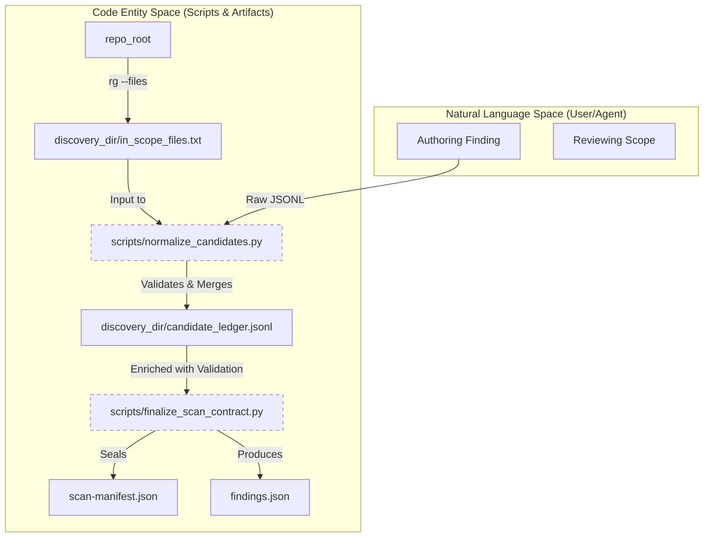
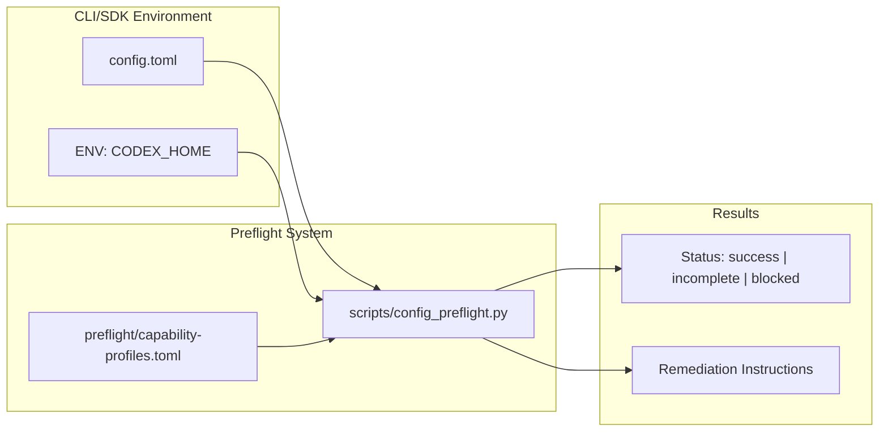

<!-- source: DeepWiki mcp.deepwiki.com · repo openai/codex-security · page 4.3 Scan Artifact Conventions and Reference Documents · fetched 2026-10-26 -->

# Scan Artifact Conventions and Reference Documents

Relevant source files

The following files were used as context for generating this wiki page:

- [sdk/typescript/.prettierignore](sdk/typescript/.prettierignore)
- [sdk/typescript/_bundled_plugin/references/config-preflight.md](sdk/typescript/_bundled_plugin/references/config-preflight.md)
- [sdk/typescript/_bundled_plugin/references/final-report.md](sdk/typescript/_bundled_plugin/references/final-report.md)
- [sdk/typescript/_bundled_plugin/references/sarif-adapter.md](sdk/typescript/_bundled_plugin/references/sarif-adapter.md)
- [sdk/typescript/_bundled_plugin/references/scan-artifacts.md](sdk/typescript/_bundled_plugin/references/scan-artifacts.md)
- [sdk/typescript/_bundled_plugin/references/scan-contract.md](sdk/typescript/_bundled_plugin/references/scan-contract.md)
- [sdk/typescript/_bundled_plugin/references/shared-hard-rules.md](sdk/typescript/_bundled_plugin/references/shared-hard-rules.md)
- [sdk/typescript/_bundled_plugin/scripts/config_preflight.py](sdk/typescript/_bundled_plugin/scripts/config_preflight.py)
- [sdk/typescript/_bundled_plugin/skills/security-scan/references/repository-wide-scan.md](sdk/typescript/_bundled_plugin/skills/security-scan/references/repository-wide-scan.md)

This page documents the canonical structure, path conventions, and metadata standards for Codex Security scan artifacts. It covers the directory layout used by the TypeScript SDK and Python plugin, the capability profile system for environment validation, and the structured finding detail reference.

## 1. Scan Artifact Directory Layout

Codex Security uses a hierarchical directory structure to organize scan inputs, intermediate ledgers, and final reports. The base directory (`scan_dir`) is typically located in the system temporary directory under `codex-security-scans` to ensure isolation from the source repository [sdk/typescript/_bundled_plugin/references/scan-artifacts.md:5-13]().

### Canonical Directory Structure

| Path Variable | Description | Source |
| :--- | :--- | :--- |
| `scan_dir` | The root for a specific scan execution. | [sdk/typescript/_bundled_plugin/references/scan-artifacts.md:13]() |
| `artifacts_dir` | Subdirectory containing all raw and intermediate data. | [sdk/typescript/_bundled_plugin/references/scan-artifacts.md:15]() |
| `context_dir` | Phase 1: Threat models and security guidance. | [sdk/typescript/_bundled_plugin/references/scan-artifacts.md:16]() |
| `discovery_dir` | Phase 2: File lists and candidate ledgers. | [sdk/typescript/_bundled_plugin/references/scan-artifacts.md:17]() |
| `coverage_dir` | Phase 3: Coverage ledgers and reviewed surfaces. | [sdk/typescript/_bundled_plugin/references/scan-artifacts.md:18]() |
| `findings_dir` | Phase 4/5: Validated findings and attack-path analysis. | [sdk/typescript/_bundled_plugin/references/scan-artifacts.md:20]() |

### Data Flow: Discovery to Finalization

The following diagram illustrates how raw code discovery is transformed into a sealed scan contract through the artifact directories.

**Scan Artifact Lifecycle**

**Sources:** [sdk/typescript/_bundled_plugin/skills/security-scan/references/repository-wide-scan.md:9-40](), [sdk/typescript/_bundled_plugin/references/scan-artifacts.md:41-48]()

---

## 2. Scan Contract Conventions

A completed scan is defined by a "Semantic Bundle" consisting of three core JSON documents. These documents have strict size limits enforced during finalization [sdk/typescript/_bundled_plugin/references/scan-contract.md:7-13]().

### Canonical Documents
*   **`scan-manifest.json`**: Immutable receipt containing timestamps, target identity, and hashes of all artifacts. Limit: 16 MiB [sdk/typescript/_bundled_plugin/references/scan-contract.md:9,13]().
*   **`findings.json`**: Semantic records of every identified vulnerability. Limit: 128 MiB [sdk/typescript/_bundled_plugin/references/scan-contract.md:10,13]().
*   **`coverage.json`**: Structured summary of what was scanned and what was excluded. Limit: 32 MiB [sdk/typescript/_bundled_plugin/references/scan-contract.md:11,13]().

### Target Snapshots and Identity
The `targetId` is a stable identifier for a repository, typically a digest of a sanitized remote URL [sdk/typescript/_bundled_plugin/references/scan-contract.md:41](). Snapshots are categorized by `kind`:

| Kind | Required Fields | Context |
| :--- | :--- | :--- |
| `git_revision` | `revision` | Immutable Git tree. |
| `git_worktree` | `revision`, `snapshotDigest` | Local Git workspace. |
| `git_diff` | `snapshotDigest`, `baseRevision` | Change set/PR. |
| `directory_snapshot`| `snapshotDigest` | Non-Git directory. |

**Sources:** [sdk/typescript/_bundled_plugin/references/scan-contract.md:31-43]()

---

## 3. Config Preflight and Capability Profiles

Before a scan begins, the `config_preflight.py` script evaluates the environment against a **Capability Profile**. This ensures the runtime has the necessary tools (e.g., delegation, multi-agent support) and that the project is "trusted" [sdk/typescript/_bundled_plugin/references/config-preflight.md:3-17]().

### Evaluation Logic
The preflight script checks:
1.  **Trust Levels**: Validates `trust_level` in `[projects."<path>"]` from `config.toml` [sdk/typescript/_bundled_plugin/references/config-preflight.md:17]().
2.  **Runtime Facts**: Verifies `delegation_available` and `multi-agent` version/provenance [sdk/typescript/_bundled_plugin/references/config-preflight.md:11]().
3.  **Skill Dependencies**: Ensures required plugin skills (e.g., `security-scan`) are exposed by the session [sdk/typescript/_bundled_plugin/references/config-preflight.md:23]().

**Preflight Execution Diagram**

**Sources:** [sdk/typescript/_bundled_plugin/scripts/config_preflight.py:20-35](), [sdk/typescript/_bundled_plugin/references/config-preflight.md:5-15]()

---

## 4. Finding Detail Reference

Findings are identified by a stable `findingId` derived from a fingerprint of the `targetId`, `ruleId`, `anchor`, and `instance` [sdk/typescript/_bundled_plugin/references/scan-contract.md:53-58]().

### Finding Identity Fields
*   **`ruleId`**: A lowercase slug identifying the vulnerability family (e.g., `sql-injection.query-builder`) [sdk/typescript/_bundled_plugin/references/scan-contract.md:49,70]().
*   **`identity.anchor`**: The semantic root-control anchor (e.g., a specific function or variable) [sdk/typescript/_bundled_plugin/references/scan-contract.md:50]().
*   **`identity.instance`**: Used to distinguish sibling vulnerabilities sharing the same anchor [sdk/typescript/_bundled_plugin/references/scan-contract.md:51]().

### Severity and Disposition Mapping
Standard scans use an enriched `candidate_ledger.jsonl` where each row must receive a `validation` and `attack_path` record [sdk/typescript/_bundled_plugin/references/scan-artifacts.md:46-47]().

| Disposition | Decision | Resulting Finding Severity |
| :--- | :--- | :--- |
| `reportable` | `reportable` | Critical, High, Medium, or Low |
| `suppressed` | N/A | Excluded from report |
| `deferred` | `deferred` | Provisional severity or Unknown |

**Sources:** [sdk/typescript/_bundled_plugin/references/scan-contract.md:45-64](), [sdk/typescript/_bundled_plugin/references/final-report.md:56-58]()

---

## 5. Reference Documents

| Document | Purpose |
| :--- | :--- |
| `scan-contract.md` | Defines the canonical JSON schemas and identity rules. |
| `scan-artifacts.md` | Defines the standard filesystem paths for all phases. |
| `final-report.md` | Guidance for projecting JSON into the `report.md` markdown. |
| `sarif-adapter.md` | Rules for exporting findings to SARIF 2.1.0. |
| `shared-hard-rules.md` | Core constraints for all scan workflows (e.g., no destructive commands). |

**Sources:** [sdk/typescript/_bundled_plugin/references/scan-contract.md:1-3](), [sdk/typescript/_bundled_plugin/references/scan-artifacts.md:1-3](), [sdk/typescript/_bundled_plugin/references/final-report.md:1-3](), [sdk/typescript/_bundled_plugin/references/sarif-adapter.md:1-5](), [sdk/typescript/_bundled_plugin/references/shared-hard-rules.md:1-5]()

---

