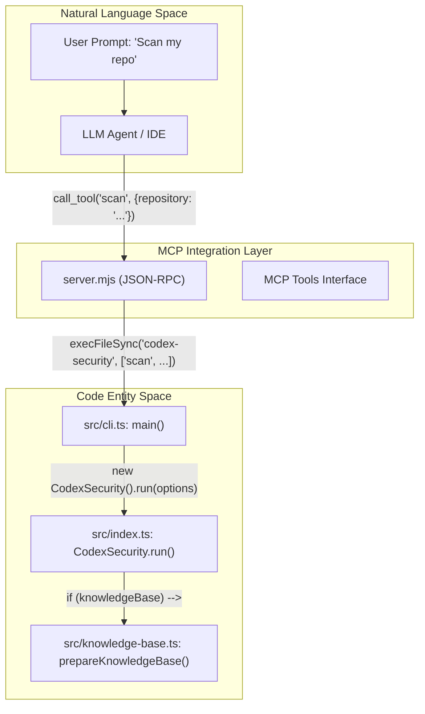
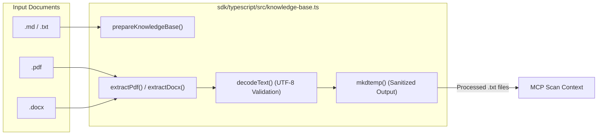

<!-- source: DeepWiki mcp.deepwiki.com · repo openai/codex-security · page 4.4 MCP Server Integration · fetched 2026-10-26 -->

# MCP Server Integration

Relevant source files

The following files were used as context for generating this wiki page:

- [sdk/typescript/_bundled_plugin/.mcp.json](sdk/typescript/_bundled_plugin/.mcp.json)
- [sdk/typescript/_bundled_plugin/mcp/mcp-app.html.br](sdk/typescript/_bundled_plugin/mcp/mcp-app.html.br)
- [sdk/typescript/_bundled_plugin/mcp/server.mjs.br.part-000](sdk/typescript/_bundled_plugin/mcp/server.mjs.br.part-000)
- [sdk/typescript/_bundled_plugin/mcp/server.mjs.br.part-001](sdk/typescript/_bundled_plugin/mcp/server.mjs.br.part-001)
- [sdk/typescript/src/knowledge-base.ts](sdk/typescript/src/knowledge-base.ts)
- [sdk/typescript/tests-ts/cli.test.ts](sdk/typescript/tests-ts/cli.test.ts)

The Model Context Protocol (MCP) server integration allows external LLM agents and IDEs to interact with Codex Security as a standardized toolset. This integration is bundled within the `_bundled_plugin/mcp` directory and provides a JSON-RPC interface for executing security scans, querying findings, and managing the scan lifecycle.

## Architecture and Components

The MCP implementation consists of a Node.js server, a web-based UI, and a configuration manifest. The server is distributed in a compressed format to optimize the plugin package size.

### Key Components

| Component | Path | Description |
| :--- | :--- | :--- |
| **MCP Server** | `_bundled_plugin/mcp/server.mjs.br` | Brotli-compressed entry point for the MCP server. Implements the JSON-RPC protocol over stdio. |
| **MCP UI** | `_bundled_plugin/mcp/mcp-app.html.br` | Brotli-compressed web interface for visualizing MCP status and logs. |
| **Configuration** | `_bundled_plugin/.mcp.json` | Defines the server command, arguments, and required environment variables. |

### Configuration (`.mcp.json`)
The configuration file specifies how the MCP server should be launched by a host (e.g., Claude Desktop or a custom IDE extension). It explicitly lists environment variables required for the server to function, such as `CODEX_API_KEY` and `CODEX_CLI_PATH` [_bundled_plugin/.mcp.json:1-21]().

**Sources:**
- [_bundled_plugin/.mcp.json:1-21]()
- [_bundled_plugin/mcp/server.mjs.br.part-000:1-33]()
- [_bundled_plugin/mcp/mcp-app.html.br:1-27]()

## Data Flow: Natural Language to Code Entity

The following diagram illustrates how a natural language request from an LLM (e.g., "Scan this repository for vulnerabilities") is translated through the MCP server into specific code executions within the Codex Security SDK.

### Request Translation Flow

**Sources:**
- [_bundled_plugin/.mcp.json:3-5]()
- [sdk/typescript/src/cli.ts:33-33]()
- [sdk/typescript/src/knowledge-base.ts:29-32]()

## MCP Server Implementation

The server operates primarily via `stdio` using the JSON-RPC 2.0 protocol. It exposes three primary primitives defined by the Model Context Protocol:

1.  **Tools**: Executable functions that the LLM can invoke (e.g., `scan`, `list_findings`, `triage`).
2.  **Resources**: Static or dynamic data that the LLM can read (e.g., scan manifests, SARIF reports).
3.  **Prompts**: Templates that guide the LLM on how to use the security tools effectively.

### CLI Integration
The Codex Security CLI exposes the MCP mode via the `--mcp` flag. When this flag is passed to the `codex-security` command, the CLI identifies the bundled server and prepares the environment.

### Environment Variable Requirements
The MCP server requires several environment variables to be passed from the host to interact with the underlying system and API [_bundled_plugin/.mcp.json:7-16]():
*   `CODEX_HOME`: The base directory for Codex data.
*   `CODEX_API_KEY`: Authentication for the OpenAI Codex Security backend.
*   `CODEX_CLI_PATH`: Path to the `codex-security` executable.
*   `PYTHON`: Path to the Python interpreter used by the bundled plugin.

**Sources:**
- [_bundled_plugin/.mcp.json:7-17]()
- [sdk/typescript/tests-ts/cli.test.ts:75-86]()

## Knowledge Base Integration

The MCP server can leverage the `Knowledge Base` feature to provide context to the scanning engine. The `prepareKnowledgeBase` function in the SDK handles the ingestion of various document formats to augment scan intelligence [sdk/typescript/src/knowledge-base.ts:29-32]().

### Document Processing Pipeline

The system strictly validates that knowledge base documents are supported extensions [sdk/typescript/src/knowledge-base.ts:15-21]() and ensures they are valid UTF-8 before passing them to the scan engine [sdk/typescript/src/knowledge-base.ts:132-140]().

**Sources:**
- [sdk/typescript/src/knowledge-base.ts:15-21]()
- [sdk/typescript/src/knowledge-base.ts:29-50]()
- [sdk/typescript/src/knowledge-base.ts:67-70]()
- [sdk/typescript/src/knowledge-base.ts:132-140]()

## Usage and Execution

To run the MCP server manually or via an integration host:

1.  **Host Configuration**: Point the MCP host to the `server.mjs` file using `node`.
2.  **Arguments**: Use `--stdio` for standard communication [_bundled_plugin/.mcp.json:5-5]().
3.  **Timeout**: The default tool timeout is set to 86,400 seconds (24 hours) to accommodate deep security scans [_bundled_plugin/.mcp.json:17-17]().

The CLI's `info` command can be used to verify the availability of the MCP server and its current configuration [sdk/typescript/tests-ts/cli.test.ts:144-144]().

**Sources:**
- [_bundled_plugin/.mcp.json:4-17]()
- [sdk/typescript/tests-ts/cli.test.ts:144-144]()

---

