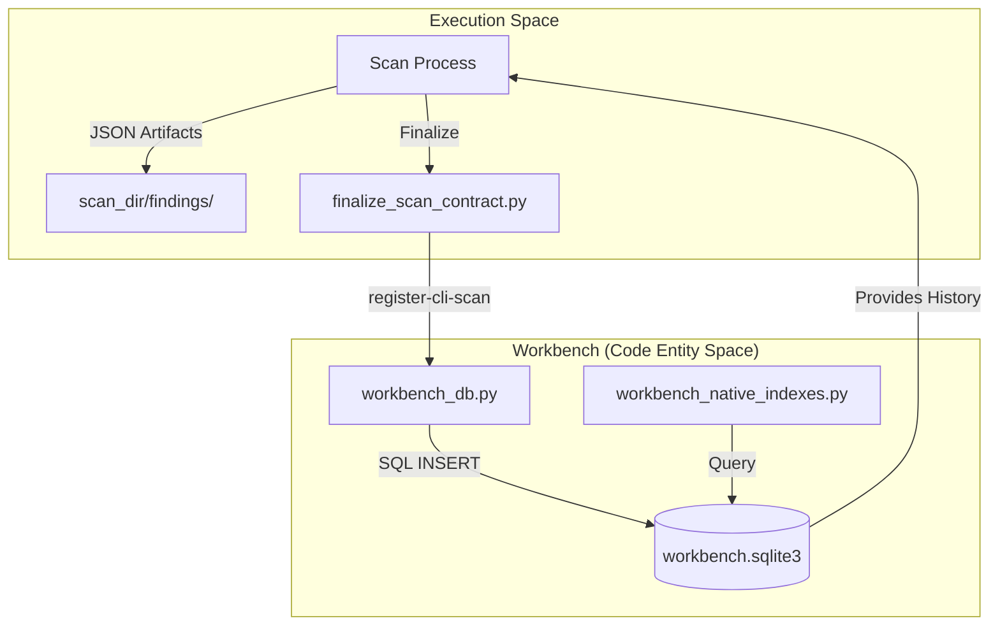
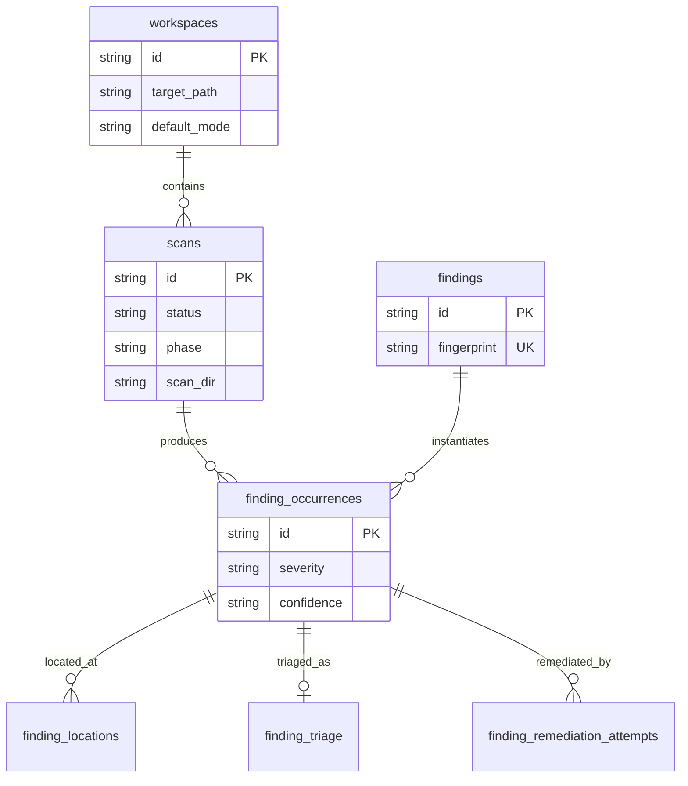

<!-- source: DeepWiki mcp.deepwiki.com · repo openai/codex-security · page 5 Workbench: State Persistence and Scan History · fetched 2026-10-26 -->

# Workbench: State Persistence and Scan History

Relevant source files

The following files were used as context for generating this wiki page:

- [sdk/typescript/_bundled_plugin/scripts/workbench_cli.py](sdk/typescript/_bundled_plugin/scripts/workbench_cli.py)
- [sdk/typescript/_bundled_plugin/scripts/workbench_db.py](sdk/typescript/_bundled_plugin/scripts/workbench_db.py)
- [sdk/typescript/_bundled_plugin/scripts/workbench_schema.py](sdk/typescript/_bundled_plugin/scripts/workbench_schema.py)

The Workbench is the persistent state layer for the Codex Security system. It utilizes a SQLite database to manage the lifecycle of security scans, track findings across different scan runs, and maintain the state of triage and remediation efforts. By decoupling the ephemeral execution of scan plugins from the long-term history of a repository, the Workbench allows for features like finding deduplication, incremental scanning, and persistent remediation workflows.

### System Architecture Overview

The Workbench acts as a bridge between the **Natural Language Space** (user intent, summaries, and triage notes) and the **Code Entity Space** (files, line ranges, and git revisions). It is primarily implemented as a set of Python scripts within the `_bundled_plugin` that are invoked by the TypeScript SDK.

#### Workbench Data Flow
The following diagram illustrates how scan data flows from the execution environment into the persistent SQLite store.

**Scan Data Persistence Flow**

Sources: [sdk/typescript/_bundled_plugin/scripts/workbench_db.py:1-58](), [sdk/typescript/_bundled_plugin/scripts/workbench_schema.py:32-58]()

### Core Components

The Workbench system is divided into several functional layers:

1.  **Database Layer (`workbench_db.py` & `workbench_schema.py`)**: Defines the SQLite schema and provides low-level commands for managing workspaces and scans. It handles migrations and ensures data integrity through foreign keys and check constraints.
2.  **Lifecycle Management**: Controls the transitions of a scan from `running` to `complete` or `failed`. It uses file-system locks to prevent race conditions during scan finalization.
3.  **Finding Deduplication**: Uses "fingerprints" to track the same security vulnerability across different commits and scan runs, allowing triage status (e.g., `false_positive`) to persist even as code changes.
4.  **Remediation State Machine**: Manages the multi-step process of generating, applying, and verifying security patches.

### Workbench Data Model

The database schema is designed to associate high-level "Workspaces" (representing a user's task or thread) with specific "Scans" and their resulting "Findings".

**Workbench Entity Relationship**

Sources: [sdk/typescript/_bundled_plugin/scripts/workbench_schema.py:11-118](), [sdk/typescript/_bundled_plugin/scripts/workbench_schema.py:131-164]()

### Sub-Pages

For detailed technical documentation on specific parts of the Workbench, refer to the following child pages:

#### [Workbench Database and Lifecycle Commands](#5.1)
This page details the internal workings of `workbench_db.py`. It covers:
*   **Schema & Migrations**: How the SQLite database is initialized and updated using `MIGRATIONS` [sdk/typescript/_bundled_plugin/scripts/workbench_schema.py:6-30]().
*   **Scan Lifecycle**: Commands like `start-scan` [sdk/typescript/_bundled_plugin/scripts/workbench_cli.py:113-116]() and `complete-scan`.
*   **Concurrency Control**: The use of `scan_completion_lock` using `fcntl` or `msvcrt` to manage simultaneous scan updates [sdk/typescript/_bundled_plugin/scripts/workbench_db.py:160-180]().
*   **Remediation Logic**: The state machine for tracking fixes from `requested` to `verified` [sdk/typescript/_bundled_plugin/scripts/workbench_schema.py:148-150]().

#### [Workbench Indexes, Queries, and Scan History](#5.2)
This page covers how data is retrieved and presented from the Workbench. It covers:
*   **Native Indexes**: High-performance queries in `workbench_native_indexes.py` for listing findings and repositories.
*   **Scan History**: Logic in `workbench_scan_history.py` for detecting if a repository has been scanned before and projecting history for the UI.
*   **Constants & Enums**: Canonical definitions for severities, statuses, and phases found in `workbench_constants.py` [sdk/typescript/_bundled_plugin/scripts/workbench_cli.py:13-24]().

### State Directory and Persistence
The Workbench stores its data in a directory determined by the `CODEX_SECURITY_STATE_DIR` or `CODEX_HOME` environment variables. The primary database file is named `workbench.sqlite3` [sdk/typescript/_bundled_plugin/scripts/workbench_db.py:147-156]().

Sources: [sdk/typescript/_bundled_plugin/scripts/workbench_db.py:147-156]()

---

