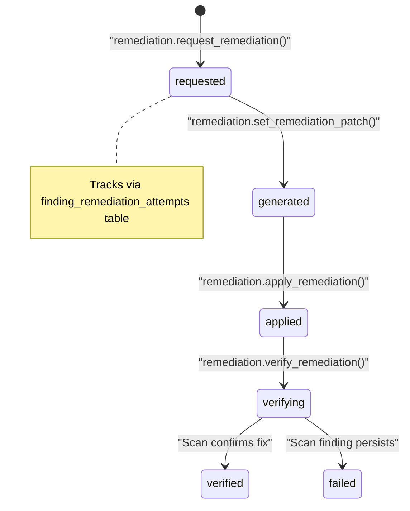

<!-- source: DeepWiki mcp.deepwiki.com · repo openai/codex-security · page 5.1 Workbench Database and Lifecycle Commands · fetched 2026-10-26 -->

# Workbench Database and Lifecycle Commands

<details>
<summary>Relevant source files</summary>

The following files were used as context for generating this wiki page:

- [sdk/typescript/_bundled_plugin/scripts/workbench_cli.py](sdk/typescript/_bundled_plugin/scripts/workbench_cli.py)
- [sdk/typescript/_bundled_plugin/scripts/workbench_db.py](sdk/typescript/_bundled_plugin/scripts/workbench_db.py)
- [sdk/typescript/_bundled_plugin/scripts/workbench_scan_start.py](sdk/typescript/_bundled_plugin/scripts/workbench_scan_start.py)
- [sdk/typescript/_bundled_plugin/scripts/workbench_schema.py](sdk/typescript/_bundled_plugin/scripts/workbench_schema.py)
- [sdk/typescript/_bundled_plugin/scripts/workbench_validation.py](sdk/typescript/_bundled_plugin/scripts/workbench_validation.py)

</details>


The Workbench is the persistent state layer for Codex Security, implemented as a local SQLite database. It manages the lifecycle of scans, findings, triage states, and remediation attempts. The core logic resides in `workbench_db.py`, which serves as the primary interface for both the CLI and the bundled Python skills to interact with historical and active scan data.

## Database Architecture

The workbench uses SQLite with **Write-Ahead Logging (WAL)** mode enabled to allow concurrent readers and writers [sdk/typescript/_bundled_plugin/scripts/workbench_db.py:255-257](). It enforces foreign key constraints [sdk/typescript/_bundled_plugin/scripts/workbench_db.py:258]() and manages schema evolution through a structured migration system [sdk/typescript/_bundled_plugin/scripts/workbench_schema.py:6-7]().

### Schema Overview

The database is structured around several key entities:
*   **Workspaces**: Logical groupings of scans for a specific target and context [sdk/typescript/_bundled_plugin/scripts/workbench_schema.py:11-30]().
*   **Scans**: Individual execution instances, tracking status (`running`, `complete`, `failed`) and phases (`preflight`, `discovery`, `validation`, etc.) [sdk/typescript/_bundled_plugin/scripts/workbench_schema.py:32-58]().
*   **Findings & Occurrences**: Findings represent unique security issues (fingerprinted), while occurrences link a finding to a specific scan instance [sdk/typescript/_bundled_plugin/scripts/workbench_schema.py:81-102]().
*   **Remediation**: Tracks the state machine for AI-generated fixes [sdk/typescript/_bundled_plugin/scripts/workbench_schema.py:145-164]().

### Data Flow: Scan Lifecycle
The following diagram illustrates how the workbench transitions a scan through its lifecycle via `workbench_db.py` commands.

**Scan Lifecycle Entity Mapping**
```mermaid
graph TD
    subgraph "Natural Language Space"
        A["User starts scan"]
        B["System processes scan"]
        C["Scan finishes successfully"]
        D["Scan encounters error"]
    end

    subgraph "Code Entity Space (workbench_db.py)"
        A --> CMD1["create_workspace()"]
        CMD1 --> CMD2["start_scan()"]
        CMD2 --> DB1[("scans table: status='running'")]
        
        B --> CMD3["update_scan_progress()"]
        CMD3 --> DB2[("scan_progress table")]
        
        C --> CMD4["complete_scan()"]
        CMD4 --> DB3[("scans table: status='complete'")]
        
        D --> CMD5["fail_scan()"]
        CMD5 --> DB4[("scans table: status='failed'")]
    end
    
    Sources: [sdk/typescript/_bundled_plugin/scripts/workbench_db.py:284-1120]()
```
Sources: [sdk/typescript/_bundled_plugin/scripts/workbench_db.py:284-1120](), [sdk/typescript/_bundled_plugin/scripts/workbench_schema.py:32-69]()

---

## Scan Lifecycle Commands

The lifecycle is managed through a set of atomic commands that ensure database consistency and file-system synchronization.

### 1. Workspace and Scan Initialization
*   **`create-workspace`**: Initializes a `workspaces` entry. It accepts parameters like `target-path`, `mode`, and `capability-preflight-json` [sdk/typescript/_bundled_plugin/scripts/workbench_cli.py:33-49]().
*   **`start-scan`**: Transitions a workspace into an active scanning state. It creates a new entry in the `scans` table with `status='running'` and `phase='preflight'` [sdk/typescript/_bundled_plugin/scripts/workbench_scan_start.py:71-127](). It also initializes `scan_progress` [sdk/typescript/_bundled_plugin/scripts/workbench_scan_start.py:128-136]().

### 2. Scan Completion and Locking
When a scan completes, `complete-scan` is called to ingest artifacts and seal the scan record. To prevent race conditions during artifact finalization, the system employs a file-based locking mechanism [sdk/typescript/_bundled_plugin/scripts/workbench_db.py:160-180]().

*   **POSIX**: Uses `fcntl.flock` for exclusive locking [sdk/typescript/_bundled_plugin/scripts/workbench_db.py:187-189]().
*   **Windows**: Uses `msvcrt.locking` on a specific byte range of a lock file [sdk/typescript/_bundled_plugin/scripts/workbench_db.py:193-212]().

### 3. Finding Indexing and Triage
As scans produce findings, the workbench indexes them to support cross-scan tracking:
*   **`finding_occurrences`**: Stores the scan-specific metadata (severity, confidence, remediation text) [sdk/typescript/_bundled_plugin/scripts/workbench_schema.py:91-102]().
*   **`set-finding-triage`**: Updates the `finding_triage` table. Users can set status to `closed` with reasons like `already_fixed`, `wont_fix`, or `false_positive` [sdk/typescript/_bundled_plugin/scripts/workbench_schema.py:131-143]().

Sources: [sdk/typescript/_bundled_plugin/scripts/workbench_db.py:160-223](), [sdk/typescript/_bundled_plugin/scripts/workbench_cli.py:33-132](), [sdk/typescript/_bundled_plugin/scripts/workbench_scan_start.py:71-141]()

---

## Remediation State Machine

The workbench manages a complex state machine for AI-driven code remediation. This allows the system to track a request from the initial prompt to the final verification of a patch.

| State | Description |
| :--- | :--- |
| `requested` | A remediation has been requested by the user or agent [sdk/typescript/_bundled_plugin/scripts/workbench_schema.py:149](). |
| `generated` | The AI has produced a suggested patch [sdk/typescript/_bundled_plugin/scripts/workbench_schema.py:149](). |
| `applied` | The patch has been applied to the local file system [sdk/typescript/_bundled_plugin/scripts/workbench_schema.py:149](). |
| `verifying` | A validation scan is currently running against the patched code [sdk/typescript/_bundled_plugin/scripts/workbench_schema.py:149](). |
| `verified` | The validation scan confirmed the finding is resolved [sdk/typescript/_bundled_plugin/scripts/workbench_schema.py:149](). |
| `failed` | The patch failed to apply or failed verification [sdk/typescript/_bundled_plugin/scripts/workbench_schema.py:149](). |

**Remediation Logic Entity Mapping**

Sources: [sdk/typescript/_bundled_plugin/scripts/workbench_schema.py:145-164](), [sdk/typescript/_bundled_plugin/scripts/workbench_cli.py:204-235]()

---

## Implementation Details

### Migrations
The database schema is versioned. The `migrate()` function in `workbench_db.py` checks the `PRAGMA user_version` and applies missing scripts from the `MIGRATIONS` tuple defined in `workbench_schema.py` [sdk/typescript/_bundled_plugin/scripts/workbench_db.py:260-278]().

### Integrity Constraints
The workbench uses strict validation for inputs:
*   **UUIDs**: All IDs (scan, workspace, occurrence) must pass `require_uuid` validation [sdk/typescript/_bundled_plugin/scripts/workbench_validation.py:19-23]().
*   **JSON Payloads**: Capability preflights and scan costs are parsed and validated against size limits (e.g., 8 KiB for costs) before insertion [sdk/typescript/_bundled_plugin/scripts/workbench_validation.py:39-62]().
*   **Path Safety**: Finding locations are limited to `FINDING_LOCATIONS_LIMIT` (100) to prevent database bloat [sdk/typescript/_bundled_plugin/scripts/workbench_constants.py:69]().

Sources: [sdk/typescript/_bundled_plugin/scripts/workbench_db.py:255-282](), [sdk/typescript/_bundled_plugin/scripts/workbench_schema.py:6-200](), [sdk/typescript/_bundled_plugin/scripts/workbench_validation.py:19-85]()

---

