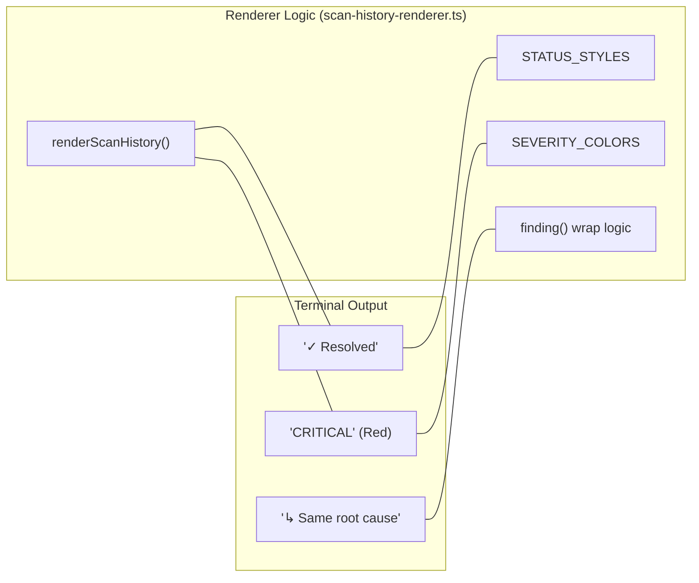

<!-- source: DeepWiki mcp.deepwiki.com · repo openai/codex-security · page 5.2 Workbench Indexes, Queries, and Scan History · fetched 2026-10-26 -->

# Workbench Indexes, Queries, and Scan History

Relevant source files

The following files were used as context for generating this wiki page:

- [sdk/typescript/_bundled_plugin/scripts/workbench_constants.py](sdk/typescript/_bundled_plugin/scripts/workbench_constants.py)
- [sdk/typescript/_bundled_plugin/scripts/workbench_native_indexes.py](sdk/typescript/_bundled_plugin/scripts/workbench_native_indexes.py)
- [sdk/typescript/_bundled_plugin/scripts/workbench_scan_history.py](sdk/typescript/_bundled_plugin/scripts/workbench_scan_history.py)
- [sdk/typescript/src/scan-history-renderer.ts](sdk/typescript/src/scan-history-renderer.ts)
- [sdk/typescript/tests-ts/cli-workbench.test.ts](sdk/typescript/tests-ts/cli-workbench.test.ts)
- [sdk/typescript/tests-ts/scan-history-renderer.test.ts](sdk/typescript/tests-ts/scan-history-renderer.test.ts)

The Workbench state layer provides a high-performance query interface over the SQLite persistence layer. It is responsible for aggregating finding occurrences across multiple scans, determining finding "staleness" based on scan coverage, and projecting historical scan data for the CLI and UI renderers.

## Native Finding and Repository Indexes

The system uses `workbench_native_indexes.py` to provide optimized views of security findings and repository metadata. It abstracts complex SQLite window functions and recursive coverage checks into high-level Python functions.

### Active Finding Logic

A finding is considered "active" if it was detected in a previous scan and has not been "covered" by a more recent successful scan. The logic in `_active_findings` performs the following steps:

1.  **Ranking**: It uses a Common Table Expression (CTE) with `ROW_NUMBER()` partitioned by `target_id` and `finding_id` to identify the most recent occurrence of every unique finding [sdk/typescript/_bundled_plugin/scripts/workbench_native_indexes.py:93-112]().
2.  **Staleness Check**: For each latest occurrence, the system checks all subsequent completed scans for that target. If a newer scan's coverage includes the file path where the finding was originally located, but that scan did not report the finding, the finding is considered resolved and is filtered out [sdk/typescript/_bundled_plugin/scripts/workbench_native_indexes.py:149-170]().
3.  **Triage Integration**: Triage statuses (e.g., `open`, `fixed`) are joined directly into the finding rows, with `updated_at` reflecting the maximum of the scan time or the triage modification time [sdk/typescript/_bundled_plugin/scripts/workbench_native_indexes.py:104-116]().

### Repository Discovery

The `list_repositories` function aggregates data across the `security_targets` and `scans` tables to provide a summary of all scanned projects. It calculates finding counts per repository and identifies the "latest" scan status for each unique `target_id` [sdk/typescript/_bundled_plugin/scripts/workbench_native_indexes.py:173-188]().

### Natural Language to Code Entity Mapping: Indexing

| System Concept | Code Entity (Python) | Role |
| :--- | :--- | :--- |
| Finding Deduplication | `ROW_NUMBER() OVER (PARTITION BY ...)` | Ensures only the latest version of a finding is indexed [sdk/typescript/_bundled_plugin/scripts/workbench_native_indexes.py:109-112](). |
| Coverage Staleness | `scan_covers_path` | Logic to determine if a finding should be hidden because a new scan "missed" it [sdk/typescript/_bundled_plugin/scripts/workbench_scan_history.py:161-166](). |
| Global Finding List | `list_global_findings` | Primary entry point for searching findings across all repositories [sdk/typescript/_bundled_plugin/scripts/workbench_native_indexes.py:19-24](). |
| Repository List | `list_repositories` | Entry point for the Workbench "Home" view [sdk/typescript/_bundled_plugin/scripts/workbench_native_indexes.py:173-178](). |

**Sources:**
- [sdk/typescript/_bundled_plugin/scripts/workbench_native_indexes.py:19-170]()
- [sdk/typescript/_bundled_plugin/scripts/workbench_scan_history.py:161-168]()

---

## Scan History and Repository Detection

`workbench_scan_history.py` manages the temporal relationship between scans. A critical feature is **Same-Repository Detection**, which allows the system to link scans even if the absolute paths differ (e.g., across different CI runners or developer machines).

### Repository Identity Algorithm

The system determines if two scan targets are the same repository using three fallback checks:
1.  **Target ID Match**: Direct database ID match [sdk/typescript/_bundled_plugin/scripts/workbench_scan_history.py:23-24]().
2.  **Git Common Directory**: Resolves the absolute path of the `.git` common directory using `git rev-parse --git-common-dir` [sdk/typescript/_bundled_plugin/scripts/workbench_scan_history.py:27-39]().
3.  **Origin URL**: Parses the Git `remote` origin URL. It normalizes SSH and HTTPS URLs to a `(host, path)` tuple (e.g., `("github.com", "openai/codex-security")`) to ensure identity persists across protocol changes [sdk/typescript/_bundled_plugin/scripts/workbench_scan_history.py:41-71]().

### Data Flow: Scan History Projection

```mermaid
graph TD
    subgraph "CLI/SDK Space"
        CLI["CLI: scans list"]
        SDK["CodexSecurity.onWorkbench"]
    end

    subgraph "Python Script Space (workbench_scan_history.py)"
        LWS["list_workspace_scans"]
        LS["list_scans"]
        SRD["_same_repository"]
        RO["_repository_origin"]
    end

    subgraph "Database Space"
        DB[("SQLite: scans table")]
    end

    CLI --> SDK
    SDK --> LS
    LS --> SRD
    SRD --> RO
    LS --> DB
    LWS --> DB
```

**Sources:**
- [sdk/typescript/_bundled_plugin/scripts/workbench_scan_history.py:17-71]()
- [sdk/typescript/tests-ts/cli-workbench.test.ts:33-45]()

---

## Workbench Constants and Constraints

`workbench_constants.py` defines the canonical enums and size limits used across the Python workbench scripts and the TypeScript SDK.

### Key Enumerations
- **Severities**: `critical`, `high`, `medium`, `low`, `informational` [sdk/typescript/_bundled_plugin/scripts/workbench_constants.py:16]().
- **Remediation States**: Tracks the lifecycle of a fix from `idle` → `requested` → `generated` → `applied` → `verified` [sdk/typescript/_bundled_plugin/scripts/workbench_constants.py:19-28]().
- **Phases**: `preflight`, `threat_model`, `discovery`, `validation`, `attack_path`, `reporting` [sdk/typescript/_bundled_plugin/scripts/workbench_constants.py:7]().

### Size and Truncation Limits
To ensure the SQLite database and JSON responses remain performant, strict byte limits are enforced:
- **Finding Title**: 512 bytes [sdk/typescript/_bundled_plugin/scripts/workbench_constants.py:53]().
- **Finding Summary**: 2,000 bytes [sdk/typescript/_bundled_plugin/scripts/workbench_constants.py:54]().
- **Code Evidence Snippet**: 1,500 bytes [sdk/typescript/_bundled_plugin/scripts/workbench_constants.py:50]().
- **Patch Preview**: 16,000 bytes [sdk/typescript/_bundled_plugin/scripts/workbench_constants.py:41]().

**Sources:**
- [sdk/typescript/_bundled_plugin/scripts/workbench_constants.py:5-61]()

---

## Scan History Renderer

The `scan-history-renderer.ts` is a TypeScript utility used by the CLI to transform Workbench query results into human-readable terminal output.

### Rendering Modes
The renderer supports four primary command outputs:
1.  **`list`**: A tabular view of scans, including dates, modes, finding counts, and status icons (`✓` for complete, `●` for running) [sdk/typescript/src/scan-history-renderer.ts:148-190]().
2.  **`show`**: Detailed view of a single scan, listing all findings grouped by severity with their file paths [sdk/typescript/src/scan-history-renderer.ts:95-146]().
3.  **`compare`**: A diff-style view showing `Resolved`, `New`, and `Persisting` findings between two scan IDs [sdk/typescript/src/scan-history-renderer.ts:68-75]().
4.  **`match-all`**: Visualizes finding matches across multiple scan versions [sdk/typescript/src/scan-history-renderer.ts:69]().

### Visual Elements
- **Severity Coloring**: Maps `CRITICAL`/`HIGH` to red (ANSI 31), `MEDIUM` to yellow (ANSI 33), and `LOW` to cyan (ANSI 36) [sdk/typescript/src/scan-history-renderer.ts:25-31]().
- **Stale Scan Detection**: Scans marked as `running` but not updated for >24 hours are treated as stale and potentially hidden from the list [sdk/typescript/src/scan-history-renderer.ts:14-15]().
- **Unicode Icons**: Uses `✓` (Resolved), `+` (New), and `●` (Persisting) to denote finding transitions [sdk/typescript/src/scan-history-renderer.ts:16-23]().

### Natural Language to Code Entity Mapping: Rendering

**Sources:**
- [sdk/typescript/src/scan-history-renderer.ts:16-31]()
- [sdk/typescript/src/scan-history-renderer.ts:53-146]()
- [sdk/typescript/tests-ts/scan-history-renderer.test.ts:7-83]()

---

