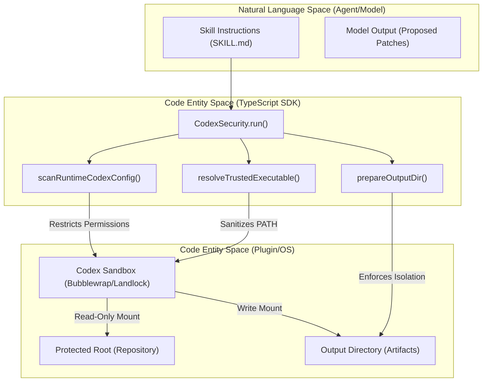
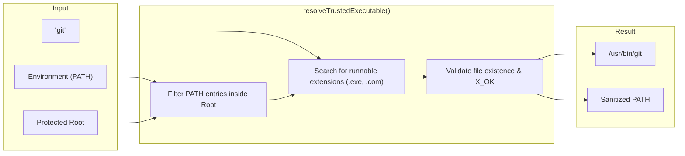

<!-- source: DeepWiki mcp.deepwiki.com · repo openai/codex-security · page 6 Security Model and Sandboxing · fetched 2026-10-26 -->

# Security Model and Sandboxing

Relevant source files

The following files were used as context for generating this wiki page:

- [.gitattributes](.gitattributes)
- [.gitignore](.gitignore)
- [CONTRIBUTING.md](CONTRIBUTING.md)
- [SECURITY.md](SECURITY.md)
- [sdk/typescript/src/trusted-executable.ts](sdk/typescript/src/trusted-executable.ts)
- [sdk/typescript/tests-ts/api.test.ts](sdk/typescript/tests-ts/api.test.ts)
- [sdk/typescript/tests-ts/trusted-executable.test.ts](sdk/typescript/tests-ts/trusted-executable.test.ts)

Codex Security is designed to analyze untrusted codebases. Because the scanning process involves executing Python-based skills and interacting with local filesystems, the system implements a multi-layered security architecture to prevent unauthorized file access, credential leakage, and execution of malicious shims.

The security model focuses on three primary areas:
1.  **Path Protection**: Ensuring the scanner does not read sensitive system files or write artifacts into the repository being scanned.
2.  **Execution Integrity**: Resolving trusted system binaries (like `git` or `python`) while ignoring malicious wrappers located within the target repository.
3.  **Environment Isolation**: Redacting credentials and sanitizing environment variables before they reach the model or the plugin runtime.

### High-Level Architecture

The following diagram illustrates how the `CodexSecurity` orchestration layer bridges the gap between high-level scan requests and the low-level sandboxed execution environment.

**Scan Orchestration to Sandbox Bridge**

Sources: [sdk/typescript/src/api.js:182-214](), [sdk/typescript/src/trusted-executable.ts:10-14](), [SECURITY.md:27-43]()

---

### Protected Roots and Output Isolation

The system uses a **Protected Root** concept to define the boundary of the repository under scan. To prevent "scan-in-scan" loops and accidental exposure of findings, the SDK enforces strict rules:
*   **Isolation**: The `CODEX_HOME` and scan output directories must reside outside the repository being scanned [SECURITY.md:33-37]().
*   **Validation**: The `prepareOutputDir` function (and related guards) ensures that artifacts are not written into the `.git` directory or the working tree.
*   **Permissions**: Output directories are typically initialized with restrictive permissions (e.g., `chmod 700`) to prevent other users on the system from accessing sensitive findings [sdk/typescript/tests-ts/api.test.ts:92-97]().

For details, see [Path Protection and Output Isolation](#6.1).

---

### Trusted Executable Resolution

To prevent a malicious repository from hijacking system commands (e.g., by placing a fake `git` binary in `node_modules/.bin`), the SDK implements `resolveTrustedExecutable`.

This utility:
*   **Sanitizes PATH**: It scans the system `PATH` and removes any entries that fall within the **Protected Root** (the repository being scanned) [sdk/typescript/src/trusted-executable.ts:22-27]().
*   **Verifies Binaries**: On Windows, it specifically looks for `.exe` and `.com` files while ignoring `.bat` and `.cmd` shims that could be used for command injection [sdk/typescript/src/trusted-executable.ts:30-41]().
*   **Canonicalization**: It uses `realpath` to resolve symlinks and junctions, ensuring that a malicious link pointing to a system binary cannot bypass the path filters [sdk/typescript/src/trusted-executable.ts:54-60]().

**Executable Resolution Flow**

Sources: [sdk/typescript/src/trusted-executable.ts:10-83](), [sdk/typescript/tests-ts/trusted-executable.test.ts:158-186]()

---

### Environment Sanitization and Redaction

Before a scan begins, `CodexSecurity` performs a "preflight" check to sanitize the configuration and environment:
*   **Credential Redaction**: Sensitive keys such as `api_key`, `token`, and internal feature secrets are stripped from the configuration passed to the model [sdk/typescript/tests-ts/api.test.ts:225-242]().
*   **Variable Normalization**: Environment variables are checked for case variants (e.g., `Codex_Home` vs `CODEX_HOME`) and empty strings are treated as unset to ensure consistent behavior across OS platforms [sdk/typescript/tests-ts/api.test.ts:166-180]().

---

### The Codex Sandbox

When running in a containerized or Linux environment, the system can leverage low-level sandboxing technologies:
*   **Bubblewrap / Landlock**: Restricts the Python plugin's ability to see the host filesystem, providing only a read-only view of the source code and a scoped write view of the output directory.
*   **Seccomp**: The `codex-security-seccomp.json` profile restricts the system calls available to the container, reducing the kernel attack surface.
*   **Non-Root Execution**: The Docker deployment uses a non-root user (`10001`) by default.

For details, see [Docker Container Deployment](#6.2).

---

### Security Best Practices for Users

*   **Permissions**: Only scan code you own or have explicit permission to assess [SECURITY.md:29]().
*   **Review**: Always review proposed patches and remediation steps before applying them to your source code [SECURITY.md:40]().
*   **Storage**: Store scan results and SARIF files in a secure location, as they contain snippets of your private source code and detailed vulnerability paths [SECURITY.md:35-39]().

Sources: [SECURITY.md:1-43]()

---

