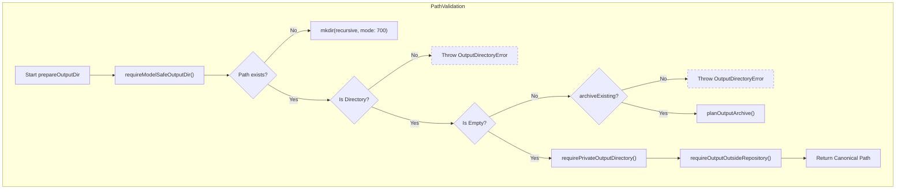
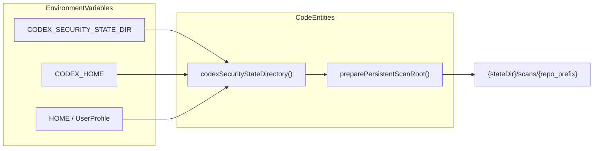

<!-- source: DeepWiki mcp.deepwiki.com · repo openai/codex-security · page 6.1 Path Protection and Output Isolation · fetched 2026-10-26 -->

# Path Protection and Output Isolation

Relevant source files

The following files were used as context for generating this wiki page:

- [sdk/typescript/src/errors.ts](sdk/typescript/src/errors.ts)
- [sdk/typescript/src/index.ts](sdk/typescript/src/index.ts)
- [sdk/typescript/src/runtime.ts](sdk/typescript/src/runtime.ts)
- [sdk/typescript/tests-ts/api.test.ts](sdk/typescript/tests-ts/api.test.ts)
- [sdk/typescript/tests-ts/cli.test.ts](sdk/typescript/tests-ts/cli.test.ts)
- [sdk/typescript/tests-ts/runtime.test.ts](sdk/typescript/tests-ts/runtime.test.ts)

Codex Security implements strict path protection and output isolation to ensure that scan artifacts do not contaminate the source code being analyzed and to prevent the model from interacting with sensitive or unsafe paths. These protections are enforced at the SDK and CLI levels during the scan lifecycle.

## Protected Roots and Output Isolation

The system enforces a strict separation between the **Protected Root** (the repository or directory being scanned) and the **Output Directory** (where results and artifacts are stored).

### Protected Root Concept
A "Protected Root" is the canonical path of the scan target. To prevent accidental modification of the source code or the introduction of scan artifacts into the version control system, the SDK requires that the output directory resides entirely outside the target repository's directory tree [sdk/typescript/src/errors.ts:19-29]().

### Path Validation Rules
1.  **requireOutputOutsideRepository**: The output directory cannot be a subdirectory of the protected root. If a violation is detected, the system throws an `OutputInsideProtectedRootError` [sdk/typescript/src/errors.ts:19-29]().
2.  **requirePrivateOutputDirectory**: On POSIX systems, the output directory must have restricted permissions (`chmod 700`) to ensure that scan results, which may contain sensitive vulnerability data, are not world-readable [sdk/typescript/src/runtime.ts:223-223]().
3.  **MODEL_UNSAFE_PATH**: Paths are validated against a regex that blocks control characters and Unicode separators (e.g., `\u0000-\u001f`, `\u2028`, `\u2029`) to prevent path injection or model manipulation [sdk/typescript/src/runtime.ts:59-59]().

### Data Flow: Output Directory Preparation
The following diagram illustrates how `prepareOutputDir` validates and secures the output path before a scan begins.

**Output Directory Validation Flow**

**Sources:** [sdk/typescript/src/runtime.ts:198-250](), [sdk/typescript/src/errors.ts:19-29]()

## CODEX_HOME and State Isolation

Codex Security uses a dedicated state directory, typically nested within `CODEX_HOME`, to isolate persistent data like the scan workbench (SQLite) and cached plugins.

### Isolation Mechanisms
*   **CODEX_HOME Isolation**: By default, the state directory is located at `$CODEX_HOME/state/plugins/codex-security` [sdk/typescript/src/runtime.ts:108-109](). If `CODEX_HOME` is not set, it defaults to `~/.codex` [sdk/typescript/src/runtime.ts:108-108]().
*   **createIsolatedHome**: During plugin bootstrap, the SDK can create a temporary, isolated home directory to ensure that the execution environment is clean and does not leak ambient configuration into the scan process [sdk/typescript/src/runtime.ts:413-433]().
*   **Persistent Scan Roots**: For every repository scanned, a unique subdirectory is created under the state directory using a safe prefix of the repository name, ensuring that SQLite databases for different projects do not collide [sdk/typescript/src/runtime.ts:112-119]().

### Environment Sanitization
When the SDK invokes the Python-based workbench (`runWorkbench`), it explicitly filters out sensitive environment variables like `OPENAI_API_KEY` and `CODEX_API_KEY` to prevent the subprocess from having access to primary credentials unless explicitly required [sdk/typescript/src/runtime.ts:136-142]().

**Home and State Resolution**

**Sources:** [sdk/typescript/src/runtime.ts:94-119](), [sdk/typescript/src/api.js:166-180]()

## Implementation Details

### Key Classes and Functions

| Entity | Role | File |
| :--- | :--- | :--- |
| `OutputInsideProtectedRootError` | Thrown when the output path is inside the scanned repository. | [sdk/typescript/src/errors.ts:19-29]() |
| `requirePrivateOutputDirectory` | Enforces `0o700` permissions on POSIX systems. | [sdk/typescript/src/runtime.ts:223-223]() |
| `preparePersistentScanRoot` | Creates the isolated workbench state directory for a specific repository. | [sdk/typescript/src/runtime.ts:112-119]() |
| `MODEL_UNSAFE_PATH` | Regex used to block control characters in paths. | [sdk/typescript/src/runtime.ts:59-59]() |
| `validateOutputDir` | Orchestrates the full validation suite for scan outputs. | [sdk/typescript/src/runtime.ts:198-250]() |

### Sandbox Configuration
The SDK also projects a filesystem profile into the runtime configuration. By default, it uses a "workspace-write" profile where the root filesystem is read-only (`:root: read`), and only the workspace and temporary directories are writable (`:workspace_roots: write`, `:tmpdir: write`) [sdk/typescript/tests-ts/api.test.ts:182-208]().

**Sources:** [sdk/typescript/src/runtime.ts:59-119](), [sdk/typescript/src/errors.ts:19-29](), [sdk/typescript/tests-ts/api.test.ts:182-208]()

---

