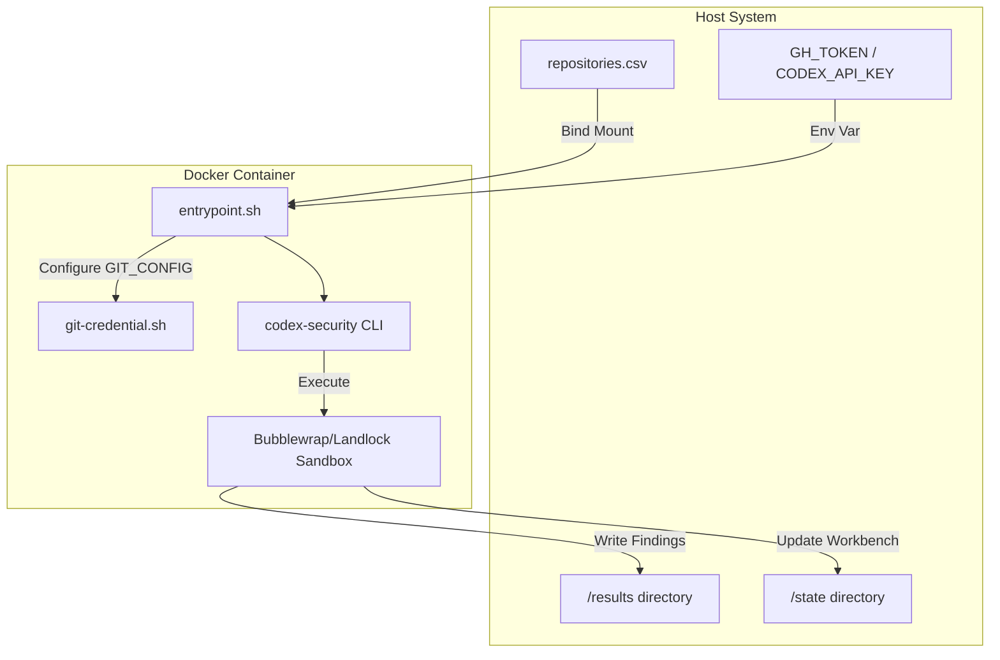
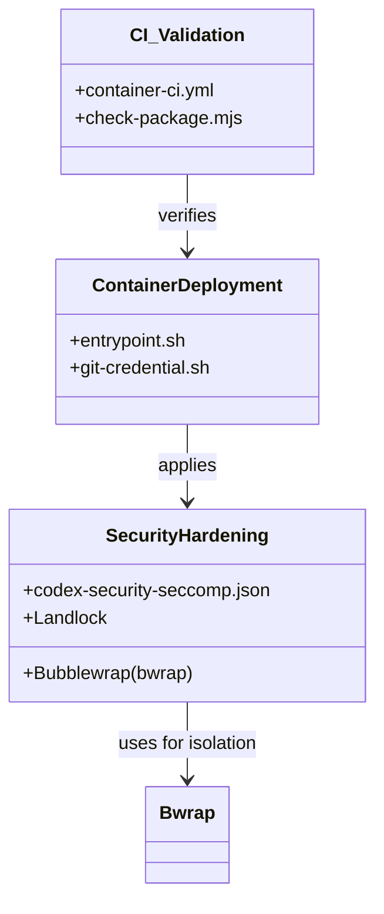

<!-- source: DeepWiki mcp.deepwiki.com · repo openai/codex-security · page 6.2 Docker Container Deployment · fetched 2026-10-26 -->

# Docker Container Deployment

Relevant source files

The following files were used as context for generating this wiki page:

- [.dockerignore](.dockerignore)
- [.github/workflows/container-ci.yml](.github/workflows/container-ci.yml)
- [Dockerfile](Dockerfile)
- [compose.yaml](compose.yaml)
- [docker/codex-security-seccomp.json](docker/codex-security-seccomp.json)
- [docker/entrypoint.sh](docker/entrypoint.sh)
- [docker/git-credential.sh](docker/git-credential.sh)
- [sdk/typescript/_bundled_plugin/scripts/normalize_candidates.py](sdk/typescript/_bundled_plugin/scripts/normalize_candidates.py)
- [sdk/typescript/tests-ts/auth.test.ts](sdk/typescript/tests-ts/auth.test.ts)

The Codex Security container deployment model provides a hardened, non-interactive environment optimized for bulk scanning and CI/CD integration. It leverages multi-stage builds, non-root execution, and strict volume isolation to ensure that security scans are performed within a controlled sandbox.

## Container Architecture

The deployment is defined by a multi-stage `Dockerfile` that separates the build-time TypeScript compilation from the runtime environment.

### Build Stages
1.  **package stage**: Uses `node:22-bookworm-slim` to install dependencies via `pnpm`, compile TypeScript, and generate a `.tgz` package. It runs `check-package.mjs` to verify the integrity of the build artifacts [Dockerfile:3-19]().
2.  **runtime stage**: A hardened image containing only the necessary runtimes (`node`, `python3`, `git`) and the global installation of the `@openai/codex-security` package [Dockerfile:20-41]().

### Security Hardening
*   **Non-Root User**: The container runs as user `10001:10001` (`codex-security`). The `/state` and `/output` directories are owned by this user, while `/input` is typically mounted read-only [Dockerfile:46-57]().
*   **Volume Isolation**:
    *   `/input`: Contains the `repositories.csv` inventory [compose.yaml:21-25]().
    *   `/output`: Stores scan results and findings [compose.yaml:27-30]().
    *   `/state`: Persists the SQLite workbench and `CODEX_HOME` data [Dockerfile:51-54](), [compose.yaml:32-35]().
*   **Seccomp Profile**: The deployment includes a custom seccomp profile `codex-security-seccomp.json` that restricts syscalls to a safe baseline, specifically allowing `landlock` and `bwrap` related calls for internal sandboxing while dropping dangerous capabilities like `CAP_SYS_ADMIN` [docker/codex-security-seccomp.json:1-153](), [compose.yaml:8-12]().

### Natural Language to Code Entity Mapping: Deployment Flow

| System Concept | Code Entity / Implementation |
| :--- | :--- |
| **Image Entrypoint** | `docker/entrypoint.sh` [docker/entrypoint.sh:1-46]() |
| **Credential Injection** | `docker/git-credential.sh` [docker/git-credential.sh:1-32]() |
| **Sandbox Policy** | `docker/codex-security-seccomp.json` [docker/codex-security-seccomp.json:1-303]() |
| **Volume Configuration** | `compose.yaml` (services.codex-security.volumes) [compose.yaml:19-35]() |

Sources: [Dockerfile:1-62](), [compose.yaml:1-41](), [docker/codex-security-seccomp.json:1-303]()

## Entrypoint and Git Credential Handling

The `entrypoint.sh` script manages the initialization of the environment, specifically handling non-interactive validation and Git authentication.

### Bulk-Scan Validation
The entrypoint enforces that `bulk-scan` is never run in interactive discovery mode within the container. It requires a repository CSV to be provided as an argument [docker/entrypoint.sh:5-14]().

### Git Credential Injection
If `GH_TOKEN` or `GITHUB_TOKEN` is present, the entrypoint configures `git` to use a custom credential helper:
1.  It validates `CODEX_SECURITY_GIT_HOST` (defaulting to `github.com`) [docker/entrypoint.sh:17-24]().
2.  It uses `GIT_CONFIG_KEY_n` and `GIT_CONFIG_VALUE_n` environment variables to inject Git configuration without modifying a global `.gitconfig` file [docker/entrypoint.sh:37-42]().
3.  The `git-credential.sh` helper retrieves the token from the environment and provides it to Git as an `x-access-token` for the specified host [docker/git-credential.sh:20-31]().

### Deployment Data Flow

Sources: [docker/entrypoint.sh:16-43](), [docker/git-credential.sh:1-32](), [compose.yaml:13-35]()

## Sandboxing (Bubblewrap and Landlock)

Codex Security employs nested sandboxing within the container to protect the host and the container's own root filesystem from potentially malicious code analysis tasks.

1.  **Bubblewrap**: The primary sandbox mechanism used to create isolated namespaces. The CI workflow verifies that the container can successfully execute `codex sandbox` [github.workflows/container-ci.yml:107-116]().
2.  **Landlock Fallback**: If the Docker host restricts nested namespaces, the system falls back to **Landlock** (via `--enable use_legacy_landlock`), which provides filesystem-level access control without requiring new namespaces [github.workflows/container-ci.yml:117-121]().

### CI Verification Workflow

The `container-ci.yml` workflow ensures the integrity and security of the container image through several automated checks:

*   **Exclusion Check**: Verifies that `.dockerignore` (or `Dockerfile.dockerignore`) correctly excludes sensitive files like `.env`, `node_modules`, and local scan results [github.workflows/container-ci.yml:40-72]().
*   **Sandbox Verification**: Runs the internal Codex sandbox within the container to ensure compatibility with the host's kernel security features [github.workflows/container-ci.yml:103-126]().
*   **Credential Leak Prevention**: Validates that `git-credential.sh` only provides tokens for the authorized `CODEX_SECURITY_GIT_HOST` and returns nothing for untrusted hosts [github.workflows/container-ci.yml:147-156]().

### Code Entity Association: Sandbox and Security

Sources: [.github/workflows/container-ci.yml:1-156](), [docker/codex-security-seccomp.json:1-303](), [Dockerfile:1-62]()

---

