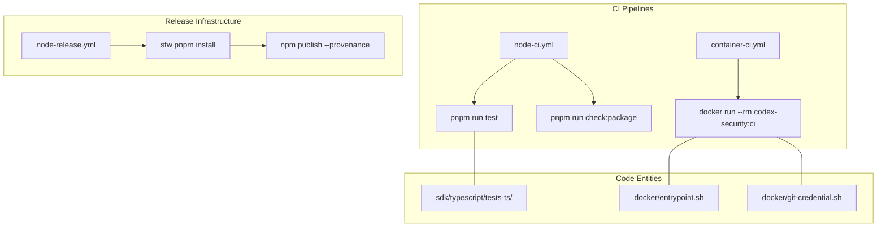
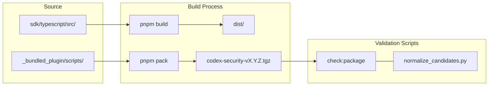

<!-- source: DeepWiki mcp.deepwiki.com · repo openai/codex-security · page 7 CI/CD and Release Infrastructure · fetched 2026-10-26 -->

# CI/CD and Release Infrastructure

Relevant source files

The following files were used as context for generating this wiki page:

- [.gitattributes](.gitattributes)
- [.github/workflows/container-ci.yml](.github/workflows/container-ci.yml)
- [.github/workflows/node-ci.yml](.github/workflows/node-ci.yml)
- [.github/workflows/node-release.yml](.github/workflows/node-release.yml)
- [.gitignore](.gitignore)
- [CONTRIBUTING.md](CONTRIBUTING.md)
- [SECURITY.md](SECURITY.md)
- [sdk/typescript/_bundled_plugin/scripts/generate_rank_input.py](sdk/typescript/_bundled_plugin/scripts/generate_rank_input.py)
- [sdk/typescript/_bundled_plugin/scripts/normalize_candidates.py](sdk/typescript/_bundled_plugin/scripts/normalize_candidates.py)
- [sdk/typescript/_bundled_plugin/scripts/rank_preview.py](sdk/typescript/_bundled_plugin/scripts/rank_preview.py)
- [sdk/typescript/src/auth.ts](sdk/typescript/src/auth.ts)
- [sdk/typescript/tests-ts/auth.test.ts](sdk/typescript/tests-ts/auth.test.ts)

This page provides a high-level overview of the automation, testing, and release pipelines for the Codex Security project. The infrastructure is designed to ensure cross-platform compatibility, maintain a locked dependency graph for reproducible builds, and provide a secure containerized environment for scanning.

## GitHub Actions Workflows

The project utilizes several GitHub Actions workflows to manage the lifecycle of the TypeScript SDK and the associated Docker infrastructure.

| Workflow | File | Purpose |
| :--- | :--- | :--- |
| **Node CI** | `node-ci.yml` | Validates every push and PR across Ubuntu, macOS, and Windows. |
| **Node Release** | `node-release.yml` | Handles npm publishing with provenance and strict dependency verification. |
| **Container CI** | `container-ci.yml` | Builds the Docker image and runs integration tests for the sandbox. |

### Node CI Pipeline
The `node-ci.yml` workflow ensures that the codebase remains healthy across different operating systems. It executes the following steps:
1.  **Environment Setup**: Installs Node.js 22, Bun, and pnpm [.github/workflows/node-ci.yml:26-38]().
2.  **Validation**: Runs `pnpm run types`, `pnpm run test`, and `pnpm run format` [.github/workflows/node-ci.yml:43-55]().
3.  **Artifact Verification**: Builds and packs the SDK into a tarball, then runs `check:package` to inspect the contents [.github/workflows/node-ci.yml:57-67]().

### Release and Provenance
The `node-release.yml` workflow is triggered by tags matching `npm-v*` [.github/workflows/node-release.yml:3-6](). It enforces a "Firewall" for dependencies using Socket Dev to ensure only approved packages are used during the build [.github/workflows/node-release.yml:34-39]().

Key features include:
*   **Provenance**: Publishes to npm with `--provenance` to link the package to the source commit and build job [.github/workflows/node-release.yml:196]().
*   **Locked Dependencies**: Uses `--frozen-lockfile` to ensure the exact dependency graph committed to the repository is used [.github/workflows/node-release.yml:98]().
*   **Smoke Testing**: Before publishing, the workflow installs the generated tarball into a fresh environment and verifies the CLI and SDK entrypoints [.github/workflows/node-release.yml:116-126]().

### Container Infrastructure
The `container-ci.yml` workflow manages the `codex-security` Docker image. It verifies that the image correctly implements security boundaries:
*   **Sandbox Verification**: Tests the hardened sandbox (using Bubblewrap or Landlock) to ensure it can execute code safely [.github/workflows/container-ci.yml:103-125]().
*   **Exclusion Rules**: Validates that `.dockerignore` prevents secrets (like `.env`) or local scan data from being accidentally baked into the image [.github/workflows/container-ci.yml:40-72]().
*   **Credential Injection**: Verifies the `codex-security-git-credential` helper correctly handles `GH_TOKEN` for host-scoped Git access [.github/workflows/container-ci.yml:147-156]().

Sources: [.github/workflows/node-ci.yml:1-68](), [.github/workflows/node-release.yml:1-196](), [.github/workflows/container-ci.yml:1-156]().

## Development Model: One-Way Mirror

Codex Security follows a **one-way mirror** development model. 
*   **Canonical Source**: Development happens within OpenAI's internal repository [CONTRIBUTING.md:3-5]().
*   **Public Repository**: The GitHub repository is a mirror of the canonical source.
*   **Contributions**: External pull requests cannot be directly merged. Instead, issues are reviewed by maintainers and manually ported to the canonical source [CONTRIBUTING.md:17-24]().

Sources: [CONTRIBUTING.md:1-31]().

## Testing and Quality Assurance

The project maintains a comprehensive test suite for both the TypeScript SDK and the Python-based plugin scripts.

### TypeScript Tests
The SDK tests use `bun:test` and focus on:
*   **Authentication Flows**: Verifying API key persistence and interactive device code login [sdk/typescript/tests-ts/auth.test.ts:74-128]().
*   **Process Handling**: Ensuring stderr is correctly drained and child processes are managed across platforms [sdk/typescript/tests-ts/auth.test.ts:130-152]().

### Python Utility Validation
The bundled plugin includes scripts that are validated for deterministic behavior:
*   **`normalize_candidates.py`**: Validates CWE IDs, ensures paths are within the repository root, and normalizes finding locations [sdk/typescript/_bundled_plugin/scripts/normalize_candidates.py:45-135]().
*   **`generate_rank_input.py`**: Manages the generation of scan worklists and partitioning of shards for worker pools [sdk/typescript/_bundled_plugin/scripts/generate_rank_input.py:6-22]().

For details on running these tests locally and the dependency injection patterns used, see [Testing Infrastructure](#7.1).

Sources: [sdk/typescript/tests-ts/auth.test.ts:1-152](), [sdk/typescript/_bundled_plugin/scripts/normalize_candidates.py:1-135](), [sdk/typescript/_bundled_plugin/scripts/generate_rank_input.py:1-23]().

## CI/CD Entity Mapping

The following diagram maps CI/CD concepts to specific files and scripts in the codebase.

### Pipeline and Release Mapping

Sources: [.github/workflows/node-ci.yml:1-68](), [.github/workflows/node-release.yml:1-196](), [.github/workflows/container-ci.yml:1-156]().

### Build and Artifact Flow

Sources: [.github/workflows/node-ci.yml:57-67](), [sdk/typescript/_bundled_plugin/scripts/normalize_candidates.py:1-135]().

---

