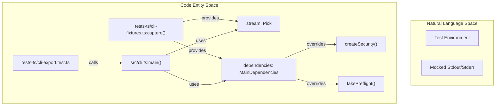
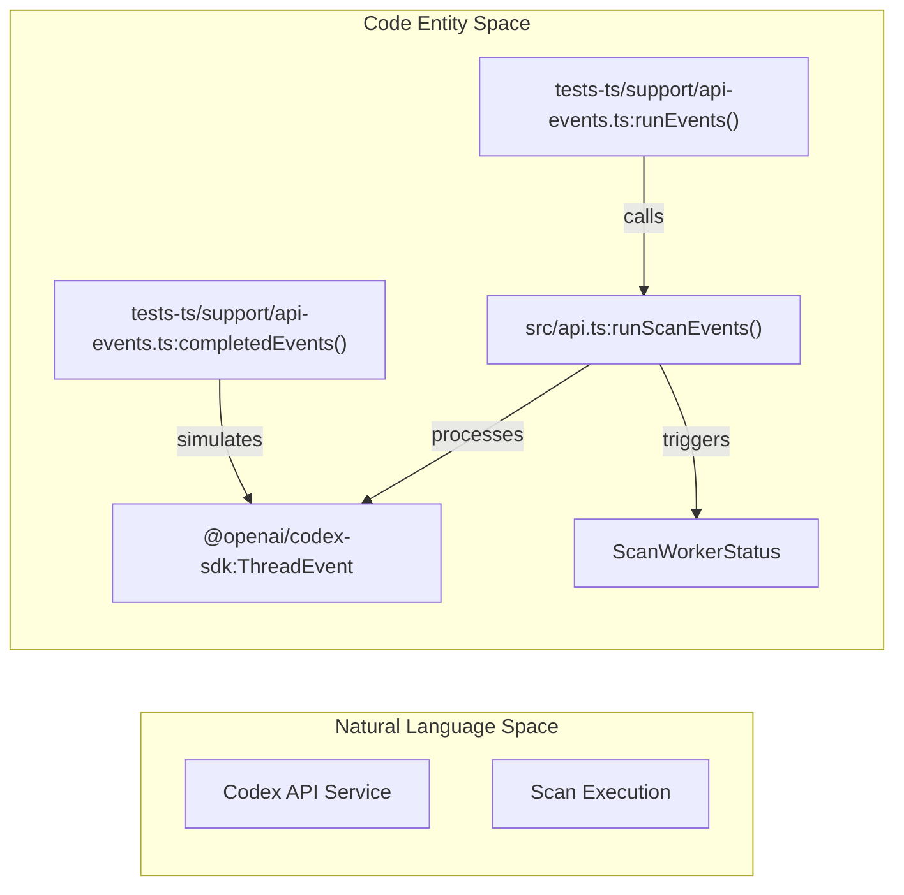

<!-- source: DeepWiki mcp.deepwiki.com · repo openai/codex-security · page 7.1 Testing Infrastructure · fetched 2026-10-26 -->

# Testing Infrastructure

Relevant source files

The following files were used as context for generating this wiki page:

- [sdk/typescript/package.json](sdk/typescript/package.json)
- [sdk/typescript/src/version.ts](sdk/typescript/src/version.ts)
- [sdk/typescript/tests-ts/cli-export.test.ts](sdk/typescript/tests-ts/cli-export.test.ts)
- [sdk/typescript/tests-ts/cli-fixtures.ts](sdk/typescript/tests-ts/cli-fixtures.ts)
- [sdk/typescript/tests-ts/plugin-root.ts](sdk/typescript/tests-ts/plugin-root.ts)
- [sdk/typescript/tests-ts/skeleton.test.ts](sdk/typescript/tests-ts/skeleton.test.ts)
- [sdk/typescript/tests-ts/support/api-events.ts](sdk/typescript/tests-ts/support/api-events.ts)
- [sdk/typescript/tests-ts/support/cli.ts](sdk/typescript/tests-ts/support/cli.ts)

The Codex Security test suite is designed to validate the TypeScript SDK, the CLI interface, and the integration between the TypeScript runtime and the Python-based plugin system. The infrastructure relies on **Bun** as the test runner for its speed and built-in support for TypeScript, while utilizing a **Dependency Injection (DI)** pattern to mock complex interactions with the OpenAI Codex API and the local filesystem.

## Test Suite Organization

The test infrastructure is primarily contained within the `sdk/typescript/tests-ts/` directory.

| Component | Description |
| :--- | :--- |
| `tests-ts/*.test.ts` | Functional and unit tests for specific modules (e.g., `cli-export.test.ts`, `skeleton.test.ts`). |
| `cli-fixtures.ts` | Shared utilities for mocking CLI dependencies, capturing output streams, and synthetic credential data. |
| `plugin-root.ts` | Resolution logic for finding the bundled or source plugin directory for integration tests. |
| `support/api-events.ts` | Utilities for simulating Codex SDK `ThreadEvent` streams and managing temporary scan artifacts. |

**Sources:** [sdk/typescript/package.json:49-49](), [sdk/typescript/tests-ts/plugin-root.ts:1-20]()

## Dependency Injection Pattern

To ensure tests are hermetic and do not perform actual network calls or expensive Python executions by default, the CLI and SDK use a Dependency Injection pattern.

### `CliDependencies`
The `main` function in the CLI accepts an optional `dependencies` object. This allows tests to override the behavior of the `CodexSecurity` client, the preflight check, and the account status checks.

*   **`fakePreflight`**: A common mock used in tests to simulate a successful Python environment check without actually probing the local system.
*   **`createSecurity`**: A factory function that can be replaced to return a mocked instance of the `CodexSecurity` class.

### CLI Test Data Flow
The following diagram illustrates how `cli-fixtures.ts` provides mocked streams and dependencies to the CLI `main` entry point.

**CLI Mocking Data Flow**

**Sources:** [sdk/typescript/tests-ts/cli-fixtures.ts:17-137](), [sdk/typescript/tests-ts/cli-export.test.ts:44-67]()

## Test Support Utilities

### `cli-fixtures.ts`
This file contains the core infrastructure for CLI testing:
*   **`capture(isTTY)`**: Returns a mock stream that intercepts `write` calls and stores them in a buffer for assertion via `.text()`. [sdk/typescript/tests-ts/cli-fixtures.ts:123-137]()
*   **`SYNTHETIC_CREDENTIALS`**: A large string of fake API keys and tokens used to verify that the CLI correctly redacts sensitive information in logs and exports. [sdk/typescript/tests-ts/cli-fixtures.ts:19-69]()
*   **`REDACTED_CREDENTIALS`**: The expected output after the redaction logic has processed the synthetic credentials. [sdk/typescript/tests-ts/cli-fixtures.ts:71-121]()

### `support/api-events.ts`
This utility mocks the Codex SDK's streaming event interface.
*   **`completedEvents()`**: An `AsyncGenerator` that yields a sequence of `ThreadEvent` objects (e.g., `thread.started`, `turn.completed`) to simulate a successful scan lifecycle. [sdk/typescript/tests-ts/support/api-events.ts:48-64]()
*   **`runEvents()`**: Wraps the `runScanEvents` function to test how the SDK handles specific event sequences and observer errors. [sdk/typescript/tests-ts/support/api-events.ts:66-103]()

### `plugin-root.ts`
This module resolves the location of the `_bundled_plugin`. It checks for the existence of the source plugin in the monorepo and falls back to the bundled version if necessary. This ensures that integration tests can find the `plugin.json` and Python scripts regardless of whether they are running in a development environment or a CI build.
**Sources:** [sdk/typescript/tests-ts/plugin-root.ts:4-15]()

## API Integration Mocking
The following diagram shows how the `runEvents` utility bridges the Codex SDK events to the `CodexSecurity` scan lifecycle.

**API Event Simulation**

**Sources:** [sdk/typescript/tests-ts/support/api-events.ts:48-103]()

## Running Tests Locally

Tests are executed using `bun test`. The configuration is defined in the SDK's `package.json`.

### Commands
*   **Run all tests**: `pnpm run test` (executes `bun test --timeout 30000 ./tests-ts`).
*   **Linting**: `pnpm run lint` (executes `tsc --noEmit` to verify type safety).
*   **Package Verification**: `pnpm run check:package` and `pnpm run test:package` are used to ensure the generated distribution is valid and the smoke tests pass.

**Sources:** [sdk/typescript/package.json:41-52]()

---

