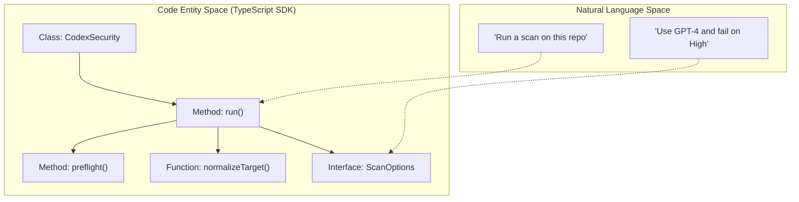
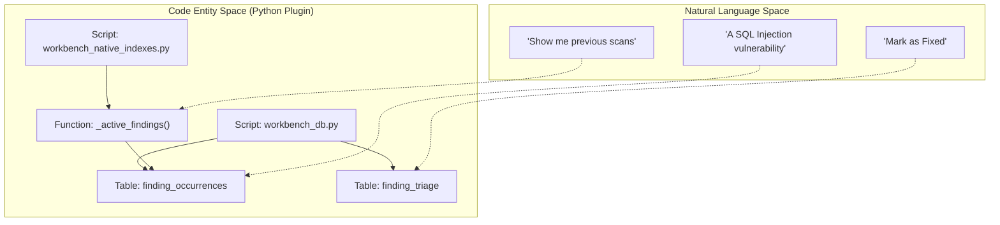

<!-- source: DeepWiki mcp.deepwiki.com · repo openai/codex-security · page 8 Glossary · fetched 2026-10-26 -->

# Glossary

Relevant source files

The following files were used as context for generating this wiki page:

- [.gitattributes](.gitattributes)
- [.github/workflows/container-ci.yml](.github/workflows/container-ci.yml)
- [.gitignore](.gitignore)
- [CONTRIBUTING.md](CONTRIBUTING.md)
- [README.md](README.md)
- [SECURITY.md](SECURITY.md)
- [sdk/typescript/README.md](sdk/typescript/README.md)
- [sdk/typescript/_bundled_plugin/references/scan-contract.md](sdk/typescript/_bundled_plugin/references/scan-contract.md)
- [sdk/typescript/_bundled_plugin/references/static-finding-assessment.md](sdk/typescript/_bundled_plugin/references/static-finding-assessment.md)
- [sdk/typescript/_bundled_plugin/scripts/normalize_candidates.py](sdk/typescript/_bundled_plugin/scripts/normalize_candidates.py)
- [sdk/typescript/_bundled_plugin/scripts/workbench_constants.py](sdk/typescript/_bundled_plugin/scripts/workbench_constants.py)
- [sdk/typescript/_bundled_plugin/scripts/workbench_db.py](sdk/typescript/_bundled_plugin/scripts/workbench_db.py)
- [sdk/typescript/_bundled_plugin/scripts/workbench_native_indexes.py](sdk/typescript/_bundled_plugin/scripts/workbench_native_indexes.py)
- [sdk/typescript/_bundled_plugin/skills/attack-path-analysis/references/severity-policy.md](sdk/typescript/_bundled_plugin/skills/attack-path-analysis/references/severity-policy.md)
- [sdk/typescript/src/api.ts](sdk/typescript/src/api.ts)
- [sdk/typescript/src/cli.ts](sdk/typescript/src/cli.ts)
- [sdk/typescript/src/cost.ts](sdk/typescript/src/cost.ts)
- [sdk/typescript/src/models.ts](sdk/typescript/src/models.ts)
- [sdk/typescript/src/worker-progress.ts](sdk/typescript/src/worker-progress.ts)
- [sdk/typescript/tests-ts/api.test.ts](sdk/typescript/tests-ts/api.test.ts)
- [sdk/typescript/tests-ts/auth.test.ts](sdk/typescript/tests-ts/auth.test.ts)
- [sdk/typescript/tests-ts/cli.test.ts](sdk/typescript/tests-ts/cli.test.ts)

This glossary defines technical terms, jargon, and domain concepts specific to the Codex Security codebase. It serves as a reference for onboarding engineers to understand the mapping between high-level security concepts and their implementation in the TypeScript SDK and Python-based plugin.

## Core System Concepts

### Scan Target
A **Scan Target** represents the specific code surface being analyzed. The system normalizes various input types (local paths, git branches, diffs) into a consistent `NormalizedTarget` structure used by the backend.

| Term | Description | Code Pointer |
| :--- | :--- | :--- |
| **Repository Target** | A full scan of a local directory or Git repository. | [sdk/typescript/src/targets.ts:77-79]() |
| **Diff Target** | A scan limited to changes between two Git references (e.g., `HEAD` vs `origin/main`) or the `working_tree`. | [sdk/typescript/src/targets.ts:77-79]() |
| **Path Target** | A scan restricted to specific subdirectories or files within a repository. | [sdk/typescript/src/targets.ts:154-155]() |
| **Target ID** | A stable, unique identifier for a repository, often derived from a digest of its canonical remote URL or local path. | [sdk/typescript/_bundled_plugin/references/scan-contract.md:41-43]() |

**Sources:** [sdk/typescript/src/targets.ts:70-81](), [sdk/typescript/_bundled_plugin/references/scan-contract.md:31-43]()

### Scan Mode
Defines the depth and workflow of the analysis.
*   **Standard (`standard`)**: A single-pass security assessment.
*   **Deep (`deep`)**: An exhaustive, multi-pass scan designed for higher recall, typically used for repository-wide analysis.

**Sources:** [sdk/typescript/src/targets.ts:77-79](), [sdk/typescript/_bundled_plugin/references/scan-contract.md:94-105]()

---

## Data Model and Findings

### Finding Identity
A **Finding** is a unique security observation. Its identity is governed by a "Scan Contract" to ensure findings can be tracked across different scans of the same repository.

*   **Rule ID**: A stable slug identifying the vulnerability class (e.g., `sql-injection.query-builder`). [sdk/typescript/_bundled_plugin/references/scan-contract.md:65-78]()
*   **Anchor**: The semantic "root control" location of the vulnerability. Unlike traditional SAST, this is line-agnostic to survive code movement. [sdk/typescript/_bundled_plugin/references/scan-contract.md:47-52]()
*   **Fingerprint**: A derived hash of the Target ID, Rule ID, Anchor, and Instance used to generate the `findingId`. [sdk/typescript/_bundled_plugin/references/scan-contract.md:53-57]()

### Finding Severity
The codebase uses a fixed hierarchy for vulnerability impact:
`critical` > `high` > `medium` > `low` > `informational`.

**Sources:** [sdk/typescript/src/cli.ts:107-116](), [sdk/typescript/_bundled_plugin/scripts/workbench_native_indexes.py:137-144]()

---

## Technical Infrastructure

### Workbench
The **Workbench** is the persistence layer that stores scan history, finding triage states, and remediation progress in a local SQLite database.

*   **`workbench_db.py`**: The primary interface for database operations, including schema migrations and scan registration. [sdk/typescript/_bundled_plugin/scripts/workbench_db.py:2-23]()
*   **Active Findings**: A logic filter that determines which findings are still relevant based on whether subsequent scans have covered the file path where the finding was originally located. [sdk/typescript/_bundled_plugin/scripts/workbench_native_indexes.py:75-171]()

### Scan Cost Tracker
A utility that monitors the financial cost of a scan in real-time by polling `session.jsonl` files generated by the underlying Codex runtime. It aggregates token usage across parent and child threads to estimate USD impact.

**Sources:** [sdk/typescript/src/api.ts:22-22](), [sdk/typescript/tests-ts/api.test.ts:99-129]()

---

## Implementation Diagrams

### Natural Language to Code: Scan Execution Flow
This diagram bridges the conceptual "Start a Scan" action to the specific TypeScript classes and methods that handle the lifecycle.

**Sources:** [sdk/typescript/src/api.ts:210-242](), [sdk/typescript/src/targets.ts:73-73]()

### Natural Language to Code: Workbench & Findings
This diagram maps the concept of "Triage a Finding" to the Python backend entities that persist the state.

**Sources:** [sdk/typescript/_bundled_plugin/scripts/workbench_db.py:2-23](), [sdk/typescript/_bundled_plugin/scripts/workbench_native_indexes.py:75-80]()

---

## Directory & File Jargon

| Path / File | Purpose |
| :--- | :--- |
| **`_bundled_plugin/`** | The core logic engine (Python) bundled with the SDK. |
| **`scan-manifest.json`** | The immutable receipt of a completed scan. [sdk/typescript/_bundled_plugin/references/scan-contract.md:9-9]() |
| **`CODEX_HOME`** | Environment variable pointing to the base directory for Codex configuration and credentials (default `~/.codex`). [sdk/typescript/_bundled_plugin/scripts/workbench_db.py:151-152]() |
| **`Protected Root`** | A directory boundary (like a repository root) that the scanner is forbidden from writing results into for security isolation. [sdk/typescript/src/api.ts:33-34]() |

**Sources:** [sdk/typescript/_bundled_plugin/references/scan-contract.md:7-13](), [sdk/typescript/src/api.ts:52-69]()