# Page: Overview

# Overview

<details>
<summary>Relevant source files</summary>

The following files were used as context for generating this wiki page:

- [.gitattributes](.gitattributes)
- [.gitignore](.gitignore)
- [CONTRIBUTING.md](CONTRIBUTING.md)
- [README.md](README.md)
- [SECURITY.md](SECURITY.md)
- [sdk/typescript/README.md](sdk/typescript/README.md)
- [sdk/typescript/_bundled_plugin/.codex-plugin/plugin.json](sdk/typescript/_bundled_plugin/.codex-plugin/plugin.json)

</details>


Codex Security is a comprehensive security analysis platform designed to find, validate, and remediate vulnerabilities in source code using advanced AI models. It is delivered as a TypeScript SDK and a command-line interface (CLI) that orchestrates a specialized Python-based execution engine.

The system supports a variety of analysis modes, including full repository scans, targeted path assessments, and differential analysis for pull requests or local working trees [sdk/typescript/README.md:46-49]().

### Core Capabilities
*   **Vulnerability Discovery**: Identifies security flaws with detailed evidence and attack paths [sdk/typescript/README.md:51-53]().
*   **Differential Scanning**: Analyzes changes between Git refs or uncommitted changes in the working tree [sdk/typescript/README.md:135-136]().
*   **Automated Remediation**: Generates and validates patches for identified findings [sdk/typescript/README.md:122-122]().
*   **CI/CD Integration**: Supports automated gates via severity-based exit codes and Git pre-commit hooks [sdk/typescript/README.md:131-133]().
*   **Knowledge Integration**: Incorporates external threat models or architecture documents to inform the scan [sdk/typescript/README.md:101-101]().

## System Architecture

Codex Security operates by bridging a high-level TypeScript orchestrator with a specialized Python plugin environment. The TypeScript layer handles user interaction, authentication, and file system safety, while the Python layer executes the security logic and interacts with the Codex reasoning models.

### Conceptual Mapping: Natural Language to Code Entities

The following diagram illustrates how high-level system concepts map to specific classes and files within the codebase.

**Concept to Entity Mapping**
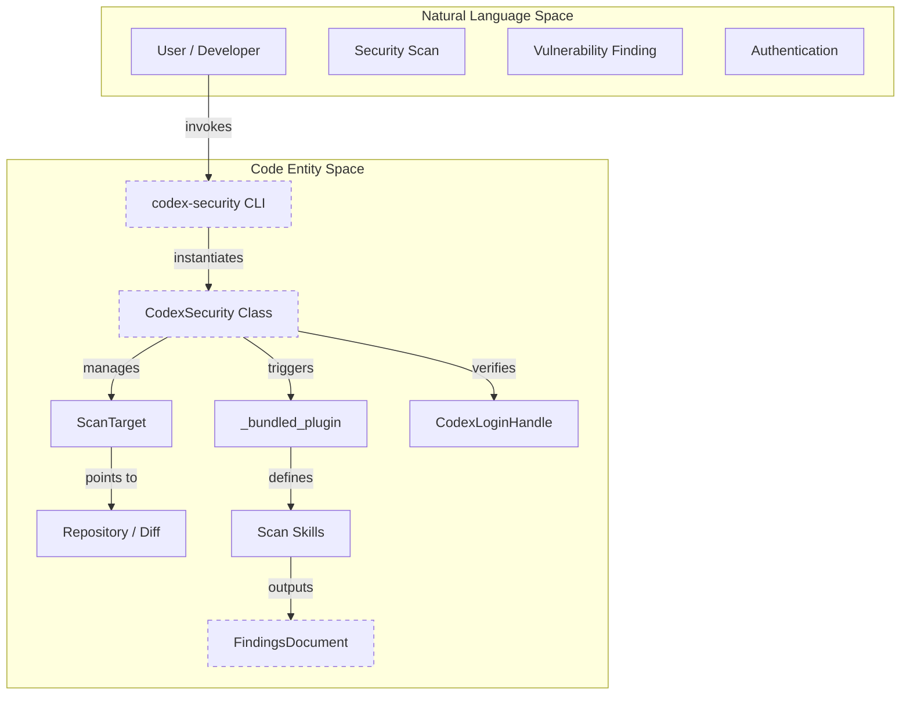
**Sources:** [sdk/typescript/README.md:29-44](), [sdk/typescript/_bundled_plugin/.codex-plugin/plugin.json:1-20]()

### Component Interaction

The interaction between the TypeScript SDK and the underlying Python execution engine is managed through a "plugin" architecture. The SDK bootstraps a runtime that executes the bundled Python logic in a controlled environment.

**System Interaction Flow**
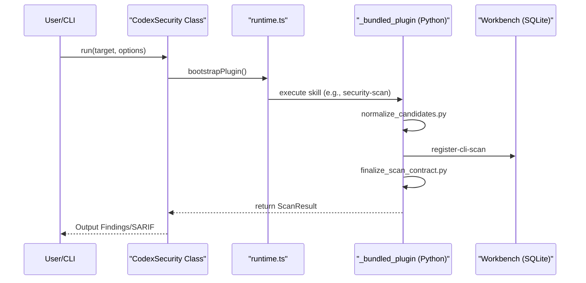
**Sources:** [sdk/typescript/README.md:32-44](), [sdk/typescript/_bundled_plugin/.codex-plugin/plugin.json:18-20](), [sdk/typescript/README.md:118-120]()

## Key Components

| Component | Description | Primary Code Location |
| :--- | :--- | :--- |
| **CLI / SDK** | The primary interface for users to interact with the system. | `sdk/typescript/` |
| **Bundled Plugin** | The core security logic, containing Python scripts for ranking, validation, and reporting. | `sdk/typescript/_bundled_plugin/` |
| **Workbench** | A persistence layer using SQLite to track scan history, findings, and remediation status. | `_bundled_plugin/` (Python logic) |
| **MCP Server** | A Model Context Protocol server that exposes security tools to AI agents. | `sdk/typescript/_bundled_plugin/.mcp.json` |

**Sources:** [sdk/typescript/README.md:1-5](), [sdk/typescript/_bundled_plugin/.codex-plugin/plugin.json:1-20]()

## Navigating the Wiki

To understand the system in depth, follow these links to the specialized documentation pages:

*   **[Getting Started](#1.1)**: Installation (Node.js 22+, Python 3.10+), authentication flows (API keys vs. ChatGPT login), and running your first scan.
*   **[Repository Structure and Build System](#1.2)**: A guide to the monorepo layout, the TypeScript build pipeline using `pnpm`, and how the bundled plugin is packaged.
*   **CLI Reference**: Detailed documentation of all command-line flags, including `scan`, `bulk-scan`, and `scans` history management.
*   **TypeScript SDK**: Technical details on the `CodexSecurity` class, the scan lifecycle, and cost tracking.
*   **Bundled Plugin Architecture**: Deep dive into the Python-based security skills, artifact conventions, and the MCP server.
*   **Workbench**: Details on the SQLite schema used for state persistence and finding triage.
*   **Security Model and Sandboxing**: Information on how the system protects the host machine, handles path isolation, and operates within Docker containers.

**Sources:** [sdk/typescript/README.md:11-21](), [sdk/typescript/README.md:55-94](), [sdk/typescript/README.md:95-123]()

---

# Page: Getting Started

# Getting Started

<details>
<summary>Relevant source files</summary>

The following files were used as context for generating this wiki page:

- [.github/workflows/node-ci.yml](.github/workflows/node-ci.yml)
- [README.md](README.md)
- [sdk/typescript/README.md](sdk/typescript/README.md)
- [sdk/typescript/_bundled_plugin/scripts/generate_rank_input.py](sdk/typescript/_bundled_plugin/scripts/generate_rank_input.py)
- [sdk/typescript/_bundled_plugin/scripts/rank_preview.py](sdk/typescript/_bundled_plugin/scripts/rank_preview.py)
- [sdk/typescript/package.json](sdk/typescript/package.json)
- [sdk/typescript/src/auth.ts](sdk/typescript/src/auth.ts)
- [sdk/typescript/tests-ts/cli-authentication.test.ts](sdk/typescript/tests-ts/cli-authentication.test.ts)

</details>


Codex Security is a security analysis platform that uses generative AI to find, validate, and remediate vulnerabilities. This page covers the initial setup, authentication workflows, and basic usage patterns for both the CLI and TypeScript SDK.

## Prerequisites

Before installing, ensure your environment meets the following requirements:

| Requirement | Version | Notes |
| :--- | :--- | :--- |
| **Node.js** | 22+ | Required for the CLI and SDK runtime. [sdk/typescript/package.json:16-16]() |
| **Python** | 3.10+ | Required for scanning and exporting findings. [sdk/typescript/README.md:19-19]() |
| **Package Manager** | `pnpm` 11.9.0+ | Used for building the monorepo. [sdk/typescript/package.json:18-18]() |

*Note: If using Python 3.10, the `tomli` package must be installed for TOML parsing.* [sdk/typescript/README.md:19-21]()

Sources: [sdk/typescript/package.json:1-30](), [sdk/typescript/README.md:1-22]()

---

## Installation

The package is distributed as `@openai/codex-security`. You can install it globally or as a project dependency.

```bash
# Local installation
npm install @openai/codex-security

# Verify installation
npx codex-security --version
```

Sources: [sdk/typescript/README.md:11-16]()

---

## Authentication

Codex Security supports three primary authentication methods. The system prioritizes environment variables over stored credentials. [sdk/typescript/README.md:89-91]()

### 1. Interactive Login (Local Development)
For local use, the standard login flow uses ChatGPT authentication.
```bash
npx codex-security login
```

### 2. Device Code (Headless/Remote)
On remote servers where a browser cannot be opened, use the device code flow.
```bash
npx codex-security login --device-auth
```
This generates a user code that you must enter at the provided URL. The `CodexLoginHandle` class manages this lifecycle, polling for completion. [sdk/typescript/src/auth.ts:18-101]()

### 3. API Key (CI/CD)
For automated environments, set the `OPENAI_API_KEY` or `CODEX_API_KEY` environment variables. Alternatively, you can pipe a key into the login command:
```bash
printenv OPENAI_API_KEY | npx codex-security login --with-api-key
```

### Authentication Logic Flow
The following diagram illustrates how the `CodexLoginHandle` and `runCodex` functions interact with the underlying system to establish identity.

**Identity Resolution Diagram**
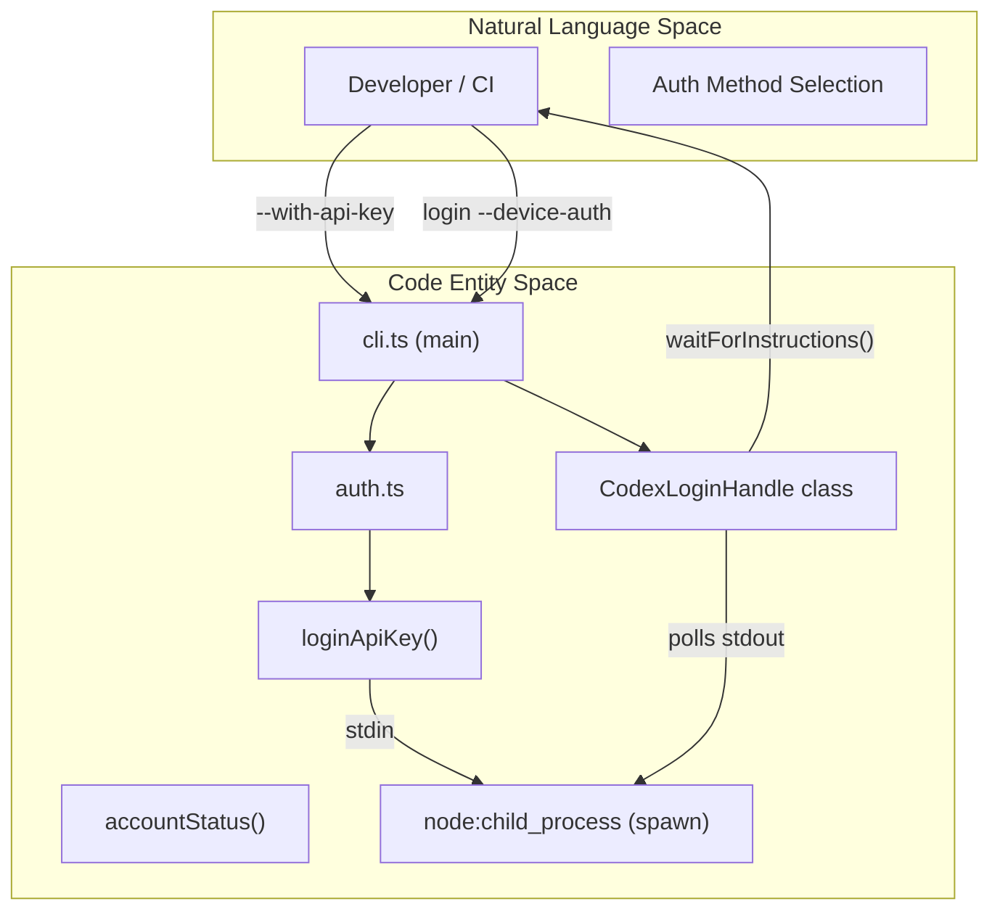
Sources: [sdk/typescript/src/auth.ts:18-201](), [sdk/typescript/README.md:55-93]()

---

## First Scan Walkthrough

A scan requires a **target** (repository or path) and an **output directory**. The output directory **must** be outside the scanned repository for security isolation. [sdk/typescript/README.md:137-138]()

### Using the CLI
```bash
# Basic scan of the current directory
npx codex-security scan . --output-dir ../results
```

### Using the SDK
The `CodexSecurity` class is the entry point for programmatic usage.

```typescript
import { CodexSecurity } from "@openai/codex-security";

const security = new CodexSecurity();
try {
  const result = await security.run("/path/to/repo", {
    outputDir: "/path/outside/repo/results",
  });
  console.log(`Scan completed. Report: ${result.reportPath}`);
} finally {
  await security.close(); // Ensure child processes are terminated
}
```
Sources: [sdk/typescript/README.md:23-53](), [README.md:19-30]()

---

## Scan Execution Pipeline

When a scan is initiated, the system goes through several phases managed by the `_bundled_plugin` Python scripts.

**Scan Pipeline Data Flow**
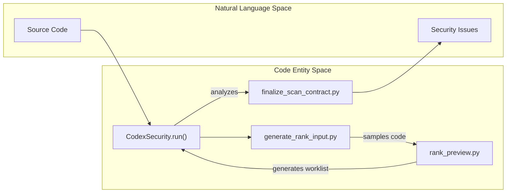
Sources: [sdk/typescript/_bundled_plugin/scripts/generate_rank_input.py:1-23](), [sdk/typescript/_bundled_plugin/scripts/rank_preview.py:1-14]()

---

## CI/CD Integration Patterns

In CI/CD, Codex Security is typically used to block PRs based on finding severity.

### GitHub Actions Example
Use the `--fail-on-severity` flag to return a non-zero exit code if vulnerabilities are found. [sdk/typescript/README.md:153-154]()

```yaml
- name: Run Codex Security Scan
  env:
    OPENAI_API_KEY: ${{ secrets.OPENAI_API_KEY }}
  run: |
    npx codex-security scan . \
      --output-dir ../scan-results \
      --fail-on-severity high
```

### Key CI Flags
| Flag | Purpose |
| :--- | :--- |
| `--fail-on-severity <level>` | Exit with code 1 if findings meet threshold. [sdk/typescript/README.md:153-154]() |
| `--max-cost <USD>` | Hard limit on scan spend. [sdk/typescript/README.md:107-107]() |
| `--diff <ref>` | Only scan changes since a specific Git ref. [sdk/typescript/README.md:102-102]() |

Sources: [sdk/typescript/README.md:95-168](), [.github/workflows/node-ci.yml:48-53]()

---

# Page: Repository Structure and Build System

# Repository Structure and Build System

<details>
<summary>Relevant source files</summary>

The following files were used as context for generating this wiki page:

- [sdk/typescript/.gitignore](sdk/typescript/.gitignore)
- [sdk/typescript/_bundled_plugin/skills/security-scan/references/scan-artifacts-and-ledger.md](sdk/typescript/_bundled_plugin/skills/security-scan/references/scan-artifacts-and-ledger.md)
- [sdk/typescript/bin/codex-security.mjs](sdk/typescript/bin/codex-security.mjs)
- [sdk/typescript/package.json](sdk/typescript/package.json)
- [sdk/typescript/plugin-files.json](sdk/typescript/plugin-files.json)
- [sdk/typescript/scripts/check-package.mjs](sdk/typescript/scripts/check-package.mjs)
- [sdk/typescript/scripts/generate-models.cjs](sdk/typescript/scripts/generate-models.cjs)
- [sdk/typescript/scripts/smoke-package.mjs](sdk/typescript/scripts/smoke-package.mjs)

</details>


This page details the monorepo layout, the TypeScript-based build pipeline, and the verification mechanisms that ensure the integrity of the `@openai/codex-security` package and its bundled Python-based execution engine.

## Monorepo Layout

The repository is organized to separate the TypeScript SDK/CLI from the core security analysis logic (the "plugin"). The primary development and build activities occur within the `sdk/typescript` directory.

| Directory | Purpose |
| :--- | :--- |
| `sdk/typescript` | The primary workspace containing the CLI, SDK, and build scripts [sdk/typescript/package.json:8-12](). |
| `sdk/typescript/bin` | Contains the `codex-security.mjs` entrypoint for the CLI [sdk/typescript/bin/codex-security.mjs:1-27](). |
| `sdk/typescript/dist` | Build output directory for transpiled JavaScript and type definitions [sdk/typescript/package.json:19-20](). |
| `sdk/typescript/_bundled_plugin` | The embedded analysis engine, containing Python scripts, skills, and schemas [sdk/typescript/package.json:34](). |
| `sdk/typescript/scripts` | Build, model generation, and package verification utilities [sdk/typescript/package.json:44-47](). |
| `sdk/typescript/tests-ts` | TypeScript test suite executed via `bun` [sdk/typescript/package.json:49](). |

**Sources:** [sdk/typescript/package.json:1-40](), [sdk/typescript/bin/codex-security.mjs:1-27]()

## TypeScript Build Pipeline

The build system leverages `pnpm` and `tsc` (TypeScript Compiler) to transform source code into a distributable ESM (ECMAScript Module) package.

### Build Lifecycle
1.  **Model Generation**: The build begins by generating TypeScript interfaces from JSON schemas located in the bundled plugin. The `generate:models` script uses `json-schema-to-typescript` to create `src/models.ts` [sdk/typescript/scripts/generate-models.cjs:25-44]().
2.  **Cleaning**: The `dist` directory is removed to ensure a fresh state [sdk/typescript/package.json:42]().
3.  **Compilation**: `tsc` compiles the project using `tsconfig.build.json` [sdk/typescript/package.json:43]().
4.  **Verification**: Post-build scripts verify the package structure and bundled plugin integrity.

### Data Flow: Schema to TypeScript Models
The following diagram illustrates how analysis contracts defined in JSON Schema are projected into the TypeScript SDK.

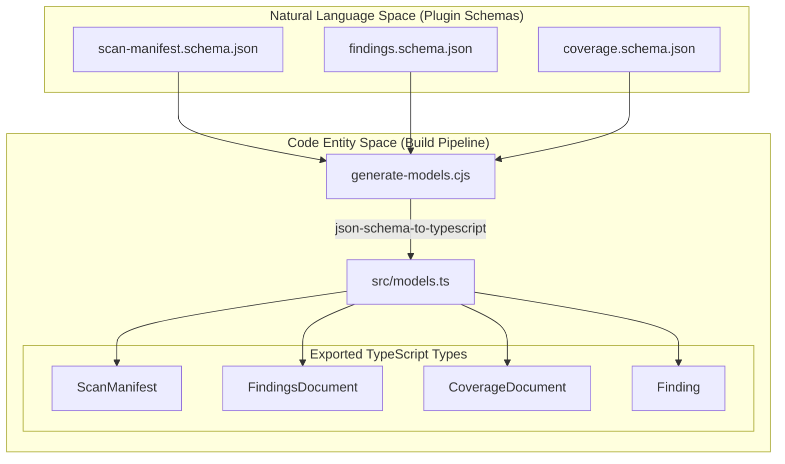
**Sources:** [sdk/typescript/scripts/generate-models.cjs:25-87](), [sdk/typescript/package.json:46-47]()

## Bundled Plugin and Manifest (`plugin-files.json`)

The `_bundled_plugin` directory is a critical component that allows the CLI to function without external dependencies. Its contents are strictly controlled by the `plugin-files.json` manifest.

### Manifest Structure
The manifest defines two categories of files:
*   **`externalOwnedExact`**: Files like `plugin.json` and `OWNERS` that are required for plugin identification [sdk/typescript/plugin-files.json:2-5]().
*   **`shippedExact`**: A comprehensive list of Python scripts, skills (e.g., `security-scan`, `attack-path-analysis`), and reference documents included in the package [sdk/typescript/plugin-files.json:6-100]().

### Plugin Asset Mapping
This diagram bridges the conceptual "Skills" used by the analysis engine to the physical file entities in the repository.

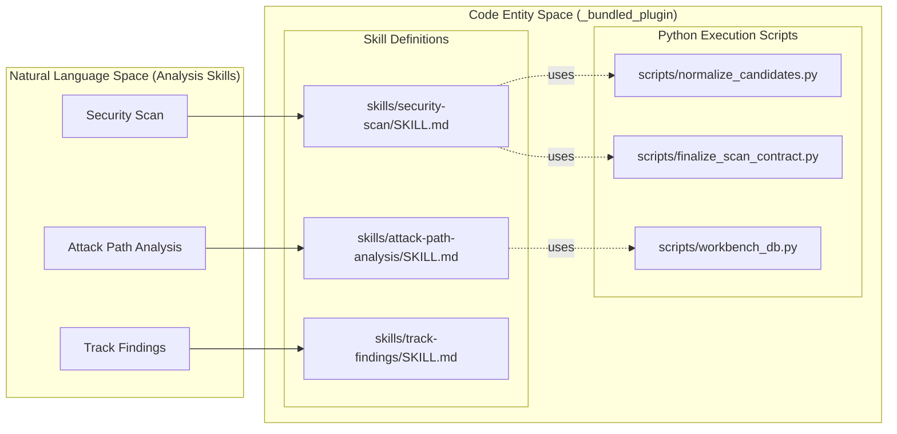
**Sources:** [sdk/typescript/plugin-files.json:30-99](), [sdk/typescript/_bundled_plugin/skills/security-scan/references/scan-artifacts-and-ledger.md:27-32]()

## Package Verification Scripts

To ensure security and correctness before publishing to npm, the repository utilizes two primary verification scripts: `check-package.mjs` and `smoke-package.mjs`.

### `check-package.mjs`
This script performs static analysis on the generated npm tarball [sdk/typescript/scripts/check-package.mjs:9-12]():
*   **Tarball Integrity**: Validates the tar header and ensures no trailing data or duplicate paths exist [sdk/typescript/scripts/check-package.mjs:41-73]().
*   **Structure Validation**: Ensures all required files (`package.json`, `dist/cli.js`, `bin/codex-security.mjs`) are present [sdk/typescript/scripts/check-package.mjs:74-87]().
*   **Plugin Contract Enforcement**: Cross-references the tarball contents against `plugin-files.json` to ensure no unauthorized files are included and no required analysis scripts are missing [sdk/typescript/scripts/check-package.mjs:105-128]().
*   **Permission Checks**: Verifies that the CLI launcher has executable bits set [sdk/typescript/scripts/check-package.mjs:198-205]().

### `smoke-package.mjs`
This script performs a dynamic "smoke test" by installing the tarball into a temporary directory [sdk/typescript/scripts/smoke-package.mjs:177-186]():
*   **Installation Test**: Runs `npm install` on the tarball to ensure dependency resolution works [sdk/typescript/scripts/smoke-package.mjs:189-203]().
*   **SDK Import**: Verifies that the installed package can be imported as a module and that the `CodexSecurity` class is exported [sdk/typescript/scripts/smoke-package.mjs:222-230]().
*   **CLI Execution**: Validates the presence and pathing of the `codex-security` binary [sdk/typescript/scripts/smoke-package.mjs:232-245]().

**Sources:** [sdk/typescript/scripts/check-package.mjs:1-215](), [sdk/typescript/scripts/smoke-package.mjs:1-245]()

---

# Page: CLI Reference

# CLI Reference

<details>
<summary>Relevant source files</summary>

The following files were used as context for generating this wiki page:

- [sdk/typescript/src/cli.ts](sdk/typescript/src/cli.ts)
- [sdk/typescript/tests-ts/cli.test.ts](sdk/typescript/tests-ts/cli.test.ts)

</details>


The `codex-security` CLI is the primary interface for executing AI-powered security analysis, managing scan history, and integrating with development workflows. It acts as a wrapper around the `CodexSecurity` SDK [sdk/typescript/src/cli.ts:32-36](), orchestrating the lifecycle of scans from preflight checks to artifact export.

### Command Hierarchy

The CLI is built using the `incur` framework [sdk/typescript/src/cli.ts:28](), providing a structured command tree with built-in schema validation and shell completions.

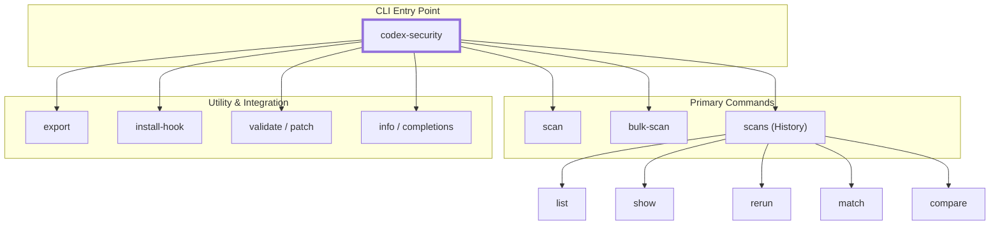
**Sources:** [sdk/typescript/src/cli.ts:79-146](), [sdk/typescript/tests-ts/cli.test.ts:75-85]()

---

### Global Flags and Output Modes

The CLI supports several global flags that modify execution behavior and output formatting across all commands.

| Flag | Description |
| :--- | :--- |
| `--json` | Outputs machine-readable JSON to `stdout`. Disables interactive progress bars. |
| `--schema` | Prints the JSON schema for the current command's arguments and options. |
| `--format` | Specifies output format (e.g., `json`, `csv`, `sarif`) for supported commands. |
| `--codex` | Pass configuration overrides as `key=value` pairs. [sdk/typescript/src/cli.ts:166]() |
| `--llms` | Displays the tool manifest and available LLM configurations. [sdk/typescript/tests-ts/cli.test.ts:123-126]() |

**Sources:** [sdk/typescript/src/cli.ts:94-121](), [sdk/typescript/tests-ts/cli.test.ts:88-107]()

---

### Signal Handling and Terminal State

The CLI implements robust signal handling to ensure that terminal states (like cursor visibility) are restored even if a scan is interrupted.

*   **SIGINT / SIGTERM:** When these signals are received, the CLI attempts to gracefully shut down the worker pool and close the `CodexSecurity` instance [sdk/typescript/src/cli.ts:218-221]().
*   **Progress UI:** During interactive scans, the CLI uses ANSI escape codes (`HIDE_CURSOR`, `SHOW_CURSOR`) to manage the `Progress` display [sdk/typescript/src/cli.ts:96-97]().
*   **Synchronous Cleanup:** The `writeSynchronously` utility ensures terminal cleanup commands are flushed to the file descriptor even during process exit [sdk/typescript/src/cli.ts:244-251]().

**Sources:** [sdk/typescript/src/cli.ts:54-55](), [sdk/typescript/src/cli.ts:218-221]()

---

### Detailed Command Groups

The CLI functionality is divided into three major areas, each documented in detail on its own child page:

#### 1. Scan Commands
The core analysis engine. Supports single-repository scans, path-based scanning, and differential scanning (analyzing changes between commits). Includes the `scans` management group for interacting with the local workbench history.
*   **Key Entities:** `ScanTarget`, `ScanMode`, `ScanResult`.
*   **For details, see [Scan Commands](#2.1).**

#### 2. Export, Validate, and Utility Commands
Tools for integrating Codex into the wider security ecosystem. This includes exporting results to standard formats like **SARIF**, validating findings against custom security skills, and installing **Git pre-commit hooks** to block insecure code from being committed.
*   **Key Entities:** `ExportArguments`, `SkillCommandOutput`.
*   **For details, see [Export, Validate, Patch, and Utility Commands](#2.2).**

#### 3. Bulk Scan and Multi-Repository Scanning
Designed for large-scale security audits across hundreds of repositories. Uses a worker pool to execute parallel scans and a ledger system to track progress and handle retries.
*   **Key Entities:** `runMultiscan`, `BulkScanDiscoveryDependencies`.
*   **For details, see [Bulk Scan and Multi-Repository Scanning](#2.3).**

---

### Code Mapping: CLI to SDK
The following diagram illustrates how CLI commands map to internal SDK classes and Python-based workbench entities.

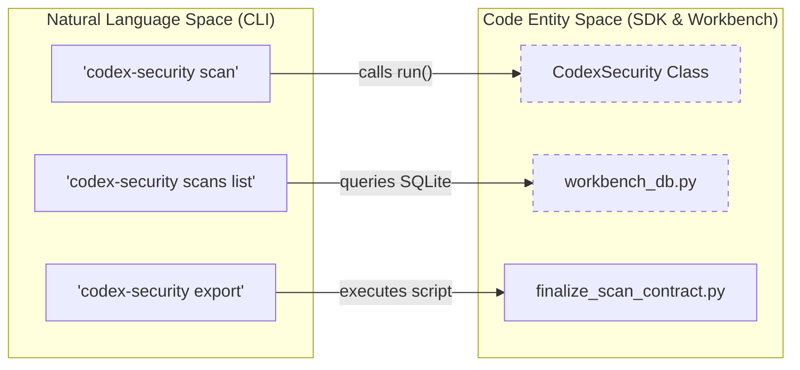
**Sources:** [sdk/typescript/src/cli.ts:32](), [sdk/typescript/src/runtime.ts:65](), [sdk/typescript/src/cli.ts:222-225]()

---

# Page: Scan Commands

# Scan Commands

<details>
<summary>Relevant source files</summary>

The following files were used as context for generating this wiki page:

- [sdk/typescript/src/cli.ts](sdk/typescript/src/cli.ts)
- [sdk/typescript/src/scan-comparison.ts](sdk/typescript/src/scan-comparison.ts)
- [sdk/typescript/src/scan-history-renderer.ts](sdk/typescript/src/scan-history-renderer.ts)
- [sdk/typescript/src/targets.ts](sdk/typescript/src/targets.ts)
- [sdk/typescript/tests-ts/cli.test.ts](sdk/typescript/tests-ts/cli.test.ts)
- [sdk/typescript/tests-ts/config.test.ts](sdk/typescript/tests-ts/config.test.ts)
- [sdk/typescript/tests-ts/contract.test.ts](sdk/typescript/tests-ts/contract.test.ts)
- [sdk/typescript/tests-ts/scan-comparison.test.ts](sdk/typescript/tests-ts/scan-comparison.test.ts)
- [sdk/typescript/tests-ts/scan-history-renderer.test.ts](sdk/typescript/tests-ts/scan-history-renderer.test.ts)
- [sdk/typescript/tests-ts/targets.test.ts](sdk/typescript/tests-ts/targets.test.ts)

</details>


The `codex-security` CLI provides a suite of commands for executing and managing security scans. These commands interface with the `CodexSecurity` SDK class to perform repository analysis, vulnerability discovery, and results management.

## Primary Scan Execution

The `scan` command is the primary entry point for analyzing a repository. It supports full repository scans, targeted path scans, and differential scans (Git diffs).

### Scan Targets and Modes

The CLI determines the scan scope based on the provided arguments and flags:

| Target Type | Command Pattern | Implementation Detail |
| :--- | :--- | :--- |
| **Full Repository** | `codex-security scan [repo]` | Scans all files within the repository root [sdk/typescript/src/targets.ts:165-167](). |
| **Path-limited** | `codex-security scan [repo] --path <file>` | Restricts analysis to specific files or directories [sdk/typescript/src/targets.ts:230-260](). |
| **Diff (Refs)** | `codex-security scan [repo] --diff <base>...<head>` | Scans the delta between two Git references [sdk/typescript/src/targets.ts:193-207](). |
| **Working Tree** | `codex-security scan [repo] --working-tree` | Scans uncommitted changes against a base (default `HEAD`) [sdk/typescript/src/targets.ts:209-216](). |

**Modes:**
*   `standard`: Optimized for speed and coverage of common vulnerabilities [sdk/typescript/src/cli.ts:160]().
*   `deep`: Performs multi-pass analysis for complex logic flaws [sdk/typescript/src/cli.ts:160]().

### Key Flags

*   `--knowledge-base <path>`: Provides supplementary documentation (e.g., threat models, architecture docs) to the LLM to improve context [sdk/typescript/src/cli.ts:155]().
*   `--max-cost <usd>`: Sets a hard limit on the scan cost. The process will terminate if polling indicates the budget is exceeded [sdk/typescript/src/cli.ts:169]().
*   `--fail-on-severity <level>`: Returns exit code `1` if findings at or above the specified severity (`critical`, `high`, `medium`, `low`) are discovered [sdk/typescript/src/cli.ts:168]().
*   `--mode <standard|deep>`: Sets the analysis depth [sdk/typescript/src/cli.ts:160]().

**Sources:** [sdk/typescript/src/cli.ts:152-173](), [sdk/typescript/src/targets.ts:158-217]()

---

## Scan Lifecycle and Data Flow

The following diagram illustrates the transition from a CLI command invocation to the execution of the underlying SDK and plugin logic.

### CLI to SDK Bridge

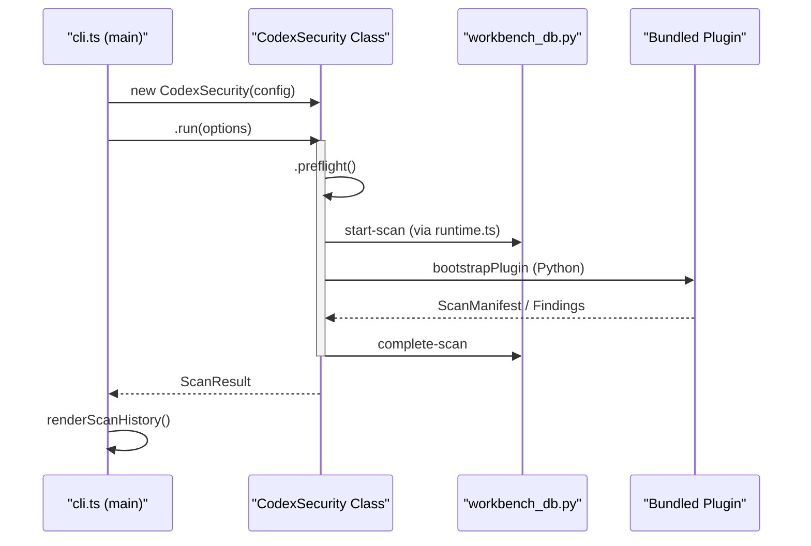
**Sources:** [sdk/typescript/src/cli.ts:235-243](), [sdk/typescript/src/api.ts:32-36](), [sdk/typescript/src/runtime.ts:65-67]()

---

## The `scans` Subcommand Group

The `scans` command provides management and historical analysis of previous scan results stored in the local SQLite workbench.

### Commands

| Subcommand | Purpose | Key Flags |
| :--- | :--- | :--- |
| `list` | Displays a table of historical scans for a repository [sdk/typescript/src/cli.ts:135](). | `--format json`, `--scan-root` |
| `show` | Provides detailed findings and metadata for a specific `scanId` [sdk/typescript/src/cli.ts:136](). | `--format json` |
| `rerun` | Re-executes a previous scan using the exact same configuration [sdk/typescript/src/cli.ts:137](). | N/A |
| `match` | Semantically matches findings between two scans to identify persisting issues [sdk/typescript/src/cli.ts:138](). | `--all` |
| `compare` | Renders a visual diff between two scans, highlighting new and resolved findings [sdk/typescript/src/cli.ts:141](). | N/A |

### Semantic Matching Implementation

The `scans match` and `scans compare` commands utilize an LLM-backed matching engine. This engine identifies if a finding in a "before" scan is the same root cause as a finding in an "after" scan, even if the code location or wording has shifted.

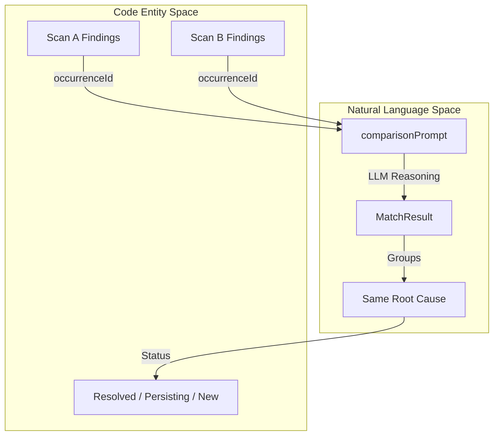
**Sources:** [sdk/typescript/src/scan-comparison.ts:69-72](), [sdk/typescript/src/scan-comparison.ts:124-135](), [sdk/typescript/src/scan-history-renderer.ts:16-23]()

---

## Bulk Scanning

The `bulk-scan` command facilitates scanning multiple repositories in parallel. It is designed for large-scale security audits and CI/CD environments.

*   **Discovery**: Can discover repositories via GitHub GraphQL API or a `repositories.csv` file [sdk/typescript/tests-ts/cli.test.ts:44-72]().
*   **Execution**: Spawns a worker pool to process repositories. It maintains a ledger to support resumability in case of interruption [sdk/typescript/src/cli.ts:57]().
*   **Wizard**: If run without arguments, it initiates an interactive wizard to configure the bulk scan [sdk/typescript/src/cli.ts:39]().

**Sources:** [sdk/typescript/src/cli.ts:38-41](), [sdk/typescript/src/multiscan.ts:57]()

---

## Configuration and Overrides

Scan behavior can be fine-tuned using TOML configuration or CLI overrides.

*   **Codex Overrides**: The `--codex` flag allows passing raw TOML strings to the underlying Codex engine (e.g., `--codex 'model_reasoning_effort="high"'`) [sdk/typescript/src/cli.ts:166]().
*   **Config Merging**: The CLI merges `DEFAULT_CODEX_CONFIG` with any local `codex-security.toml` and CLI overrides [sdk/typescript/src/config.ts:44-49]().
*   **Validation**: Overrides are validated to prevent illegal operations like disabling the multi-agent system or modifying protected plugin paths [sdk/typescript/tests-ts/config.test.ts:98-113]().

**Sources:** [sdk/typescript/src/cli.ts:166-167](), [sdk/typescript/src/config.ts:43-49](), [sdk/typescript/tests-ts/config.test.ts:31-48]()

---

# Page: Export, Validate, Patch, and Utility Commands

# Export, Validate, Patch, and Utility Commands

<details>
<summary>Relevant source files</summary>

The following files were used as context for generating this wiki page:

- [sdk/typescript/src/cli.ts](sdk/typescript/src/cli.ts)
- [sdk/typescript/tests-ts/cli-export.test.ts](sdk/typescript/tests-ts/cli-export.test.ts)
- [sdk/typescript/tests-ts/cli-fixtures.ts](sdk/typescript/tests-ts/cli-fixtures.ts)
- [sdk/typescript/tests-ts/cli-launcher.test.ts](sdk/typescript/tests-ts/cli-launcher.test.ts)
- [sdk/typescript/tests-ts/cli-signals.test.ts](sdk/typescript/tests-ts/cli-signals.test.ts)
- [sdk/typescript/tests-ts/cli-skills.test.ts](sdk/typescript/tests-ts/cli-skills.test.ts)
- [sdk/typescript/tests-ts/cli-workbench.test.ts](sdk/typescript/tests-ts/cli-workbench.test.ts)
- [sdk/typescript/tests-ts/cli.test.ts](sdk/typescript/tests-ts/cli.test.ts)

</details>


This page details the implementation and data flow for the `codex-security` CLI utility commands. These commands facilitate data portability (export), AI-assisted remediation and verification (validate/patch), and environment integration (hooks, completions, and MCP).

## Export Command

The `export` command transforms internal scan artifacts into standardized formats for ingestion by third-party tools. It operates independently of the main Codex scan engine and does not require an active API session [sdk/typescript/tests-ts/cli-export.test.ts:44-55]().

### Supported Formats
The CLI supports three primary export formats, defined in `EXPORT_DEFAULT_OUTPUTS` [sdk/typescript/src/cli.ts:117-121]():
*   **SARIF**: Static Analysis Results Interchange Format (v2.1.0) for IDE and CI integration.
*   **CSV**: A flat representation of findings for spreadsheet analysis.
*   **JSON**: The canonical `codex-security.findings` document type.

### Implementation and Data Flow
The export logic is executed via the `exportFindings` dependency [sdk/typescript/src/cli.ts:222-225](). It invokes a Python-based exporter within the bundled plugin. To ensure security, the CLI redacts sensitive credentials (like `OPENAI_API_KEY` or `GITHUB_TOKEN`) and restricts `PYTHONPATH` before spawning the exporter process [sdk/typescript/tests-ts/cli-export.test.ts:26-42]().

**Data Flow: Exporting Scan Results**
```mermaid
graph TD
    subgraph "CLI Space (TypeScript)"
        A["cli.ts: main()"] -->|"--format sarif"| B["cli.ts: exportFindings()"]
        B --> C["runtime.ts: runCodex()"]
    end

    subgraph "Plugin Space (Python)"
        C --> D["finalize_scan_contract.py"]
        D --> E["Findings JSONL"]
        E --> F["SARIF/CSV/JSON Output"]
    end

    F -->|Stream| G["stdout / File"]
    
    Sources: [sdk/typescript/src/cli.ts:117-121, 222-225](), [sdk/typescript/tests-ts/cli-export.test.ts:44-55]()
```

## Validate and Patch Commands

These commands leverage specific "skills" within the bundled plugin to perform targeted AI operations on findings.

### Validate Skill
The `validate` command uses the `validation` skill to re-verify findings. It accepts file paths or raw JSON literals as input [sdk/typescript/tests-ts/cli-skills.test.ts:14-18](). The CLI reads these inputs and passes them to the Codex engine with a specific `SKILL.md` contract that instructs the model to treat entries as data, not instructions [sdk/typescript/tests-ts/cli-skills.test.ts:68-71]().

### Patch Skill
The `patch` command utilizes the `fix-finding` skill to generate suggested code changes for identified vulnerabilities [sdk/typescript/tests-ts/cli-skills.test.ts:19]().

### Skill Execution Configuration
Both commands share a hardened configuration to prevent prompt injection and ensure deterministic behavior [sdk/typescript/tests-ts/cli-skills.test.ts:46-66]():
*   `--ignore-user-config`: Ensures a clean environment.
*   `--ephemeral`: Prevents state persistence between runs.
*   `approval_policy="never"`: Disables interactive prompts during skill execution.
*   `--sandbox workspace-write`: Restricts the AI's ability to modify the host filesystem outside the workspace.

**Natural Language Space to Code Entity Space: Skill Invocation**
```mermaid
graph LR
    subgraph "Natural Language (User Intent)"
        UI1["'Fix this finding'"]
        UI2["'Verify this vulnerability'"]
    end

    subgraph "Code Entity Space (codex-security)"
        UI1 -->|cli.ts| CMD1["'patch' command"]
        UI2 -->|cli.ts| CMD2["'validate' command"]
        
        CMD1 -->|SKILL_ID| S1["'fix-finding'"]
        CMD2 -->|SKILL_ID| S2["'validation'"]
        
        S1 --> P1["_bundled_plugin/skills/fix-finding/SKILL.md"]
        S2 --> P2["_bundled_plugin/skills/validation/SKILL.md"]
    end
    
    Sources: [sdk/typescript/tests-ts/cli-skills.test.ts:14-77](), [sdk/typescript/src/cli.ts:203-207]()
```

## Utility and Integration Commands

### Git Hook Integration (`install-hook`)
The `install-hook` command automates the setup of a git `pre-commit` hook. It is designed to block commits if a `codex-security scan` detects vulnerabilities above a specified severity threshold [sdk/typescript/tests-ts/cli.test.ts:158-182]().
*   **Behavior**: It detects the repository's `core.hooksPath` and writes a script that executes `codex-security scan . --working-tree --fail-on-severity <level>` [sdk/typescript/tests-ts/cli.test.ts:163-194]().
*   **Migration**: If an existing hook is detected, the CLI attempts to migrate it to the current version while preserving custom logic [sdk/typescript/tests-ts/cli.test.ts:197-217]().

### System Info and Completions
*   **`info`**: Displays versioning information for the CLI, SDK, and the bundled plugin [sdk/typescript/src/cli.ts:80-83]().
*   **`completions`**: Generates shell completion scripts (e.g., for `bash`) by utilizing the `incur` library's built-in support [sdk/typescript/tests-ts/cli.test.ts:146-156]().

### MCP Server Mode
The CLI can be launched in **Model Context Protocol (MCP)** mode using the `--mcp` flag. This exposes the scan capabilities as tools and resources that can be consumed by MCP-compliant LLM clients (like Claude Desktop). This mode is implemented via the bundled plugin's MCP server [sdk/typescript/src/cli.ts:146]().

## Signal Handling and Exit Codes

The CLI implements robust signal handling to ensure partial scan results are preserved even if the process is interrupted [sdk/typescript/tests-ts/cli-signals.test.ts:12-16]().

| Signal | Exit Code | Description |
| :--- | :--- | :--- |
| `SIGINT` (Ctrl-C) | `130` | Scan canceled; partial output kept at `/tmp/scan` [sdk/typescript/tests-ts/cli-signals.test.ts:14-36](). |
| `SIGTERM` | `143` | Scan terminated; partial output preserved [sdk/typescript/tests-ts/cli-signals.test.ts:15-80](). |
| Startup Failure | `2` | Generic error code for failures during process initialization [sdk/typescript/tests-ts/cli-launcher.test.ts:43-61](). |

**Data Flow: Signal Interruption Lifecycle**
```mermaid
graph TD
    subgraph "Process Monitoring"
        A["CLI Process"] -->|Listens for| B["SIGINT / SIGTERM"]
    end

    subgraph "Cleanup Logic (cli.ts)"
        B --> C["cli.ts: addSignalListener()"]
        C --> D["Abort Scan Lifecycle"]
        D --> E["cli.ts: writeSynchronously()"]
        E -->|Restore Terminal| F["Show Cursor (\u001B[?25h)"]
        D --> G["Report Partial Artifact Path"]
    end

    G --> H["Exit with 130/143"]

    Sources: [sdk/typescript/src/cli.ts:96-97, 218-221](), [sdk/typescript/tests-ts/cli-signals.test.ts:12-40]()
```

Sources: [sdk/typescript/src/cli.ts:1-251](), [sdk/typescript/tests-ts/cli.test.ts:74-218](), [sdk/typescript/tests-ts/cli-export.test.ts:1-67](), [sdk/typescript/tests-ts/cli-skills.test.ts:1-98](), [sdk/typescript/tests-ts/cli-signals.test.ts:1-115](), [sdk/typescript/tests-ts/cli-launcher.test.ts:43-61]()

---

# Page: Bulk Scan and Multi-Repository Scanning

# Bulk Scan and Multi-Repository Scanning

<details>
<summary>Relevant source files</summary>

The following files were used as context for generating this wiki page:

- [sdk/typescript/pnpm-lock.yaml](sdk/typescript/pnpm-lock.yaml)
- [sdk/typescript/src/bulk-scan-discovery.ts](sdk/typescript/src/bulk-scan-discovery.ts)
- [sdk/typescript/src/cli.ts](sdk/typescript/src/cli.ts)
- [sdk/typescript/src/multiscan.ts](sdk/typescript/src/multiscan.ts)
- [sdk/typescript/tests-ts/bulk-scan-discovery.test.ts](sdk/typescript/tests-ts/bulk-scan-discovery.test.ts)
- [sdk/typescript/tests-ts/multiscan.test.ts](sdk/typescript/tests-ts/multiscan.test.ts)

</details>


The `bulk-scan` capability provides a high-throughput orchestration layer for running security scans across multiple repositories. It automates the discovery of repositories via the GitHub GraphQL API, manages a local inventory, and executes scans in parallel using a resumable worker pool architecture.

## Repository Discovery and Wizard

The `runBulkScanWizard` function provides an interactive CLI experience for selecting targets when no inventory is provided [sdk/typescript/src/bulk-scan-discovery.ts:130-133](). It leverages the GitHub CLI (`gh`) for authentication and uses the `@octokit/core` library to query the GitHub GraphQL API [sdk/typescript/src/bulk-scan-discovery.ts:96-126]().

### Discovery Data Flow
1.  **Authentication**: The system attempts to resolve a trusted `gh` executable and retrieves an OAuth token for the specified host (defaulting to `github.com`) [sdk/typescript/src/bulk-scan-discovery.ts:108-125]().
2.  **Owner Selection**: Fetches organizations the user belongs to or defaults to the personal account [sdk/typescript/src/bulk-scan-discovery.ts:195-216]().
3.  **GraphQL Query**: Executes `GITHUB_REPOSITORIES_QUERY` to find non-archived, non-fork repositories pushed within the last 90 days [sdk/typescript/src/bulk-scan-discovery.ts:14-33]().
4.  **Inventory Creation**: Discovered repositories are written to a `repositories.csv` file in the specified output directory [sdk/typescript/src/bulk-scan-discovery.ts:181-191]().

**Sources:** [sdk/typescript/src/bulk-scan-discovery.ts:14-33](), [sdk/typescript/src/bulk-scan-discovery.ts:96-126](), [sdk/typescript/src/bulk-scan-discovery.ts:130-193]()

## Inventory Management (`repositories.csv`)

The inventory is a CSV file that defines the worklist for the bulk scan. It supports standard CSV formatting, including quoted fields and embedded delimiters [sdk/typescript/tests-ts/multiscan.test.ts:183-189]().

| Column | Description |
| :--- | :--- |
| `id` | A unique identifier for the repository (used for directory naming). |
| `repository` | The URL or local path to the repository. |
| `revision` | The specific git commit OID to scan. |
| `scope` | (Optional) A subdirectory within the repository to restrict the scan. |
| `mode` | (Optional) The scan mode (`standard` or `deep`). |

**Sources:** [sdk/typescript/src/multiscan.ts:31-37](), [sdk/typescript/tests-ts/multiscan.test.ts:183-189]()

## Parallel Execution and Worker Pool

The `runMultiscan` function manages the execution of the inventory using a worker pool pattern [sdk/typescript/src/multiscan.ts:75-77]().

### Implementation Details
-   **Parallelism**: Controlled by the `--workers` flag. The system spawns a set of asynchronous worker loops that pull tasks from a shared `pending` queue [sdk/typescript/src/multiscan.ts:138-144]().
-   **Isolation**: Each worker creates a dedicated checkout directory under `checkouts/<id>` for every task [sdk/typescript/src/multiscan.ts:162-163]().
-   **Cleanup**: Repositories are removed from the local disk immediately after the scan completes or fails [sdk/typescript/src/multiscan.ts:195-195]().
-   **Signal Handling**: Workers monitor an `AbortSignal` to stop execution gracefully if the user interrupts the process [sdk/typescript/src/multiscan.ts:142-142]().

### Multi-Scan System Interaction
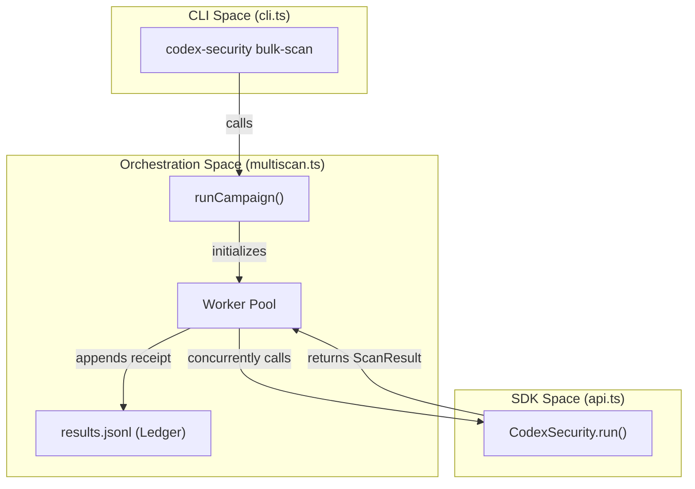
**Sources:** [sdk/typescript/src/multiscan.ts:75-98](), [sdk/typescript/src/multiscan.ts:138-221](), [sdk/typescript/src/cli.ts:57-57]()

## Ledger-Based Resumability

Bulk scans are designed to be resumable. Progress is tracked in a `results.jsonl` ledger located in the output directory [sdk/typescript/src/multiscan.ts:105-105]().

1.  **Receipts**: Every successful or failed scan attempt is appended to the ledger as a `MultiscanReceipt` [sdk/typescript/src/multiscan.ts:39-45]().
2.  **State Recovery**: Upon startup, `runCampaign` reads the ledger to determine which repositories have already been successfully scanned [sdk/typescript/src/multiscan.ts:109-113]().
3.  **Artifact Verification**: A scan is only considered "completed" and skipped if its `results.jsonl` entry exists AND the required artifacts (`findings.json`, `coverage.json`, etc.) are present on disk [sdk/typescript/src/multiscan.ts:114-121]().

**Sources:** [sdk/typescript/src/multiscan.ts:24-29](), [sdk/typescript/src/multiscan.ts:105-124](), [sdk/typescript/src/multiscan.ts:198-208]()

## Retry Logic and Error Handling

The system implements a retry mechanism to handle transient failures (e.g., network issues during checkout or API timeouts).

-   **Attempts**: The `--max-attempts` flag controls how many times a worker will try to scan a single repository [sdk/typescript/src/multiscan.ts:146-146]().
-   **Error Redaction**: Error messages are passed through `redactError` to remove sensitive path information before being logged to the ledger [sdk/typescript/src/multiscan.ts:193-193]().
-   **Completeness Guard**: If a scan finishes but the coverage report indicates it is not "complete", it is treated as a failure to trigger a retry [sdk/typescript/src/multiscan.ts:188-190]().

**Sources:** [sdk/typescript/src/multiscan.ts:146-219](), [sdk/typescript/src/multiscan.ts:188-190]()

## Locking and Concurrency Safety

To prevent multiple CLI instances from corrupting the same output directory, the system implements a file-based locking mechanism.

### Multi-Process Locking
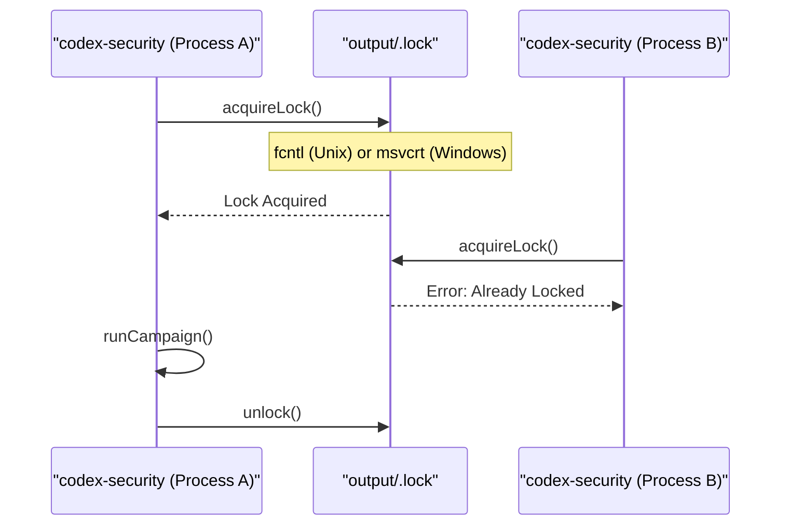
The implementation uses `acquireLock` at the start of `runMultiscan`, which creates a `.lock` file in the output directory [sdk/typescript/src/multiscan.ts:92-92]().

**Sources:** [sdk/typescript/src/multiscan.ts:92-97](), [sdk/typescript/src/multiscan.ts:75-98]()

---

# Page: TypeScript SDK

# TypeScript SDK

<details>
<summary>Relevant source files</summary>

The following files were used as context for generating this wiki page:

- [sdk/typescript/src/api.ts](sdk/typescript/src/api.ts)
- [sdk/typescript/src/errors.ts](sdk/typescript/src/errors.ts)
- [sdk/typescript/src/index.ts](sdk/typescript/src/index.ts)
- [sdk/typescript/tests-ts/api.test.ts](sdk/typescript/tests-ts/api.test.ts)

</details>


The `@openai/codex-security` SDK provides a high-level TypeScript API for orchestrating security scans. It manages the lifecycle of the bundled Python plugin, handles authentication, tracks scan costs in real-time, and enforces security boundaries for scan artifacts. The SDK is designed to be used both by the official CLI and as a library for custom integrations.

### Core Architecture

The SDK is centered around the `CodexSecurity` class [sdk/typescript/src/api.ts:210-210](), which acts as the primary entry point for all operations. It bridges the gap between the high-level scan requests and the underlying `Codex` agentic runtime.

The following diagram illustrates the relationship between the SDK's public API surface and the internal execution entities.

**SDK to Code Entity Mapping**
```mermaid
graph TD
    subgraph "Natural Language Space"
        User["User Application / CLI"]
        ScanRequest["Scan Request"]
        ScanResult["Scan Result"]
    end

    subgraph "Code Entity Space (TypeScript SDK)"
        CS["CodexSecurity Class"]
        SO["ScanOptions Interface"]
        RT["runtime.ts (Plugin Bootstrap)"]
        CT["ScanCostTracker"]
        WS["ScanWorkerStatus"]
    end

    subgraph "Execution Space"
        BP["_bundled_plugin (Python)"]
        CA["Codex Agent Runtime"]
    end

    User -->|instantiates| CS
    User -->|provides| SO
    CS -->|calls run()| RT
    RT -->|launches| BP
    CS -->|monitors| CT
    CS -->|emits| WS
    BP -->|executes via| CA
    CS -->|returns| ScanResult
```
Sources: [sdk/typescript/src/api.ts:210-242](), [sdk/typescript/src/runtime.ts:50-69](), [sdk/typescript/src/cost.ts:22-22](), [sdk/typescript/src/worker-progress.ts:45-47]()

---

### Main API Surface

The SDK exports a set of core classes and types from its entry point [sdk/typescript/src/index.ts:1-74]().

| Entity | Role |
| :--- | :--- |
| `CodexSecurity` | Main orchestrator for scans and authentication. |
| `ScanOptions` | Configuration for a specific scan (targets, modes, hooks). |
| `ScanResult` | Container for scan findings, coverage, and metadata. |
| `CodexLoginHandle` | Manages active authentication sessions (API key or ChatGPT). |
| `ScanCost` | Real-time breakdown of token usage and USD estimates. |

For a deep dive into the primary orchestrator, see [CodexSecurity Class and Scan Lifecycle](#3.1).

---

### Execution and Environment

The SDK does not perform analysis itself; instead, it bootstraps a specialized environment for the `_bundled_plugin`. This involves:
1.  **Plugin Resolution**: Locating the bundled Python plugin or extracting it from a zip.
2.  **Runtime Validation**: Ensuring a compatible Python 3.10+ interpreter is available.
3.  **Isolation**: Creating a `CODEX_HOME` directory and ensuring scan outputs are placed outside of protected repository roots.

For details on how the environment is prepared, see [Runtime and Plugin Bootstrap](#3.2).

---

### Configuration and Targets

Scanning supports various `ScanTarget` types, including local paths, full git repositories, and specific diffs (e.g., comparing a branch to the working tree) [sdk/typescript/src/targets.ts:78-78](). Configuration is managed via a hierarchy of defaults, TOML files, and runtime overrides.

For details on target normalization and configuration merging, see [Scan Targets and Configuration](#3.3).

---

### Monitoring and Cost Control

Because scans utilize LLMs, the SDK provides robust mechanisms to track and limit costs. The `ScanCostTracker` polls session logs to aggregate token usage across all agent threads [sdk/typescript/src/cost.ts:22-22]().

**Scan Execution Flow**
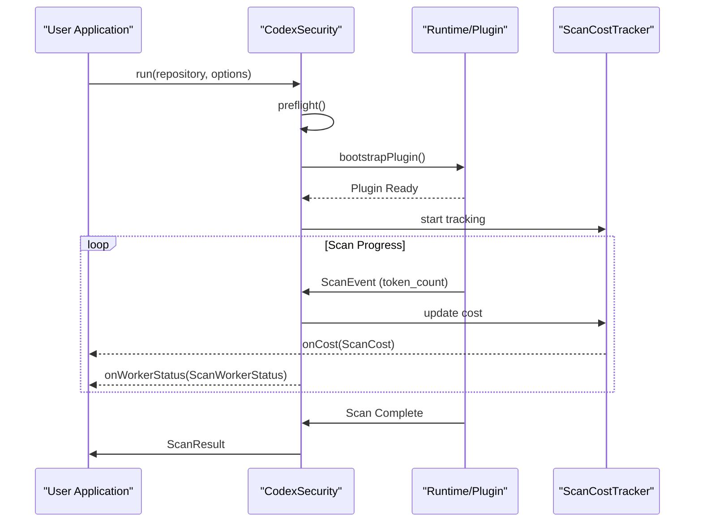
Sources: [sdk/typescript/src/api.ts:237-330](), [sdk/typescript/src/cost.ts:22-22](), [sdk/typescript/src/worker-progress.ts:45-47]()

For details on cost estimation and progress tracking, see [Cost Tracking and Worker Progress](#3.4).

---

### Authentication

The SDK supports multiple authentication flows, including OpenAI API keys and ChatGPT device-based login [sdk/typescript/src/auth.ts:9-14](). Credentials can be imported from the ambient environment or persisted locally.

For details on authentication handles and flows, see [Authentication](#3.5).

---

### Error Hierarchy

All SDK errors inherit from `CodexSecurityError` [sdk/typescript/src/errors.ts:4-9](). The hierarchy allows for precise handling of common failure modes:

*   `AuthenticationRequiredError`: Triggered when no valid credentials are found.
*   `ScanCostLimitExceededError`: Raised if the estimated USD cost exceeds the user-defined `maxCostUsd` [sdk/typescript/src/errors.ts:41-41]().
*   `OutputInsideProtectedRootError`: A security guard preventing artifacts from being written into the source repository [sdk/typescript/src/errors.ts:19-19]().
*   `PluginPythonUnavailableError`: Raised if a valid Python interpreter cannot be found during bootstrap.

For the full schema of results and error details, see [Data Models and Contracts](#3.6).

---
**Sources:**
- [sdk/typescript/src/api.ts:210-330]()
- [sdk/typescript/src/index.ts:1-74]()
- [sdk/typescript/src/errors.ts:1-58]()
- [sdk/typescript/src/runtime.ts:50-69]()
- [sdk/typescript/src/targets.ts:78-81]()

---

# Page: CodexSecurity Class and Scan Lifecycle

# CodexSecurity Class and Scan Lifecycle

<details>
<summary>Relevant source files</summary>

The following files were used as context for generating this wiki page:

- [sdk/typescript/src/api.ts](sdk/typescript/src/api.ts)
- [sdk/typescript/src/result.ts](sdk/typescript/src/result.ts)
- [sdk/typescript/tests-ts/api-events.test.ts](sdk/typescript/tests-ts/api-events.test.ts)
- [sdk/typescript/tests-ts/api-integration.test.ts](sdk/typescript/tests-ts/api-integration.test.ts)
- [sdk/typescript/tests-ts/api.test.ts](sdk/typescript/tests-ts/api.test.ts)
- [sdk/typescript/tests-ts/result.test.ts](sdk/typescript/tests-ts/result.test.ts)
- [sdk/typescript/tests-ts/support/api-events.ts](sdk/typescript/tests-ts/support/api-events.ts)

</details>


The `CodexSecurity` class is the primary entry point for the TypeScript SDK, providing a high-level API to orchestrate security scans. It manages the lifecycle of a scan—from environment preflight and output directory isolation to real-time event monitoring and final result collection.

### Overview

The `CodexSecurity` class encapsulates the complexity of the underlying `codex` executable and the bundled Python plugin. It handles authentication, cost tracking, and provides hooks for observing scan progress.

The core execution flow is encapsulated in the `run()` method, which performs a sequence of validation and execution steps to ensure scan integrity and security.

### Scan Execution Pipeline

The scan lifecycle follows a strict sequence to maintain the "Protected Root" security model and ensure all dependencies (Python, Codex, and Plugins) are correctly configured.

#### Logic Flow: `run()`

1.  **Validation**: Validates the repository path and scan mode [sdk/typescript/src/api.ts:249-251]().
2.  **Runtime Preparation**: Resolves the Python interpreter, bootstraps the security plugin, and prepares the isolated `CODEX_HOME` [sdk/typescript/src/api.ts:253-254]().
3.  **Output Directory Setup**: Creates a private, isolated directory for scan artifacts, ensuring it is not inside the scanned repository [sdk/typescript/src/api.ts:260-264]().
4.  **Workbench Registration**: Initializes the SQLite workbench for the new scan [sdk/typescript/src/api.ts:278-282]().
5.  **Thread Execution**: Starts a Codex thread and streams events from the plugin [sdk/typescript/src/api.ts:311-320]().
6.  **Result Collection**: Finalizes the scan contract, estimates costs, and returns a `ScanResult` object [sdk/typescript/src/api.ts:322-337]().

#### Data Flow: Natural Language Space to Code Entities

The following diagram maps high-level scan concepts to their specific implementation classes and functions.

Title: Mapping Scan Concepts to Code Entities
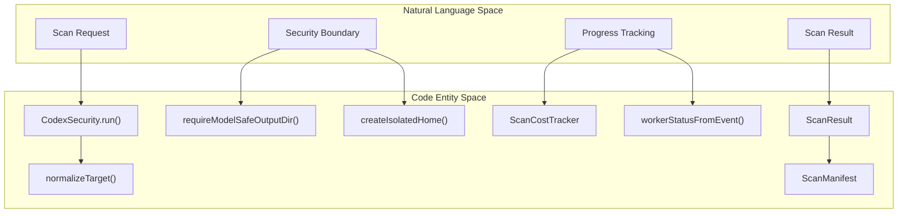
**Sources:** [sdk/typescript/src/api.ts:237-242](), [sdk/typescript/src/targets.ts:73-73](), [sdk/typescript/src/runtime.ts:53-69](), [sdk/typescript/src/cost.ts:22-22](), [sdk/typescript/src/worker-progress.ts:45-45](), [sdk/typescript/src/result.ts:30-30]().

---

### The `CodexSecurity` Class

#### Constructor and Configuration
The constructor accepts an optional `CodexSecurityConfig` which allows overriding default behaviors like model selection or sandbox permissions [sdk/typescript/src/api.ts:228-235]().

#### `preflight()`
The `preflight()` method allows callers to inspect the scan configuration (target resolution, authentication status, and estimated model usage) without actually starting the scan [sdk/typescript/src/api.ts:244-247](). It returns a `ScanPreflight` object containing:
*   Resolved `NormalizedTarget`.
*   Authentication method used (API Key vs. Stored Credentials).
*   Selected model and reasoning effort.
*   Calculated output and archive directories [sdk/typescript/src/api.ts:164-175]().

#### `run()`
The primary execution method. It takes a repository path and `ScanOptions`. It is wrapped in `#trackOperation` to prevent concurrent operations on a single class instance [sdk/typescript/src/api.ts:237-242]().

#### `close()`
Performs cleanup of temporary resources, including the `bootstrapWorkspace` and any active login handles [sdk/typescript/src/api.ts:365-385]().

**Sources:** [sdk/typescript/src/api.ts:210-385]().

---

### ScanOptions and Event Hooks

The `ScanOptions` interface allows consumers to react to the scan's progress in real-time through various callbacks.

| Hook | Description |
| :--- | :--- |
| `onCost` | Triggered when token usage is updated; provides `ScanCost` (USD estimate) [sdk/typescript/src/api.ts:124-124](). |
| `onWorkerStatus` | Reports the current phase of the scan (e.g., `discovery`, `analyzing`, `finalizing`) [sdk/typescript/src/api.ts:134-134](). |
| `onReconnect` | Fired if the Codex stream encounters a network or rate-limit error and attempts to resume [sdk/typescript/src/api.ts:129-133](). |
| `onAuthentication` | Reports which credential source is being used for the scan [sdk/typescript/src/api.ts:127-127](). |
| `onOutputDirReady` | Provides the absolute path to the isolated directory where artifacts are being written [sdk/typescript/src/api.ts:126-126](). |

**Sources:** [sdk/typescript/src/api.ts:114-137]().

---

### Scan Lifecycle Sequence

The following diagram illustrates the interaction between the `CodexSecurity` SDK, the `Codex` CLI executable, and the Python `plugin`.

Title: Scan Lifecycle Execution Sequence
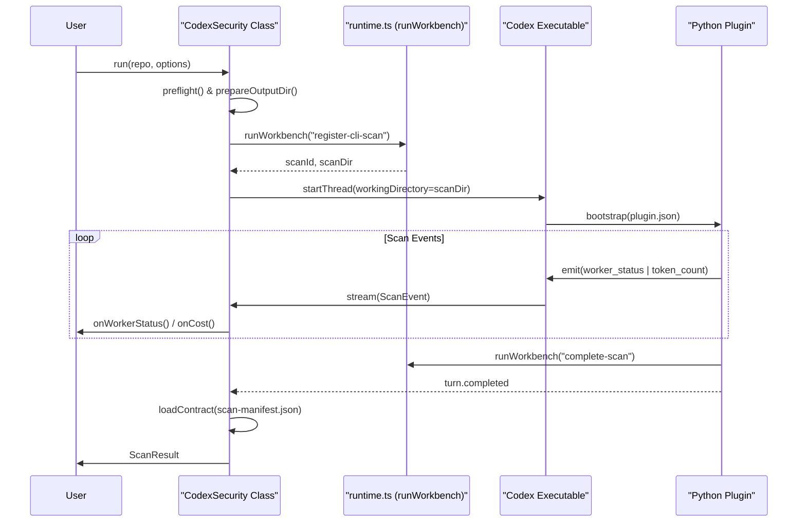
**Sources:** [sdk/typescript/src/api.ts:237-340](), [sdk/typescript/src/runtime.ts:63-63](), [sdk/typescript/src/worker-progress.ts:45-47](), [sdk/typescript/src/result.ts:30-46]().

---

### Result Collection and `ScanResult`

Upon successful completion, the SDK aggregates data from the output directory to construct a `ScanResult` object [sdk/typescript/src/api.ts:335-337]().

*   **Manifest**: Loaded from `scan-manifest.json`, containing scan metadata [sdk/typescript/src/result.ts:79-81]().
*   **Findings**: Loaded from `findings.json` [sdk/typescript/src/result.ts:83-85]().
*   **Coverage**: Loaded from `coverage.json` [sdk/typescript/src/result.ts:87-89]().
*   **Cost**: Calculated using `estimateScanCost` based on final token usage [sdk/typescript/src/result.ts:47-50]().
*   **SARIF**: Automatically discovers `exports/results.sarif` if it exists [sdk/typescript/src/result.ts:54-68]().

**Sources:** [sdk/typescript/src/result.ts:30-109]().

---

# Page: Runtime and Plugin Bootstrap

# Runtime and Plugin Bootstrap

<details>
<summary>Relevant source files</summary>

The following files were used as context for generating this wiki page:

- [sdk/typescript/src/runtime.ts](sdk/typescript/src/runtime.ts)
- [sdk/typescript/src/trusted-executable.ts](sdk/typescript/src/trusted-executable.ts)
- [sdk/typescript/src/version.ts](sdk/typescript/src/version.ts)
- [sdk/typescript/tests-ts/plugin-root.ts](sdk/typescript/tests-ts/plugin-root.ts)
- [sdk/typescript/tests-ts/runtime.test.ts](sdk/typescript/tests-ts/runtime.test.ts)
- [sdk/typescript/tests-ts/skeleton.test.ts](sdk/typescript/tests-ts/skeleton.test.ts)
- [sdk/typescript/tests-ts/trusted-executable.test.ts](sdk/typescript/tests-ts/trusted-executable.test.ts)

</details>


The runtime system in `@openai/codex-security` is responsible for preparing the execution environment required to run security scans. This includes locating the Python-based plugin, setting up isolated home directories, validating the Python interpreter, and ensuring output directories are safe and correctly permissioned.

## Plugin Resolution and Marketplace

The SDK supports two primary modes for plugin resolution: using a bundled plugin (shipped within the npm package) or extracting a plugin from a ZIP archive. The system organizes these into a "Marketplace" structure within the user's state directory.

### Key Functions
- `bundledPluginRoot()`: Locates the plugin directory by checking `bundledPluginCandidates`. It searches for a directory containing a valid `.codex-plugin/plugin.json` manifest [sdk/typescript/src/runtime.ts:186-196]().
- `createMarketplace()`: Creates a structured marketplace directory. If the source is a local directory (like the bundled plugin), it projects the files into the marketplace, ensuring only files allowed by the `plugin-files.json` contract are copied [sdk/typescript/tests-ts/runtime.test.ts:132-164]().
- `extractPluginZip()`: Handles secure extraction of plugin ZIP files, enforcing limits on entry counts, file sizes, and total expanded size to prevent zip-bomb attacks [sdk/typescript/src/runtime.ts:51-54]().

### Plugin Discovery Flow
The following diagram illustrates how the `CodexSecurity` client resolves the plugin path during initialization.

**Title: Plugin Resolution Logic**
```mermaid
graph TD
    subgraph "Natural Language Space"
        "User Config"
        "NPM Package"
        "State Directory"
    end

    subgraph "Code Entity Space"
        direction TB
        C["CodexSecurity Class"] -->|checks| P["config.pluginPath"]
        P -->|undefined| B["bundledPluginRoot()"]
        B -->|searches| BC["bundledPluginCandidates()"]
        BC -->|looks in| D1["dist/_bundled_plugin"]
        BC -->|looks in| D2["_bundled_plugin"]
        
        P -->|defined| RPP["resolvePluginPath()"]
        RPP -->|is .zip| EPZ["extractPluginZip()"]
        RPP -->|is dir| CM["createMarketplace()"]
        
        CM -->|writes to| MK["MARKETPLACE_NAME"]
    end
```
Sources: [sdk/typescript/src/runtime.ts:48-49](), [sdk/typescript/src/runtime.ts:173-196](), [sdk/typescript/tests-ts/runtime.test.ts:89-105]()

## Python Interpreter Validation

The plugin relies on a Python 3.10+ environment. The `resolvePluginPython` function performs a "probe" to ensure the interpreter is valid and has the necessary capabilities.

### Validation Steps
1. **Trusted Resolution**: Uses `resolveTrustedExecutable` to find a `python3` or `python` binary that is not located inside the repository being scanned (to prevent execution of malicious shims) [sdk/typescript/src/trusted-executable.ts:10-27]().
2. **Version Probe**: Executes the candidate Python with a script to verify its version and environment [sdk/typescript/src/runtime.ts:43-44]().
3. **Environment Sanitization**: Removes potentially dangerous environment variables and ensures `PATH` does not point into the scan target [sdk/typescript/src/trusted-executable.ts:75-82]().

### Interpreter Probing Flow
**Title: Python Validation Probe**
```mermaid
graph LR
    subgraph "Natural Language Space"
        "OS Path"
        "Python Binary"
        "Security Guard"
    end

    subgraph "Code Entity Space"
        direction TB
        RPP["resolvePluginPython()"] --> RTE["resolveTrustedExecutable()"]
        RTE -->|filter| PW["isWithin(protectedRoot)"]
        RTE -->|returns| TE["TrustedExecutable"]
        
        RPP -->|exec| CP["config_preflight.py"]
        CP -->|validates| V["Python 3.10+"]
        V -->|success| PPE["pluginExecutionEnvironment()"]
    end
```
Sources: [sdk/typescript/src/runtime.ts:77-84](), [sdk/typescript/src/trusted-executable.ts:10-14](), [sdk/typescript/src/trusted-executable.ts:85-90]()

## Output Directory Guards

To prevent data loss and ensure security, the runtime enforces strict rules on where scan results can be stored.

- **Isolation**: The output directory must not be inside the repository being scanned [sdk/typescript/src/runtime.ts:205]().
- **Permissions**: The directory must be private (typically `0700` on POSIX) to prevent other users on the system from reading sensitive scan artifacts [sdk/typescript/src/runtime.ts:117]().
- **Empty Check**: By default, the directory must be empty. If `archiveExisting` is true, the runtime uses `planOutputArchive` to move existing contents to a timestamped sub-directory [sdk/typescript/src/runtime.ts:218-222]().
- **Path Validation**: Paths containing unsafe control characters or line separators (matching `MODEL_UNSAFE_PATH`) are rejected [sdk/typescript/src/runtime.ts:59]().

### Key Functions
| Function | Responsibility |
| :--- | :--- |
| `prepareOutputDir` | Orchestrates the creation, permissioning, and archiving of the output path [sdk/typescript/src/runtime.ts:201-237](). |
| `requirePrivateOutputDirectory` | Verifies the directory is not a symlink and has restrictive permissions [sdk/typescript/src/runtime.ts:223](). |
| `createIsolatedHome` | Creates a temporary `CODEX_HOME` for the plugin to ensure it does not leak state between runs [sdk/typescript/tests-ts/runtime.test.ts:33](). |

Sources: [sdk/typescript/src/runtime.ts:59](), [sdk/typescript/src/runtime.ts:112-119](), [sdk/typescript/src/runtime.ts:198-226]()

## Runtime State and Workbench

The runtime maintains a persistent state directory, typically located at `~/.codex/state/plugins/codex-security` or defined by `CODEX_SECURITY_DIR`.

### Persistent Scan Root
The function `preparePersistentScanRoot` creates a repository-specific directory within the state folder. It uses a `safePrefix` of the repository name to ensure the path is filesystem-friendly [sdk/typescript/src/runtime.ts:112-119]().

### Workbench Execution
The `runWorkbench` function is the bridge between the TypeScript SDK and the Python `workbench_db.py` script. It handles:
- **Process Spawning**: Uses `execFile` with `-I` (isolated mode) and `-B` (no pyc files) [sdk/typescript/src/runtime.ts:127-134]().
- **Credential Redaction**: Explicitly filters out `OPENAI_API_KEY` and `CODEX_API_KEY` from the environment passed to the workbench to prevent accidental leakage into SQLite logs or error messages [sdk/typescript/src/runtime.ts:137-142]().
- **JSON Communication**: Captures `stdout` and parses it as a `JsonObject` [sdk/typescript/src/runtime.ts:156-170]().

Sources: [sdk/typescript/src/runtime.ts:94-110](), [sdk/typescript/src/runtime.ts:121-171]()

---

# Page: Scan Targets and Configuration

# Scan Targets and Configuration

<details>
<summary>Relevant source files</summary>

The following files were used as context for generating this wiki page:

- [sdk/typescript/_bundled_plugin/.mcp.json](sdk/typescript/_bundled_plugin/.mcp.json)
- [sdk/typescript/src/config.ts](sdk/typescript/src/config.ts)
- [sdk/typescript/src/knowledge-base.ts](sdk/typescript/src/knowledge-base.ts)
- [sdk/typescript/src/targets.ts](sdk/typescript/src/targets.ts)
- [sdk/typescript/tests-ts/config.test.ts](sdk/typescript/tests-ts/config.test.ts)
- [sdk/typescript/tests-ts/contract.test.ts](sdk/typescript/tests-ts/contract.test.ts)
- [sdk/typescript/tests-ts/knowledge-base.test.ts](sdk/typescript/tests-ts/knowledge-base.test.ts)
- [sdk/typescript/tests-ts/targets.test.ts](sdk/typescript/tests-ts/targets.test.ts)

</details>


This section details how Codex Security defines, validates, and normalizes the subjects of a security scan, alongside the configuration system that governs the behavior of the underlying AI agents.

## Scan Targets

A `ScanTarget` represents the scope of analysis. The SDK supports three primary categories of targets: full repositories, specific file paths, and Git-based differences.

### ScanTarget Types

| Type | Description | Code Entity |
| :--- | :--- | :--- |
| **Repository** | Scans the entire directory content. | `"repository"` |
| **Paths** | Scans a specific subset of files or directories. | `readonly string[]` |
| **DiffTarget** | Scans changes between refs or the working tree. | `DiffTarget` class |

### Target Normalization
The `normalizeTarget` function [sdk/typescript/src/targets.ts:158-162]() is responsible for converting raw user input into a `NormalizedTarget`. This process ensures that all paths are relative to the repository root and that Git references are resolved to immutable commit SHAs.

1.  **Repository Validation**: The root directory is resolved via `realpath` and checked for existence [sdk/typescript/src/targets.ts:98-119]().
2.  **Path Sanitization**: For path-based targets, the system rejects empty paths or paths that escape the repository boundary [sdk/typescript/src/targets.ts:238-255]().
3.  **Git Ref Resolution**: For `DiffTarget`, the system executes `git rev-parse` to bind human-readable refs (like `HEAD` or `main`) to specific commit IDs [sdk/typescript/src/targets.ts:192-216]().

### DiffTarget Specifications
The `DiffTarget` class [sdk/typescript/src/targets.ts:30-80]() provides two primary modes:
*   **Refs**: Compares two specific Git references (e.g., `base: "main"`, `head: "feature-branch"`).
*   **Working Tree**: Compares a base reference against the current uncommitted state of the filesystem.

**Sources:** [sdk/typescript/src/targets.ts:21-96](), [sdk/typescript/tests-ts/targets.test.ts:112-198]()

---

## Configuration System

Codex Security uses a hierarchical configuration system that merges internal defaults with user-provided overrides.

### Data Flow: Natural Language to Code Entity Space

The following diagram illustrates how configuration flows from raw TOML/JSON overrides into the structured `ScanModelConfiguration` used by the SDK.

```mermaid
graph TD
    subgraph "Natural Language / User Input"
        TOML["codexOverrides (TOML Table)"]
        ENV["Environment Variables (CODEX_API_KEY)"]
    end

    subgraph "Code Entity Space (sdk/typescript/src/config.ts)"
        DDC["DEFAULT_CODEX_CONFIG"]
        MCF["mergedCodexConfig()"]
        SMC["ScanModelConfiguration"]
        VNA["validateNativeMultiAgentV2Overrides()"]
    end

    TOML --> MCF
    DDC --> MCF
    MCF --> VNA
    VNA --> SMC
    SMC -->|used by| SDK["CodexSecurity.run()"]
```
**Sources:** [sdk/typescript/src/config.ts:24-72](), [sdk/typescript/tests-ts/config.test.ts:30-48]()

### CodexSecurityConfig and Overrides
The `CodexSecurityConfig` interface [sdk/typescript/src/config.ts:13-17]() accepts `codexOverrides`, which are deep-merged with `DEFAULT_CODEX_CONFIG`.

*   **Default Model**: The system defaults to `gpt-5.6-sol` with `xhigh` reasoning effort [sdk/typescript/src/config.ts:24-36]().
*   **Validation**: Overrides are strictly validated to prevent prototype pollution [sdk/typescript/src/config.ts:109-121]() and to ensure that internal plugin loading logic is not subverted by the user [sdk/typescript/src/config.ts:123-139]().
*   **Multi-Agent V2**: The system enforces the use of the `multi_agent_v2` feature set. Attempts to disable this or use legacy `agents.max_threads` settings result in a `ConfigurationError` [sdk/typescript/src/config.ts:169-201]().

### Atomic Configuration Writing
When the SDK needs to persist configuration (e.g., for the bundled plugin), it uses `writeCodexConfig` [sdk/typescript/src/config.ts:74-107](). This function ensures:
1.  **Atomicity**: Writes to a temporary file and uses `rename` to prevent partial writes.
2.  **Security**: Files are created with `0o600` permissions (read/write by owner only) [sdk/typescript/src/config.ts:91-94]().

**Sources:** [sdk/typescript/src/config.ts:61-107](), [sdk/typescript/tests-ts/config.test.ts:158-175]()

---

## Knowledge Base Feature

The Knowledge Base allows users to provide supplementary documentation (e.g., architecture docs, threat models) to the AI agents to improve scan context.

### Document Processing Pipeline

```mermaid
sequenceDiagram
    participant U as User Paths
    participant P as prepareKnowledgeBase()
    participant D as Document Discovery
    participant E as Text Extraction
    participant T as Temporary Storage

    U->>P: [dir/, doc.pdf, doc.docx]
    P->>D: Filter by SUPPORTED_EXTENSIONS (.md, .txt, .pdf, .docx)
    D-->>P: List of valid files
    loop Each Document
        P->>E: extractPdf() or extractDocx()
        E-->>P: Plain Text
        P->>T: Write to {index}-{name}.txt (0o600)
    end
    P-->>U: PreparedKnowledgeBase { path, cleanup() }
```
**Sources:** [sdk/typescript/src/knowledge-base.ts:29-112](), [sdk/typescript/tests-ts/knowledge-base.test.ts:78-106]()

### Implementation Details
*   **Supported Formats**: `.md`, `.markdown`, `.txt`, `.pdf`, `.docx` [sdk/typescript/src/knowledge-base.ts:15-21]().
*   **Extraction**:
    *   **PDF**: Uses `pdfjs-dist` to iterate through pages and join text items [sdk/typescript/src/knowledge-base.ts:142-172]().
    *   **DOCX**: Unzips the archive, extracts `word/document.xml`, and strips XML tags while preserving tabs and newlines [sdk/typescript/src/knowledge-base.ts:174-204]().
*   **Isolation**: The prepared knowledge base is stored in a unique temporary directory with restricted permissions [sdk/typescript/src/knowledge-base.ts:67-97]().

**Sources:** [sdk/typescript/src/knowledge-base.ts:15-112](), [sdk/typescript/tests-ts/knowledge-base.test.ts:108-122]()

---

## Scan Modes

The `ScanMode` [sdk/typescript/src/targets.ts:21]() determines the depth of analysis:

1.  **Standard**: A single-pass scan focused on immediate vulnerability discovery.
2.  **Deep**: A multi-pass analysis that includes more exhaustive reasoning and cross-file data flow tracking.

**Sources:** [sdk/typescript/src/targets.ts:21](), [sdk/typescript/tests-ts/contract.test.ts:89-100]()

---

# Page: Cost Tracking and Worker Progress

# Cost Tracking and Worker Progress

<details>
<summary>Relevant source files</summary>

The following files were used as context for generating this wiki page:

- [sdk/typescript/src/cost.ts](sdk/typescript/src/cost.ts)
- [sdk/typescript/src/worker-progress.ts](sdk/typescript/src/worker-progress.ts)
- [sdk/typescript/tests-ts/cost.test.ts](sdk/typescript/tests-ts/cost.test.ts)
- [sdk/typescript/tests-ts/worker-progress.test.ts](sdk/typescript/tests-ts/worker-progress.test.ts)

</details>


This section details the mechanisms used by the Codex Security SDK to monitor the financial cost of scans and the operational progress of delegated workers. These systems rely on real-time polling of session artifacts and parsing of agent execution events to provide feedback to users and enforce safety limits.

## Cost Tracking Architecture

The `ScanCostTracker` class is responsible for aggregating token usage and estimating USD costs during a scan. It operates by polling JSONL session files generated by the underlying execution engine.

### Implementation and Data Flow

The tracker monitors the `sessions` directory within the `codexHome` directory [sdk/typescript/src/cost.ts:112](). It identifies the primary scan thread and recursively discovers all child threads spawned by delegated workers to provide a comprehensive cost view [sdk/typescript/src/cost.ts:128-143]().

#### Token Aggregation Logic
1.  **File Polling**: The tracker scans for `.jsonl` files in the sessions directory [sdk/typescript/src/cost.ts:180-182]().
2.  **Incremental Reading**: Files are read using an offset to avoid re-processing the same data [sdk/typescript/src/cost.ts:117-207]().
3.  **Thread Linking**: It parses `session_meta` events to build a tree of `threadId` and `parentThreadId` relationships [sdk/typescript/src/cost.ts:239-251]().
4.  **Token Summation**: It aggregates `input_tokens`, `cached_input_tokens`, `cache_write_input_tokens`, and `output_tokens` across all related threads [sdk/typescript/src/cost.ts:145-154]().

**Scan Cost Data Flow**

```mermaid
graph TD
    subgraph "Filesystem (codexHome/sessions)"
        S1["rollout-main.jsonl"]
        S2["rollout-worker-1.jsonl"]
    end

    subgraph "ScanCostTracker (sdk/typescript/src/cost.ts)"
        P["sessionFiles() Generator"]
        R["readSessionUsage()"]
        M["#sessions Map (SessionUsage)"]
        A["Aggregation Logic"]
        E["estimateScanCost()"]
    end

    S1 --> P
    S2 --> P
    P --> R
    R --> M
    M --> A
    A --> E
    E --> Final["ScanCost (USD)"]
```
Sources: [sdk/typescript/src/cost.ts:60-166](), [sdk/typescript/src/cost.ts:168-184](), [sdk/typescript/src/cost.ts:186-227]()

### Pricing and Estimation

The system uses a hardcoded pricing table for USD estimation. If a model is not found in the table, or if usage data is incomplete, the estimation returns `null` [sdk/typescript/src/cost.ts:316-339]().

| Model | Input (per 1M) | Cached Input (per 1M) | Cache Write (per 1M) | Output (per 1M) |
| :--- | :--- | :--- | :--- | :--- |
| `gpt-5.6` / `-sol` | $5.00 | $0.50 | $6.25 | $30.00 |
| `gpt-5.6-terra` | $2.50 | $0.25 | $3.125 | $15.00 |
| `gpt-5.6-luna` | $1.00 | $0.10 | $1.25 | $6.00 |

Sources: [sdk/typescript/src/cost.ts:50-55](), [sdk/typescript/tests-ts/cost.test.ts:73-80]()

### Cost Limits

If `maxCostUsd` is provided in the `ScanCostTrackerOptions` [sdk/typescript/src/cost.ts:40](), the tracker polls every 100ms [sdk/typescript/src/cost.ts:57](). While the tracker itself does not throw the error, the `CodexSecurity` class uses these snapshots to enforce limits and throw `ScanCostLimitExceededError` if the estimate exceeds the user-defined threshold.

## Worker Progress Tracking

The worker progress system tracks the lifecycle of a scan from preflight capability checks to the dispatch of specific analysis phases.

### ScanWorkerStatus

The `ScanWorkerStatus` type represents the current state of the scan engine's workers [sdk/typescript/src/worker-progress.ts:18-29]().

*   **`preflight`**: Reports if delegated workers are available and how many slots are configured [sdk/typescript/src/worker-progress.ts:20-23]().
*   **`dispatch`**: Reports the active analysis phase and the ratio of `started` vs `planned` worker tasks [sdk/typescript/src/worker-progress.ts:25-29]().

### Event Processing

The function `workerStatusFromEvent` parses events of type `item.completed` from the scan stream [sdk/typescript/src/worker-progress.ts:31-41]().

1.  **Preflight Status**: Parsed from the output of `config_preflight.py`. It extracts the `delegated_workers` capability and `usable_worker_slots_X` counts [sdk/typescript/src/worker-progress.ts:43-100]().
2.  **Dispatch Status**: Parsed from `agent_message` items containing the `CODEX_SECURITY_WORKER_STATUS` prefix [sdk/typescript/src/worker-progress.ts:102-139]().

**Worker Phase Transition Diagram**

```mermaid
stateDiagram-v2
    [*] --> Preflight: config_preflight.py
    Preflight --> Dispatch: item.completed (agent_message)
    
    state Dispatch {
        ranking --> file_review
        file_review --> validation
        validation --> attack_path
    }
    
    Dispatch --> [*]: Scan Completed
```
Sources: [sdk/typescript/src/worker-progress.ts:5-16](), [sdk/typescript/src/worker-progress.ts:31-41]()

### Phase Definitions

The following phases are tracked during the `dispatch` kind:
*   **`ranking`**: Prioritizing candidates for review [sdk/typescript/src/worker-progress.ts:6]().
*   **`file_review`**: Workers performing deep analysis of specific files [sdk/typescript/src/worker-progress.ts:7]().
*   **`validation`**: Confirming findings and checking for false positives [sdk/typescript/src/worker-progress.ts:8]().
*   **`attack_path`**: Generating attack graphs for validated findings [sdk/typescript/src/worker-progress.ts:9]().

Sources: [sdk/typescript/src/worker-progress.ts:12-16](), [sdk/typescript/tests-ts/worker-progress.test.ts:103-111]()

---

# Page: Authentication

# Authentication

<details>
<summary>Relevant source files</summary>

The following files were used as context for generating this wiki page:

- [.github/workflows/container-ci.yml](.github/workflows/container-ci.yml)
- [.github/workflows/node-ci.yml](.github/workflows/node-ci.yml)
- [sdk/typescript/_bundled_plugin/scripts/generate_rank_input.py](sdk/typescript/_bundled_plugin/scripts/generate_rank_input.py)
- [sdk/typescript/_bundled_plugin/scripts/normalize_candidates.py](sdk/typescript/_bundled_plugin/scripts/normalize_candidates.py)
- [sdk/typescript/_bundled_plugin/scripts/rank_preview.py](sdk/typescript/_bundled_plugin/scripts/rank_preview.py)
- [sdk/typescript/src/auth.ts](sdk/typescript/src/auth.ts)
- [sdk/typescript/tests-ts/auth.test.ts](sdk/typescript/tests-ts/auth.test.ts)
- [sdk/typescript/tests-ts/cli-authentication.test.ts](sdk/typescript/tests-ts/cli-authentication.test.ts)

</details>


The Codex Security SDK and CLI manage authentication by delegating to the underlying Codex engine. It supports both long-lived API keys (via environment variables or local storage) and interactive ChatGPT device-code flows.

## Overview of Authentication Flows

Authentication is handled through the `auth.ts` module, which wraps the execution of the `codex` binary for all credential-related operations [sdk/typescript/src/auth.ts:1-5]().

The system supports three primary authentication methods:
1.  **Ambient API Keys**: Credentials imported from `OPENAI_API_KEY` or `CODEX_API_KEY` environment variables [sdk/typescript/tests-ts/cli-authentication.test.ts:48-52]().
2.  **Stored API Keys**: Keys provided via `login --with-api-key` and persisted in the `CODEX_HOME` directory [sdk/typescript/tests-ts/cli-authentication.test.ts:139-142]().
3.  **Interactive Device Auth**: A ChatGPT-based flow where the user is provided a URL and a one-time code [sdk/typescript/src/auth.ts:107-122]().

### Authentication Process Boundary
The `CodexLoginHandle` class manages the lifecycle of an interactive login process, providing promises that resolve when authentication instructions (URLs/Codes) are ready [sdk/typescript/src/auth.ts:18-48]().

| Feature | Description |
| :--- | :--- |
| **API Key Login** | `loginApiKey` pipes the key to `stdin` of `codex login --with-api-key` [sdk/typescript/src/auth.ts:185-201](). |
| **Device Auth** | `CodexLoginHandle` parses `stdout`/`stderr` for URLs and codes [sdk/typescript/src/auth.ts:107-122](). |
| **Status Check** | `accountStatus` queries `codex login status` and parses the result [sdk/typescript/src/auth.ts:203-223](). |
| **Logout** | `logout` executes `codex logout` to clear local sessions [sdk/typescript/src/auth.ts:225-242](). |

**Sources:** [sdk/typescript/src/auth.ts:1-242](), [sdk/typescript/tests-ts/cli-authentication.test.ts:48-142]()

---

## Interactive Login: CodexLoginHandle

The `CodexLoginHandle` is designed for interactive environments (like IDEs or CLIs) where the user must be prompted to visit a URL.

### Data Flow: Instruction Extraction
The handle monitors the child process output in real-time to extract authentication metadata.

```mermaid
graph TD
    subgraph "Code Entity Space"
        Handle["CodexLoginHandle"]
        Child["ChildProcess (codex login)"]
        Notify["#notifyInstructions()"]
        UrlReady["#urlReady Promise"]
        DevReady["#deviceReady Promise"]
    end

    Child -- "stderr/stdout chunks" --> Handle
    Handle -- "plainTerminalText()" --> Notify
    Notify -- "regex match URL" --> UrlReady
    Notify -- "regex match userCode" --> DevReady

    subgraph "Natural Language Space"
        URL["https://auth.example.com/device"]
        Code["8356-V2EGR"]
    end

    UrlReady -.-> URL
    DevReady -.-> Code
```
**Sources:** [sdk/typescript/src/auth.ts:57-64](), [sdk/typescript/src/auth.ts:107-122](), [sdk/typescript/src/auth.ts:141-154]()

### Stderr Draining and Process Handling
To ensure all error messages are captured, especially on Windows where process exit and stream closure can be decoupled, the SDK implements specific draining logic:
*   **Windows Exit Delay**: On Windows, the SDK waits up to 1,000ms after the `exit` event to ensure `stdout`/`stderr` streams have fully flushed before resolving the completion promise [sdk/typescript/src/auth.ts:92-99]().
*   **Instruction Waiters**: `waitForInstructions()` allows callers to block until the URL or device code is parsed from the stream, rather than waiting for the process to exit [sdk/typescript/src/auth.ts:128-132]().

**Sources:** [sdk/typescript/src/auth.ts:92-100](), [sdk/typescript/src/auth.ts:128-132](), [sdk/typescript/tests-ts/auth.test.ts:130-152]()

---

## API Key vs. Device Auth Flows

The SDK distinguishes between programmatic API key injection and interactive user flows.

### API Key Flow (`loginApiKey`)
This flow is non-interactive. The SDK spawns `codex login --with-api-key`, writes the key to `stdin`, and closes the stream immediately [sdk/typescript/src/auth.ts:54](), [sdk/typescript/src/auth.ts:198]().

### Ambient Credential Import
The CLI automatically detects and reports when environment variables override stored credentials. It prioritizes `OPENAI_API_KEY` over `CODEX_API_KEY` [sdk/typescript/tests-ts/cli-authentication.test.ts:87-115](). If an environment key is present, the CLI emits a warning to `stderr` to inform the user that their stored ChatGPT session is being ignored [sdk/typescript/tests-ts/cli-authentication.test.ts:63-68]().

```mermaid
flowchart LR
    subgraph "Credential Priority"
        EnvPrimary["OPENAI_API_KEY (Env)"]
        EnvSecondary["CODEX_API_KEY (Env)"]
        StoredKey["auth.json (Stored API Key)"]
        StoredSession["auth.json (ChatGPT Session)"]
    end

    EnvPrimary -->|High Priority| Auth[Effective Auth]
    EnvSecondary -->|Fallback| Auth
    StoredKey -->|Fallback| Auth
    StoredSession -->|Lowest Priority| Auth
```
**Sources:** [sdk/typescript/tests-ts/cli-authentication.test.ts:48-71](), [sdk/typescript/tests-ts/cli-authentication.test.ts:87-115]()

---

## Technical Implementation Details

### CodexCommand and Runtime
Authentication functions require a `CodexCommand` object, which defines the absolute path to the `codex` executable and any required prefix arguments (e.g., `node codex.js`) [sdk/typescript/src/auth.ts:34](), [sdk/typescript/src/runtime.ts:4-5]().

### Credential Storage (`CODEX_HOME`)
Credentials are saved in a location determined by the `CODEX_HOME` environment variable. If not set, it defaults to `~/.codex` [sdk/typescript/tests-ts/cli-authentication.test.ts:151-161](). The SDK ensures that `auth.json` is stored within this isolated directory and not inside the scanned repository [sdk/typescript/tests-ts/cli-authentication.test.ts:181-183]().

### Process Sanitization
When running authentication commands, the SDK:
1.  **Hides Windows Windows**: Uses `windowsHide: true` to prevent console windows from popping up during background auth checks [sdk/typescript/src/auth.ts:52]().
2.  **Redacts Secrets**: The CLI logic ensures that synthetic secrets or actual API keys are never printed to `stdout` or `stderr` during status reports [sdk/typescript/tests-ts/cli-authentication.test.ts:69]().

**Sources:** [sdk/typescript/src/auth.ts:33-56](), [sdk/typescript/tests-ts/cli-authentication.test.ts:139-183]()

---

# Page: Data Models and Contracts

# Data Models and Contracts

<details>
<summary>Relevant source files</summary>

The following files were used as context for generating this wiki page:

- [sdk/typescript/_bundled_plugin/references/final-report.md](sdk/typescript/_bundled_plugin/references/final-report.md)
- [sdk/typescript/_bundled_plugin/references/scan-contract.md](sdk/typescript/_bundled_plugin/references/scan-contract.md)
- [sdk/typescript/src/contract.ts](sdk/typescript/src/contract.ts)
- [sdk/typescript/src/models.ts](sdk/typescript/src/models.ts)
- [sdk/typescript/src/result.ts](sdk/typescript/src/result.ts)

</details>


This section documents the canonical JSON schemas and data structures that define a completed Codex Security scan. These contracts ensure interoperability between the Python-based execution engine (the plugin), the TypeScript SDK, and downstream consumers like the CLI or Workbench.

## Overview of Canonical Documents

A completed scan bundle is defined by three primary JSON documents located in the `<scan_dir>`. These documents are immutable once the scan is finalized and sealed [sdk/typescript/_bundled_plugin/references/scan-contract.md:7-11]().

| Document | Purpose | Size Limit |
| :--- | :--- | :--- |
| `scan-manifest.json` | Immutable receipt containing scan metadata, target snapshots, and artifact hashes. | 16 MiB |
| `findings.json` | Semantic security finding records including evidence, attack paths, and remediation. | 128 MiB |
| `coverage.json` | Structured summary of reviewed surfaces and inventory strategies. | 32 MiB |

**Sources:** [sdk/typescript/_bundled_plugin/references/scan-contract.md:7-13](), [sdk/typescript/src/contract.ts:28-32]()

### The Scan Contract Lifecycle

The following diagram illustrates how raw scan data is transformed into the canonical contract through the `finalize_scan_contract.py` script and validated by the SDK's `loadContract` function.

**Scan Finalization and Validation Flow**
```mermaid
graph TD
    subgraph "Python Execution Space (_bundled_plugin)"
        A["Candidate Ledger (.jsonl)"] --> B["finalize_scan_contract.py"]
        B --> C["scan-manifest.json"]
        B --> D["findings.json"]
        B --> E["coverage.json"]
        B --> F["report.md (Projection)"]
    end

    subgraph "TypeScript SDK Space (src/contract.ts)"
        C & D & E --> G["loadContract()"]
        G --> H["ajv.compile(schemas)"]
        H --> I["validateSeal(hashes)"]
        I --> J["ScanResult Object"]
    end

    style B stroke-width:2px
    style G stroke-width:2px
```
**Sources:** [sdk/typescript/_bundled_plugin/references/final-report.md:21-23](), [sdk/typescript/src/contract.ts:88-191]()

---

## Data Models (TypeScript)

The SDK provides TypeScript interfaces generated from the JSON schemas to ensure type safety when interacting with scan results [sdk/typescript/src/models.ts:1-2]().

### ScanManifest
The `ScanManifest` records the environment and parameters of the scan. It includes the `target` (e.g., `git_revision`, `git_diff`), the `scope` (included/excluded paths), and a list of `artifacts` with their SHA-256 hashes [sdk/typescript/src/models.ts:3-66]().

### FindingsDocument
Contains an array of `findings`. Each finding is uniquely identified by a `findingId` derived from a primary fingerprint [sdk/typescript/src/models.ts:68-164](). Key fields include:
*   **Severity & Confidence**: Categorization and rationale [sdk/typescript/src/models.ts:88-101]().
*   **Taxonomy**: Mapping to CWEs and internal categories [sdk/typescript/src/models.ts:102-106]().
*   **Locations**: Array of affected file paths and line ranges [sdk/typescript/src/models.ts:110-116]().
*   **Code Evidence**: Snippets of code demonstrating the vulnerability [sdk/typescript/src/models.ts:121-132]().
*   **Remediation**: Markdown instructions for fixing the issue [sdk/typescript/src/models.ts:142]().

### CoverageDocument
Records the scan `mode` (e.g., `deep_repository`, `working_tree`) and `surfaces`. Surfaces track the disposition of specific code areas (e.g., `reported`, `no_issue_found`, `rejected`) [sdk/typescript/src/models.ts:166-220]().

**Sources:** [sdk/typescript/src/models.ts:3-220]()

---

## ScanResult Class

The `ScanResult` class is the primary container for a completed scan within the SDK. It aggregates the three canonical documents and provides helper methods for path resolution and cost estimation [sdk/typescript/src/result.ts:30-39]().

### Key Properties and Methods
*   `manifest`, `findings`, `coverage`: The parsed JSON documents [sdk/typescript/src/result.ts:31-33]().
*   `cost`: A `ScanCost` object estimated based on model usage [sdk/typescript/src/result.ts:37](), [sdk/typescript/src/result.ts:47-50]().
*   `reportPath`: Returns the path to the generated `report.md` [sdk/typescript/src/result.ts:71-73]().
*   `toJSON()`: Serializes the result for API responses or logging [sdk/typescript/src/result.ts:95-108]().

**Sources:** [sdk/typescript/src/result.ts:30-109]()

---

## Finding Identity and Fingerprinting

Codex Security uses a stable identity system to track findings across multiple scans.

### Fingerprint Components
The `fingerprints.primary` value is derived during finalization from:
1.  **Target ID**: Stable repository or workspace identity [sdk/typescript/_bundled_plugin/references/scan-contract.md:41-43]().
2.  **Rule ID**: Vulnerability class (e.g., `sql-injection.query-builder`) [sdk/typescript/_bundled_plugin/references/scan-contract.md:49]().
3.  **Anchor**: A semantic root-control anchor, avoiding line numbers to remain stable across code shifts [sdk/typescript/_bundled_plugin/references/scan-contract.md:50-59]().
4.  **Instance**: An optional slug for independently attackable sibling instances [sdk/typescript/_bundled_plugin/references/scan-contract.md:51-52]().

**Sources:** [sdk/typescript/_bundled_plugin/references/scan-contract.md:45-64]()

---

## Contract Validation Logic

The `loadContract` function in `sdk/typescript/src/contract.ts` enforces strict validation rules to ensure the integrity of the scan data.

### Validation Steps
1.  **Size Checks**: Rejects documents exceeding byte limits (e.g., 128 MiB for findings) [sdk/typescript/src/contract.ts:28-32]().
2.  **Schema Validation**: Uses `Ajv2020` to validate documents against the plugin's JSON schemas [sdk/typescript/src/contract.ts:124-152]().
3.  **Cross-Document Integrity**: Verifies that `scanId` matches across all three documents and that `includePaths`/`excludePaths` in coverage match the manifest [sdk/typescript/src/contract.ts:156-173]().
4.  **Seal Verification**: Re-calculates SHA-256 hashes of the findings and coverage documents and compares them against the `artifacts` record in the manifest [sdk/typescript/src/contract.ts:177-185]().
5.  **Sanitization**: Ensures `remote` URLs do not contain credentials or fragments [sdk/typescript/src/contract.ts:197-236]().

**Sources:** [sdk/typescript/src/contract.ts:28-236]()

---

## Target and Snapshot Contracts

Codex defines specific requirements for identifying the code being scanned, categorized by the `TargetKind` [sdk/typescript/src/models.ts:229]().

| Kind | Required Fields | Description |
| :--- | :--- | :--- |
| `git_revision` | `revision` | An exact immutable Git tree. |
| `git_worktree` | `revision`, `snapshotDigest` | A checked-out Git workspace. |
| `git_diff` | `snapshotDigest`, `baseRevision` | A Git-backed change set. |
| `directory_snapshot` | `snapshotDigest` | A non-Git directory. |

**Snapshot Digests**: Calculated as `codex-security-snapshot/v1:sha256:<hex>` from a deterministic representation of the content [sdk/typescript/_bundled_plugin/references/scan-contract.md:43]().

**Sources:** [sdk/typescript/_bundled_plugin/references/scan-contract.md:31-43](), [sdk/typescript/src/models.ts:18-27]()

---

# Page: Bundled Plugin Architecture

# Bundled Plugin Architecture

<details>
<summary>Relevant source files</summary>

The following files were used as context for generating this wiki page:

- [sdk/typescript/_bundled_plugin/.codex-plugin/plugin.json](sdk/typescript/_bundled_plugin/.codex-plugin/plugin.json)
- [sdk/typescript/_bundled_plugin/mcp/mcp-app.html.br](sdk/typescript/_bundled_plugin/mcp/mcp-app.html.br)
- [sdk/typescript/_bundled_plugin/mcp/server.mjs.br.part-000](sdk/typescript/_bundled_plugin/mcp/server.mjs.br.part-000)
- [sdk/typescript/_bundled_plugin/mcp/server.mjs.br.part-001](sdk/typescript/_bundled_plugin/mcp/server.mjs.br.part-001)
- [sdk/typescript/_bundled_plugin/skills/security-scan/references/scan-artifacts-and-ledger.md](sdk/typescript/_bundled_plugin/skills/security-scan/references/scan-artifacts-and-ledger.md)
- [sdk/typescript/plugin-files.json](sdk/typescript/plugin-files.json)

</details>


The `_bundled_plugin` is the core Python-based execution engine for Codex Security. It implements the domain logic for security scanning, vulnerability analysis, and finding remediation. While the TypeScript SDK manages the high-level scan lifecycle and process orchestration, the bundled plugin contains the specialized "skills" (agent workflows) and helper scripts that perform the actual code analysis.

The plugin is structured as a self-contained unit defined by a manifest [sdk/typescript/_bundled_plugin/plugin.json:1-41](), which registers its skills, applications, and Model Context Protocol (MCP) server integration.

### Core Components

| Component | Description |
| :--- | :--- |
| **Skills System** | A collection of YAML-configured agents and Markdown-based contracts (`SKILL.md`) defining specific security tasks. |
| **Python Scripts** | Specialized utilities for data normalization, worklist generation, and scan artifact finalization. |
| **Reference Documents** | Canonical definitions for artifact layouts, finding schemas, and security guidance used by agents. |
| **MCP Server** | A Model Context Protocol implementation providing a standardized interface for tools and resources. |

```mermaid
graph TD
    subgraph "TypeScript SDK Space"
        TS_Runtime["runtime.ts"]
        TS_PluginBootstrap["bootstrapPlugin"]
    end

    subgraph "Bundled Plugin Space (_bundled_plugin)"
        Manifest["plugin.json"]
        
        subgraph "Execution Layer"
            Scripts["Python Scripts<br/>(scripts/*.py)"]
            Skills["Skills System<br/>(skills/*)"]
        end
        
        subgraph "Data & Contracts"
            Refs["Reference Docs<br/>(references/*.md)"]
            Schemas["JSON Schemas<br/>(schemas/*.json)"]
        end
        
        MCP["MCP Server<br/>(mcp/server.mjs)"]
    end

    TS_Runtime --> TS_PluginBootstrap
    TS_PluginBootstrap --> Manifest
    Manifest --> Skills
    Manifest --> Scripts
    Skills --> Refs
    Skills --> Scripts
    MCP --> Skills
```
**Sources:** [sdk/typescript/_bundled_plugin/plugin.json:1-41](), [sdk/typescript/plugin-files.json:1-101]()

---

### Scan Skills and Workflows
The plugin defines a variety of security-focused skills, ranging from broad repository scans to specific triage and patching tasks. Each skill follows a strict contract defined in a `SKILL.md` file and is powered by an agent configuration (e.g., `openai.yaml`).

Key workflows include:
*   **Exhaustive Scanning**: `security-scan` for full repositories and `security-diff-scan` for PRs/commits.
*   **Analysis & Validation**: `validation`, `attack-path-analysis`, and `threat-model`.
*   **Remediation**: `fix-finding` and `propose-security-hardening`.

For details on skill contracts and agent dispatch, see [Scan Skills and Workflows](#4.1).

**Sources:** [sdk/typescript/plugin-files.json:61-99](), [sdk/typescript/_bundled_plugin/skills/security-scan/references/scan-artifacts-and-ledger.md:21-33]()

---

### Python Plugin Scripts
A suite of Python scripts handles the "heavy lifting" of data processing between agent turns. These scripts ensure that the natural language outputs of LLMs are transformed into structured, validated code entities.

*   **`normalize_candidates.py`**: Validates CWEs and deduplicates findings [sdk/typescript/plugin-files.json:37-37]().
*   **`generate_rank_input.py`**: Creates sharded worklists for parallel execution [sdk/typescript/plugin-files.json:36-36]().
*   **`finalize_scan_contract.py`**: Seals the scan results and exports SARIF/CSV reports [sdk/typescript/plugin-files.json:34-34]().

For details on script logic and CLI utilities, see [Python Plugin Scripts](#4.2).

**Sources:** [sdk/typescript/plugin-files.json:30-60]()

---

### Scan Artifact Conventions and Reference Documents
The architecture relies on a rigid directory structure and set of reference documents to maintain state across complex, multi-pass scans. This ensures that agents can reliably find "Seed Research," "Work Ledgers," and "Raw Candidates" [sdk/typescript/_bundled_plugin/skills/security-scan/references/scan-artifacts-and-ledger.md:1-10]().

*   **`scan-artifacts.md`**: The source of truth for all file paths within a scan directory [sdk/typescript/plugin-files.json:22-22]().
*   **`finding-detail-fields.md`**: Defines the required fields for a valid security finding [sdk/typescript/plugin-files.json:20-20]().

For details on the artifact layout and capability profiles, see [Scan Artifact Conventions and Reference Documents](#4.3).

**Sources:** [sdk/typescript/plugin-files.json:18-26](), [sdk/typescript/_bundled_plugin/skills/security-scan/references/scan-artifacts-and-ledger.md:7-9]()

---

### MCP Server Integration
The plugin includes a Model Context Protocol (MCP) server, allowing the security tools to be exposed to any MCP-compliant client. The server is provided as a compressed bundle (`server.mjs.br`) and includes a web-based UI for interaction [sdk/typescript/plugin-files.json:13-16]().

*   **Tools**: Interface for running scans and triaging findings.
*   **Resources**: Access to scan history and artifact data.

For details on the JSON-RPC interface and server configuration, see [MCP Server Integration](#4.4).

**Sources:** [sdk/typescript/_bundled_plugin/plugin.json:20-20](), [sdk/typescript/plugin-files.json:8-16]()

---

### Natural Language to Code Entity Mapping

The following diagram illustrates how natural language security concepts are mapped to concrete code entities and scripts within the bundled plugin.

```mermaid
graph LR
    subgraph "Natural Language Space"
        NL_Vuln["'Vulnerability Found'"]
        NL_Dedupe["'Remove duplicates'"]
        NL_Worklist["'Scan these files'"]
    end

    subgraph "Code Entity Space"
        Script_Normalize["normalize_candidates.py"]
        Script_Rank["generate_rank_input.py"]
        Schema_Finding["findings.schema.json"]
        Ref_Artifacts["scan-artifacts.md"]
    end

    NL_Vuln -- "Validates against" --> Schema_Finding
    NL_Dedupe -- "Executed by" --> Script_Normalize
    NL_Worklist -- "Planned by" --> Script_Rank
    Script_Rank -- "Pathing from" --> Ref_Artifacts
```
**Sources:** [sdk/typescript/plugin-files.json:22-37](), [sdk/typescript/_bundled_plugin/skills/security-scan/references/scan-artifacts-and-ledger.md:3-8]()

---

# Page: Scan Skills and Workflows

# Scan Skills and Workflows

<details>
<summary>Relevant source files</summary>

The following files were used as context for generating this wiki page:

- [sdk/typescript/_bundled_plugin/references/scan-artifacts.md](sdk/typescript/_bundled_plugin/references/scan-artifacts.md)
- [sdk/typescript/_bundled_plugin/references/shared-hard-rules.md](sdk/typescript/_bundled_plugin/references/shared-hard-rules.md)
- [sdk/typescript/_bundled_plugin/references/static-finding-assessment.md](sdk/typescript/_bundled_plugin/references/static-finding-assessment.md)
- [sdk/typescript/_bundled_plugin/scripts/resolve_security_md.py](sdk/typescript/_bundled_plugin/scripts/resolve_security_md.py)
- [sdk/typescript/_bundled_plugin/skills/attack-path-analysis/SKILL.md](sdk/typescript/_bundled_plugin/skills/attack-path-analysis/SKILL.md)
- [sdk/typescript/_bundled_plugin/skills/attack-path-analysis/references/severity-policy.md](sdk/typescript/_bundled_plugin/skills/attack-path-analysis/references/severity-policy.md)
- [sdk/typescript/_bundled_plugin/skills/deep-security-scan/SKILL.md](sdk/typescript/_bundled_plugin/skills/deep-security-scan/SKILL.md)
- [sdk/typescript/_bundled_plugin/skills/define-security-policy/SKILL.md](sdk/typescript/_bundled_plugin/skills/define-security-policy/SKILL.md)
- [sdk/typescript/_bundled_plugin/skills/define-security-policy/agents/openai.yaml](sdk/typescript/_bundled_plugin/skills/define-security-policy/agents/openai.yaml)
- [sdk/typescript/_bundled_plugin/skills/finding-discovery/SKILL.md](sdk/typescript/_bundled_plugin/skills/finding-discovery/SKILL.md)
- [sdk/typescript/_bundled_plugin/skills/security-diff-scan/SKILL.md](sdk/typescript/_bundled_plugin/skills/security-diff-scan/SKILL.md)
- [sdk/typescript/_bundled_plugin/skills/security-scan/SKILL.md](sdk/typescript/_bundled_plugin/skills/security-scan/SKILL.md)
- [sdk/typescript/_bundled_plugin/skills/security-scan/references/repository-wide-scan.md](sdk/typescript/_bundled_plugin/skills/security-scan/references/repository-wide-scan.md)
- [sdk/typescript/_bundled_plugin/skills/validation/SKILL.md](sdk/typescript/_bundled_plugin/skills/validation/SKILL.md)

</details>


The Codex Security bundled plugin implements a suite of specialized security analysis capabilities known as **Skills**. Each skill is a self-contained agentic workflow defined by a `SKILL.md` contract and an `openai.yaml` configuration. These skills orchestrate the transition from raw source code to validated, triaged security findings.

## The Skill Contract (SKILL.md)

Every skill in the `_bundled_plugin/skills/` directory follows a strict execution contract defined in its `SKILL.md` file. This file serves as the "system prompt" extension for the agent, defining:
*   **Objective**: The specific security goal (e.g., discovery, validation).
*   **Artifact Resolution**: Path conventions for reading inputs and writing outputs based on `references/scan-artifacts.md`.
*   **Workflow**: The step-by-step procedure the agent must follow.
*   **Hard Rules**: Mandatory constraints to ensure scan integrity and prevent resource exhaustion.

**Sources:** `[sdk/typescript/_bundled_plugin/skills/security-scan/SKILL.md:1-22]()`, `[sdk/typescript/_bundled_plugin/references/shared-hard-rules.md:1-16]()`.

## Primary Scan Workflows

Codex Security provides three primary entry-point workflows depending on the scan target and depth required.

### 1. Standard Scan (`security-scan`)
The default workflow for auditing an entire repository or a scoped path. It uses a single-pass approach designed for efficiency.
*   **Phase 1: Threat Model**: Loads or generates a repository-wide threat model.
*   **Phase 2: Discovery**: Reviews every file in scope, generating a `candidate_ledger.jsonl`.
*   **Phase 3: Compact Validation**: A single pass over the ledger to add `validation` records to every row.
*   **Phase 4: Compact Attack-Path**: A final pass to add `attack_path` records to reportable candidates.

**Sources:** `[sdk/typescript/_bundled_plugin/skills/security-scan/SKILL.md:6-36]()`, `[sdk/typescript/_bundled_plugin/skills/security-scan/references/repository-wide-scan.md:1-49]()`.

### 2. Deep Scan (`deep-security-scan`)
A multi-pass workflow used for complex repositories. Unlike the standard scan, it uses:
*   **Ranking**: Shards the repository and ranks files by security interest using `generate_rank_input.py`.
*   **Fan-out**: Uses worker assignments to parallelize deep review.
*   **Per-Finding Reports**: Generates individual narrative reports and receipts for every candidate.

**Sources:** `[sdk/typescript/_bundled_plugin/references/scan-artifacts.md:52-75]()`.

### 3. Diff Scan (`security-diff-scan`)
Targeted at Pull Requests, commits, or working-tree changes.
*   **Anchoring**: Stays strictly anchored to changed code and direct supporting files.
*   **Diff Ranking**: Uses `generate_rank_input.py make-diff-rank-input` to identify relevant files for review.

**Sources:** `[sdk/typescript/_bundled_plugin/skills/finding-discovery/SKILL.md:23-33]()`.

## Technical Data Flow: Natural Language to Code Entities

The following diagram illustrates how natural language goals (e.g., "Scan this PR") are translated into specific Python script executions and filesystem artifacts.

### Scan Execution Pipeline
```mermaid
graph TD
    User["User/CLI Input"] -- "--mode standard" --> ScanSkill["security-scan SKILL.md"]
    
    subgraph "Discovery Phase"
        ScanSkill --> RG["rg --files (File Inventory)"]
        RG --> Discovery["finding-discovery SKILL.md"]
        Discovery --> Normalize["normalize_candidates.py"]
        Normalize --> Ledger["candidate_ledger.jsonl"]
    end

    subgraph "Refinement Phases"
        Ledger --> Validation["validation SKILL.md"]
        Validation --> AP["attack-path-analysis SKILL.md"]
        AP --> Finalize["finalize_scan_contract.py"]
    end

    Finalize --> SARIF["report.sarif"]
    Finalize --> MD["report.md"]

    style Ledger stroke-dasharray: 5 5
```
**Sources:** `[sdk/typescript/_bundled_plugin/skills/security-scan/SKILL.md:23-36]()`, `[sdk/typescript/_bundled_plugin/skills/security-scan/references/repository-wide-scan.md:9-28]()`.

## Core Analysis Skills

### Finding Discovery
Investigates code for technically plausible vulnerabilities.
*   **Role Identification**: Locations are tagged as `entrypoint`, `source`, `root_control`, `sink`, or `evidence`.
*   **Normalization**: The `normalize_candidates.py` script merges duplicate findings and assigns stable `candidate_id` values.

**Sources:** `[sdk/typescript/_bundled_plugin/skills/finding-discovery/SKILL.md:8-11]()`, `[sdk/typescript/_bundled_plugin/skills/security-scan/references/repository-wide-scan.md:30-41]()`.

### Validation
Produces evidence-backed assessments of candidates.
*   **Methods**: Prioritizes dynamic execution (unit tests, PoCs, debugger traces) over static code tracing.
*   **Static Fallback**: Uses `references/static-finding-assessment.md` when runtime environment is unavailable.

**Sources:** `[sdk/typescript/_bundled_plugin/skills/validation/SKILL.md:8-10]()`, `[sdk/typescript/_bundled_plugin/skills/validation/SKILL.md:29-36]()`.

### Attack Path Analysis
Turns validated findings into attacker stories.
*   **Counterevidence**: Explicitly searches for repository evidence that defeats a finding (e.g., `admin-only`, `internal-only`).
*   **Severity Calibration**: Uses `references/severity-policy.md` to map impact to `critical`, `high`, `medium`, or `low`.

**Sources:** `[sdk/typescript/_bundled_plugin/skills/attack-path-analysis/SKILL.md:8-10]()`, `[sdk/typescript/_bundled_plugin/skills/attack-path-analysis/SKILL.md:58-82]()`.

## Policy and Governance Skills

### Define Security Policy
Manages the `SECURITY.md` files that guide the scanner.
*   **Policy Resolution**: The `resolve_security_md.py` script concatenates policies from the root to the leaf directory, with the leaf taking precedence.
*   **Guidance**: Defines system boundaries, threat models, and out-of-scope components.

**Sources:** `[sdk/typescript/_bundled_plugin/scripts/resolve_security_md.py:68-113]()`, `[sdk/typescript/_bundled_plugin/skills/define-security-policy/SKILL.md:28-33]()`.

### Entity Mapping: Policy Resolution
```mermaid
graph LR
    subgraph "Filesystem Space"
        RootPol["/repo/SECURITY.md"]
        SubPol["/repo/src/auth/SECURITY.md"]
    end

    subgraph "Code Entity Space"
        PythonScript["resolve_security_md.py"]
        FnResolve["resolve_security_md()"]
        FnList["list_security_md()"]
    end

    PythonScript --> FnResolve
    PythonScript --> FnList
    FnResolve -- "concatenates" --> RootPol
    FnResolve -- "overrides with" --> SubPol
    FnResolve -- "returns" --> Context["security_guidance.md"]
```
**Sources:** `[sdk/typescript/_bundled_plugin/scripts/resolve_security_md.py:37-65]()`, `[sdk/typescript/_bundled_plugin/scripts/resolve_security_md.py:68-113]()`.

## Artifact Conventions

All skills adhere to the directory structure defined in `references/scan-artifacts.md`:

| Directory | Purpose | Key Artifacts |
| :--- | :--- | :--- |
| `01_context` | Scan inputs | `threat_model.md`, `security_guidance.md` |
| `02_discovery` | Finding candidates | `candidate_ledger.jsonl`, `in_scope_files.txt` |
| `05_findings` | Refined analysis | `validation_report.md`, `attack_path_analysis_report.md` |
| `scan_dir` | Final output | `report.md`, `findings.json`, `scan-manifest.json` |

**Sources:** `[sdk/typescript/_bundled_plugin/references/scan-artifacts.md:16-21]()`, `[sdk/typescript/_bundled_plugin/references/scan-artifacts.md:43-48]()`.

---

# Page: Python Plugin Scripts

# Python Plugin Scripts

<details>
<summary>Relevant source files</summary>

The following files were used as context for generating this wiki page:

- [.github/workflows/container-ci.yml](.github/workflows/container-ci.yml)
- [.github/workflows/node-ci.yml](.github/workflows/node-ci.yml)
- [sdk/typescript/.prettierignore](sdk/typescript/.prettierignore)
- [sdk/typescript/_bundled_plugin/references/config-preflight.md](sdk/typescript/_bundled_plugin/references/config-preflight.md)
- [sdk/typescript/_bundled_plugin/references/sarif-adapter.md](sdk/typescript/_bundled_plugin/references/sarif-adapter.md)
- [sdk/typescript/_bundled_plugin/scripts/config_preflight.py](sdk/typescript/_bundled_plugin/scripts/config_preflight.py)
- [sdk/typescript/_bundled_plugin/scripts/finalize_scan_contract.py](sdk/typescript/_bundled_plugin/scripts/finalize_scan_contract.py)
- [sdk/typescript/_bundled_plugin/scripts/generate_rank_input.py](sdk/typescript/_bundled_plugin/scripts/generate_rank_input.py)
- [sdk/typescript/_bundled_plugin/scripts/normalize_candidates.py](sdk/typescript/_bundled_plugin/scripts/normalize_candidates.py)
- [sdk/typescript/_bundled_plugin/scripts/rank_preview.py](sdk/typescript/_bundled_plugin/scripts/rank_preview.py)
- [sdk/typescript/src/auth.ts](sdk/typescript/src/auth.ts)
- [sdk/typescript/tests-ts/auth.test.ts](sdk/typescript/tests-ts/auth.test.ts)

</details>


Python helper scripts serve as the execution engine for the Codex Security bundled plugin. They handle data normalization, worklist generation, shard management, and the finalization of scan contracts into standardized formats like SARIF and CSV.

## Data Normalization and Validation

The normalization layer ensures that all findings and candidates produced by LLM-based skills adhere to the strict schema requirements of the TypeScript SDK and the workbench database.

### Candidate Normalization (`normalize_candidates.py`)

`normalize_candidates.py` is responsible for validating security-scan candidates, deduplicating them, and filtering based on the defined scan scope. It converts raw model outputs into deterministic JSONL files.

**Key Implementation Details:**
*   **CWE Validation:** Validates CWE IDs against a regex `CWE-(\d+)` and ensures they are positive integers [sdk/typescript/_bundled_plugin/scripts/normalize_candidates.py:15-57]().
*   **Path Safety:** Enforces repository-relative POSIX paths, rejecting absolute paths, directory traversals (`..`), or paths resolving outside the `--repo-root` [sdk/typescript/_bundled_plugin/scripts/normalize_candidates.py:60-80]().
*   **Location Sorting:** Locations are normalized and sorted based on a predefined role hierarchy (e.g., `entrypoint` > `source` > `sink`) [sdk/typescript/_bundled_plugin/scripts/normalize_candidates.py:16-24, 127-135]().
*   **Scope Filtering:** Uses `read_scope` to determine which files are within the allowed scan boundaries, handling cross-platform line endings (CRLF/LF) to prevent ambiguous path resolution [sdk/typescript/_bundled_plugin/scripts/normalize_candidates.py:138-188]().

### Worklist Generation (`generate_rank_input.py`)

This script manages the transition from raw file discovery to prioritized worker tasks. It partitions the scan area into manageable units for the ranking subagents.

**Key Functions:**
*   **`make-repo-rank-input`**: Creates the initial JSONL worklist of files or scoped paths [sdk/typescript/_bundled_plugin/scripts/generate_rank_input.py:6-7, 133-154]().
*   **`make-diff-rank-input`**: Specifically for PR/Diff scans, it generates inputs based on Git changed paths, supporting both committed revisions and local working-tree patches [sdk/typescript/_bundled_plugin/scripts/generate_rank_input.py:8-10, 164-184]().
*   **Sharding and Planning**: `make-rank-shards` partitions inputs into deterministic shards (default 150 rows), and `make-rank-pool-plan` assigns these to a worker pool (capped at 6 slots) using a round-robin strategy [sdk/typescript/_bundled_plugin/scripts/generate_rank_input.py:11-13, 186-210, 122-123]().
*   **Validation**: Includes `validate-rank-shard` and `validate-rank-pool` to ensure worker outputs match the assigned inputs before the coordinator accepts them [sdk/typescript/_bundled_plugin/scripts/generate_rank_input.py:14-18, 212-220]().

### Source Previewing (`rank_preview.py`)

To provide context to ranking agents without exhausting token limits, `rank_preview.py` generates deterministic structural previews of source files.

**Implementation Logic:**
*   **Language Detection:** Supports a wide range of extensions including C-style, Python, and JavaScript [sdk/typescript/_bundled_plugin/scripts/rank_preview.py:15-59]().
*   **Structural Outlining:** For Python, it uses the `ast` module to extract function decorators, arguments, and class definitions [sdk/typescript/_bundled_plugin/scripts/rank_preview.py:145-197]().
*   **Smart Truncation:** If a file is too large, it selects the head lines and samples the remainder, fitting the result within a byte limit (default 1024 bytes) [sdk/typescript/_bundled_plugin/scripts/rank_preview.py:11, 98-110, 113-142]().

**Sources:**
* `sdk/typescript/_bundled_plugin/scripts/normalize_candidates.py`
* `sdk/typescript/_bundled_plugin/scripts/generate_rank_input.py`
* `sdk/typescript/_bundled_plugin/scripts/rank_preview.py`

---

## Scan Contract Finalization

The finalization process "seals" the scan results, ensuring they are immutable and validated against size and schema constraints.

### Contract Sealing (`finalize_scan_contract.py`)

`finalize_scan_contract.py` is the final step in the scan lifecycle. It validates the additive contract artifacts (`scan-manifest.json`, `findings.json`, `coverage.json`) and exports them to consumer-friendly formats.

**Validation Logic:**
*   **Size Limits:** Enforces strict byte limits: 16MB for manifest, 128MB for findings, and 32MB for coverage [sdk/typescript/_bundled_plugin/scripts/finalize_scan_contract.py:64-68]().
*   **JSON Integrity:** Implements `_require_json_nesting` to prevent stack overflows by limiting JSON depth to 256 levels [sdk/typescript/_bundled_plugin/scripts/finalize_scan_contract.py:71, 185-207]().
*   **Deterministic Fingerprinting:** Computes a semantic fingerprint for each finding using the `codex-security/v1` algorithm [sdk/typescript/_bundled_plugin/scripts/finalize_scan_contract.py:28]().

### Export Formats
The script supports three primary exports [sdk/typescript/_bundled_plugin/scripts/finalize_scan_contract.py:88-92]():
1.  **SARIF:** Emits SARIF 2.1.0, mapping categorical severities to SARIF levels (e.g., `critical` -> `error`) and preserving repository-relative POSIX paths [sdk/typescript/_bundled_plugin/references/sarif-adapter.md:9-16]().
2.  **CSV:** A flat representation of findings for spreadsheet consumption.
3.  **JSON:** The canonical findings document.

**Sources:**
* `sdk/typescript/_bundled_plugin/scripts/finalize_scan_contract.py`
* `sdk/typescript/_bundled_plugin/references/sarif-adapter.md`

---

## Capability and Configuration Preflight

`config_preflight.py` evaluates the environment and Codex configuration to determine if the requested scan skill can execute successfully.

### Preflight Evaluation Flow

The preflight script resolves the capability profile against the active Codex setup, checking for features like multi-agent support and worker availability.

**Logic Flow:**
1.  **Config Discovery:** Searches for `config.toml` in `/etc/codex/`, `$CODEX_HOME`, and trusted project roots [sdk/typescript/_bundled_plugin/references/config-preflight.md:17]().
2.  **Runtime Checks:** Validates runtime facts such as `delegation_available` and `goal_tools_available` [sdk/typescript/_bundled_plugin/references/config-preflight.md:8]().
3.  **Multi-Agent Validation:** Detects the runtime owner (`native` vs `codex-bridge`) and version (`v1` vs `v2`), ensuring session caps are correctly applied [sdk/typescript/_bundled_plugin/references/config-preflight.md:29-35, sdk/typescript/_bundled_plugin/scripts/config_preflight.py:26-33]().

**Preflight Logic Diagram:**
```mermaid
graph TD
    subgraph "Natural Language Space"
        UserReq["User requests Scan"]
        Profile["Capability Profile (e.g. deep_security_scan)"]
    end

    subgraph "Code Entity Space"
        CP["config_preflight.py"]
        RL["read_toml()"]
        LCV["lookup_layered_value()"]
        RC["parse_runtime_checks()"]
    end

    UserReq --> CP
    Profile --> CP
    CP --> RL
    RL --> LCV
    CP --> RC
    LCV -- "Check trust_level" --> Result["Capability Status"]
```
*Sources:* [sdk/typescript/_bundled_plugin/scripts/config_preflight.py:122-130](), [sdk/typescript/_bundled_plugin/scripts/config_preflight.py:155-161](), [sdk/typescript/_bundled_plugin/scripts/config_preflight.py:194-201](), [sdk/typescript/_bundled_plugin/references/config-preflight.md:17]().

---

## Authentication Integration

The Python scripts rely on credentials managed by the TypeScript SDK. The SDK interacts with the `codex` binary to handle authentication states.

### Auth State Diagram

This diagram bridges the high-level authentication concepts to the specific TypeScript classes and methods that manage the Python plugin's environment.

```mermaid
graph LR
    subgraph "Natural Language Space"
        Login["User Login"]
        Status["Check Auth Status"]
        Token["API Key Storage"]
    end

    subgraph "Code Entity Space"
        CLH["CodexLoginHandle"]
        LAK["loginApiKey()"]
        AS["accountStatus()"]
        RCX["runCodex()"]
    end

    Login --> CLH
    Token --> LAK
    Status --> AS
    LAK --> RCX
    AS --> RCX
    CLH --> RCX
```
*Sources:* [sdk/typescript/src/auth.ts:18-33](), [sdk/typescript/src/auth.ts:185-190](), [sdk/typescript/src/auth.ts:203-207](), [sdk/typescript/src/auth.ts:244-250]().

**Key Auth Components:**
*   **`CodexLoginHandle`**: Manages the lifecycle of an interactive login process, capturing verification URLs and user codes from stderr/stdout [sdk/typescript/src/auth.ts:18-31, 107-122]().
*   **`loginApiKey`**: Executes `login --with-api-key` and pipes the key to the child process stdin [sdk/typescript/src/auth.ts:185-201]().
*   **`runCodex`**: The underlying utility that spawns the `codex` command with appropriate environment variables and prefix arguments [sdk/typescript/src/auth.ts:244-260]().

**Sources:**
* `sdk/typescript/src/auth.ts`
* `sdk/typescript/tests-ts/auth.test.ts`

---

# Page: Scan Artifact Conventions and Reference Documents

# Scan Artifact Conventions and Reference Documents

<details>
<summary>Relevant source files</summary>

The following files were used as context for generating this wiki page:

- [sdk/typescript/.prettierignore](sdk/typescript/.prettierignore)
- [sdk/typescript/_bundled_plugin/references/config-preflight.md](sdk/typescript/_bundled_plugin/references/config-preflight.md)
- [sdk/typescript/_bundled_plugin/references/final-report.md](sdk/typescript/_bundled_plugin/references/final-report.md)
- [sdk/typescript/_bundled_plugin/references/sarif-adapter.md](sdk/typescript/_bundled_plugin/references/sarif-adapter.md)
- [sdk/typescript/_bundled_plugin/references/scan-artifacts.md](sdk/typescript/_bundled_plugin/references/scan-artifacts.md)
- [sdk/typescript/_bundled_plugin/references/scan-contract.md](sdk/typescript/_bundled_plugin/references/scan-contract.md)
- [sdk/typescript/_bundled_plugin/references/shared-hard-rules.md](sdk/typescript/_bundled_plugin/references/shared-hard-rules.md)
- [sdk/typescript/_bundled_plugin/scripts/config_preflight.py](sdk/typescript/_bundled_plugin/scripts/config_preflight.py)
- [sdk/typescript/_bundled_plugin/skills/security-scan/references/repository-wide-scan.md](sdk/typescript/_bundled_plugin/skills/security-scan/references/repository-wide-scan.md)

</details>


This page documents the canonical structure, path conventions, and metadata standards for Codex Security scan artifacts. It covers the directory layout used by the TypeScript SDK and Python plugin, the capability profile system for environment validation, and the structured finding detail reference.

## 1. Scan Artifact Directory Layout

Codex Security uses a hierarchical directory structure to organize scan inputs, intermediate ledgers, and final reports. The base directory (`scan_dir`) is typically located in the system temporary directory under `codex-security-scans` to ensure isolation from the source repository [sdk/typescript/_bundled_plugin/references/scan-artifacts.md:5-13]().

### Canonical Directory Structure

| Path Variable | Description | Source |
| :--- | :--- | :--- |
| `scan_dir` | The root for a specific scan execution. | [sdk/typescript/_bundled_plugin/references/scan-artifacts.md:13]() |
| `artifacts_dir` | Subdirectory containing all raw and intermediate data. | [sdk/typescript/_bundled_plugin/references/scan-artifacts.md:15]() |
| `context_dir` | Phase 1: Threat models and security guidance. | [sdk/typescript/_bundled_plugin/references/scan-artifacts.md:16]() |
| `discovery_dir` | Phase 2: File lists and candidate ledgers. | [sdk/typescript/_bundled_plugin/references/scan-artifacts.md:17]() |
| `coverage_dir` | Phase 3: Coverage ledgers and reviewed surfaces. | [sdk/typescript/_bundled_plugin/references/scan-artifacts.md:18]() |
| `findings_dir` | Phase 4/5: Validated findings and attack-path analysis. | [sdk/typescript/_bundled_plugin/references/scan-artifacts.md:20]() |

### Data Flow: Discovery to Finalization

The following diagram illustrates how raw code discovery is transformed into a sealed scan contract through the artifact directories.

**Scan Artifact Lifecycle**
```mermaid
graph TD
    subgraph "Natural Language Space (User/Agent)"
        A["Authoring Finding"]
        B["Reviewing Scope"]
    end

    subgraph "Code Entity Space (Scripts & Artifacts)"
        direction TB
        F1["repo_root"]
        D1["discovery_dir/in_scope_files.txt"]
        D2["discovery_dir/candidate_ledger.jsonl"]
        S1["scripts/normalize_candidates.py"]
        S2["scripts/finalize_scan_contract.py"]
        M1["scan-manifest.json"]
        F2["findings.json"]
    end

    F1 -->|rg --files| D1
    D1 -->|Input to| S1
    A -->|Raw JSONL| S1
    S1 -->|Validates & Merges| D2
    D2 -->|Enriched with Validation| S2
    S2 -->|Seals| M1
    S2 -->|Produces| F2

    style S1 stroke-dasharray: 5 5
    style S2 stroke-dasharray: 5 5
```
**Sources:** [sdk/typescript/_bundled_plugin/skills/security-scan/references/repository-wide-scan.md:9-40](), [sdk/typescript/_bundled_plugin/references/scan-artifacts.md:41-48]()

---

## 2. Scan Contract Conventions

A completed scan is defined by a "Semantic Bundle" consisting of three core JSON documents. These documents have strict size limits enforced during finalization [sdk/typescript/_bundled_plugin/references/scan-contract.md:7-13]().

### Canonical Documents
*   **`scan-manifest.json`**: Immutable receipt containing timestamps, target identity, and hashes of all artifacts. Limit: 16 MiB [sdk/typescript/_bundled_plugin/references/scan-contract.md:9,13]().
*   **`findings.json`**: Semantic records of every identified vulnerability. Limit: 128 MiB [sdk/typescript/_bundled_plugin/references/scan-contract.md:10,13]().
*   **`coverage.json`**: Structured summary of what was scanned and what was excluded. Limit: 32 MiB [sdk/typescript/_bundled_plugin/references/scan-contract.md:11,13]().

### Target Snapshots and Identity
The `targetId` is a stable identifier for a repository, typically a digest of a sanitized remote URL [sdk/typescript/_bundled_plugin/references/scan-contract.md:41](). Snapshots are categorized by `kind`:

| Kind | Required Fields | Context |
| :--- | :--- | :--- |
| `git_revision` | `revision` | Immutable Git tree. |
| `git_worktree` | `revision`, `snapshotDigest` | Local Git workspace. |
| `git_diff` | `snapshotDigest`, `baseRevision` | Change set/PR. |
| `directory_snapshot`| `snapshotDigest` | Non-Git directory. |

**Sources:** [sdk/typescript/_bundled_plugin/references/scan-contract.md:31-43]()

---

## 3. Config Preflight and Capability Profiles

Before a scan begins, the `config_preflight.py` script evaluates the environment against a **Capability Profile**. This ensures the runtime has the necessary tools (e.g., delegation, multi-agent support) and that the project is "trusted" [sdk/typescript/_bundled_plugin/references/config-preflight.md:3-17]().

### Evaluation Logic
The preflight script checks:
1.  **Trust Levels**: Validates `trust_level` in `[projects."<path>"]` from `config.toml` [sdk/typescript/_bundled_plugin/references/config-preflight.md:17]().
2.  **Runtime Facts**: Verifies `delegation_available` and `multi-agent` version/provenance [sdk/typescript/_bundled_plugin/references/config-preflight.md:11]().
3.  **Skill Dependencies**: Ensures required plugin skills (e.g., `security-scan`) are exposed by the session [sdk/typescript/_bundled_plugin/references/config-preflight.md:23]().

**Preflight Execution Diagram**
```mermaid
graph LR
    subgraph "CLI/SDK Environment"
        C1["config.toml"]
        E1["ENV: CODEX_HOME"]
    end

    subgraph "Preflight System"
        P1["scripts/config_preflight.py"]
        P2["preflight/capability-profiles.toml"]
    end

    subgraph "Results"
        R1["Status: success | incomplete | blocked"]
        R2["Remediation Instructions"]
    end

    C1 --> P1
    E1 --> P1
    P2 --> P1
    P1 --> R1
    P1 --> R2
```
**Sources:** [sdk/typescript/_bundled_plugin/scripts/config_preflight.py:20-35](), [sdk/typescript/_bundled_plugin/references/config-preflight.md:5-15]()

---

## 4. Finding Detail Reference

Findings are identified by a stable `findingId` derived from a fingerprint of the `targetId`, `ruleId`, `anchor`, and `instance` [sdk/typescript/_bundled_plugin/references/scan-contract.md:53-58]().

### Finding Identity Fields
*   **`ruleId`**: A lowercase slug identifying the vulnerability family (e.g., `sql-injection.query-builder`) [sdk/typescript/_bundled_plugin/references/scan-contract.md:49,70]().
*   **`identity.anchor`**: The semantic root-control anchor (e.g., a specific function or variable) [sdk/typescript/_bundled_plugin/references/scan-contract.md:50]().
*   **`identity.instance`**: Used to distinguish sibling vulnerabilities sharing the same anchor [sdk/typescript/_bundled_plugin/references/scan-contract.md:51]().

### Severity and Disposition Mapping
Standard scans use an enriched `candidate_ledger.jsonl` where each row must receive a `validation` and `attack_path` record [sdk/typescript/_bundled_plugin/references/scan-artifacts.md:46-47]().

| Disposition | Decision | Resulting Finding Severity |
| :--- | :--- | :--- |
| `reportable` | `reportable` | Critical, High, Medium, or Low |
| `suppressed` | N/A | Excluded from report |
| `deferred` | `deferred` | Provisional severity or Unknown |

**Sources:** [sdk/typescript/_bundled_plugin/references/scan-contract.md:45-64](), [sdk/typescript/_bundled_plugin/references/final-report.md:56-58]()

---

## 5. Reference Documents

| Document | Purpose |
| :--- | :--- |
| `scan-contract.md` | Defines the canonical JSON schemas and identity rules. |
| `scan-artifacts.md` | Defines the standard filesystem paths for all phases. |
| `final-report.md` | Guidance for projecting JSON into the `report.md` markdown. |
| `sarif-adapter.md` | Rules for exporting findings to SARIF 2.1.0. |
| `shared-hard-rules.md` | Core constraints for all scan workflows (e.g., no destructive commands). |

**Sources:** [sdk/typescript/_bundled_plugin/references/scan-contract.md:1-3](), [sdk/typescript/_bundled_plugin/references/scan-artifacts.md:1-3](), [sdk/typescript/_bundled_plugin/references/final-report.md:1-3](), [sdk/typescript/_bundled_plugin/references/sarif-adapter.md:1-5](), [sdk/typescript/_bundled_plugin/references/shared-hard-rules.md:1-5]()

---

# Page: MCP Server Integration

# MCP Server Integration

<details>
<summary>Relevant source files</summary>

The following files were used as context for generating this wiki page:

- [sdk/typescript/_bundled_plugin/.mcp.json](sdk/typescript/_bundled_plugin/.mcp.json)
- [sdk/typescript/_bundled_plugin/mcp/mcp-app.html.br](sdk/typescript/_bundled_plugin/mcp/mcp-app.html.br)
- [sdk/typescript/_bundled_plugin/mcp/server.mjs.br.part-000](sdk/typescript/_bundled_plugin/mcp/server.mjs.br.part-000)
- [sdk/typescript/_bundled_plugin/mcp/server.mjs.br.part-001](sdk/typescript/_bundled_plugin/mcp/server.mjs.br.part-001)
- [sdk/typescript/src/knowledge-base.ts](sdk/typescript/src/knowledge-base.ts)
- [sdk/typescript/tests-ts/cli.test.ts](sdk/typescript/tests-ts/cli.test.ts)

</details>


The Model Context Protocol (MCP) server integration allows external LLM agents and IDEs to interact with Codex Security as a standardized toolset. This integration is bundled within the `_bundled_plugin/mcp` directory and provides a JSON-RPC interface for executing security scans, querying findings, and managing the scan lifecycle.

## Architecture and Components

The MCP implementation consists of a Node.js server, a web-based UI, and a configuration manifest. The server is distributed in a compressed format to optimize the plugin package size.

### Key Components

| Component | Path | Description |
| :--- | :--- | :--- |
| **MCP Server** | `_bundled_plugin/mcp/server.mjs.br` | Brotli-compressed entry point for the MCP server. Implements the JSON-RPC protocol over stdio. |
| **MCP UI** | `_bundled_plugin/mcp/mcp-app.html.br` | Brotli-compressed web interface for visualizing MCP status and logs. |
| **Configuration** | `_bundled_plugin/.mcp.json` | Defines the server command, arguments, and required environment variables. |

### Configuration (`.mcp.json`)
The configuration file specifies how the MCP server should be launched by a host (e.g., Claude Desktop or a custom IDE extension). It explicitly lists environment variables required for the server to function, such as `CODEX_API_KEY` and `CODEX_CLI_PATH` [_bundled_plugin/.mcp.json:1-21]().

**Sources:**
- [_bundled_plugin/.mcp.json:1-21]()
- [_bundled_plugin/mcp/server.mjs.br.part-000:1-33]()
- [_bundled_plugin/mcp/mcp-app.html.br:1-27]()

## Data Flow: Natural Language to Code Entity

The following diagram illustrates how a natural language request from an LLM (e.g., "Scan this repository for vulnerabilities") is translated through the MCP server into specific code executions within the Codex Security SDK.

### Request Translation Flow
```mermaid
graph TD
    subgraph "Natural Language Space"
        User["User Prompt: 'Scan my repo'"]
        LLM["LLM Agent / IDE"]
    end

    subgraph "MCP Integration Layer"
        Server["server.mjs (JSON-RPC)"]
        Tools["MCP Tools Interface"]
    end

    subgraph "Code Entity Space"
        CLI["src/cli.ts: main()"]
        SDK["src/index.ts: CodexSecurity.run()"]
        KB["src/knowledge-base.ts: prepareKnowledgeBase()"]
    end

    User --> LLM
    LLM -- "call_tool('scan', {repository: '...'})" --> Server
    Server -- "execFileSync('codex-security', ['scan', ...])" --> CLI
    CLI -- "new CodexSecurity().run(options)" --> SDK
    SDK -- "if (knowledgeBase) -->" --> KB
```
**Sources:**
- [_bundled_plugin/.mcp.json:3-5]()
- [sdk/typescript/src/cli.ts:33-33]()
- [sdk/typescript/src/knowledge-base.ts:29-32]()

## MCP Server Implementation

The server operates primarily via `stdio` using the JSON-RPC 2.0 protocol. It exposes three primary primitives defined by the Model Context Protocol:

1.  **Tools**: Executable functions that the LLM can invoke (e.g., `scan`, `list_findings`, `triage`).
2.  **Resources**: Static or dynamic data that the LLM can read (e.g., scan manifests, SARIF reports).
3.  **Prompts**: Templates that guide the LLM on how to use the security tools effectively.

### CLI Integration
The Codex Security CLI exposes the MCP mode via the `--mcp` flag. When this flag is passed to the `codex-security` command, the CLI identifies the bundled server and prepares the environment.

### Environment Variable Requirements
The MCP server requires several environment variables to be passed from the host to interact with the underlying system and API [_bundled_plugin/.mcp.json:7-16]():
*   `CODEX_HOME`: The base directory for Codex data.
*   `CODEX_API_KEY`: Authentication for the OpenAI Codex Security backend.
*   `CODEX_CLI_PATH`: Path to the `codex-security` executable.
*   `PYTHON`: Path to the Python interpreter used by the bundled plugin.

**Sources:**
- [_bundled_plugin/.mcp.json:7-17]()
- [sdk/typescript/tests-ts/cli.test.ts:75-86]()

## Knowledge Base Integration

The MCP server can leverage the `Knowledge Base` feature to provide context to the scanning engine. The `prepareKnowledgeBase` function in the SDK handles the ingestion of various document formats to augment scan intelligence [sdk/typescript/src/knowledge-base.ts:29-32]().

### Document Processing Pipeline
```mermaid
graph LR
    subgraph "Input Documents"
        MD[".md / .txt"]
        PDF[".pdf"]
        DOCX[".docx"]
    end

    subgraph "sdk/typescript/src/knowledge-base.ts"
        P["prepareKnowledgeBase()"]
        EXT["extractPdf() / extractDocx()"]
        VAL["decodeText() (UTF-8 Validation)"]
        TMP["mkdtemp() (Sanitized Output)"]
    end

    MD --> P
    PDF --> EXT
    DOCX --> EXT
    EXT --> VAL
    VAL --> TMP
    TMP -- "Processed .txt files" --> MCP["MCP Scan Context"]
```

The system strictly validates that knowledge base documents are supported extensions [sdk/typescript/src/knowledge-base.ts:15-21]() and ensures they are valid UTF-8 before passing them to the scan engine [sdk/typescript/src/knowledge-base.ts:132-140]().

**Sources:**
- [sdk/typescript/src/knowledge-base.ts:15-21]()
- [sdk/typescript/src/knowledge-base.ts:29-50]()
- [sdk/typescript/src/knowledge-base.ts:67-70]()
- [sdk/typescript/src/knowledge-base.ts:132-140]()

## Usage and Execution

To run the MCP server manually or via an integration host:

1.  **Host Configuration**: Point the MCP host to the `server.mjs` file using `node`.
2.  **Arguments**: Use `--stdio` for standard communication [_bundled_plugin/.mcp.json:5-5]().
3.  **Timeout**: The default tool timeout is set to 86,400 seconds (24 hours) to accommodate deep security scans [_bundled_plugin/.mcp.json:17-17]().

The CLI's `info` command can be used to verify the availability of the MCP server and its current configuration [sdk/typescript/tests-ts/cli.test.ts:144-144]().

**Sources:**
- [_bundled_plugin/.mcp.json:4-17]()
- [sdk/typescript/tests-ts/cli.test.ts:144-144]()

---

# Page: Workbench: State Persistence and Scan History

# Workbench: State Persistence and Scan History

<details>
<summary>Relevant source files</summary>

The following files were used as context for generating this wiki page:

- [sdk/typescript/_bundled_plugin/scripts/workbench_cli.py](sdk/typescript/_bundled_plugin/scripts/workbench_cli.py)
- [sdk/typescript/_bundled_plugin/scripts/workbench_db.py](sdk/typescript/_bundled_plugin/scripts/workbench_db.py)
- [sdk/typescript/_bundled_plugin/scripts/workbench_schema.py](sdk/typescript/_bundled_plugin/scripts/workbench_schema.py)

</details>


The Workbench is the persistent state layer for the Codex Security system. It utilizes a SQLite database to manage the lifecycle of security scans, track findings across different scan runs, and maintain the state of triage and remediation efforts. By decoupling the ephemeral execution of scan plugins from the long-term history of a repository, the Workbench allows for features like finding deduplication, incremental scanning, and persistent remediation workflows.

### System Architecture Overview

The Workbench acts as a bridge between the **Natural Language Space** (user intent, summaries, and triage notes) and the **Code Entity Space** (files, line ranges, and git revisions). It is primarily implemented as a set of Python scripts within the `_bundled_plugin` that are invoked by the TypeScript SDK.

#### Workbench Data Flow
The following diagram illustrates how scan data flows from the execution environment into the persistent SQLite store.

**Scan Data Persistence Flow**
```mermaid
graph TD
    subgraph "Execution Space"
        A["Scan Process"] -- "JSON Artifacts" --> B["scan_dir/findings/"]
        A -- "Finalize" --> C["finalize_scan_contract.py"]
    end

    subgraph "Workbench (Code Entity Space)"
        D["workbench_db.py"] -- "SQL INSERT" --> E[("workbench.sqlite3")]
        F["workbench_native_indexes.py"] -- "Query" --> E
    end

    C -- "register-cli-scan" --> D
    E -- "Provides History" --> A
```
Sources: [sdk/typescript/_bundled_plugin/scripts/workbench_db.py:1-58](), [sdk/typescript/_bundled_plugin/scripts/workbench_schema.py:32-58]()

### Core Components

The Workbench system is divided into several functional layers:

1.  **Database Layer (`workbench_db.py` & `workbench_schema.py`)**: Defines the SQLite schema and provides low-level commands for managing workspaces and scans. It handles migrations and ensures data integrity through foreign keys and check constraints.
2.  **Lifecycle Management**: Controls the transitions of a scan from `running` to `complete` or `failed`. It uses file-system locks to prevent race conditions during scan finalization.
3.  **Finding Deduplication**: Uses "fingerprints" to track the same security vulnerability across different commits and scan runs, allowing triage status (e.g., `false_positive`) to persist even as code changes.
4.  **Remediation State Machine**: Manages the multi-step process of generating, applying, and verifying security patches.

### Workbench Data Model

The database schema is designed to associate high-level "Workspaces" (representing a user's task or thread) with specific "Scans" and their resulting "Findings".

**Workbench Entity Relationship**
```mermaid
erDiagram
    "workspaces" ||--o{ "scans" : "contains"
    "scans" ||--o{ "finding_occurrences" : "produces"
    "findings" ||--o{ "finding_occurrences" : "instantiates"
    "finding_occurrences" ||--o{ "finding_locations" : "located_at"
    "finding_occurrences" ||--o| "finding_triage" : "triaged_as"
    "finding_occurrences" ||--o{ "finding_remediation_attempts" : "remediated_by"

    "workspaces" {
        string id PK
        string target_path
        string default_mode
    }
    "scans" {
        string id PK
        string status
        string phase
        string scan_dir
    }
    "findings" {
        string id PK
        string fingerprint UK
    }
    "finding_occurrences" {
        string id PK
        string severity
        string confidence
    }
```
Sources: [sdk/typescript/_bundled_plugin/scripts/workbench_schema.py:11-118](), [sdk/typescript/_bundled_plugin/scripts/workbench_schema.py:131-164]()

### Sub-Pages

For detailed technical documentation on specific parts of the Workbench, refer to the following child pages:

#### [Workbench Database and Lifecycle Commands](#5.1)
This page details the internal workings of `workbench_db.py`. It covers:
*   **Schema & Migrations**: How the SQLite database is initialized and updated using `MIGRATIONS` [sdk/typescript/_bundled_plugin/scripts/workbench_schema.py:6-30]().
*   **Scan Lifecycle**: Commands like `start-scan` [sdk/typescript/_bundled_plugin/scripts/workbench_cli.py:113-116]() and `complete-scan`.
*   **Concurrency Control**: The use of `scan_completion_lock` using `fcntl` or `msvcrt` to manage simultaneous scan updates [sdk/typescript/_bundled_plugin/scripts/workbench_db.py:160-180]().
*   **Remediation Logic**: The state machine for tracking fixes from `requested` to `verified` [sdk/typescript/_bundled_plugin/scripts/workbench_schema.py:148-150]().

#### [Workbench Indexes, Queries, and Scan History](#5.2)
This page covers how data is retrieved and presented from the Workbench. It covers:
*   **Native Indexes**: High-performance queries in `workbench_native_indexes.py` for listing findings and repositories.
*   **Scan History**: Logic in `workbench_scan_history.py` for detecting if a repository has been scanned before and projecting history for the UI.
*   **Constants & Enums**: Canonical definitions for severities, statuses, and phases found in `workbench_constants.py` [sdk/typescript/_bundled_plugin/scripts/workbench_cli.py:13-24]().

### State Directory and Persistence
The Workbench stores its data in a directory determined by the `CODEX_SECURITY_STATE_DIR` or `CODEX_HOME` environment variables. The primary database file is named `workbench.sqlite3` [sdk/typescript/_bundled_plugin/scripts/workbench_db.py:147-156]().

Sources: [sdk/typescript/_bundled_plugin/scripts/workbench_db.py:147-156]()

---

# Page: Workbench Database and Lifecycle Commands

# Workbench Database and Lifecycle Commands

<details>
<summary>Relevant source files</summary>

The following files were used as context for generating this wiki page:

- [sdk/typescript/_bundled_plugin/scripts/workbench_cli.py](sdk/typescript/_bundled_plugin/scripts/workbench_cli.py)
- [sdk/typescript/_bundled_plugin/scripts/workbench_db.py](sdk/typescript/_bundled_plugin/scripts/workbench_db.py)
- [sdk/typescript/_bundled_plugin/scripts/workbench_scan_start.py](sdk/typescript/_bundled_plugin/scripts/workbench_scan_start.py)
- [sdk/typescript/_bundled_plugin/scripts/workbench_schema.py](sdk/typescript/_bundled_plugin/scripts/workbench_schema.py)
- [sdk/typescript/_bundled_plugin/scripts/workbench_validation.py](sdk/typescript/_bundled_plugin/scripts/workbench_validation.py)

</details>


The Workbench is the persistent state layer for Codex Security, implemented as a local SQLite database. It manages the lifecycle of scans, findings, triage states, and remediation attempts. The core logic resides in `workbench_db.py`, which serves as the primary interface for both the CLI and the bundled Python skills to interact with historical and active scan data.

## Database Architecture

The workbench uses SQLite with **Write-Ahead Logging (WAL)** mode enabled to allow concurrent readers and writers [sdk/typescript/_bundled_plugin/scripts/workbench_db.py:255-257](). It enforces foreign key constraints [sdk/typescript/_bundled_plugin/scripts/workbench_db.py:258]() and manages schema evolution through a structured migration system [sdk/typescript/_bundled_plugin/scripts/workbench_schema.py:6-7]().

### Schema Overview

The database is structured around several key entities:
*   **Workspaces**: Logical groupings of scans for a specific target and context [sdk/typescript/_bundled_plugin/scripts/workbench_schema.py:11-30]().
*   **Scans**: Individual execution instances, tracking status (`running`, `complete`, `failed`) and phases (`preflight`, `discovery`, `validation`, etc.) [sdk/typescript/_bundled_plugin/scripts/workbench_schema.py:32-58]().
*   **Findings & Occurrences**: Findings represent unique security issues (fingerprinted), while occurrences link a finding to a specific scan instance [sdk/typescript/_bundled_plugin/scripts/workbench_schema.py:81-102]().
*   **Remediation**: Tracks the state machine for AI-generated fixes [sdk/typescript/_bundled_plugin/scripts/workbench_schema.py:145-164]().

### Data Flow: Scan Lifecycle
The following diagram illustrates how the workbench transitions a scan through its lifecycle via `workbench_db.py` commands.

**Scan Lifecycle Entity Mapping**
```mermaid
graph TD
    subgraph "Natural Language Space"
        A["User starts scan"]
        B["System processes scan"]
        C["Scan finishes successfully"]
        D["Scan encounters error"]
    end

    subgraph "Code Entity Space (workbench_db.py)"
        A --> CMD1["create_workspace()"]
        CMD1 --> CMD2["start_scan()"]
        CMD2 --> DB1[("scans table: status='running'")]
        
        B --> CMD3["update_scan_progress()"]
        CMD3 --> DB2[("scan_progress table")]
        
        C --> CMD4["complete_scan()"]
        CMD4 --> DB3[("scans table: status='complete'")]
        
        D --> CMD5["fail_scan()"]
        CMD5 --> DB4[("scans table: status='failed'")]
    end
    
    Sources: [sdk/typescript/_bundled_plugin/scripts/workbench_db.py:284-1120]()
```
Sources: [sdk/typescript/_bundled_plugin/scripts/workbench_db.py:284-1120](), [sdk/typescript/_bundled_plugin/scripts/workbench_schema.py:32-69]()

---

## Scan Lifecycle Commands

The lifecycle is managed through a set of atomic commands that ensure database consistency and file-system synchronization.

### 1. Workspace and Scan Initialization
*   **`create-workspace`**: Initializes a `workspaces` entry. It accepts parameters like `target-path`, `mode`, and `capability-preflight-json` [sdk/typescript/_bundled_plugin/scripts/workbench_cli.py:33-49]().
*   **`start-scan`**: Transitions a workspace into an active scanning state. It creates a new entry in the `scans` table with `status='running'` and `phase='preflight'` [sdk/typescript/_bundled_plugin/scripts/workbench_scan_start.py:71-127](). It also initializes `scan_progress` [sdk/typescript/_bundled_plugin/scripts/workbench_scan_start.py:128-136]().

### 2. Scan Completion and Locking
When a scan completes, `complete-scan` is called to ingest artifacts and seal the scan record. To prevent race conditions during artifact finalization, the system employs a file-based locking mechanism [sdk/typescript/_bundled_plugin/scripts/workbench_db.py:160-180]().

*   **POSIX**: Uses `fcntl.flock` for exclusive locking [sdk/typescript/_bundled_plugin/scripts/workbench_db.py:187-189]().
*   **Windows**: Uses `msvcrt.locking` on a specific byte range of a lock file [sdk/typescript/_bundled_plugin/scripts/workbench_db.py:193-212]().

### 3. Finding Indexing and Triage
As scans produce findings, the workbench indexes them to support cross-scan tracking:
*   **`finding_occurrences`**: Stores the scan-specific metadata (severity, confidence, remediation text) [sdk/typescript/_bundled_plugin/scripts/workbench_schema.py:91-102]().
*   **`set-finding-triage`**: Updates the `finding_triage` table. Users can set status to `closed` with reasons like `already_fixed`, `wont_fix`, or `false_positive` [sdk/typescript/_bundled_plugin/scripts/workbench_schema.py:131-143]().

Sources: [sdk/typescript/_bundled_plugin/scripts/workbench_db.py:160-223](), [sdk/typescript/_bundled_plugin/scripts/workbench_cli.py:33-132](), [sdk/typescript/_bundled_plugin/scripts/workbench_scan_start.py:71-141]()

---

## Remediation State Machine

The workbench manages a complex state machine for AI-driven code remediation. This allows the system to track a request from the initial prompt to the final verification of a patch.

| State | Description |
| :--- | :--- |
| `requested` | A remediation has been requested by the user or agent [sdk/typescript/_bundled_plugin/scripts/workbench_schema.py:149](). |
| `generated` | The AI has produced a suggested patch [sdk/typescript/_bundled_plugin/scripts/workbench_schema.py:149](). |
| `applied` | The patch has been applied to the local file system [sdk/typescript/_bundled_plugin/scripts/workbench_schema.py:149](). |
| `verifying` | A validation scan is currently running against the patched code [sdk/typescript/_bundled_plugin/scripts/workbench_schema.py:149](). |
| `verified` | The validation scan confirmed the finding is resolved [sdk/typescript/_bundled_plugin/scripts/workbench_schema.py:149](). |
| `failed` | The patch failed to apply or failed verification [sdk/typescript/_bundled_plugin/scripts/workbench_schema.py:149](). |

**Remediation Logic Entity Mapping**
```mermaid
stateDiagram-v2
    [*] --> requested: "remediation.request_remediation()"
    requested --> generated: "remediation.set_remediation_patch()"
    generated --> applied: "remediation.apply_remediation()"
    applied --> verifying: "remediation.verify_remediation()"
    verifying --> verified: "Scan confirms fix"
    verifying --> failed: "Scan finding persists"
    
    note right of requested: Tracks via finding_remediation_attempts table
```
Sources: [sdk/typescript/_bundled_plugin/scripts/workbench_schema.py:145-164](), [sdk/typescript/_bundled_plugin/scripts/workbench_cli.py:204-235]()

---

## Implementation Details

### Migrations
The database schema is versioned. The `migrate()` function in `workbench_db.py` checks the `PRAGMA user_version` and applies missing scripts from the `MIGRATIONS` tuple defined in `workbench_schema.py` [sdk/typescript/_bundled_plugin/scripts/workbench_db.py:260-278]().

### Integrity Constraints
The workbench uses strict validation for inputs:
*   **UUIDs**: All IDs (scan, workspace, occurrence) must pass `require_uuid` validation [sdk/typescript/_bundled_plugin/scripts/workbench_validation.py:19-23]().
*   **JSON Payloads**: Capability preflights and scan costs are parsed and validated against size limits (e.g., 8 KiB for costs) before insertion [sdk/typescript/_bundled_plugin/scripts/workbench_validation.py:39-62]().
*   **Path Safety**: Finding locations are limited to `FINDING_LOCATIONS_LIMIT` (100) to prevent database bloat [sdk/typescript/_bundled_plugin/scripts/workbench_constants.py:69]().

Sources: [sdk/typescript/_bundled_plugin/scripts/workbench_db.py:255-282](), [sdk/typescript/_bundled_plugin/scripts/workbench_schema.py:6-200](), [sdk/typescript/_bundled_plugin/scripts/workbench_validation.py:19-85]()

---

# Page: Workbench Indexes, Queries, and Scan History

# Workbench Indexes, Queries, and Scan History

<details>
<summary>Relevant source files</summary>

The following files were used as context for generating this wiki page:

- [sdk/typescript/_bundled_plugin/scripts/workbench_constants.py](sdk/typescript/_bundled_plugin/scripts/workbench_constants.py)
- [sdk/typescript/_bundled_plugin/scripts/workbench_native_indexes.py](sdk/typescript/_bundled_plugin/scripts/workbench_native_indexes.py)
- [sdk/typescript/_bundled_plugin/scripts/workbench_scan_history.py](sdk/typescript/_bundled_plugin/scripts/workbench_scan_history.py)
- [sdk/typescript/src/scan-history-renderer.ts](sdk/typescript/src/scan-history-renderer.ts)
- [sdk/typescript/tests-ts/cli-workbench.test.ts](sdk/typescript/tests-ts/cli-workbench.test.ts)
- [sdk/typescript/tests-ts/scan-history-renderer.test.ts](sdk/typescript/tests-ts/scan-history-renderer.test.ts)

</details>


The Workbench state layer provides a high-performance query interface over the SQLite persistence layer. It is responsible for aggregating finding occurrences across multiple scans, determining finding "staleness" based on scan coverage, and projecting historical scan data for the CLI and UI renderers.

## Native Finding and Repository Indexes

The system uses `workbench_native_indexes.py` to provide optimized views of security findings and repository metadata. It abstracts complex SQLite window functions and recursive coverage checks into high-level Python functions.

### Active Finding Logic

A finding is considered "active" if it was detected in a previous scan and has not been "covered" by a more recent successful scan. The logic in `_active_findings` performs the following steps:

1.  **Ranking**: It uses a Common Table Expression (CTE) with `ROW_NUMBER()` partitioned by `target_id` and `finding_id` to identify the most recent occurrence of every unique finding [sdk/typescript/_bundled_plugin/scripts/workbench_native_indexes.py:93-112]().
2.  **Staleness Check**: For each latest occurrence, the system checks all subsequent completed scans for that target. If a newer scan's coverage includes the file path where the finding was originally located, but that scan did not report the finding, the finding is considered resolved and is filtered out [sdk/typescript/_bundled_plugin/scripts/workbench_native_indexes.py:149-170]().
3.  **Triage Integration**: Triage statuses (e.g., `open`, `fixed`) are joined directly into the finding rows, with `updated_at` reflecting the maximum of the scan time or the triage modification time [sdk/typescript/_bundled_plugin/scripts/workbench_native_indexes.py:104-116]().

### Repository Discovery

The `list_repositories` function aggregates data across the `security_targets` and `scans` tables to provide a summary of all scanned projects. It calculates finding counts per repository and identifies the "latest" scan status for each unique `target_id` [sdk/typescript/_bundled_plugin/scripts/workbench_native_indexes.py:173-188]().

### Natural Language to Code Entity Mapping: Indexing

| System Concept | Code Entity (Python) | Role |
| :--- | :--- | :--- |
| Finding Deduplication | `ROW_NUMBER() OVER (PARTITION BY ...)` | Ensures only the latest version of a finding is indexed [sdk/typescript/_bundled_plugin/scripts/workbench_native_indexes.py:109-112](). |
| Coverage Staleness | `scan_covers_path` | Logic to determine if a finding should be hidden because a new scan "missed" it [sdk/typescript/_bundled_plugin/scripts/workbench_scan_history.py:161-166](). |
| Global Finding List | `list_global_findings` | Primary entry point for searching findings across all repositories [sdk/typescript/_bundled_plugin/scripts/workbench_native_indexes.py:19-24](). |
| Repository List | `list_repositories` | Entry point for the Workbench "Home" view [sdk/typescript/_bundled_plugin/scripts/workbench_native_indexes.py:173-178](). |

**Sources:**
- [sdk/typescript/_bundled_plugin/scripts/workbench_native_indexes.py:19-170]()
- [sdk/typescript/_bundled_plugin/scripts/workbench_scan_history.py:161-168]()

---

## Scan History and Repository Detection

`workbench_scan_history.py` manages the temporal relationship between scans. A critical feature is **Same-Repository Detection**, which allows the system to link scans even if the absolute paths differ (e.g., across different CI runners or developer machines).

### Repository Identity Algorithm

The system determines if two scan targets are the same repository using three fallback checks:
1.  **Target ID Match**: Direct database ID match [sdk/typescript/_bundled_plugin/scripts/workbench_scan_history.py:23-24]().
2.  **Git Common Directory**: Resolves the absolute path of the `.git` common directory using `git rev-parse --git-common-dir` [sdk/typescript/_bundled_plugin/scripts/workbench_scan_history.py:27-39]().
3.  **Origin URL**: Parses the Git `remote` origin URL. It normalizes SSH and HTTPS URLs to a `(host, path)` tuple (e.g., `("github.com", "openai/codex-security")`) to ensure identity persists across protocol changes [sdk/typescript/_bundled_plugin/scripts/workbench_scan_history.py:41-71]().

### Data Flow: Scan History Projection

```mermaid
graph TD
    subgraph "CLI/SDK Space"
        CLI["CLI: scans list"]
        SDK["CodexSecurity.onWorkbench"]
    end

    subgraph "Python Script Space (workbench_scan_history.py)"
        LWS["list_workspace_scans"]
        LS["list_scans"]
        SRD["_same_repository"]
        RO["_repository_origin"]
    end

    subgraph "Database Space"
        DB[("SQLite: scans table")]
    end

    CLI --> SDK
    SDK --> LS
    LS --> SRD
    SRD --> RO
    LS --> DB
    LWS --> DB
```
**Sources:**
- [sdk/typescript/_bundled_plugin/scripts/workbench_scan_history.py:17-71]()
- [sdk/typescript/tests-ts/cli-workbench.test.ts:33-45]()

---

## Workbench Constants and Constraints

`workbench_constants.py` defines the canonical enums and size limits used across the Python workbench scripts and the TypeScript SDK.

### Key Enumerations
- **Severities**: `critical`, `high`, `medium`, `low`, `informational` [sdk/typescript/_bundled_plugin/scripts/workbench_constants.py:16]().
- **Remediation States**: Tracks the lifecycle of a fix from `idle` → `requested` → `generated` → `applied` → `verified` [sdk/typescript/_bundled_plugin/scripts/workbench_constants.py:19-28]().
- **Phases**: `preflight`, `threat_model`, `discovery`, `validation`, `attack_path`, `reporting` [sdk/typescript/_bundled_plugin/scripts/workbench_constants.py:7]().

### Size and Truncation Limits
To ensure the SQLite database and JSON responses remain performant, strict byte limits are enforced:
- **Finding Title**: 512 bytes [sdk/typescript/_bundled_plugin/scripts/workbench_constants.py:53]().
- **Finding Summary**: 2,000 bytes [sdk/typescript/_bundled_plugin/scripts/workbench_constants.py:54]().
- **Code Evidence Snippet**: 1,500 bytes [sdk/typescript/_bundled_plugin/scripts/workbench_constants.py:50]().
- **Patch Preview**: 16,000 bytes [sdk/typescript/_bundled_plugin/scripts/workbench_constants.py:41]().

**Sources:**
- [sdk/typescript/_bundled_plugin/scripts/workbench_constants.py:5-61]()

---

## Scan History Renderer

The `scan-history-renderer.ts` is a TypeScript utility used by the CLI to transform Workbench query results into human-readable terminal output.

### Rendering Modes
The renderer supports four primary command outputs:
1.  **`list`**: A tabular view of scans, including dates, modes, finding counts, and status icons (`✓` for complete, `●` for running) [sdk/typescript/src/scan-history-renderer.ts:148-190]().
2.  **`show`**: Detailed view of a single scan, listing all findings grouped by severity with their file paths [sdk/typescript/src/scan-history-renderer.ts:95-146]().
3.  **`compare`**: A diff-style view showing `Resolved`, `New`, and `Persisting` findings between two scan IDs [sdk/typescript/src/scan-history-renderer.ts:68-75]().
4.  **`match-all`**: Visualizes finding matches across multiple scan versions [sdk/typescript/src/scan-history-renderer.ts:69]().

### Visual Elements
- **Severity Coloring**: Maps `CRITICAL`/`HIGH` to red (ANSI 31), `MEDIUM` to yellow (ANSI 33), and `LOW` to cyan (ANSI 36) [sdk/typescript/src/scan-history-renderer.ts:25-31]().
- **Stale Scan Detection**: Scans marked as `running` but not updated for >24 hours are treated as stale and potentially hidden from the list [sdk/typescript/src/scan-history-renderer.ts:14-15]().
- **Unicode Icons**: Uses `✓` (Resolved), `+` (New), and `●` (Persisting) to denote finding transitions [sdk/typescript/src/scan-history-renderer.ts:16-23]().

### Natural Language to Code Entity Mapping: Rendering

```mermaid
graph LR
    subgraph "Terminal Output"
        T1["'✓ Resolved'"]
        T2["'CRITICAL' (Red)"]
        T3["'↳ Same root cause'"]
    end

    subgraph "Renderer Logic (scan-history-renderer.ts)"
        R1["renderScanHistory()"]
        R2["STATUS_STYLES"]
        R3["SEVERITY_COLORS"]
        R4["finding() wrap logic"]
    end

    T1 --- R2
    T2 --- R3
    T3 --- R4
    R1 --- T1
    R1 --- T2
```

**Sources:**
- [sdk/typescript/src/scan-history-renderer.ts:16-31]()
- [sdk/typescript/src/scan-history-renderer.ts:53-146]()
- [sdk/typescript/tests-ts/scan-history-renderer.test.ts:7-83]()

---

# Page: Security Model and Sandboxing

# Security Model and Sandboxing

<details>
<summary>Relevant source files</summary>

The following files were used as context for generating this wiki page:

- [.gitattributes](.gitattributes)
- [.gitignore](.gitignore)
- [CONTRIBUTING.md](CONTRIBUTING.md)
- [SECURITY.md](SECURITY.md)
- [sdk/typescript/src/trusted-executable.ts](sdk/typescript/src/trusted-executable.ts)
- [sdk/typescript/tests-ts/api.test.ts](sdk/typescript/tests-ts/api.test.ts)
- [sdk/typescript/tests-ts/trusted-executable.test.ts](sdk/typescript/tests-ts/trusted-executable.test.ts)

</details>


Codex Security is designed to analyze untrusted codebases. Because the scanning process involves executing Python-based skills and interacting with local filesystems, the system implements a multi-layered security architecture to prevent unauthorized file access, credential leakage, and execution of malicious shims.

The security model focuses on three primary areas:
1.  **Path Protection**: Ensuring the scanner does not read sensitive system files or write artifacts into the repository being scanned.
2.  **Execution Integrity**: Resolving trusted system binaries (like `git` or `python`) while ignoring malicious wrappers located within the target repository.
3.  **Environment Isolation**: Redacting credentials and sanitizing environment variables before they reach the model or the plugin runtime.

### High-Level Architecture

The following diagram illustrates how the `CodexSecurity` orchestration layer bridges the gap between high-level scan requests and the low-level sandboxed execution environment.

**Scan Orchestration to Sandbox Bridge**
```mermaid
graph TD
    subgraph "Natural Language Space (Agent/Model)"
        A["Skill Instructions (SKILL.md)"]
        B["Model Output (Proposed Patches)"]
    end

    subgraph "Code Entity Space (TypeScript SDK)"
        C["CodexSecurity.run()"]
        D["resolveTrustedExecutable()"]
        E["prepareOutputDir()"]
        F["scanRuntimeCodexConfig()"]
    end

    subgraph "Code Entity Space (Plugin/OS)"
        G["Codex Sandbox (Bubblewrap/Landlock)"]
        H["Protected Root (Repository)"]
        I["Output Directory (Artifacts)"]
    end

    A --> C
    C --> D
    C --> E
    C --> F
    D -- "Sanitizes PATH" --> G
    E -- "Enforces Isolation" --> I
    F -- "Restricts Permissions" --> G
    G -- "Read-Only Mount" --> H
    G -- "Write Mount" --> I
```
Sources: [sdk/typescript/src/api.js:182-214](), [sdk/typescript/src/trusted-executable.ts:10-14](), [SECURITY.md:27-43]()

---

### Protected Roots and Output Isolation

The system uses a **Protected Root** concept to define the boundary of the repository under scan. To prevent "scan-in-scan" loops and accidental exposure of findings, the SDK enforces strict rules:
*   **Isolation**: The `CODEX_HOME` and scan output directories must reside outside the repository being scanned [SECURITY.md:33-37]().
*   **Validation**: The `prepareOutputDir` function (and related guards) ensures that artifacts are not written into the `.git` directory or the working tree.
*   **Permissions**: Output directories are typically initialized with restrictive permissions (e.g., `chmod 700`) to prevent other users on the system from accessing sensitive findings [sdk/typescript/tests-ts/api.test.ts:92-97]().

For details, see [Path Protection and Output Isolation](#6.1).

---

### Trusted Executable Resolution

To prevent a malicious repository from hijacking system commands (e.g., by placing a fake `git` binary in `node_modules/.bin`), the SDK implements `resolveTrustedExecutable`.

This utility:
*   **Sanitizes PATH**: It scans the system `PATH` and removes any entries that fall within the **Protected Root** (the repository being scanned) [sdk/typescript/src/trusted-executable.ts:22-27]().
*   **Verifies Binaries**: On Windows, it specifically looks for `.exe` and `.com` files while ignoring `.bat` and `.cmd` shims that could be used for command injection [sdk/typescript/src/trusted-executable.ts:30-41]().
*   **Canonicalization**: It uses `realpath` to resolve symlinks and junctions, ensuring that a malicious link pointing to a system binary cannot bypass the path filters [sdk/typescript/src/trusted-executable.ts:54-60]().

**Executable Resolution Flow**
```mermaid
graph LR
    subgraph "Input"
        Candidate["'git'"]
        Env["Environment (PATH)"]
        Root["Protected Root"]
    end

    subgraph "resolveTrustedExecutable()"
        Step1["Filter PATH entries inside Root"]
        Step2["Search for runnable extensions (.exe, .com)"]
        Step3["Validate file existence & X_OK"]
    end

    subgraph "Result"
        Trusted["/usr/bin/git"]
        CleanEnv["Sanitized PATH"]
    end

    Candidate --> Step2
    Env --> Step1
    Root --> Step1
    Step1 --> Step2
    Step2 --> Step3
    Step3 --> Trusted
    Step3 --> CleanEnv
```
Sources: [sdk/typescript/src/trusted-executable.ts:10-83](), [sdk/typescript/tests-ts/trusted-executable.test.ts:158-186]()

---

### Environment Sanitization and Redaction

Before a scan begins, `CodexSecurity` performs a "preflight" check to sanitize the configuration and environment:
*   **Credential Redaction**: Sensitive keys such as `api_key`, `token`, and internal feature secrets are stripped from the configuration passed to the model [sdk/typescript/tests-ts/api.test.ts:225-242]().
*   **Variable Normalization**: Environment variables are checked for case variants (e.g., `Codex_Home` vs `CODEX_HOME`) and empty strings are treated as unset to ensure consistent behavior across OS platforms [sdk/typescript/tests-ts/api.test.ts:166-180]().

---

### The Codex Sandbox

When running in a containerized or Linux environment, the system can leverage low-level sandboxing technologies:
*   **Bubblewrap / Landlock**: Restricts the Python plugin's ability to see the host filesystem, providing only a read-only view of the source code and a scoped write view of the output directory.
*   **Seccomp**: The `codex-security-seccomp.json` profile restricts the system calls available to the container, reducing the kernel attack surface.
*   **Non-Root Execution**: The Docker deployment uses a non-root user (`10001`) by default.

For details, see [Docker Container Deployment](#6.2).

---

### Security Best Practices for Users

*   **Permissions**: Only scan code you own or have explicit permission to assess [SECURITY.md:29]().
*   **Review**: Always review proposed patches and remediation steps before applying them to your source code [SECURITY.md:40]().
*   **Storage**: Store scan results and SARIF files in a secure location, as they contain snippets of your private source code and detailed vulnerability paths [SECURITY.md:35-39]().

Sources: [SECURITY.md:1-43]()

---

# Page: Path Protection and Output Isolation

# Path Protection and Output Isolation

<details>
<summary>Relevant source files</summary>

The following files were used as context for generating this wiki page:

- [sdk/typescript/src/errors.ts](sdk/typescript/src/errors.ts)
- [sdk/typescript/src/index.ts](sdk/typescript/src/index.ts)
- [sdk/typescript/src/runtime.ts](sdk/typescript/src/runtime.ts)
- [sdk/typescript/tests-ts/api.test.ts](sdk/typescript/tests-ts/api.test.ts)
- [sdk/typescript/tests-ts/cli.test.ts](sdk/typescript/tests-ts/cli.test.ts)
- [sdk/typescript/tests-ts/runtime.test.ts](sdk/typescript/tests-ts/runtime.test.ts)

</details>


Codex Security implements strict path protection and output isolation to ensure that scan artifacts do not contaminate the source code being analyzed and to prevent the model from interacting with sensitive or unsafe paths. These protections are enforced at the SDK and CLI levels during the scan lifecycle.

## Protected Roots and Output Isolation

The system enforces a strict separation between the **Protected Root** (the repository or directory being scanned) and the **Output Directory** (where results and artifacts are stored).

### Protected Root Concept
A "Protected Root" is the canonical path of the scan target. To prevent accidental modification of the source code or the introduction of scan artifacts into the version control system, the SDK requires that the output directory resides entirely outside the target repository's directory tree [sdk/typescript/src/errors.ts:19-29]().

### Path Validation Rules
1.  **requireOutputOutsideRepository**: The output directory cannot be a subdirectory of the protected root. If a violation is detected, the system throws an `OutputInsideProtectedRootError` [sdk/typescript/src/errors.ts:19-29]().
2.  **requirePrivateOutputDirectory**: On POSIX systems, the output directory must have restricted permissions (`chmod 700`) to ensure that scan results, which may contain sensitive vulnerability data, are not world-readable [sdk/typescript/src/runtime.ts:223-223]().
3.  **MODEL_UNSAFE_PATH**: Paths are validated against a regex that blocks control characters and Unicode separators (e.g., `\u0000-\u001f`, `\u2028`, `\u2029`) to prevent path injection or model manipulation [sdk/typescript/src/runtime.ts:59-59]().

### Data Flow: Output Directory Preparation
The following diagram illustrates how `prepareOutputDir` validates and secures the output path before a scan begins.

**Output Directory Validation Flow**
```mermaid
graph TD
    subgraph "PathValidation"
        A["Start prepareOutputDir"] --> B["requireModelSafeOutputDir()"]
        B --> C{"Path exists?"}
        C -- "No" --> D["mkdir(recursive, mode: 700)"]
        C -- "Yes" --> E{"Is Directory?"}
        E -- "No" --> F["Throw OutputDirectoryError"]
        E -- "Yes" --> G{"Is Empty?"}
        G -- "No" --> H{"archiveExisting?"}
        H -- "No" --> I["Throw OutputDirectoryError"]
        H -- "Yes" --> J["planOutputArchive()"]
        G -- "Yes" --> K["requirePrivateOutputDirectory()"]
        K --> L["requireOutputOutsideRepository()"]
        L --> M["Return Canonical Path"]
    end

    style F stroke-dasharray: 5 5
    style I stroke-dasharray: 5 5
```
**Sources:** [sdk/typescript/src/runtime.ts:198-250](), [sdk/typescript/src/errors.ts:19-29]()

## CODEX_HOME and State Isolation

Codex Security uses a dedicated state directory, typically nested within `CODEX_HOME`, to isolate persistent data like the scan workbench (SQLite) and cached plugins.

### Isolation Mechanisms
*   **CODEX_HOME Isolation**: By default, the state directory is located at `$CODEX_HOME/state/plugins/codex-security` [sdk/typescript/src/runtime.ts:108-109](). If `CODEX_HOME` is not set, it defaults to `~/.codex` [sdk/typescript/src/runtime.ts:108-108]().
*   **createIsolatedHome**: During plugin bootstrap, the SDK can create a temporary, isolated home directory to ensure that the execution environment is clean and does not leak ambient configuration into the scan process [sdk/typescript/src/runtime.ts:413-433]().
*   **Persistent Scan Roots**: For every repository scanned, a unique subdirectory is created under the state directory using a safe prefix of the repository name, ensuring that SQLite databases for different projects do not collide [sdk/typescript/src/runtime.ts:112-119]().

### Environment Sanitization
When the SDK invokes the Python-based workbench (`runWorkbench`), it explicitly filters out sensitive environment variables like `OPENAI_API_KEY` and `CODEX_API_KEY` to prevent the subprocess from having access to primary credentials unless explicitly required [sdk/typescript/src/runtime.ts:136-142]().

**Home and State Resolution**
```mermaid
graph LR
    subgraph "EnvironmentVariables"
        CS_STATE["CODEX_SECURITY_STATE_DIR"]
        CH["CODEX_HOME"]
        HOME["HOME / UserProfile"]
    end

    subgraph "CodeEntities"
        RESOLVER["codexSecurityStateDirectory()"]
        PERSIST["preparePersistentScanRoot()"]
    end

    CS_STATE --> RESOLVER
    CH --> RESOLVER
    HOME --> RESOLVER
    RESOLVER --> PERSIST
    PERSIST --> SCAN_ROOT["{stateDir}/scans/{repo_prefix}"]
```
**Sources:** [sdk/typescript/src/runtime.ts:94-119](), [sdk/typescript/src/api.js:166-180]()

## Implementation Details

### Key Classes and Functions

| Entity | Role | File |
| :--- | :--- | :--- |
| `OutputInsideProtectedRootError` | Thrown when the output path is inside the scanned repository. | [sdk/typescript/src/errors.ts:19-29]() |
| `requirePrivateOutputDirectory` | Enforces `0o700` permissions on POSIX systems. | [sdk/typescript/src/runtime.ts:223-223]() |
| `preparePersistentScanRoot` | Creates the isolated workbench state directory for a specific repository. | [sdk/typescript/src/runtime.ts:112-119]() |
| `MODEL_UNSAFE_PATH` | Regex used to block control characters in paths. | [sdk/typescript/src/runtime.ts:59-59]() |
| `validateOutputDir` | Orchestrates the full validation suite for scan outputs. | [sdk/typescript/src/runtime.ts:198-250]() |

### Sandbox Configuration
The SDK also projects a filesystem profile into the runtime configuration. By default, it uses a "workspace-write" profile where the root filesystem is read-only (`:root: read`), and only the workspace and temporary directories are writable (`:workspace_roots: write`, `:tmpdir: write`) [sdk/typescript/tests-ts/api.test.ts:182-208]().

**Sources:** [sdk/typescript/src/runtime.ts:59-119](), [sdk/typescript/src/errors.ts:19-29](), [sdk/typescript/tests-ts/api.test.ts:182-208]()

---

# Page: Docker Container Deployment

# Docker Container Deployment

<details>
<summary>Relevant source files</summary>

The following files were used as context for generating this wiki page:

- [.dockerignore](.dockerignore)
- [.github/workflows/container-ci.yml](.github/workflows/container-ci.yml)
- [Dockerfile](Dockerfile)
- [compose.yaml](compose.yaml)
- [docker/codex-security-seccomp.json](docker/codex-security-seccomp.json)
- [docker/entrypoint.sh](docker/entrypoint.sh)
- [docker/git-credential.sh](docker/git-credential.sh)
- [sdk/typescript/_bundled_plugin/scripts/normalize_candidates.py](sdk/typescript/_bundled_plugin/scripts/normalize_candidates.py)
- [sdk/typescript/tests-ts/auth.test.ts](sdk/typescript/tests-ts/auth.test.ts)

</details>


The Codex Security container deployment model provides a hardened, non-interactive environment optimized for bulk scanning and CI/CD integration. It leverages multi-stage builds, non-root execution, and strict volume isolation to ensure that security scans are performed within a controlled sandbox.

## Container Architecture

The deployment is defined by a multi-stage `Dockerfile` that separates the build-time TypeScript compilation from the runtime environment.

### Build Stages
1.  **package stage**: Uses `node:22-bookworm-slim` to install dependencies via `pnpm`, compile TypeScript, and generate a `.tgz` package. It runs `check-package.mjs` to verify the integrity of the build artifacts [Dockerfile:3-19]().
2.  **runtime stage**: A hardened image containing only the necessary runtimes (`node`, `python3`, `git`) and the global installation of the `@openai/codex-security` package [Dockerfile:20-41]().

### Security Hardening
*   **Non-Root User**: The container runs as user `10001:10001` (`codex-security`). The `/state` and `/output` directories are owned by this user, while `/input` is typically mounted read-only [Dockerfile:46-57]().
*   **Volume Isolation**:
    *   `/input`: Contains the `repositories.csv` inventory [compose.yaml:21-25]().
    *   `/output`: Stores scan results and findings [compose.yaml:27-30]().
    *   `/state`: Persists the SQLite workbench and `CODEX_HOME` data [Dockerfile:51-54](), [compose.yaml:32-35]().
*   **Seccomp Profile**: The deployment includes a custom seccomp profile `codex-security-seccomp.json` that restricts syscalls to a safe baseline, specifically allowing `landlock` and `bwrap` related calls for internal sandboxing while dropping dangerous capabilities like `CAP_SYS_ADMIN` [docker/codex-security-seccomp.json:1-153](), [compose.yaml:8-12]().

### Natural Language to Code Entity Mapping: Deployment Flow

| System Concept | Code Entity / Implementation |
| :--- | :--- |
| **Image Entrypoint** | `docker/entrypoint.sh` [docker/entrypoint.sh:1-46]() |
| **Credential Injection** | `docker/git-credential.sh` [docker/git-credential.sh:1-32]() |
| **Sandbox Policy** | `docker/codex-security-seccomp.json` [docker/codex-security-seccomp.json:1-303]() |
| **Volume Configuration** | `compose.yaml` (services.codex-security.volumes) [compose.yaml:19-35]() |

Sources: [Dockerfile:1-62](), [compose.yaml:1-41](), [docker/codex-security-seccomp.json:1-303]()

## Entrypoint and Git Credential Handling

The `entrypoint.sh` script manages the initialization of the environment, specifically handling non-interactive validation and Git authentication.

### Bulk-Scan Validation
The entrypoint enforces that `bulk-scan` is never run in interactive discovery mode within the container. It requires a repository CSV to be provided as an argument [docker/entrypoint.sh:5-14]().

### Git Credential Injection
If `GH_TOKEN` or `GITHUB_TOKEN` is present, the entrypoint configures `git` to use a custom credential helper:
1.  It validates `CODEX_SECURITY_GIT_HOST` (defaulting to `github.com`) [docker/entrypoint.sh:17-24]().
2.  It uses `GIT_CONFIG_KEY_n` and `GIT_CONFIG_VALUE_n` environment variables to inject Git configuration without modifying a global `.gitconfig` file [docker/entrypoint.sh:37-42]().
3.  The `git-credential.sh` helper retrieves the token from the environment and provides it to Git as an `x-access-token` for the specified host [docker/git-credential.sh:20-31]().

### Deployment Data Flow

```mermaid
graph TD
    subgraph "Host System"
        CSV["repositories.csv"]
        RES["/results directory"]
        STA["/state directory"]
        ENV["GH_TOKEN / CODEX_API_KEY"]
    end

    subgraph "Docker Container"
        EP["entrypoint.sh"]
        GC["git-credential.sh"]
        CLI["codex-security CLI"]
        BWRAP["Bubblewrap/Landlock Sandbox"]
    end

    CSV -->|Bind Mount| EP
    ENV -->|Env Var| EP
    EP -->|Configure GIT_CONFIG| GC
    EP --> CLI
    CLI -->|Execute| BWRAP
    BWRAP -->|Write Findings| RES
    BWRAP -->|Update Workbench| STA
```
Sources: [docker/entrypoint.sh:16-43](), [docker/git-credential.sh:1-32](), [compose.yaml:13-35]()

## Sandboxing (Bubblewrap and Landlock)

Codex Security employs nested sandboxing within the container to protect the host and the container's own root filesystem from potentially malicious code analysis tasks.

1.  **Bubblewrap**: The primary sandbox mechanism used to create isolated namespaces. The CI workflow verifies that the container can successfully execute `codex sandbox` [github.workflows/container-ci.yml:107-116]().
2.  **Landlock Fallback**: If the Docker host restricts nested namespaces, the system falls back to **Landlock** (via `--enable use_legacy_landlock`), which provides filesystem-level access control without requiring new namespaces [github.workflows/container-ci.yml:117-121]().

### CI Verification Workflow

The `container-ci.yml` workflow ensures the integrity and security of the container image through several automated checks:

*   **Exclusion Check**: Verifies that `.dockerignore` (or `Dockerfile.dockerignore`) correctly excludes sensitive files like `.env`, `node_modules`, and local scan results [github.workflows/container-ci.yml:40-72]().
*   **Sandbox Verification**: Runs the internal Codex sandbox within the container to ensure compatibility with the host's kernel security features [github.workflows/container-ci.yml:103-126]().
*   **Credential Leak Prevention**: Validates that `git-credential.sh` only provides tokens for the authorized `CODEX_SECURITY_GIT_HOST` and returns nothing for untrusted hosts [github.workflows/container-ci.yml:147-156]().

### Code Entity Association: Sandbox and Security

```mermaid
classDiagram
    class ContainerDeployment {
        +entrypoint.sh
        +git-credential.sh
    }
    class SecurityHardening {
        +codex-security-seccomp.json
        +Bubblewrap (bwrap)
        +Landlock
    }
    class CI_Validation {
        +container-ci.yml
        +check-package.mjs
    }

    ContainerDeployment --> SecurityHardening : applies
    CI_Validation --> ContainerDeployment : verifies
    SecurityHardening --> Bwrap : uses for isolation
```
Sources: [.github/workflows/container-ci.yml:1-156](), [docker/codex-security-seccomp.json:1-303](), [Dockerfile:1-62]()

---

# Page: CI/CD and Release Infrastructure

# CI/CD and Release Infrastructure

<details>
<summary>Relevant source files</summary>

The following files were used as context for generating this wiki page:

- [.gitattributes](.gitattributes)
- [.github/workflows/container-ci.yml](.github/workflows/container-ci.yml)
- [.github/workflows/node-ci.yml](.github/workflows/node-ci.yml)
- [.github/workflows/node-release.yml](.github/workflows/node-release.yml)
- [.gitignore](.gitignore)
- [CONTRIBUTING.md](CONTRIBUTING.md)
- [SECURITY.md](SECURITY.md)
- [sdk/typescript/_bundled_plugin/scripts/generate_rank_input.py](sdk/typescript/_bundled_plugin/scripts/generate_rank_input.py)
- [sdk/typescript/_bundled_plugin/scripts/normalize_candidates.py](sdk/typescript/_bundled_plugin/scripts/normalize_candidates.py)
- [sdk/typescript/_bundled_plugin/scripts/rank_preview.py](sdk/typescript/_bundled_plugin/scripts/rank_preview.py)
- [sdk/typescript/src/auth.ts](sdk/typescript/src/auth.ts)
- [sdk/typescript/tests-ts/auth.test.ts](sdk/typescript/tests-ts/auth.test.ts)

</details>


This page provides a high-level overview of the automation, testing, and release pipelines for the Codex Security project. The infrastructure is designed to ensure cross-platform compatibility, maintain a locked dependency graph for reproducible builds, and provide a secure containerized environment for scanning.

## GitHub Actions Workflows

The project utilizes several GitHub Actions workflows to manage the lifecycle of the TypeScript SDK and the associated Docker infrastructure.

| Workflow | File | Purpose |
| :--- | :--- | :--- |
| **Node CI** | `node-ci.yml` | Validates every push and PR across Ubuntu, macOS, and Windows. |
| **Node Release** | `node-release.yml` | Handles npm publishing with provenance and strict dependency verification. |
| **Container CI** | `container-ci.yml` | Builds the Docker image and runs integration tests for the sandbox. |

### Node CI Pipeline
The `node-ci.yml` workflow ensures that the codebase remains healthy across different operating systems. It executes the following steps:
1.  **Environment Setup**: Installs Node.js 22, Bun, and pnpm [.github/workflows/node-ci.yml:26-38]().
2.  **Validation**: Runs `pnpm run types`, `pnpm run test`, and `pnpm run format` [.github/workflows/node-ci.yml:43-55]().
3.  **Artifact Verification**: Builds and packs the SDK into a tarball, then runs `check:package` to inspect the contents [.github/workflows/node-ci.yml:57-67]().

### Release and Provenance
The `node-release.yml` workflow is triggered by tags matching `npm-v*` [.github/workflows/node-release.yml:3-6](). It enforces a "Firewall" for dependencies using Socket Dev to ensure only approved packages are used during the build [.github/workflows/node-release.yml:34-39]().

Key features include:
*   **Provenance**: Publishes to npm with `--provenance` to link the package to the source commit and build job [.github/workflows/node-release.yml:196]().
*   **Locked Dependencies**: Uses `--frozen-lockfile` to ensure the exact dependency graph committed to the repository is used [.github/workflows/node-release.yml:98]().
*   **Smoke Testing**: Before publishing, the workflow installs the generated tarball into a fresh environment and verifies the CLI and SDK entrypoints [.github/workflows/node-release.yml:116-126]().

### Container Infrastructure
The `container-ci.yml` workflow manages the `codex-security` Docker image. It verifies that the image correctly implements security boundaries:
*   **Sandbox Verification**: Tests the hardened sandbox (using Bubblewrap or Landlock) to ensure it can execute code safely [.github/workflows/container-ci.yml:103-125]().
*   **Exclusion Rules**: Validates that `.dockerignore` prevents secrets (like `.env`) or local scan data from being accidentally baked into the image [.github/workflows/container-ci.yml:40-72]().
*   **Credential Injection**: Verifies the `codex-security-git-credential` helper correctly handles `GH_TOKEN` for host-scoped Git access [.github/workflows/container-ci.yml:147-156]().

Sources: [.github/workflows/node-ci.yml:1-68](), [.github/workflows/node-release.yml:1-196](), [.github/workflows/container-ci.yml:1-156]().

## Development Model: One-Way Mirror

Codex Security follows a **one-way mirror** development model. 
*   **Canonical Source**: Development happens within OpenAI's internal repository [CONTRIBUTING.md:3-5]().
*   **Public Repository**: The GitHub repository is a mirror of the canonical source.
*   **Contributions**: External pull requests cannot be directly merged. Instead, issues are reviewed by maintainers and manually ported to the canonical source [CONTRIBUTING.md:17-24]().

Sources: [CONTRIBUTING.md:1-31]().

## Testing and Quality Assurance

The project maintains a comprehensive test suite for both the TypeScript SDK and the Python-based plugin scripts.

### TypeScript Tests
The SDK tests use `bun:test` and focus on:
*   **Authentication Flows**: Verifying API key persistence and interactive device code login [sdk/typescript/tests-ts/auth.test.ts:74-128]().
*   **Process Handling**: Ensuring stderr is correctly drained and child processes are managed across platforms [sdk/typescript/tests-ts/auth.test.ts:130-152]().

### Python Utility Validation
The bundled plugin includes scripts that are validated for deterministic behavior:
*   **`normalize_candidates.py`**: Validates CWE IDs, ensures paths are within the repository root, and normalizes finding locations [sdk/typescript/_bundled_plugin/scripts/normalize_candidates.py:45-135]().
*   **`generate_rank_input.py`**: Manages the generation of scan worklists and partitioning of shards for worker pools [sdk/typescript/_bundled_plugin/scripts/generate_rank_input.py:6-22]().

For details on running these tests locally and the dependency injection patterns used, see [Testing Infrastructure](#7.1).

Sources: [sdk/typescript/tests-ts/auth.test.ts:1-152](), [sdk/typescript/_bundled_plugin/scripts/normalize_candidates.py:1-135](), [sdk/typescript/_bundled_plugin/scripts/generate_rank_input.py:1-23]().

## CI/CD Entity Mapping

The following diagram maps CI/CD concepts to specific files and scripts in the codebase.

### Pipeline and Release Mapping
```mermaid
graph TD
    subgraph "CI Pipelines"
        A["node-ci.yml"] --> B["pnpm run test"]
        A --> C["pnpm run check:package"]
        D["container-ci.yml"] --> E["docker run --rm codex-security:ci"]
    end

    subgraph "Release Infrastructure"
        F["node-release.yml"] --> G["sfw pnpm install"]
        G --> H["npm publish --provenance"]
    end

    subgraph "Code Entities"
        B --- TS_TESTS["sdk/typescript/tests-ts/"]
        E --- ENTRYPOINT["docker/entrypoint.sh"]
        E --- GIT_CRED["docker/git-credential.sh"]
    end
```
Sources: [.github/workflows/node-ci.yml:1-68](), [.github/workflows/node-release.yml:1-196](), [.github/workflows/container-ci.yml:1-156]().

### Build and Artifact Flow
```mermaid
graph LR
    subgraph "Source"
        SRC["sdk/typescript/src/"]
        SCRIPTS["_bundled_plugin/scripts/"]
    end

    subgraph "Build Process"
        SRC --> BUILD["pnpm build"]
        BUILD --> DIST["dist/"]
        SCRIPTS --> PACK["pnpm pack"]
        PACK --> TARBALL["codex-security-vX.Y.Z.tgz"]
    end

    subgraph "Validation Scripts"
        TARBALL --> PKG_CHECK["check:package"]
        PKG_CHECK --- NORM_PY["normalize_candidates.py"]
    end
```
Sources: [.github/workflows/node-ci.yml:57-67](), [sdk/typescript/_bundled_plugin/scripts/normalize_candidates.py:1-135]().

---

# Page: Testing Infrastructure

# Testing Infrastructure

<details>
<summary>Relevant source files</summary>

The following files were used as context for generating this wiki page:

- [sdk/typescript/package.json](sdk/typescript/package.json)
- [sdk/typescript/src/version.ts](sdk/typescript/src/version.ts)
- [sdk/typescript/tests-ts/cli-export.test.ts](sdk/typescript/tests-ts/cli-export.test.ts)
- [sdk/typescript/tests-ts/cli-fixtures.ts](sdk/typescript/tests-ts/cli-fixtures.ts)
- [sdk/typescript/tests-ts/plugin-root.ts](sdk/typescript/tests-ts/plugin-root.ts)
- [sdk/typescript/tests-ts/skeleton.test.ts](sdk/typescript/tests-ts/skeleton.test.ts)
- [sdk/typescript/tests-ts/support/api-events.ts](sdk/typescript/tests-ts/support/api-events.ts)
- [sdk/typescript/tests-ts/support/cli.ts](sdk/typescript/tests-ts/support/cli.ts)

</details>


The Codex Security test suite is designed to validate the TypeScript SDK, the CLI interface, and the integration between the TypeScript runtime and the Python-based plugin system. The infrastructure relies on **Bun** as the test runner for its speed and built-in support for TypeScript, while utilizing a **Dependency Injection (DI)** pattern to mock complex interactions with the OpenAI Codex API and the local filesystem.

## Test Suite Organization

The test infrastructure is primarily contained within the `sdk/typescript/tests-ts/` directory.

| Component | Description |
| :--- | :--- |
| `tests-ts/*.test.ts` | Functional and unit tests for specific modules (e.g., `cli-export.test.ts`, `skeleton.test.ts`). |
| `cli-fixtures.ts` | Shared utilities for mocking CLI dependencies, capturing output streams, and synthetic credential data. |
| `plugin-root.ts` | Resolution logic for finding the bundled or source plugin directory for integration tests. |
| `support/api-events.ts` | Utilities for simulating Codex SDK `ThreadEvent` streams and managing temporary scan artifacts. |

**Sources:** [sdk/typescript/package.json:49-49](), [sdk/typescript/tests-ts/plugin-root.ts:1-20]()

## Dependency Injection Pattern

To ensure tests are hermetic and do not perform actual network calls or expensive Python executions by default, the CLI and SDK use a Dependency Injection pattern.

### `CliDependencies`
The `main` function in the CLI accepts an optional `dependencies` object. This allows tests to override the behavior of the `CodexSecurity` client, the preflight check, and the account status checks.

*   **`fakePreflight`**: A common mock used in tests to simulate a successful Python environment check without actually probing the local system.
*   **`createSecurity`**: A factory function that can be replaced to return a mocked instance of the `CodexSecurity` class.

### CLI Test Data Flow
The following diagram illustrates how `cli-fixtures.ts` provides mocked streams and dependencies to the CLI `main` entry point.

**CLI Mocking Data Flow**
```mermaid
graph TD
    subgraph "Natural Language Space"
        TestEnv["Test Environment"]
        MockOutput["Mocked Stdout/Stderr"]
    end

    subgraph "Code Entity Space"
        T["tests-ts/cli-export.test.ts"] -- calls --> M["src/cli.ts:main()"]
        F["tests-ts/cli-fixtures.ts:capture()"] -- provides --> S["stream: Pick<NodeJS.WriteStream>"]
        F -- provides --> D["dependencies: MainDependencies"]
        
        M -- uses --> S
        M -- uses --> D
        
        D -- overrides --> CS["createSecurity()"]
        D -- overrides --> FP["fakePreflight()"]
    end
```
**Sources:** [sdk/typescript/tests-ts/cli-fixtures.ts:17-137](), [sdk/typescript/tests-ts/cli-export.test.ts:44-67]()

## Test Support Utilities

### `cli-fixtures.ts`
This file contains the core infrastructure for CLI testing:
*   **`capture(isTTY)`**: Returns a mock stream that intercepts `write` calls and stores them in a buffer for assertion via `.text()`. [sdk/typescript/tests-ts/cli-fixtures.ts:123-137]()
*   **`SYNTHETIC_CREDENTIALS`**: A large string of fake API keys and tokens used to verify that the CLI correctly redacts sensitive information in logs and exports. [sdk/typescript/tests-ts/cli-fixtures.ts:19-69]()
*   **`REDACTED_CREDENTIALS`**: The expected output after the redaction logic has processed the synthetic credentials. [sdk/typescript/tests-ts/cli-fixtures.ts:71-121]()

### `support/api-events.ts`
This utility mocks the Codex SDK's streaming event interface.
*   **`completedEvents()`**: An `AsyncGenerator` that yields a sequence of `ThreadEvent` objects (e.g., `thread.started`, `turn.completed`) to simulate a successful scan lifecycle. [sdk/typescript/tests-ts/support/api-events.ts:48-64]()
*   **`runEvents()`**: Wraps the `runScanEvents` function to test how the SDK handles specific event sequences and observer errors. [sdk/typescript/tests-ts/support/api-events.ts:66-103]()

### `plugin-root.ts`
This module resolves the location of the `_bundled_plugin`. It checks for the existence of the source plugin in the monorepo and falls back to the bundled version if necessary. This ensures that integration tests can find the `plugin.json` and Python scripts regardless of whether they are running in a development environment or a CI build.
**Sources:** [sdk/typescript/tests-ts/plugin-root.ts:4-15]()

## API Integration Mocking
The following diagram shows how the `runEvents` utility bridges the Codex SDK events to the `CodexSecurity` scan lifecycle.

**API Event Simulation**
```mermaid
graph LR
    subgraph "Natural Language Space"
        CodexAPI["Codex API Service"]
        ScanProcess["Scan Execution"]
    end

    subgraph "Code Entity Space"
        AE["tests-ts/support/api-events.ts:completedEvents()"] -- simulates --> CE["@openai/codex-sdk:ThreadEvent"]
        RE["tests-ts/support/api-events.ts:runEvents()"] -- calls --> RS["src/api.ts:runScanEvents()"]
        RS -- processes --> CE
        RS -- triggers --> WS["ScanWorkerStatus"]
    end
```
**Sources:** [sdk/typescript/tests-ts/support/api-events.ts:48-103]()

## Running Tests Locally

Tests are executed using `bun test`. The configuration is defined in the SDK's `package.json`.

### Commands
*   **Run all tests**: `pnpm run test` (executes `bun test --timeout 30000 ./tests-ts`).
*   **Linting**: `pnpm run lint` (executes `tsc --noEmit` to verify type safety).
*   **Package Verification**: `pnpm run check:package` and `pnpm run test:package` are used to ensure the generated distribution is valid and the smoke tests pass.

**Sources:** [sdk/typescript/package.json:41-52]()

---

# Page: Glossary

# Glossary

<details>
<summary>Relevant source files</summary>

The following files were used as context for generating this wiki page:

- [.gitattributes](.gitattributes)
- [.github/workflows/container-ci.yml](.github/workflows/container-ci.yml)
- [.gitignore](.gitignore)
- [CONTRIBUTING.md](CONTRIBUTING.md)
- [README.md](README.md)
- [SECURITY.md](SECURITY.md)
- [sdk/typescript/README.md](sdk/typescript/README.md)
- [sdk/typescript/_bundled_plugin/references/scan-contract.md](sdk/typescript/_bundled_plugin/references/scan-contract.md)
- [sdk/typescript/_bundled_plugin/references/static-finding-assessment.md](sdk/typescript/_bundled_plugin/references/static-finding-assessment.md)
- [sdk/typescript/_bundled_plugin/scripts/normalize_candidates.py](sdk/typescript/_bundled_plugin/scripts/normalize_candidates.py)
- [sdk/typescript/_bundled_plugin/scripts/workbench_constants.py](sdk/typescript/_bundled_plugin/scripts/workbench_constants.py)
- [sdk/typescript/_bundled_plugin/scripts/workbench_db.py](sdk/typescript/_bundled_plugin/scripts/workbench_db.py)
- [sdk/typescript/_bundled_plugin/scripts/workbench_native_indexes.py](sdk/typescript/_bundled_plugin/scripts/workbench_native_indexes.py)
- [sdk/typescript/_bundled_plugin/skills/attack-path-analysis/references/severity-policy.md](sdk/typescript/_bundled_plugin/skills/attack-path-analysis/references/severity-policy.md)
- [sdk/typescript/src/api.ts](sdk/typescript/src/api.ts)
- [sdk/typescript/src/cli.ts](sdk/typescript/src/cli.ts)
- [sdk/typescript/src/cost.ts](sdk/typescript/src/cost.ts)
- [sdk/typescript/src/models.ts](sdk/typescript/src/models.ts)
- [sdk/typescript/src/worker-progress.ts](sdk/typescript/src/worker-progress.ts)
- [sdk/typescript/tests-ts/api.test.ts](sdk/typescript/tests-ts/api.test.ts)
- [sdk/typescript/tests-ts/auth.test.ts](sdk/typescript/tests-ts/auth.test.ts)
- [sdk/typescript/tests-ts/cli.test.ts](sdk/typescript/tests-ts/cli.test.ts)

</details>


This glossary defines technical terms, jargon, and domain concepts specific to the Codex Security codebase. It serves as a reference for onboarding engineers to understand the mapping between high-level security concepts and their implementation in the TypeScript SDK and Python-based plugin.

## Core System Concepts

### Scan Target
A **Scan Target** represents the specific code surface being analyzed. The system normalizes various input types (local paths, git branches, diffs) into a consistent `NormalizedTarget` structure used by the backend.

| Term | Description | Code Pointer |
| :--- | :--- | :--- |
| **Repository Target** | A full scan of a local directory or Git repository. | [sdk/typescript/src/targets.ts:77-79]() |
| **Diff Target** | A scan limited to changes between two Git references (e.g., `HEAD` vs `origin/main`) or the `working_tree`. | [sdk/typescript/src/targets.ts:77-79]() |
| **Path Target** | A scan restricted to specific subdirectories or files within a repository. | [sdk/typescript/src/targets.ts:154-155]() |
| **Target ID** | A stable, unique identifier for a repository, often derived from a digest of its canonical remote URL or local path. | [sdk/typescript/_bundled_plugin/references/scan-contract.md:41-43]() |

**Sources:** [sdk/typescript/src/targets.ts:70-81](), [sdk/typescript/_bundled_plugin/references/scan-contract.md:31-43]()

### Scan Mode
Defines the depth and workflow of the analysis.
*   **Standard (`standard`)**: A single-pass security assessment.
*   **Deep (`deep`)**: An exhaustive, multi-pass scan designed for higher recall, typically used for repository-wide analysis.

**Sources:** [sdk/typescript/src/targets.ts:77-79](), [sdk/typescript/_bundled_plugin/references/scan-contract.md:94-105]()

---

## Data Model and Findings

### Finding Identity
A **Finding** is a unique security observation. Its identity is governed by a "Scan Contract" to ensure findings can be tracked across different scans of the same repository.

*   **Rule ID**: A stable slug identifying the vulnerability class (e.g., `sql-injection.query-builder`). [sdk/typescript/_bundled_plugin/references/scan-contract.md:65-78]()
*   **Anchor**: The semantic "root control" location of the vulnerability. Unlike traditional SAST, this is line-agnostic to survive code movement. [sdk/typescript/_bundled_plugin/references/scan-contract.md:47-52]()
*   **Fingerprint**: A derived hash of the Target ID, Rule ID, Anchor, and Instance used to generate the `findingId`. [sdk/typescript/_bundled_plugin/references/scan-contract.md:53-57]()

### Finding Severity
The codebase uses a fixed hierarchy for vulnerability impact:
`critical` > `high` > `medium` > `low` > `informational`.

**Sources:** [sdk/typescript/src/cli.ts:107-116](), [sdk/typescript/_bundled_plugin/scripts/workbench_native_indexes.py:137-144]()

---

## Technical Infrastructure

### Workbench
The **Workbench** is the persistence layer that stores scan history, finding triage states, and remediation progress in a local SQLite database.

*   **`workbench_db.py`**: The primary interface for database operations, including schema migrations and scan registration. [sdk/typescript/_bundled_plugin/scripts/workbench_db.py:2-23]()
*   **Active Findings**: A logic filter that determines which findings are still relevant based on whether subsequent scans have covered the file path where the finding was originally located. [sdk/typescript/_bundled_plugin/scripts/workbench_native_indexes.py:75-171]()

### Scan Cost Tracker
A utility that monitors the financial cost of a scan in real-time by polling `session.jsonl` files generated by the underlying Codex runtime. It aggregates token usage across parent and child threads to estimate USD impact.

**Sources:** [sdk/typescript/src/api.ts:22-22](), [sdk/typescript/tests-ts/api.test.ts:99-129]()

---

## Implementation Diagrams

### Natural Language to Code: Scan Execution Flow
This diagram bridges the conceptual "Start a Scan" action to the specific TypeScript classes and methods that handle the lifecycle.

```mermaid
graph TD
    subgraph "Natural Language Space"
        UserAction["'Run a scan on this repo'"]
        Config["'Use GPT-4 and fail on High'"]
    end

    subgraph "Code Entity Space (TypeScript SDK)"
        Client["Class: CodexSecurity"]
        RunMethod["Method: run()"]
        Preflight["Method: preflight()"]
        Options["Interface: ScanOptions"]
        Target["Function: normalizeTarget()"]
        
        Client --> RunMethod
        RunMethod --> Preflight
        RunMethod --> Target
        RunMethod --> Options
    end

    UserAction -.-> RunMethod
    Config -.-> Options
```
**Sources:** [sdk/typescript/src/api.ts:210-242](), [sdk/typescript/src/targets.ts:73-73]()

### Natural Language to Code: Workbench & Findings
This diagram maps the concept of "Triage a Finding" to the Python backend entities that persist the state.

```mermaid
graph TD
    subgraph "Natural Language Space"
        FindingConcept["'A SQL Injection vulnerability'"]
        TriageAction["'Mark as Fixed'"]
        History["'Show me previous scans'"]
    end

    subgraph "Code Entity Space (Python Plugin)"
        DB["Script: workbench_db.py"]
        Index["Script: workbench_native_indexes.py"]
        TableOccurrences["Table: finding_occurrences"]
        TableTriage["Table: finding_triage"]
        ActiveFindings["Function: _active_findings()"]
        
        DB --> TableOccurrences
        DB --> TableTriage
        Index --> ActiveFindings
        ActiveFindings --> TableOccurrences
    end

    FindingConcept -.-> TableOccurrences
    TriageAction -.-> TableTriage
    History -.-> ActiveFindings
```
**Sources:** [sdk/typescript/_bundled_plugin/scripts/workbench_db.py:2-23](), [sdk/typescript/_bundled_plugin/scripts/workbench_native_indexes.py:75-80]()

---

## Directory & File Jargon

| Path / File | Purpose |
| :--- | :--- |
| **`_bundled_plugin/`** | The core logic engine (Python) bundled with the SDK. |
| **`scan-manifest.json`** | The immutable receipt of a completed scan. [sdk/typescript/_bundled_plugin/references/scan-contract.md:9-9]() |
| **`CODEX_HOME`** | Environment variable pointing to the base directory for Codex configuration and credentials (default `~/.codex`). [sdk/typescript/_bundled_plugin/scripts/workbench_db.py:151-152]() |
| **`Protected Root`** | A directory boundary (like a repository root) that the scanner is forbidden from writing results into for security isolation. [sdk/typescript/src/api.ts:33-34]() |

**Sources:** [sdk/typescript/_bundled_plugin/references/scan-contract.md:7-13](), [sdk/typescript/src/api.ts:52-69]()