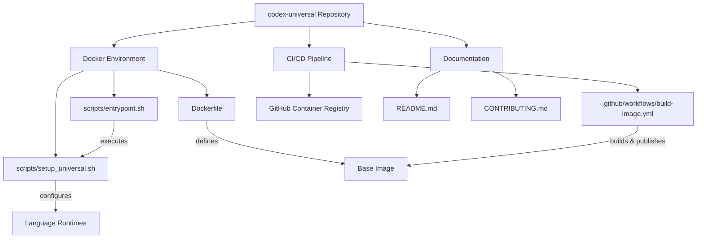
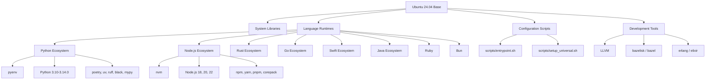
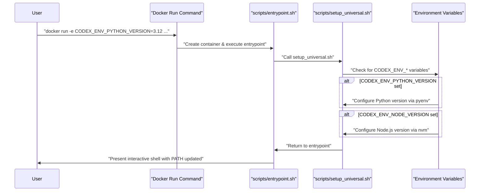

<!-- source: DeepWiki mcp.deepwiki.com · repo openai/codex-universal · page 1 Overview · fetched 2026-10-26 -->

# Overview

<details>
<summary>Relevant source files</summary>

The following files were used as context for generating this wiki page:

- [CONTRIBUTING.md](CONTRIBUTING.md)
- [README.md](README.md)

</details>


This document provides an introduction to the `codex-universal` repository, its purpose, components, and architecture. The repository contains a Docker-based development environment designed to provide a consistent and configurable platform for developing and testing code related to OpenAI Codex.

## Purpose and Scope

The `codex-universal` repository serves as a reference implementation of the base Docker image available in OpenAI Codex [README.md:1-3](). It helps developers customize environments in Codex by providing a similar containerized environment that can be run locally [README.md:5-7](). While not identical to the production Codex environment, this image offers a consistent platform for debugging and development work [README.md:5-7]().

The key objectives of the `codex-universal` project are:

1.  To provide a consistent, reproducible development environment [README.md:5-7]().
2.  To support multiple programming languages and their dependencies [README.md:43-56]().
3.  To enable configuration via environment variables [README.md:41-42]().
4.  To facilitate local development that closely mimics the Codex environment [README.md:24-39]().

Sources: [README.md:1-7](), [README.md:24-39](), [README.md:41-56]()

## Repository Structure

The `codex-universal` repository consists of several key components:

**System Architecture and Code Entities**


The repository is organized around three primary components:

1.  **Docker Environment**: The core functionality of the repository, defined in the `Dockerfile` [README.md:69-70]().
2.  **CI/CD Pipeline**: Automated build and publish workflows using GitHub Actions for `amd64` and `arm64` architectures [README.md:17-17]().
3.  **Documentation**: READMEs and contribution guidelines [README.md:1-1](), [CONTRIBUTING.md:1-1]().

Sources: [README.md:17-17](), [README.md:69-70](), [CONTRIBUTING.md:1-8]()

## Docker Image Architecture

The Docker image is built on Ubuntu 24.04 and includes multiple programming language runtimes, development tools, and configuration mechanisms:

**Natural Language Space to Code Entity Space: Runtime Ecosystem**


The image architecture follows a layered approach:

1.  **Base Layer**: Ubuntu 24.04 with system libraries and core utilities.
2.  **Language Runtimes**: Multiple versions of Python, Node.js, Rust, Go, Swift, Java, Ruby, and Bun [README.md:43-68]().
3.  **Development Tools**: Build tools like `bazelisk`, and language-specific tools like `poetry`, `uv`, and `corepack` [README.md:49-50](), [README.md:65-65]().
4.  **Configuration Scripts**: Scripts that handle the initialization of these runtimes at container start [README.md:41-42]().

Sources: [README.md:43-68](), [README.md:65-65]()

## Runtime Configuration System

One of the key features of `codex-universal` is its runtime configuration system, which allows developers to select specific language versions through environment variables:

**Execution Flow: Environment Initialization**


The container's behavior is customized at runtime through `CODEX_ENV_*` environment variables [README.md:41-42]():

| Environment Variable | Description | Supported Versions (Examples) |
|----------------------|-------------|-------------------|
| `CODEX_ENV_PYTHON_VERSION` | Python version | `3.10`, `3.12`, `3.13`, `3.14.0` |
| `CODEX_ENV_NODE_VERSION` | Node.js version | `18`, `20`, `22` |
| `CODEX_ENV_RUST_VERSION` | Rust version | `1.87.0`, `1.95.0` |
| `CODEX_ENV_GO_VERSION` | Go version | `1.23.8`, `1.25.1` |
| `CODEX_ENV_SWIFT_VERSION` | Swift version | `5.10`, `6.2` |
| `CODEX_ENV_JAVA_VERSION` | JDK version | `11`, `17`, `21`, `25` |

Sources: [README.md:41-57]()

## Usage Overview

The `codex-universal` Docker image is designed to be used as a development environment that closely approximates the OpenAI Codex environment. It is published as a multi-arch image for `linux/amd64` and `linux/arm64` [README.md:17-17]().

**Basic usage pattern:**

1.  **Pull**: `docker pull ghcr.io/openai/codex-universal:latest` [README.md:14-14]().
2.  **Run**: Execute with environment variables and volume mounts to simulate the Codex workspace [README.md:29-39]().

```sh
docker run --rm -it \
    -e CODEX_ENV_PYTHON_VERSION=3.12 \
    -v $(pwd):/workspace/$(basename $(pwd)) -w /workspace/$(basename $(pwd)) \
    ghcr.io/openai/codex-universal:latest
```

**Architecture Differences:**
*   **arm64**: OpenJDK 10 is unavailable [README.md:21-21]().
*   **arm64**: Swift installation is currently skipped due to a `swiftly` (mise) bug [README.md:22-22]().

Sources: [README.md:14-39](), [README.md:20-22]()

---

