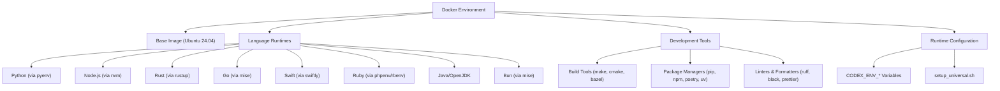
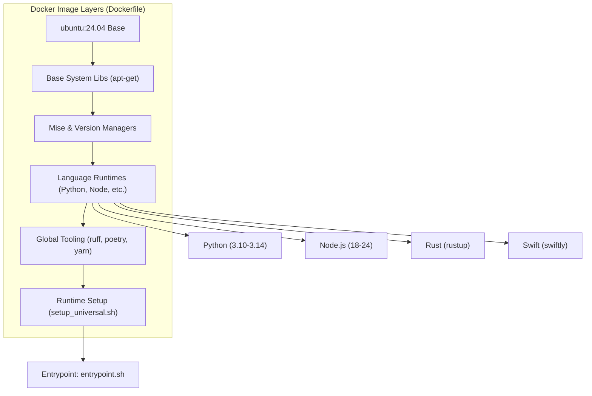
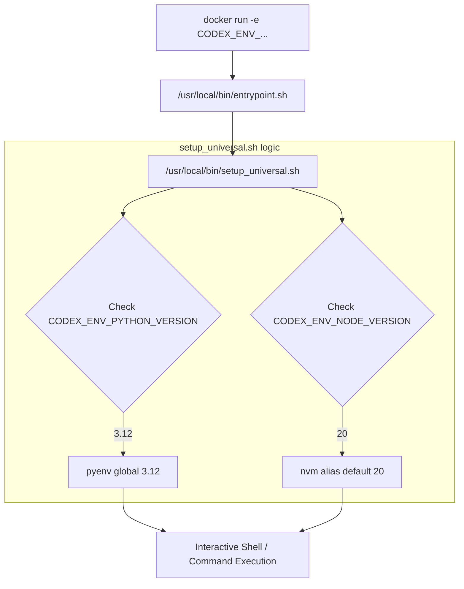

<!-- source: DeepWiki mcp.deepwiki.com · repo openai/codex-universal · page 2 Docker Environment · fetched 2026-10-26 -->

# Docker Environment

<details>
<summary>Relevant source files</summary>

The following files were used as context for generating this wiki page:

- [Dockerfile](Dockerfile)
- [README.md](README.md)

</details>


This page documents the Docker environment architecture and components within the `codex-universal` repository. The Docker environment serves as a reference implementation of the base Docker image available in OpenAI Codex, providing developers with a local development environment that closely mirrors the Codex platform.

## Overview

The Docker environment is the core component of the `codex-universal` repository, providing a consistent and configurable development platform with multiple programming languages, development tools, and utilities. It is built on **Ubuntu 24.04** [Dockerfile:2]() and uses a layered approach to install version managers (like `pyenv`, `nvm`, and `mise`) and specific language runtimes.



Sources: [Dockerfile:1-232](), [README.md:1-8]()

## Docker Image Architecture

The Docker image follows a layered architecture, building up from the base Ubuntu image through system libraries, language runtimes, and development tools. It supports multi-arch builds for both `linux/amd64` and `linux/arm64` [README.md:17]().

For details, see [Base Docker Image](#2.1).



Sources: [Dockerfile:1-232](), [README.md:17-23]()

### Base System and Dependencies
The environment starts with `ubuntu:24.04` [Dockerfile:2]() and includes a comprehensive set of system libraries:
*   **Build Essentials**: `build-essential`, `cmake`, `ninja-build`, `nasm` [Dockerfile:19-112]().
*   **Development Libraries**: `libssl-dev`, `libffi-dev`, `libxml2-dev`, `libsqlite3-dev` [Dockerfile:51-79]().
*   **Database Clients**: `default-libmysqlclient-dev`, `libpq-dev` [Dockerfile:22-47]().
*   **Utilities**: `curl`, `jq`, `ripgrep`, `git`, `fd-find` [Dockerfile:21-80]().

### Language Runtimes
The image includes multiple versions of several programming languages, often managed by specific version managers to allow runtime switching.
*   **Python**: Managed by `pyenv` [Dockerfile:124](). Includes versions 3.10 through 3.14 [Dockerfile:121]().
*   **Node.js**: Managed by `nvm` [Dockerfile:160](). Includes versions 18, 20, 22, and 24 [Dockerfile:176-179]().
*   **Rust**: Managed by `rustup` [Dockerfile:234]().
*   **Go & Bun**: Managed by `mise` [Dockerfile:190-213]().

For details, see [Language Runtimes](#2.3).

## Runtime Configuration System

The Docker environment includes a configuration system that activates specific language versions based on environment variables passed during `docker run`. This is handled by a combination of `entrypoint.sh` and `setup_universal.sh`.

For details, see [Runtime Configuration](#2.2).



Sources: [Dockerfile:306-310](), [README.md:29-41]()

### Supported Environment Variables
The following variables (defined in `setup_universal.sh`) control the active runtime versions:

| Environment Variable | Description | Example Versions |
|---------------------|-------------|-------------------|
| `CODEX_ENV_PYTHON_VERSION` | Python version | `3.10`, `3.12`, `3.14` |
| `CODEX_ENV_NODE_VERSION` | Node.js version | `18`, `20`, `22` |
| `CODEX_ENV_RUST_VERSION` | Rust version | `1.87.0`, `1.95.0` |
| `CODEX_ENV_GO_VERSION` | Go version | `1.23.8`, `1.25.1` |
| `CODEX_ENV_JAVA_VERSION` | JDK version | `11`, `17`, `21`, `25` |

Sources: [README.md:47-56]()

## Developer Workflow

The image is designed to be used as a drop-in replacement for local development. Developers mount their local workspace into the container and specify the required environment via flags.

### Example Usage
```bash
docker run --rm -it \
    -e CODEX_ENV_PYTHON_VERSION=3.12 \
    -e CODEX_ENV_NODE_VERSION=20 \
    -v $(pwd):/workspace/$(basename $(pwd)) -w /workspace/$(basename $(pwd)) \
    ghcr.io/openai/codex-universal:latest
```

### Architecture Differences
The `arm64` image (common on Apple Silicon) has two primary differences from the `amd64` image:
1.  **OpenJDK 10** is not available on `arm64` [README.md:21]().
2.  **Swift** installation is skipped on `arm64` due to a known bug with the `swiftly` installer/mise [README.md:22]().

Sources: [README.md:17-39]()

---

