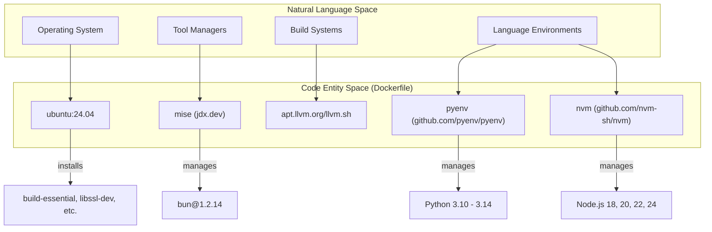
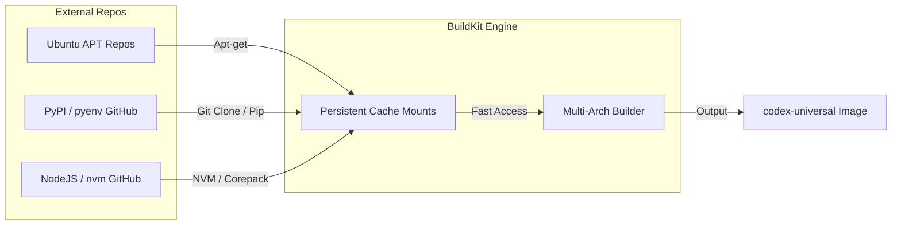

<!-- source: DeepWiki mcp.deepwiki.com · repo openai/codex-universal · page 2.1 Base Docker Image · fetched 2026-10-26 -->

# Base Docker Image

Relevant source files

The following files were used as context for generating this wiki page:

- [Dockerfile](Dockerfile)
- [LICENSES/codex-universal-image-sbom.md](LICENSES/codex-universal-image-sbom.md)
- [LICENSES/codex-universal-image-sbom.spdx.json](LICENSES/codex-universal-image-sbom.spdx.json)

## Purpose and Scope

This document details the base Docker image used in the `codex-universal` environment. It covers the underlying operating system (Ubuntu 24.04), installed language runtimes, development tools, libraries, and the multi-architecture build strategy. The image is designed to provide a reproducible local approximation of the OpenAI Codex execution environment, supporting both `amd64` and `arm64` architectures.

For information about runtime configuration of this image, see [Runtime Configuration](#2.2). For details on specific language runtime versions and options, see [Language Runtimes](#2.3).

Sources: [Dockerfile:1-232](), [LICENSES/codex-universal-image-sbom.md:1-106]()

## Image Architecture Overview

The base Docker image follows a layered approach, starting from a slim Ubuntu base and adding system dependencies, tool managers (like `mise`, `pyenv`, `nvm`), and finally specific language toolchains.

### Architecture Diagram: Code Entity Mapping

This diagram maps the high-level system components to the specific tools and scripts defined in the `Dockerfile`.

Sources: [Dockerfile:2-118](), [Dockerfile:121-180](), [Dockerfile:188-191]()

## Base Operating System

The image is built on **Ubuntu 24.04** [Dockerfile:2](). It uses BuildKit cache mounts for `apt` to optimize build times across multi-arch runners [Dockerfile:13-14]().

### Core System Components

- **Base Image**: Ubuntu 24.04
- **Character Encoding**: `C.UTF-8` [Dockerfile:7]()
- **Compiler Toolchain**: `build-essential` (12.10*), `binutils`, `gcc-13`, `stdc++-13` [Dockerfile:17-53]()
- **VCS**: `git` (2.43.*), `git-lfs`, `bzr` [Dockerfile:20-27]()
- **Core Utilities**: `curl`, `wget`, `jq`, `rsync`, `zip/unzip`, `sudo`, `ripgrep`, `fd-find` [Dockerfile:18-80]()

### System Libraries

The image includes essential libraries for building database drivers, SSL-enabled applications, and GUI-dependent tools:

| Category | Libraries |
|----------|-----------|
| **Compression** | `libbz2-dev`, `liblzma-dev`, `zlib1g-dev`, `xz-utils` [Dockerfile:32-79]() |
| **Cryptography** | `libssl-dev` (3.0.*), `gnupg`, `libgssapi-krb5-2` [Dockerfile:28-52]() |
| **Database** | `libsqlite3-dev`, `default-libmysqlclient-dev`, `libpq-dev` (Postgres) [Dockerfile:22-51]() |
| **Text/UI** | `libxml2-dev`, `libreadline-dev`, `libncurses-dev`, `tk-dev` [Dockerfile:45-69]() |
| **Interoperability** | `libffi-dev`, `unixodbc-dev`, `swig3.0`, `protobuf-compiler` [Dockerfile:38-72]() |

Sources: [Dockerfile:11-82]()

## Multi-Tool Management with Mise

The image utilizes `mise` (formerly `rtx`) as a modern polyglot tool manager. It is activated via `/etc/profile` [Dockerfile:95]().

- **Experimental Features**: Enabled to support advanced tool specs [Dockerfile:96]().
- **Managed Tools**: Currently used to install and manage `bun` [Dockerfile:190]().

Sources: [Dockerfile:84-102]()

## Language Runtimes

### Python Environment

Python is managed via `pyenv` [Dockerfile:124]().

- **Versions**: 3.10, 3.11, 3.12, 3.13, and 3.14 (experimental) [Dockerfile:121]().
- **Global Tools**: `poetry` (2.1.*) and `uv` (0.7.*) are installed via `pipx` [Dockerfile:146]().
- **Per-Version Packages**: Every installed Python version is bootstrapped with `pip`, `ruff`, `black`, `mypy`, `pyright`, `isort`, and `pytest` [Dockerfile:147-150]().

Sources: [Dockerfile:121-154]()

### Node.js Environment

Node.js is managed via `nvm` [Dockerfile:160]().

- **Versions**: 18, 20, 22 (default), and 24 [Dockerfile:176-180]().
- **Corepack**: Enabled for all versions to manage `yarn` and `pnpm` [Dockerfile:176-179]().
- **Global Defaults**: Every Node installation includes `prettier`, `eslint`, and `typescript` [Dockerfile:173]().

Sources: [Dockerfile:157-184]()

### LLVM and Build Tools

The image provides a modern LLVM toolchain directly from the LLVM project's repositories.

- **LLVM Toolchain**: Installed via `llvm.sh` script [Dockerfile:117]().
- **Build Utilities**: `cmake` (3.28.*), `ninja-build` (1.11.*), `ccache` (4.9.*) [Dockerfile:109-111]().
- **Assembly**: `nasm` and `yasm` [Dockerfile:112-113]().

Sources: [Dockerfile:104-118]()

## Build Strategy & Caching

The Dockerfile is optimized for BuildKit, utilizing several mount types to speed up the multi-arch (amd64/arm64) build process:

1.  **APT Cache**: `--mount=type=cache,target=/var/cache/apt` is used for all system package installations [Dockerfile:13]().
2.  **Language Caches**:
    *   **Python**: `/root/.cache/pip` and `/root/.cache/pipx` [Dockerfile:141-142]().
    *   **Node**: `/root/.npm`, `/root/.cache/yarn`, and `/root/.local/share/pnpm/store` [Dockerfile:168-170]().
    *   **Mise**: `/root/.cache/mise` [Dockerfile:189]().

### Build Data Flow

Sources: [Dockerfile:1-192]()

## Software Bill of Materials (SBOM)

A full SBOM is maintained to track the versions and licenses of all bundled software.

- **Primary Licenses**: MIT (pyenv, nvm, bun, uv, poetry), Apache-2.0 (LLVM, Bazelisk, Swift, Gradle), BSD-3-Clause (Go), and GPL-2.0 (Java/OpenJDK).
- **Documentation**: The human-readable version is located at `LICENSES/codex-universal-image-sbom.md` [LICENSES/codex-universal-image-sbom.md:1-106](), while a machine-readable SPDX JSON is available at `LICENSES/codex-universal-image-sbom.spdx.json` [LICENSES/codex-universal-image-sbom.spdx.json:1-196]().

Sources: [LICENSES/codex-universal-image-sbom.md:1-106](), [LICENSES/codex-universal-image-sbom.spdx.json:1-196]()

---

