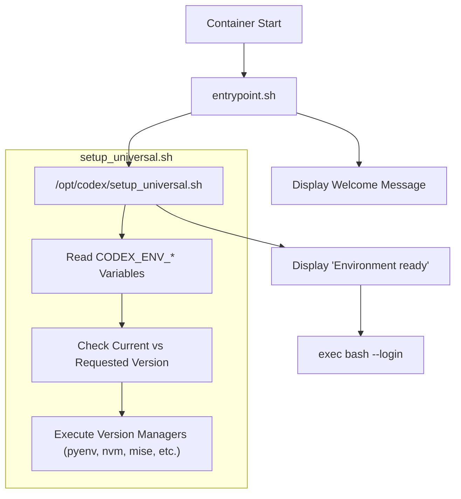
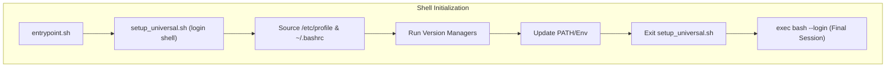

<!-- source: DeepWiki mcp.deepwiki.com · repo openai/codex-universal · page 2.2 Runtime Configuration · fetched 2026-10-26 -->

# Runtime Configuration

<details>
<summary>Relevant source files</summary>

The following files were used as context for generating this wiki page:

- [README.md](README.md)
- [entrypoint.sh](entrypoint.sh)
- [setup_universal.sh](setup_universal.sh)

</details>


This page explains how the `codex-universal` Docker environment dynamically configures language runtimes at container startup using environment variables. The system is designed to be idempotent and efficient, only performing heavy version-switching operations when the requested environment differs from the pre-installed defaults.

## Configuration Flow Overview

When a container is started, the `entrypoint.sh` script serves as the primary orchestrator. It invokes the configuration logic and then drops the user into an interactive shell.



Sources: [entrypoint.sh:1-11](), [setup_universal.sh:1-14]()

## Environment Variables

The container looks for specific `CODEX_ENV_*` variables to determine the desired runtime state.

| Environment Variable | Purpose | Supported Versions (Examples) | Version Manager |
|----------------------|---------|-------------------|-----------------|
| `CODEX_ENV_PYTHON_VERSION` | Python version | `3.10`, `3.12`, `3.14.0` | `pyenv` |
| `CODEX_ENV_NODE_VERSION` | Node.js version | `18`, `20`, `22` | `nvm` |
| `CODEX_ENV_RUBY_VERSION` | Ruby version | `3.2.3`, `3.4.4` | `mise` |
| `CODEX_ENV_RUST_VERSION` | Rust version | `1.87.0`, `1.95.0` | `rustup` |
| `CODEX_ENV_GO_VERSION` | Go version | `1.23.8`, `1.25.1` | `mise` |
| `CODEX_ENV_SWIFT_VERSION` | Swift version | `5.10`, `6.2` | `swiftly` |
| `CODEX_ENV_PHP_VERSION` | PHP version | `8.2`, `8.4` | `phpenv` |
| `CODEX_ENV_JAVA_VERSION` | JDK version | `11`, `17`, `25` | `mise` |

Sources: [README.md:45-57](), [setup_universal.sh:5-12]()

## Configuration Mechanism

The logic in `setup_universal.sh` distinguishes between runtimes that require fresh initialization every boot and those that can be skipped if the default matches.

### Version Detection and Switching

The script uses specific shell commands to detect currently active versions before deciding to invoke a version manager.

```mermaid
flowchart LR
    subgraph "Natural Language Space"
    V1["Detect Node Version"]
    V2["Detect Rust Version"]
    V3["Detect Go Version"]
    V4["Detect Java Version"]
    end

    subgraph "Code Entity Space"
    V1 --- C1["node -v | cut -d. -f1"]
    V2 --- C2["rustc --version | awk '{print $2}'"]
    V3 --- C3["go version | awk '{print $3}'"]
    V4 --- C4["java -version 2>&1 | awk -F'[ .\" ]+' '/version/ {print $3}'"]
    end
```

Sources: [setup_universal.sh:29-85]()

### Language-Specific Logic

#### Python and Node.js (Always Updated)
For Python and Node.js, the script explicitly notes that it always runs the switch commands. This ensures that global libraries for linting and formatting (like `ruff`, `black`, `poetry` for Python, or `yarn`, `pnpm` for Node) are correctly mapped to the active version.

*   **Python**: Uses `pyenv global` [setup_universal.sh:24]().
*   **Node.js**: Uses `nvm alias default` and `nvm use --save`. It also runs `corepack enable` to prepare package managers [setup_universal.sh:32-34]().

#### Rust, Go, Ruby, Swift, PHP, and Java (Idempotent)
These runtimes use an "if-changed" logic to save boot time. If the environment variable matches the detected `current` version, the installation/switching step is skipped.

*   **Rust**: Uses `rustup default` [setup_universal.sh:51]().
*   **Ruby, Go, Java**: Managed via `mise use --global` [setup_universal.sh:42, 60, 88]().
*   **Swift**: Managed via `swiftly use` [setup_universal.sh:69]().
*   **PHP**: Managed via `phpenv global` (using the `snapshot` suffix convention) [setup_universal.sh:79]().

Sources: [setup_universal.sh:16-91]()

## Shell Initialization and PATH

The configuration process ensures that interactive sessions are ready for use immediately after the setup script finishes.

1.  **Login Shell**: `setup_universal.sh` starts with `#!/bin/bash --login` to ensure all version manager profiles (like `.bashrc` or `/etc/profile.d/` scripts) are sourced [setup_universal.sh:1]().
2.  **Entrypoint Handoff**: The `entrypoint.sh` script executes `setup_universal.sh` and then uses `exec bash --login "$@"` [entrypoint.sh:10](). This replaces the entrypoint process with a login shell, preserving the environment variables and PATH modifications made during the setup phase.
3.  **Path Management**: Version managers (pyenv, nvm, mise) handle PATH manipulation dynamically. For example, `nvm use` updates the PATH for the current session, and `mise use --global` updates the global configuration files.



Sources: [entrypoint.sh:1-11](), [setup_universal.sh:1-4]()

## Optimization Strategy

The implementation prioritizes speed for common development scenarios:

| Strategy | Description | Implementation |
| :--- | :--- | :--- |
| **Tooling Consistency** | Python/Node always switch to ensure `poetry`/`npm` work. | [setup_universal.sh:16-17]() |
| **Boot Speed** | Skip `rustup`/`mise`/`swiftly` if version is already correct. | [setup_universal.sh:19-20]() |
| **Logging** | Clear output of what is being configured for debugging. | [setup_universal.sh:14, 23, 30]() |

Sources: [setup_universal.sh:14-91]()

---

