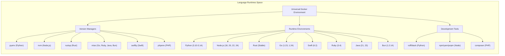
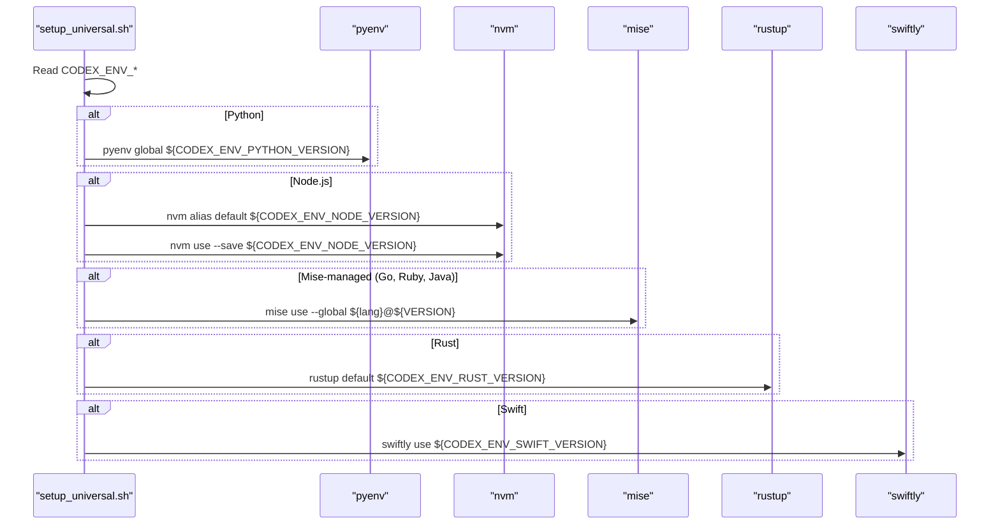
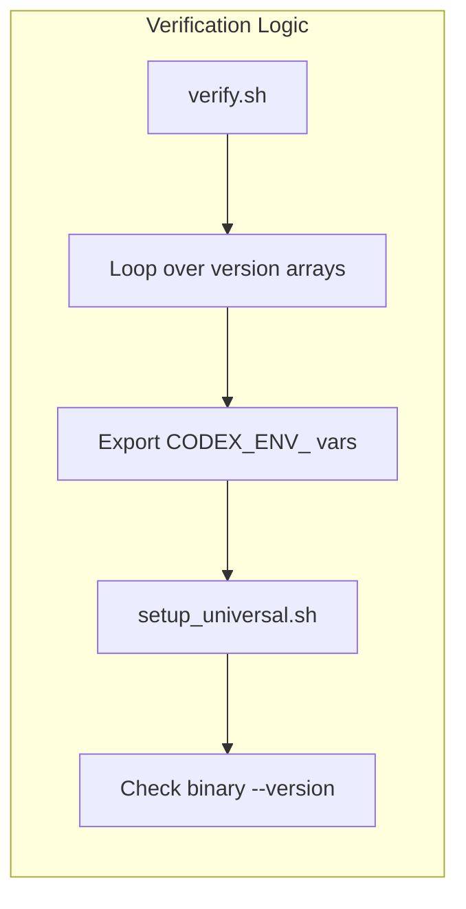

<!-- source: DeepWiki mcp.deepwiki.com · repo openai/codex-universal · page 2.3 Language Runtimes · fetched 2026-10-26 -->

# Language Runtimes

Relevant source files

The following files were used as context for generating this wiki page:

- [Dockerfile](Dockerfile)
- [setup_universal.sh](setup_universal.sh)
- [verify.sh](verify.sh)

## Purpose and Scope

This document details the language runtimes included in the codex-universal Docker environment, their configuration options, version management systems, and associated development tools. It covers the transition from `asdf` to `mise` for several runtimes and the specific version managers used for others. For information about runtime configuration at container startup, see [Runtime Configuration](2.2).

## Overview of Supported Language Runtimes

The codex-universal Docker image provides a comprehensive multi-language development environment. Runtimes are managed using a mix of specialized version managers (like `pyenv` and `nvm`) and the `mise` polyglot tool manager [Dockerfile:84-102]().

Sources: [Dockerfile:119-216](), [setup_universal.sh:5-13]()

## Supported Languages and Versions

The following table summarizes all language runtimes available and their configuration variables:

| Language | Version Manager | Available Versions | Default Version | Environment Variable |
|----------|----------------|-------------------|-----------------|---------------------|
| Python | `pyenv` | 3.10, 3.11, 3.12, 3.13, 3.14 | 3.12 | `CODEX_ENV_PYTHON_VERSION` |
| Node.js | `nvm` | 18, 20, 22, 24 | 22 | `CODEX_ENV_NODE_VERSION` |
| Rust | `rustup` | Stable | Latest | `CODEX_ENV_RUST_VERSION` |
| Go | `mise` | 1.23, 1.24 | 1.24 | `CODEX_ENV_GO_VERSION` |
| Swift | `swiftly` | 6.2 | 6.2 | `CODEX_ENV_SWIFT_VERSION` |
| Ruby | `mise` | 3.4 | 3.4 | `CODEX_ENV_RUBY_VERSION` |
| PHP | `phpenv` | 8.3, 8.4 | 8.4 | `CODEX_ENV_PHP_VERSION` |
| Java | `mise` | 21, 23 | 21 | `CODEX_ENV_JAVA_VERSION` |
| Bun | `mise` | 1.2.14 | 1.2.14 | N/A |
| Elixir | `mise` | 1.18 | 1.18 | N/A |

Sources: [Dockerfile:121-216](), [setup_universal.sh:5-13]()

## Runtime Configuration Mechanism

The container uses `setup_universal.sh` to reconcile the requested environment variables with the pre-installed versions.

Sources: [setup_universal.sh:22-91]()

## Language Runtime Details

### Python Environment
Managed via `pyenv` [Dockerfile:123-134]().
- **Versions**: 3.10 through 3.14.
- **Global Tools**: `pipx` is used to install `poetry` and `uv` [Dockerfile:146]().
- **Pre-installed Libraries**: Every version includes `ruff`, `black`, `mypy`, `pyright`, `isort`, and `pytest` [Dockerfile:149]().
- **Optimization**: `UV_NO_PROGRESS=1` is set to improve performance of stdout buffering [Dockerfile:153]().

### Node.js Environment
Managed via `nvm` [Dockerfile:160-184]().
- **Versions**: 18, 20, 22, 24.
- **Corepack**: Enabled for `yarn` and `pnpm` management [Dockerfile:176-179]().
- **Default Packages**: `prettier`, `eslint`, and `typescript` are automatically installed for new Node versions [Dockerfile:173]().

### Mise-Managed Runtimes
The `mise` tool (a modern successor to `asdf`) manages several runtimes to ensure architecture-agnostic versioning [Dockerfile:84-102]().
- **Go**: Versions 1.23 and 1.24 [Dockerfile:198-201]().
- **Ruby**: Version 3.4 [Dockerfile:203-206]().
- **Java**: OpenJDK 21 and 23 via `mise` [Dockerfile:193-196]().
- **Bun**: Version 1.2.14 [Dockerfile:188-191]().
- **Elixir/Erlang**: Elixir 1.18 and Erlang 27 [Dockerfile:213-216]().

### PHP Environment
Managed via `phpenv` [Dockerfile:208-211]().
- **Versions**: 8.3 and 8.4.
- **Tooling**: Includes `composer` and `phpunit`.
- **Note**: Version switching in `setup_universal.sh` appends `snapshot` to the version string for `phpenv` compatibility [setup_universal.sh:79]().

### Swift Environment
Managed via `swiftly` [Dockerfile:218-223]().
- **Architecture Support**: Uses architecture-specific installation scripts (`aarch64` vs `x86_64`) [Dockerfile:220]().
- **Version**: 6.2.

## Verification and Testing
The `verify.sh` script iterates through all supported version combinations defined in the Dockerfile arguments to ensure `setup_universal.sh` can successfully switch between them without errors [verify.sh:27-42]().

Sources: [verify.sh:5-86]()

## Shell Environment Integration
Runtimes are integrated into the system-wide shell via `/etc/profile`:
- **Mise**: `eval "$(mise activate bash)"` [Dockerfile:95]().
- **Pyenv**: `eval "$(pyenv init - bash)"` [Dockerfile:129]().
- **NVM**: `source $NVM_DIR/nvm.sh` [Dockerfile:172]().
- **Pathing**: `PATH` is updated to include `mise` shims [Dockerfile:102]() and `pipx` binaries [Dockerfile:138]().

Sources: [Dockerfile:95-138](), [Dockerfile:172]()

---

