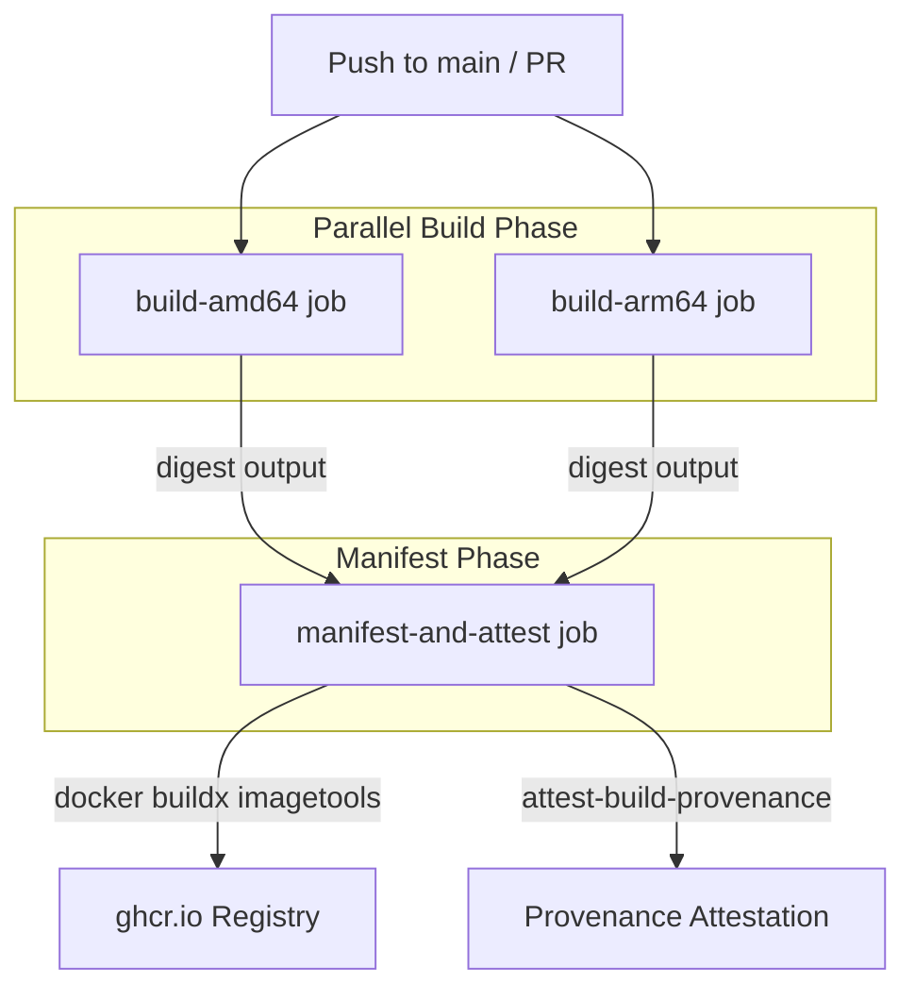
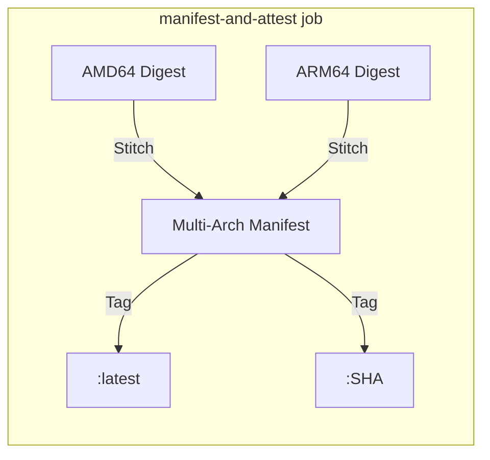
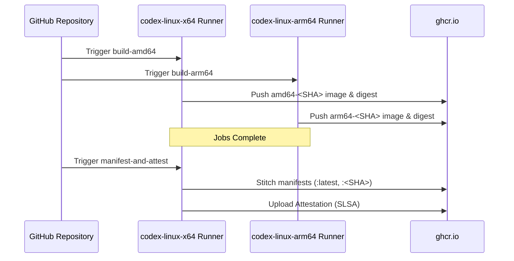

<!-- source: DeepWiki mcp.deepwiki.com · repo openai/codex-universal · page 3 CI/CD Pipeline · fetched 2026-10-26 -->

# CI/CD Pipeline

Relevant source files

The following files were used as context for generating this wiki page:

- [.github/workflows/build-image.yml](.github/workflows/build-image.yml)

## Purpose and Scope

This document details the Continuous Integration/Continuous Deployment (CI/CD) pipeline used by the `codex-universal` repository. The pipeline automatically builds, manifests, and publishes a multi-architecture Docker image to the GitHub Container Registry (`ghcr.io`) whenever changes are pushed to the `main` branch. It utilizes dedicated runners to perform parallel builds for `amd64` and `arm64` architectures, ensuring high-performance execution and broad compatibility.

Sources: [.github/workflows/build-image.yml:1-18]()

## Pipeline Overview

The CI/CD pipeline is implemented using GitHub Actions and is defined in `.github/workflows/build-image.yml`. It employs a three-job strategy: two parallel architecture-specific build jobs and a final synchronization job to stitch the manifests together.

Sources: [.github/workflows/build-image.yml:19-111]()

## Workflow Configuration

### Trigger Conditions
The workflow is triggered on:
*   **Push**: Any push to the `main` branch [[.github/workflows/build-image.yml:4-5]()]
*   **Pull Request**: Any PR targeting the `main` branch [[.github/workflows/build-image.yml:6-7]()]

### Permissions
The workflow requires elevated permissions to interact with the GitHub Container Registry and security services:
*   `packages: write`: To upload Docker images [[.github/workflows/build-image.yml:11]()]
*   `id-token: write` & `attestations: write`: Required for generating build provenance [[.github/workflows/build-image.yml:12-13]()]

## Architecture-Specific Build Jobs

The pipeline splits the build into two distinct jobs: `build-amd64` [[.github/workflows/build-image.yml:20]()] and `build-arm64` [[.github/workflows/build-image.yml:49]()]. This allows the use of native hardware runners rather than slow emulation.

### Runner Selection
Jobs are assigned to specific runner groups and labels:
*   **AMD64**: Runs on `group: codex-runners` with label `codex-linux-x64` [[.github/workflows/build-image.yml:21-23]()]
*   **ARM64**: Runs on `group: codex-runners` with label `codex-linux-arm64` [[.github/workflows/build-image.yml:50-52]()]

### Build Implementation Details
Each job follows a standard sequence:
1.  **Environment Setup**: Uses `docker/setup-qemu-action` and `docker/setup-buildx-action` to initialize the BuildKit engine [[.github/workflows/build-image.yml:33-34](), [.github/workflows/build-image.yml:62-63]()].
2.  **Build and Push**: Executes `docker/build-push-action@v6` [[.github/workflows/build-image.yml:37](), [.github/workflows/build-image.yml:66]()].
    *   **Architecture Isolation**: `build-amd64` specifies `platforms: linux/amd64` [[.github/workflows/build-image.yml:39]()].
    *   **Architecture Isolation**: `build-arm64` specifies `platforms: linux/arm64` [[.github/workflows/build-image.yml:68]()].
3.  **Tagging**: Images are initially pushed with architecture-specific tags: `amd64-${{ github.sha }}` and `arm64-${{ github.sha }}` [[.github/workflows/build-image.yml:41](), [.github/workflows/build-image.yml:70]()].

### Caching Strategy
The pipeline uses an **inline caching strategy** combined with registry lookups:
*   `cache-from`: Points to the `:latest` image in the registry to pull existing layers [[.github/workflows/build-image.yml:42](), [.github/workflows/build-image.yml:71]()].
*   `cache-to`: Uses `type=inline`, which embeds build cache metadata directly into the pushed image [[.github/workflows/build-image.yml:43](), [.github/workflows/build-image.yml:72]()].

Sources: [.github/workflows/build-image.yml:20-77]()

## Multi-Arch Manifest and Attestation

The final job, `manifest-and-attest`, runs only after the parallel builds succeed and only on pushes to the `main` branch [[.github/workflows/build-image.yml:78-83]()].

### Manifest Stitching
Instead of rebuilding, this job uses `docker buildx imagetools` to create a multi-arch manifest. This links the previously uploaded `amd64` and `arm64` blobs under a single unified tag.

The command targets the digests produced by the previous jobs:
`docker buildx imagetools create -t ...:latest -t ...:${GITHUB_SHA} ...@${{ needs.build-amd64.outputs.digest }} ...@${{ needs.build-arm64.outputs.digest }}` [[.github/workflows/build-image.yml:93-97]()]

### Build Provenance
The pipeline enhances security by generating a **Build Provenance Attestation**. This uses the `actions/attest-build-provenance` action [[.github/workflows/build-image.yml:105-106]()].
*   **Subject**: The full image path in `ghcr.io` [[.github/workflows/build-image.yml:109]()].
*   **Digest**: The manifest digest extracted via `docker buildx imagetools inspect` [[.github/workflows/build-image.yml:102-103](), [.github/workflows/build-image.yml:110]()].

Sources: [.github/workflows/build-image.yml:78-111]()

## Tagging Strategy Summary

The pipeline applies a tiered tagging strategy to ensure both stability and traceability.

| Tag Pattern | Job Responsible | Purpose |
| :--- | :--- | :--- |
| `amd64-<SHA>` | `build-amd64` | Intermediate architecture-specific blob. |
| `arm64-<SHA>` | `build-arm64` | Intermediate architecture-specific blob. |
| `<SHA>` | `manifest-and-attest` | Immutable multi-arch reference for a specific commit. |
| `latest` | `manifest-and-attest` | Rolling reference for the most recent successful build on `main`. |

Sources: [.github/workflows/build-image.yml:41](), [.github/workflows/build-image.yml:70](), [.github/workflows/build-image.yml:94-95]()

## Data Flow: From Code to Registry

Sources: [.github/workflows/build-image.yml:19-111]()

---

