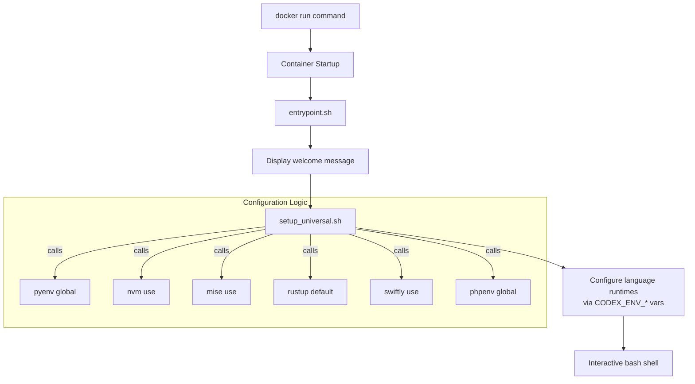
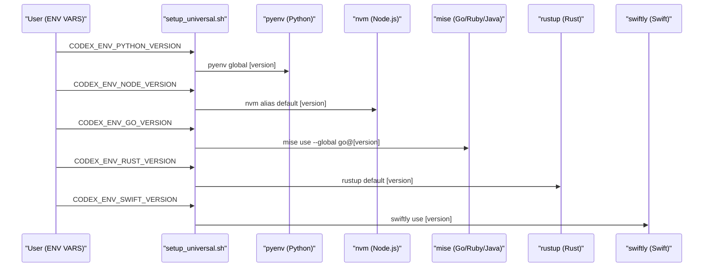

<!-- source: DeepWiki mcp.deepwiki.com · repo openai/codex-universal · page 4 Usage Guide · fetched 2026-10-26 -->

# Usage Guide

<details>
<summary>Relevant source files</summary>

The following files were used as context for generating this wiki page:

- [README.md](README.md)
- [setup_universal.sh](setup_universal.sh)

</details>


This guide provides comprehensive instructions for using the `codex-universal` Docker image in your development workflow. It covers how to pull and run the Docker image, configure language runtimes through environment variables, and set up a development environment that closely resembles the OpenAI Codex environment. For detailed information about environment variables, see [Environment Variables](#4.1).

## Getting Started

### Pulling the Docker Image

The `codex-universal` Docker image is hosted on GitHub Container Registry and can be pulled using the following command:

```bash
docker pull ghcr.io/openai/codex-universal:latest
```

Sources: [README.md:13-15]()

### Basic Usage

To run the container with default settings:

```bash
docker run --rm -it ghcr.io/openai/codex-universal:latest
```

This repository builds the image for both `linux/amd64` and `linux/arm64`. While the image is primarily run on `amd64`, your installed Docker may support `amd64` emulation on Apple Silicon or other ARM hardware by passing the `--platform linux/amd64` flag.

Sources: [README.md:17-18](), [README.md:29-39]()

## Container Environment Structure

The diagram below illustrates how the container environment is structured and initialized. The system uses `entrypoint.sh` to trigger the runtime configuration via `setup_universal.sh`.

### Initialization Workflow


Sources: [setup_universal.sh:1-91](), [README.md:41-42]()

## Configuring Language Runtimes

The `codex-universal` image supports various programming languages and allows you to specify which version of each language to use through environment variables. The configuration is idempotent; for some languages like Rust, the script only installs/switches versions if the requested version differs from the current default to save boot time.

Sources: [setup_universal.sh:19-21]()

### Supported Language Versions

| Environment Variable | Description | Supported Versions | Additional Tools |
|----------------------|-------------|-------------------|------------------|
| `CODEX_ENV_PYTHON_VERSION` | Python version | `3.10`, `3.11.12`, `3.12`, `3.13`, `3.14.0` | `pyenv`, `poetry`, `uv`, `ruff`, `black`, `mypy`, `pyright`, `isort` |
| `CODEX_ENV_NODE_VERSION` | Node.js version | `18`, `20`, `22` | `corepack`, `yarn`, `pnpm`, `npm` |
| `CODEX_ENV_RUST_VERSION` | Rust version | `1.83.0` to `1.95.0` | `rustup` |
| `CODEX_ENV_GO_VERSION` | Go version | `1.22.12`, `1.23.8`, `1.24.3`, `1.25.1` | `mise` |
| `CODEX_ENV_SWIFT_VERSION` | Swift version | `5.10`, `6.1`, `6.2` | `swiftly` |
| `CODEX_ENV_RUBY_VERSION` | Ruby version | `3.2.3`, `3.3.8`, `3.4.4` | `mise` |
| `CODEX_ENV_PHP_VERSION` | PHP version | `8.2`, `8.3`, `8.4` | `phpenv` |
| `CODEX_ENV_JAVA_VERSION` | JDK version | `11`, `17`, `21` to `25` | `mise` |

Sources: [README.md:47-57](), [setup_universal.sh:5-12]()

### Runtime Configuration Process

The diagram below maps the Natural Language intent (setting a version) to the specific Code Entities (scripts and managers) responsible for the state change.

### Version Management Mapping


Sources: [setup_universal.sh:22-91]()

## Common Usage Patterns

### Development Workflow

The most common usage pattern is to mount your local codebase into the container and use the container as your development environment. This approximates the `setup` environment in Codex.

```bash
docker run --rm -it \
    -e CODEX_ENV_PYTHON_VERSION=3.12 \
    -e CODEX_ENV_NODE_VERSION=20 \
    -v $(pwd):/workspace/$(basename $(pwd)) -w /workspace/$(basename $(pwd)) \
    ghcr.io/openai/codex-universal:latest
```

Sources: [README.md:24-39]()

### Architecture Differences (amd64 vs arm64)

While the image supports both architectures, there are two key differences to note for `arm64` (e.g., Apple Silicon):
1. **OpenJDK 10** is not available on `amd64`.
2. **Swift** installation is currently skipped on `arm64` due to a known bug with the `mise` tool.

Sources: [README.md:20-22]()

## Additional Pre-installed Tools

Besides the configurable language runtimes, the `codex-universal` image includes several fixed-version tools:

- **Bun**: `1.2.10` [README.md:64]()
- **Erlang**: `27.1.2` [README.md:66]()
- **Elixir**: `1.18.3` [README.md:67]()
- **Bazelisk / Bazel** [README.md:65]()

## Summary

The `codex-universal` Docker image provides a configurable development environment that mirrors the OpenAI Codex environment. By using the appropriate `CODEX_ENV_*` environment variables and volume mounts, you can create a consistent development environment for your projects.

For detailed information about all available environment variables and their supported values, see [Environment Variables](#4.1).

---

