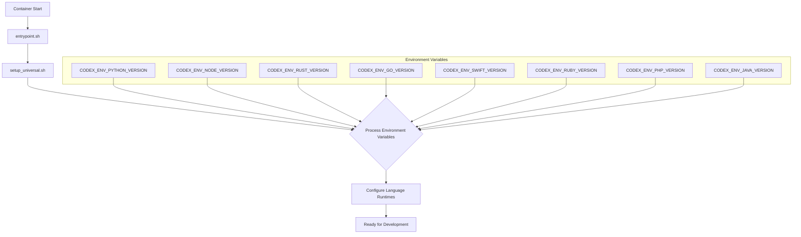
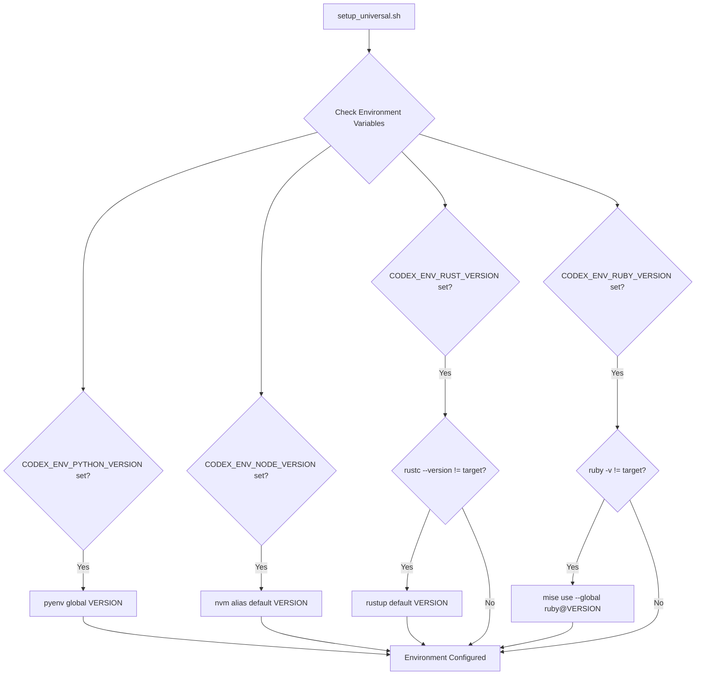
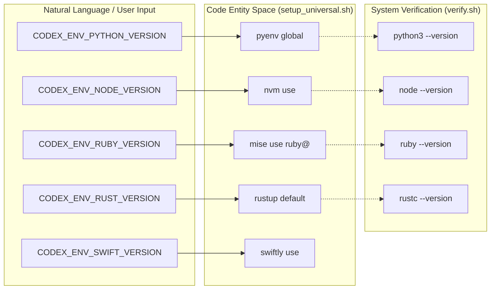

<!-- source: DeepWiki mcp.deepwiki.com · repo openai/codex-universal · page 4.1 Environment Variables · fetched 2026-10-26 -->

# Environment Variables

<details>
<summary>Relevant source files</summary>

The following files were used as context for generating this wiki page:

- [README.md](README.md)
- [setup_universal.sh](setup_universal.sh)
- [verify.sh](verify.sh)

</details>


This page documents the environment variables that can be used to configure the `codex-universal` Docker container at runtime. The container leverages these variables to set up specific language versions and development tools to match your desired environment.

## Overview

The `codex-universal` container uses environment variables prefixed with `CODEX_ENV_` to configure language runtimes during the container's initialization phase. These variables allow developers to specify which versions of programming languages should be activated in the container environment. The primary script responsible for processing these variables is `/opt/codex/setup_universal.sh` [setup_universal.sh:1-12]().



Sources: [setup_universal.sh:1-12](), [README.md:24-41]()

## Supported Environment Variables

The following table lists all supported environment variables, their purpose, and the versions that can be specified. Note that for Python and Node.js, global libraries are always re-evaluated to ensure linting and formatting tools are available [setup_universal.sh:16-17]().

| Environment Variable | Description | Supported Versions | Additional Packages |
|---------------------|-------------|-------------------|---------------------|
| `CODEX_ENV_PYTHON_VERSION` | Python version to install | `3.10`, `3.11.12`, `3.12`, `3.13`, `3.14.0` | `pyenv`, `poetry`, `uv`, `ruff`, `black`, `mypy`, `pyright`, `isort` |
| `CODEX_ENV_NODE_VERSION` | Node.js version to install | `18`, `20`, `22` | `corepack`, `yarn`, `pnpm`, `npm` |
| `CODEX_ENV_RUST_VERSION` | Rust version to install | `1.83.0` to `1.95.0` (see README) | |
| `CODEX_ENV_GO_VERSION` | Go version to install | `1.22.12`, `1.23.8`, `1.24.3`, `1.25.1` | |
| `CODEX_ENV_SWIFT_VERSION` | Swift version to install | `5.10`, `6.1`, `6.2` | |
| `CODEX_ENV_RUBY_VERSION` | Ruby version to install | `3.2.3`, `3.3.8`, `3.4.4` | |
| `CODEX_ENV_PHP_VERSION` | PHP version to install | `8.2`, `8.3`, `8.4` | |
| `CODEX_ENV_JAVA_VERSION` | JDK version to install | `11`, `17`, `21`, `22`, `23`, `24`, `25` | |

Sources: [README.md:47-57](), [setup_universal.sh:5-12]()

## Configuration Process

When a container starts, the `setup_universal.sh` script processes the environment variables. To optimize boot time, for languages like Rust, Go, Swift, Ruby, and Java, the script performs an idempotency check: it only invokes the version manager if the requested version differs from the currently active version [setup_universal.sh:19-20]().



Sources: [setup_universal.sh:22-91]()

### Python Configuration
When `CODEX_ENV_PYTHON_VERSION` is set, the script uses `pyenv global` to switch the active version [setup_universal.sh:22-26](). The container image includes pre-installed tools like `poetry`, `uv`, and `ruff` [README.md:49]().

### Node.js Configuration
When `CODEX_ENV_NODE_VERSION` is set, the script compares the current version using `node -v` [setup_universal.sh:29](). If it differs, it uses `nvm alias default` and `nvm use --save`, then executes `corepack enable` to prepare package managers [setup_universal.sh:32-34]().

### Rust Configuration
When `CODEX_ENV_RUST_VERSION` is set, the script extracts the current version from `rustc --version` [setup_universal.sh:48](). If a change is needed, it calls `rustup default` [setup_universal.sh:51]().

### Go & Java & Ruby Configuration
These runtimes are managed via `mise` (or `phpenv`/`swiftly`).
- **Go**: Uses `mise use --global go@${CODEX_ENV_GO_VERSION}` [setup_universal.sh:60]().
- **Ruby**: Uses `mise use --global ruby@${CODEX_ENV_RUBY_VERSION}` [setup_universal.sh:42]().
- **Java**: Uses `mise use --global java@${CODEX_ENV_JAVA_VERSION}` [setup_universal.sh:88]().
- **PHP**: Uses `phpenv global "${CODEX_ENV_PHP_VERSION}snapshot"` [setup_universal.sh:79]().

Sources: [setup_universal.sh:38-91]()

## Mapping Variables to Code Entities

The following diagram bridges the high-level environment variables to the specific CLI tools and version managers they interact with inside the codebase.



Sources: [setup_universal.sh:22-72](), [verify.sh:44-71]()

## Usage Examples

### Complete Configuration
To configure a full stack environment (Python 3.12, Node 20, Rust 1.87.0, Go 1.23.8, Swift 6.2, Ruby 3.4.4, PHP 8.4):

```bash
docker run --rm -it \
    -e CODEX_ENV_PYTHON_VERSION=3.12 \
    -e CODEX_ENV_NODE_VERSION=20 \
    -e CODEX_ENV_RUST_VERSION=1.87.0 \
    -e CODEX_ENV_GO_VERSION=1.23.8 \
    -e CODEX_ENV_SWIFT_VERSION=6.2 \
    -e CODEX_ENV_RUBY_VERSION=3.4.4 \
    -e CODEX_ENV_PHP_VERSION=8.4 \
    -v $(pwd):/workspace/$(basename $(pwd)) -w /workspace/$(basename $(pwd)) \
    ghcr.io/openai/codex-universal:latest
```

Sources: [README.md:29-39]()

## Verification and Testing
The repository includes a `verify.sh` script that iterates through combinations of these environment variables to ensure `setup_universal.sh` correctly configures the environment [verify.sh:27-42](). It verifies the resulting binaries by calling their respective `--version` commands [verify.sh:44-84]().

Sources: [verify.sh:1-87]()

---

