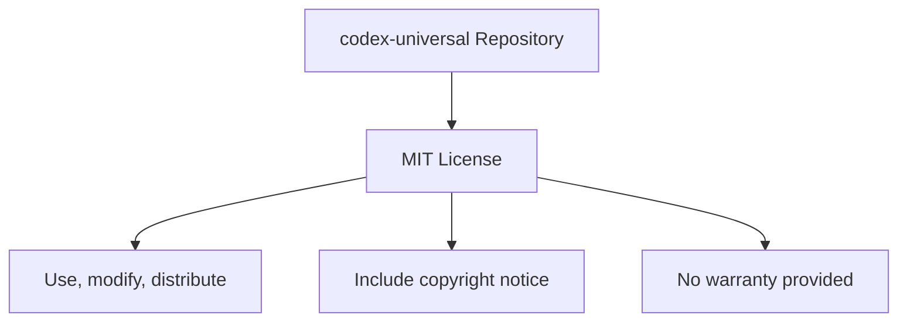
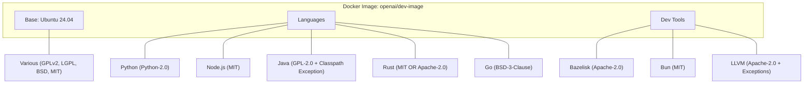
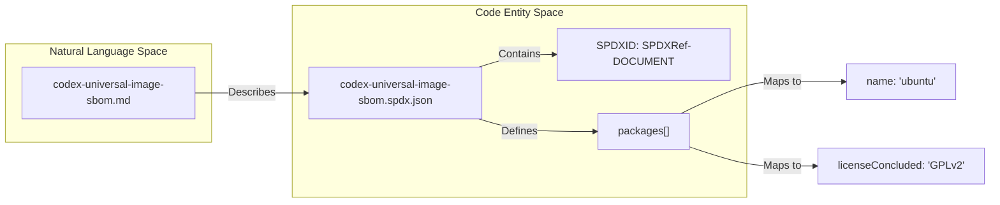
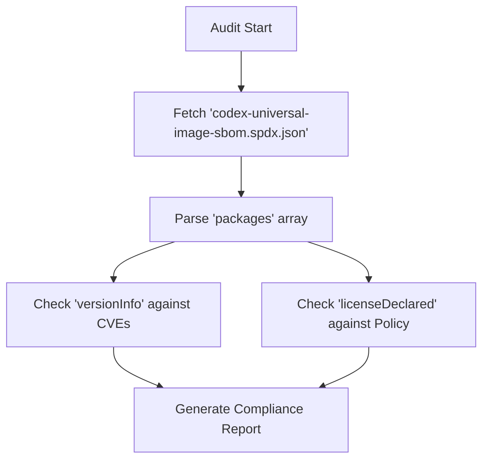

<!-- source: DeepWiki mcp.deepwiki.com · repo openai/codex-universal · page 5 Licensing and Compliance · fetched 2026-10-26 -->

# Licensing and Compliance

Relevant source files

The following files were used as context for generating this wiki page:

- [LICENSES/LICENSE](LICENSES/LICENSE)
- [LICENSES/codex-universal-image-sbom.md](LICENSES/codex-universal-image-sbom.md)
- [LICENSES/codex-universal-image-sbom.spdx.json](LICENSES/codex-universal-image-sbom.spdx.json)

This document provides information about the licensing and compliance aspects of the `codex-universal` repository. It covers the project's license, the various open-source components included in the Docker environment, and the Software Bill of Materials (SBOM) used for security and legal auditing.

## Repository License

The `codex-universal` repository is licensed under the MIT License, a permissive open-source license that allows for use, modification, and distribution with minimal restrictions.

Sources: [LICENSES/LICENSE:1-22]()

## Docker Image Components

The Docker image includes a wide variety of open-source components, from the base Ubuntu system to programming languages, development tools, and utilities. These components are governed by their respective upstream licenses.

Sources: [LICENSES/LICENSE:24-34](), [LICENSES/codex-universal-image-sbom.md:6-95]()

### License Categories

The components included in the Docker image fall into two primary categories: permissive and copyleft.

| License Category | License Types | Examples |
|-----------------|---------------|----------|
| **Permissive** | MIT, Apache-2.0, BSD, Python-2.0 | Python, Node.js, Rust, Go, Swift, Bun, Bazelisk |
| **Copyleft** | GPL-2.0, LGPL, Artistic-2.0 | OpenJDK, coreutils, binutils, bash |

Sources: [LICENSES/LICENSE:30-32](), [LICENSES/codex-universal-image-sbom.md:83-97]()

## Software Bill of Materials (SBOM)

To support transparency and legal auditing, the project provides a Software Bill of Materials (SBOM) in two distinct formats. These artifacts allow users to verify the provenance and security of the bundled software.

### SBOM Artifacts
1.  **Human-Readable**: `codex-universal-image-sbom.md` provides a tabular view of names, versions, and licenses.
2.  **Machine-Readable**: `codex-universal-image-sbom.spdx.json` follows the SPDX 2.2 standard for automated compliance scanning.

Sources: [LICENSES/LICENSE:36-42](), [LICENSES/codex-universal-image-sbom.md:1-5](), [LICENSES/codex-universal-image-sbom.spdx.json:1-24]()

## Security and Legal Auditing

The SBOM can be used by security teams to perform vulnerability scanning (e.g., matching package versions against CVE databases) and by legal teams to ensure license compatibility.

### Auditing Workflow
1.  **Ingestion**: Import `codex-universal-image-sbom.spdx.json` into a compliance tool.
2.  **Validation**: Verify the `documentNamespace` and `creationInfo` to ensure the document is authentic.
3.  **Scanning**: Cross-reference the `packages` list against known vulnerabilities.

Sources: [LICENSES/codex-universal-image-sbom.spdx.json:1-18](), [LICENSES/codex-universal-image-sbom.spdx.json:25-33]()

## License Compliance Considerations

The project adheres to the following principles to ensure compliance with the various licenses of its components:

*   **No Static Linking**: GPL-covered libraries are not statically linked with proprietary software [LICENSES/LICENSE:34-34]().
*   **Attribution**: License information and copyright notices are maintained within the image and repository [LICENSES/LICENSE:5-13]().
*   **Source Availability**: Instructions for obtaining source code for upstream components (Ubuntu, PyPI, npm, GitHub) are provided [LICENSES/LICENSE:43-51]().

## Key Component Licensing Summary

| Component | Version | Method | License |
|-----------|---------|--------|---------|
| `ubuntu` | 24.04 | base image | Various (GPLv2, LGPL, BSD, MIT) |
| `go` | 1.23.8 | curl+tar | BSD-3-Clause |
| `java` | OpenJDK 21 | apt | GPL-2.0 with Classpath Exception |
| `python` | 3.10-3.13 | pyenv | Python-2.0 |
| `rust` | stable | rustup | MIT OR Apache-2.0 |
| `bun` | 1.2.10 | curl+unzip | MIT |
| `bazelisk`| 1.26.0 | curl | Apache-2.0 |

Sources: [LICENSES/codex-universal-image-sbom.md:6-95]()

---

