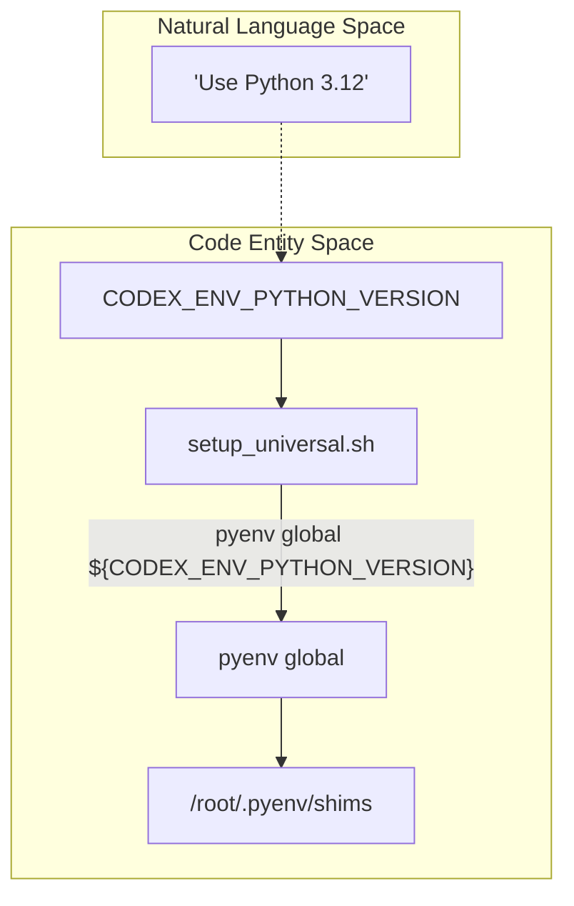
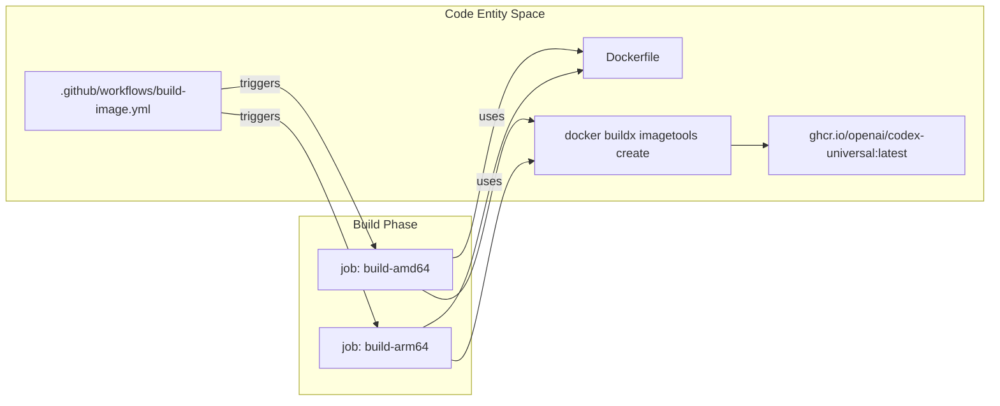

<!-- source: DeepWiki mcp.deepwiki.com · repo openai/codex-universal · page 6 Glossary · fetched 2026-10-26 -->

# Glossary

Relevant source files

The following files were used as context for generating this wiki page:

- [.github/workflows/build-image.yml](.github/workflows/build-image.yml)
- [Dockerfile](Dockerfile)
- [LICENSES/codex-universal-image-sbom.md](LICENSES/codex-universal-image-sbom.md)
- [LICENSES/codex-universal-image-sbom.spdx.json](LICENSES/codex-universal-image-sbom.spdx.json)
- [README.md](README.md)
- [setup_universal.sh](setup_universal.sh)

This page provides definitions for codebase-specific terms, abbreviations, and domain concepts used within the `codex-universal` repository. It serves as a technical reference for onboarding engineers to understand the mapping between abstract environment concepts and their concrete implementations in the Docker and shell environments.

## Core Concepts

### Codex Environment Variables (`CODEX_ENV_*`)
A standardized set of environment variables used to declare desired language versions and runtime configurations. These variables are consumed by the `setup_universal.sh` script at container startup to dynamically reconfigure the environment [setup_universal.sh:5-12]().

| Variable | Purpose | Code Pointer |
| :--- | :--- | :--- |
| `CODEX_ENV_PYTHON_VERSION` | Sets the global Python version via `pyenv`. | [setup_universal.sh:22-26]() |
| `CODEX_ENV_NODE_VERSION` | Sets the Node.js version and default alias via `nvm`. | [setup_universal.sh:28-36]() |
| `CODEX_ENV_RUST_VERSION` | Configures the default toolchain via `rustup`. | [setup_universal.sh:47-54]() |
| `CODEX_ENV_JAVA_VERSION` | Selects the JDK version using `mise`. | [setup_universal.sh:84-91]() |

### Mise
A polyglot tool manager (formerly known as `rtx`) used in this codebase to manage versions for Bun, Go, Ruby, and Java [Dockerfile:84-101](). It is configured with experimental features enabled and specific backends (asdf, vfox) disabled to ensure deterministic behavior [Dockerfile:96-100]().

**Sources:** [Dockerfile:84-103](), [setup_universal.sh:42-63]()

---

## Tooling & Infrastructure Jargon

### BuildKit Cache Mounts
The Dockerfile utilizes `--mount=type=cache` to persist package manager caches (apt, pip, npm, mise) across builds, significantly reducing image build times [Dockerfile:13-14](), [Dockerfile:139-142](), [Dockerfile:168-170]().

### Multi-Arch Manifest Stitching
The process of combining separate `amd64` and `arm64` Docker images into a single multi-architecture manifest. This allows users to pull `ghcr.io/openai/codex-universal:latest` and receive the correct architecture for their host machine automatically [.github/workflows/build-image.yml:91-97]().

### Shims
Executables that intercept commands and redirect them to the appropriate version of a tool.
*   **Pyenv Shims:** Located at `/root/.pyenv/shims`, these manage multiple Python versions [Dockerfile:128]().
*   **Mise Shims:** Located at `$HOME/.local/share/mise/shims`, these manage Bun, Go, and others [Dockerfile:102]().

---

## System Architecture Mapping

The following diagrams bridge the gap between high-level system requirements (Natural Language Space) and the specific scripts or files that implement them (Code Entity Space).

### Language Initialization Flow
This diagram shows how a user's request for a specific language version (e.g., "I want Python 3.12") flows through the system to reach the underlying version manager.

**Sources:** [setup_universal.sh:22-26](), [Dockerfile:124-129]()

### Multi-Arch Build Pipeline
This diagram maps the CI/CD pipeline steps to the specific GitHub Action jobs and Docker commands that produce the final universal image.

**Sources:** [.github/workflows/build-image.yml:20-97]()

---

## Domain Terms Table

| Term | Definition | Relevant Code |
| :--- | :--- | :--- |
| **Corepack** | A zero-runtime-dependency Node.js tool used to manage package managers like `yarn` and `pnpm`. | [Dockerfile:161-179]() |
| **Pipx** | Used to install and run Python applications in isolated environments (e.g., `poetry`, `uv`). | [Dockerfile:137-146]() |
| **Swiftly** | A tool manager for the Swift programming language, used to switch versions. | [setup_universal.sh:69]() |
| **Phpenv** | A version manager for PHP, specifically used to set the global PHP version. | [setup_universal.sh:79]() |
| **SBOM** | Software Bill of Materials; a comprehensive list of all software components and licenses in the image. | [LICENSES/codex-universal-image-sbom.md:1-4]() |
| **Attestation** | A cryptographically signed record of the build process to ensure provenance. | [.github/workflows/build-image.yml:105-111]() |

**Sources:** [Dockerfile:137-179](), [setup_universal.sh:65-82](), [LICENSES/codex-universal-image-sbom.md:1-4](), [.github/workflows/build-image.yml:105-111]()