# Page: Overview

# Overview

<details>
<summary>Relevant source files</summary>

The following files were used as context for generating this wiki page:

- [CONTRIBUTING.md](CONTRIBUTING.md)
- [README.md](README.md)

</details>


This document provides an introduction to the `codex-universal` repository, its purpose, components, and architecture. The repository contains a Docker-based development environment designed to provide a consistent and configurable platform for developing and testing code related to OpenAI Codex.

## Purpose and Scope

The `codex-universal` repository serves as a reference implementation of the base Docker image available in OpenAI Codex [README.md:1-3](). It helps developers customize environments in Codex by providing a similar containerized environment that can be run locally [README.md:5-7](). While not identical to the production Codex environment, this image offers a consistent platform for debugging and development work [README.md:5-7]().

The key objectives of the `codex-universal` project are:

1.  To provide a consistent, reproducible development environment [README.md:5-7]().
2.  To support multiple programming languages and their dependencies [README.md:43-56]().
3.  To enable configuration via environment variables [README.md:41-42]().
4.  To facilitate local development that closely mimics the Codex environment [README.md:24-39]().

Sources: [README.md:1-7](), [README.md:24-39](), [README.md:41-56]()

## Repository Structure

The `codex-universal` repository consists of several key components:

**System Architecture and Code Entities**
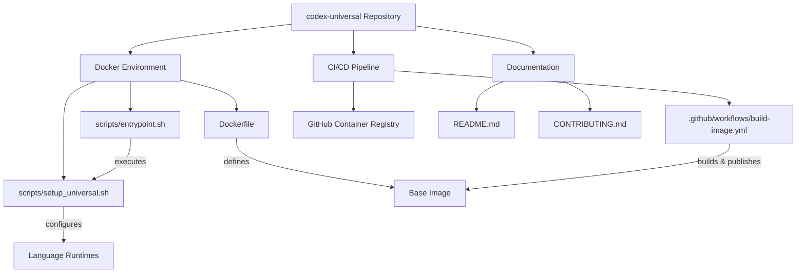

The repository is organized around three primary components:

1.  **Docker Environment**: The core functionality of the repository, defined in the `Dockerfile` [README.md:69-70]().
2.  **CI/CD Pipeline**: Automated build and publish workflows using GitHub Actions for `amd64` and `arm64` architectures [README.md:17-17]().
3.  **Documentation**: READMEs and contribution guidelines [README.md:1-1](), [CONTRIBUTING.md:1-1]().

Sources: [README.md:17-17](), [README.md:69-70](), [CONTRIBUTING.md:1-8]()

## Docker Image Architecture

The Docker image is built on Ubuntu 24.04 and includes multiple programming language runtimes, development tools, and configuration mechanisms:

**Natural Language Space to Code Entity Space: Runtime Ecosystem**
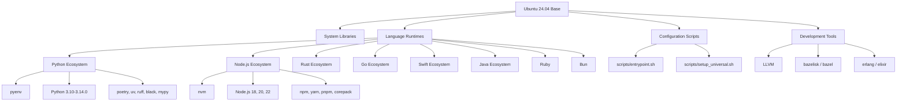

The image architecture follows a layered approach:

1.  **Base Layer**: Ubuntu 24.04 with system libraries and core utilities.
2.  **Language Runtimes**: Multiple versions of Python, Node.js, Rust, Go, Swift, Java, Ruby, and Bun [README.md:43-68]().
3.  **Development Tools**: Build tools like `bazelisk`, and language-specific tools like `poetry`, `uv`, and `corepack` [README.md:49-50](), [README.md:65-65]().
4.  **Configuration Scripts**: Scripts that handle the initialization of these runtimes at container start [README.md:41-42]().

Sources: [README.md:43-68](), [README.md:65-65]()

## Runtime Configuration System

One of the key features of `codex-universal` is its runtime configuration system, which allows developers to select specific language versions through environment variables:

**Execution Flow: Environment Initialization**
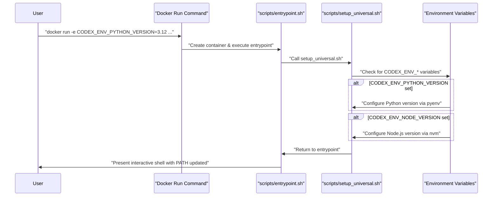

The container's behavior is customized at runtime through `CODEX_ENV_*` environment variables [README.md:41-42]():

| Environment Variable | Description | Supported Versions (Examples) |
|----------------------|-------------|-------------------|
| `CODEX_ENV_PYTHON_VERSION` | Python version | `3.10`, `3.12`, `3.13`, `3.14.0` |
| `CODEX_ENV_NODE_VERSION` | Node.js version | `18`, `20`, `22` |
| `CODEX_ENV_RUST_VERSION` | Rust version | `1.87.0`, `1.95.0` |
| `CODEX_ENV_GO_VERSION` | Go version | `1.23.8`, `1.25.1` |
| `CODEX_ENV_SWIFT_VERSION` | Swift version | `5.10`, `6.2` |
| `CODEX_ENV_JAVA_VERSION` | JDK version | `11`, `17`, `21`, `25` |

Sources: [README.md:41-57]()

## Usage Overview

The `codex-universal` Docker image is designed to be used as a development environment that closely approximates the OpenAI Codex environment. It is published as a multi-arch image for `linux/amd64` and `linux/arm64` [README.md:17-17]().

**Basic usage pattern:**

1.  **Pull**: `docker pull ghcr.io/openai/codex-universal:latest` [README.md:14-14]().
2.  **Run**: Execute with environment variables and volume mounts to simulate the Codex workspace [README.md:29-39]().

```sh
docker run --rm -it \
    -e CODEX_ENV_PYTHON_VERSION=3.12 \
    -v $(pwd):/workspace/$(basename $(pwd)) -w /workspace/$(basename $(pwd)) \
    ghcr.io/openai/codex-universal:latest
```

**Architecture Differences:**
*   **arm64**: OpenJDK 10 is unavailable [README.md:21-21]().
*   **arm64**: Swift installation is currently skipped due to a `swiftly` (mise) bug [README.md:22-22]().

Sources: [README.md:14-39](), [README.md:20-22]()

---

# Page: Docker Environment

# Docker Environment

<details>
<summary>Relevant source files</summary>

The following files were used as context for generating this wiki page:

- [Dockerfile](Dockerfile)
- [README.md](README.md)

</details>


This page documents the Docker environment architecture and components within the `codex-universal` repository. The Docker environment serves as a reference implementation of the base Docker image available in OpenAI Codex, providing developers with a local development environment that closely mirrors the Codex platform.

## Overview

The Docker environment is the core component of the `codex-universal` repository, providing a consistent and configurable development platform with multiple programming languages, development tools, and utilities. It is built on **Ubuntu 24.04** [Dockerfile:2]() and uses a layered approach to install version managers (like `pyenv`, `nvm`, and `mise`) and specific language runtimes.

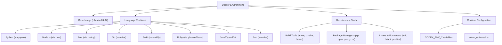

Sources: [Dockerfile:1-232](), [README.md:1-8]()

## Docker Image Architecture

The Docker image follows a layered architecture, building up from the base Ubuntu image through system libraries, language runtimes, and development tools. It supports multi-arch builds for both `linux/amd64` and `linux/arm64` [README.md:17]().

For details, see [Base Docker Image](#2.1).

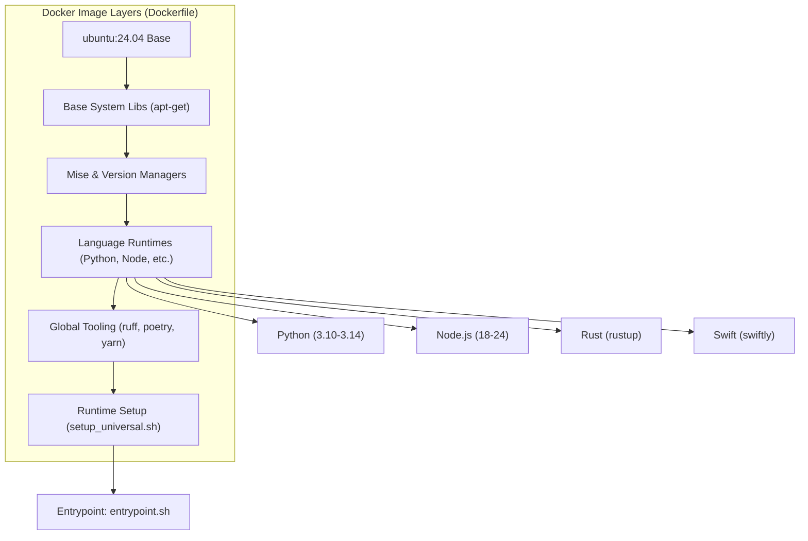

Sources: [Dockerfile:1-232](), [README.md:17-23]()

### Base System and Dependencies
The environment starts with `ubuntu:24.04` [Dockerfile:2]() and includes a comprehensive set of system libraries:
*   **Build Essentials**: `build-essential`, `cmake`, `ninja-build`, `nasm` [Dockerfile:19-112]().
*   **Development Libraries**: `libssl-dev`, `libffi-dev`, `libxml2-dev`, `libsqlite3-dev` [Dockerfile:51-79]().
*   **Database Clients**: `default-libmysqlclient-dev`, `libpq-dev` [Dockerfile:22-47]().
*   **Utilities**: `curl`, `jq`, `ripgrep`, `git`, `fd-find` [Dockerfile:21-80]().

### Language Runtimes
The image includes multiple versions of several programming languages, often managed by specific version managers to allow runtime switching.
*   **Python**: Managed by `pyenv` [Dockerfile:124](). Includes versions 3.10 through 3.14 [Dockerfile:121]().
*   **Node.js**: Managed by `nvm` [Dockerfile:160](). Includes versions 18, 20, 22, and 24 [Dockerfile:176-179]().
*   **Rust**: Managed by `rustup` [Dockerfile:234]().
*   **Go & Bun**: Managed by `mise` [Dockerfile:190-213]().

For details, see [Language Runtimes](#2.3).

## Runtime Configuration System

The Docker environment includes a configuration system that activates specific language versions based on environment variables passed during `docker run`. This is handled by a combination of `entrypoint.sh` and `setup_universal.sh`.

For details, see [Runtime Configuration](#2.2).

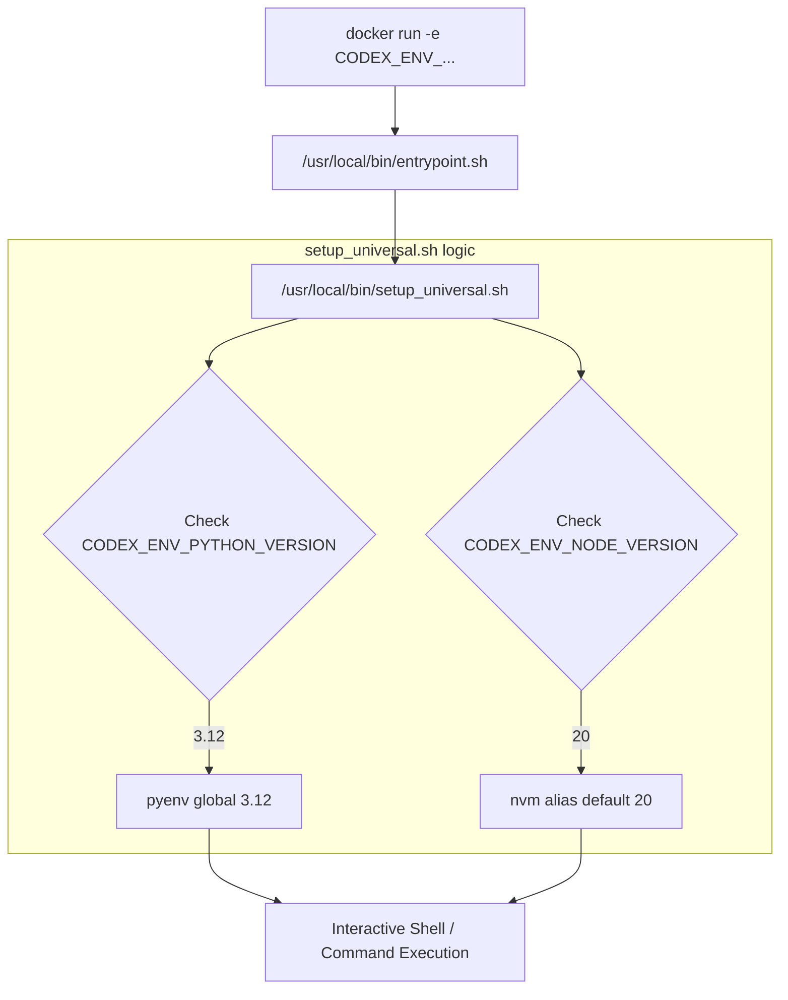

Sources: [Dockerfile:306-310](), [README.md:29-41]()

### Supported Environment Variables
The following variables (defined in `setup_universal.sh`) control the active runtime versions:

| Environment Variable | Description | Example Versions |
|---------------------|-------------|-------------------|
| `CODEX_ENV_PYTHON_VERSION` | Python version | `3.10`, `3.12`, `3.14` |
| `CODEX_ENV_NODE_VERSION` | Node.js version | `18`, `20`, `22` |
| `CODEX_ENV_RUST_VERSION` | Rust version | `1.87.0`, `1.95.0` |
| `CODEX_ENV_GO_VERSION` | Go version | `1.23.8`, `1.25.1` |
| `CODEX_ENV_JAVA_VERSION` | JDK version | `11`, `17`, `21`, `25` |

Sources: [README.md:47-56]()

## Developer Workflow

The image is designed to be used as a drop-in replacement for local development. Developers mount their local workspace into the container and specify the required environment via flags.

### Example Usage
```bash
docker run --rm -it \
    -e CODEX_ENV_PYTHON_VERSION=3.12 \
    -e CODEX_ENV_NODE_VERSION=20 \
    -v $(pwd):/workspace/$(basename $(pwd)) -w /workspace/$(basename $(pwd)) \
    ghcr.io/openai/codex-universal:latest
```

### Architecture Differences
The `arm64` image (common on Apple Silicon) has two primary differences from the `amd64` image:
1.  **OpenJDK 10** is not available on `arm64` [README.md:21]().
2.  **Swift** installation is skipped on `arm64` due to a known bug with the `swiftly` installer/mise [README.md:22]().

Sources: [README.md:17-39]()

---

# Page: Base Docker Image

# Base Docker Image

<details>
<summary>Relevant source files</summary>

The following files were used as context for generating this wiki page:

- [Dockerfile](Dockerfile)
- [LICENSES/codex-universal-image-sbom.md](LICENSES/codex-universal-image-sbom.md)
- [LICENSES/codex-universal-image-sbom.spdx.json](LICENSES/codex-universal-image-sbom.spdx.json)

</details>


## Purpose and Scope

This document details the base Docker image used in the `codex-universal` environment. It covers the underlying operating system (Ubuntu 24.04), installed language runtimes, development tools, libraries, and the multi-architecture build strategy. The image is designed to provide a reproducible local approximation of the OpenAI Codex execution environment, supporting both `amd64` and `arm64` architectures.

For information about runtime configuration of this image, see [Runtime Configuration](#2.2). For details on specific language runtime versions and options, see [Language Runtimes](#2.3).

Sources: [Dockerfile:1-232](), [LICENSES/codex-universal-image-sbom.md:1-106]()

## Image Architecture Overview

The base Docker image follows a layered approach, starting from a slim Ubuntu base and adding system dependencies, tool managers (like `mise`, `pyenv`, `nvm`), and finally specific language toolchains.

### Architecture Diagram: Code Entity Mapping

This diagram maps the high-level system components to the specific tools and scripts defined in the `Dockerfile`.

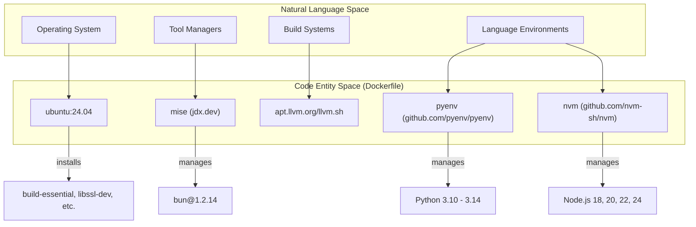

Sources: [Dockerfile:2-118](), [Dockerfile:121-180](), [Dockerfile:188-191]()

## Base Operating System

The image is built on **Ubuntu 24.04** [Dockerfile:2](). It uses BuildKit cache mounts for `apt` to optimize build times across multi-arch runners [Dockerfile:13-14]().

### Core System Components

- **Base Image**: Ubuntu 24.04
- **Character Encoding**: `C.UTF-8` [Dockerfile:7]()
- **Compiler Toolchain**: `build-essential` (12.10*), `binutils`, `gcc-13`, `stdc++-13` [Dockerfile:17-53]()
- **VCS**: `git` (2.43.*), `git-lfs`, `bzr` [Dockerfile:20-27]()
- **Core Utilities**: `curl`, `wget`, `jq`, `rsync`, `zip/unzip`, `sudo`, `ripgrep`, `fd-find` [Dockerfile:18-80]()

### System Libraries

The image includes essential libraries for building database drivers, SSL-enabled applications, and GUI-dependent tools:

| Category | Libraries |
|----------|-----------|
| **Compression** | `libbz2-dev`, `liblzma-dev`, `zlib1g-dev`, `xz-utils` [Dockerfile:32-79]() |
| **Cryptography** | `libssl-dev` (3.0.*), `gnupg`, `libgssapi-krb5-2` [Dockerfile:28-52]() |
| **Database** | `libsqlite3-dev`, `default-libmysqlclient-dev`, `libpq-dev` (Postgres) [Dockerfile:22-51]() |
| **Text/UI** | `libxml2-dev`, `libreadline-dev`, `libncurses-dev`, `tk-dev` [Dockerfile:45-69]() |
| **Interoperability** | `libffi-dev`, `unixodbc-dev`, `swig3.0`, `protobuf-compiler` [Dockerfile:38-72]() |

Sources: [Dockerfile:11-82]()

## Multi-Tool Management with Mise

The image utilizes `mise` (formerly `rtx`) as a modern polyglot tool manager. It is activated via `/etc/profile` [Dockerfile:95]().

- **Experimental Features**: Enabled to support advanced tool specs [Dockerfile:96]().
- **Managed Tools**: Currently used to install and manage `bun` [Dockerfile:190]().

Sources: [Dockerfile:84-102]()

## Language Runtimes

### Python Environment

Python is managed via `pyenv` [Dockerfile:124]().

- **Versions**: 3.10, 3.11, 3.12, 3.13, and 3.14 (experimental) [Dockerfile:121]().
- **Global Tools**: `poetry` (2.1.*) and `uv` (0.7.*) are installed via `pipx` [Dockerfile:146]().
- **Per-Version Packages**: Every installed Python version is bootstrapped with `pip`, `ruff`, `black`, `mypy`, `pyright`, `isort`, and `pytest` [Dockerfile:147-150]().

Sources: [Dockerfile:121-154]()

### Node.js Environment

Node.js is managed via `nvm` [Dockerfile:160]().

- **Versions**: 18, 20, 22 (default), and 24 [Dockerfile:176-180]().
- **Corepack**: Enabled for all versions to manage `yarn` and `pnpm` [Dockerfile:176-179]().
- **Global Defaults**: Every Node installation includes `prettier`, `eslint`, and `typescript` [Dockerfile:173]().

Sources: [Dockerfile:157-184]()

### LLVM and Build Tools

The image provides a modern LLVM toolchain directly from the LLVM project's repositories.

- **LLVM Toolchain**: Installed via `llvm.sh` script [Dockerfile:117]().
- **Build Utilities**: `cmake` (3.28.*), `ninja-build` (1.11.*), `ccache` (4.9.*) [Dockerfile:109-111]().
- **Assembly**: `nasm` and `yasm` [Dockerfile:112-113]().

Sources: [Dockerfile:104-118]()

## Build Strategy & Caching

The Dockerfile is optimized for BuildKit, utilizing several mount types to speed up the multi-arch (amd64/arm64) build process:

1.  **APT Cache**: `--mount=type=cache,target=/var/cache/apt` is used for all system package installations [Dockerfile:13]().
2.  **Language Caches**:
    *   **Python**: `/root/.cache/pip` and `/root/.cache/pipx` [Dockerfile:141-142]().
    *   **Node**: `/root/.npm`, `/root/.cache/yarn`, and `/root/.local/share/pnpm/store` [Dockerfile:168-170]().
    *   **Mise**: `/root/.cache/mise` [Dockerfile:189]().

### Build Data Flow

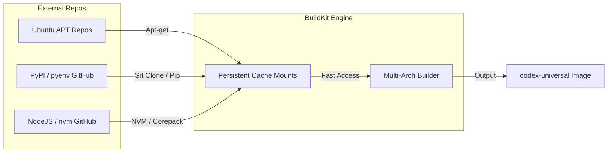

Sources: [Dockerfile:1-192]()

## Software Bill of Materials (SBOM)

A full SBOM is maintained to track the versions and licenses of all bundled software.

- **Primary Licenses**: MIT (pyenv, nvm, bun, uv, poetry), Apache-2.0 (LLVM, Bazelisk, Swift, Gradle), BSD-3-Clause (Go), and GPL-2.0 (Java/OpenJDK).
- **Documentation**: The human-readable version is located at `LICENSES/codex-universal-image-sbom.md` [LICENSES/codex-universal-image-sbom.md:1-106](), while a machine-readable SPDX JSON is available at `LICENSES/codex-universal-image-sbom.spdx.json` [LICENSES/codex-universal-image-sbom.spdx.json:1-196]().

Sources: [LICENSES/codex-universal-image-sbom.md:1-106](), [LICENSES/codex-universal-image-sbom.spdx.json:1-196]()

---

# Page: Runtime Configuration

# Runtime Configuration

<details>
<summary>Relevant source files</summary>

The following files were used as context for generating this wiki page:

- [README.md](README.md)
- [entrypoint.sh](entrypoint.sh)
- [setup_universal.sh](setup_universal.sh)

</details>


This page explains how the `codex-universal` Docker environment dynamically configures language runtimes at container startup using environment variables. The system is designed to be idempotent and efficient, only performing heavy version-switching operations when the requested environment differs from the pre-installed defaults.

## Configuration Flow Overview

When a container is started, the `entrypoint.sh` script serves as the primary orchestrator. It invokes the configuration logic and then drops the user into an interactive shell.

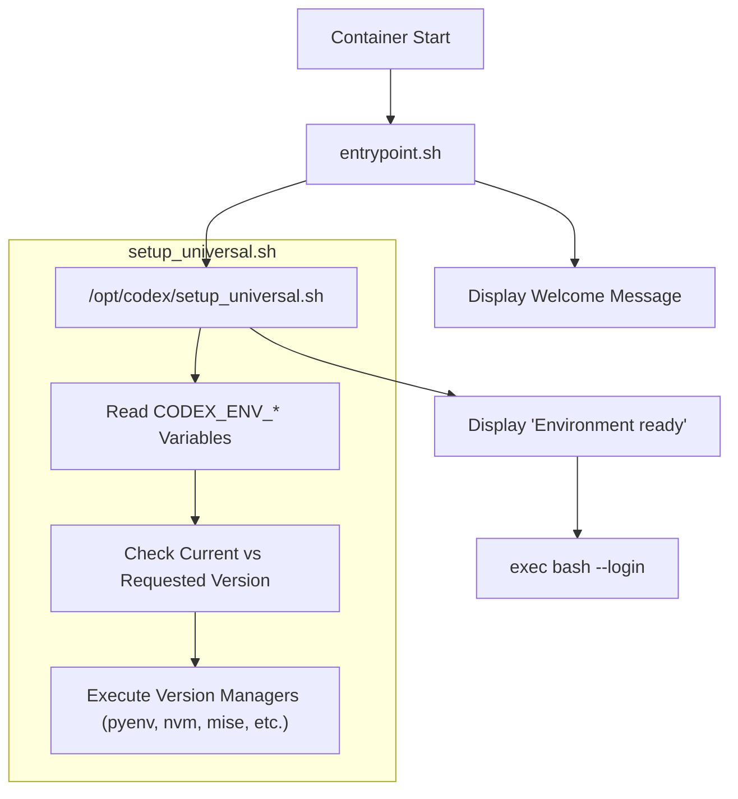

Sources: [entrypoint.sh:1-11](), [setup_universal.sh:1-14]()

## Environment Variables

The container looks for specific `CODEX_ENV_*` variables to determine the desired runtime state.

| Environment Variable | Purpose | Supported Versions (Examples) | Version Manager |
|----------------------|---------|-------------------|-----------------|
| `CODEX_ENV_PYTHON_VERSION` | Python version | `3.10`, `3.12`, `3.14.0` | `pyenv` |
| `CODEX_ENV_NODE_VERSION` | Node.js version | `18`, `20`, `22` | `nvm` |
| `CODEX_ENV_RUBY_VERSION` | Ruby version | `3.2.3`, `3.4.4` | `mise` |
| `CODEX_ENV_RUST_VERSION` | Rust version | `1.87.0`, `1.95.0` | `rustup` |
| `CODEX_ENV_GO_VERSION` | Go version | `1.23.8`, `1.25.1` | `mise` |
| `CODEX_ENV_SWIFT_VERSION` | Swift version | `5.10`, `6.2` | `swiftly` |
| `CODEX_ENV_PHP_VERSION` | PHP version | `8.2`, `8.4` | `phpenv` |
| `CODEX_ENV_JAVA_VERSION` | JDK version | `11`, `17`, `25` | `mise` |

Sources: [README.md:45-57](), [setup_universal.sh:5-12]()

## Configuration Mechanism

The logic in `setup_universal.sh` distinguishes between runtimes that require fresh initialization every boot and those that can be skipped if the default matches.

### Version Detection and Switching

The script uses specific shell commands to detect currently active versions before deciding to invoke a version manager.

```mermaid
flowchart LR
    subgraph "Natural Language Space"
    V1["Detect Node Version"]
    V2["Detect Rust Version"]
    V3["Detect Go Version"]
    V4["Detect Java Version"]
    end

    subgraph "Code Entity Space"
    V1 --- C1["node -v | cut -d. -f1"]
    V2 --- C2["rustc --version | awk '{print $2}'"]
    V3 --- C3["go version | awk '{print $3}'"]
    V4 --- C4["java -version 2>&1 | awk -F'[ .\" ]+' '/version/ {print $3}'"]
    end
```

Sources: [setup_universal.sh:29-85]()

### Language-Specific Logic

#### Python and Node.js (Always Updated)
For Python and Node.js, the script explicitly notes that it always runs the switch commands. This ensures that global libraries for linting and formatting (like `ruff`, `black`, `poetry` for Python, or `yarn`, `pnpm` for Node) are correctly mapped to the active version.

*   **Python**: Uses `pyenv global` [setup_universal.sh:24]().
*   **Node.js**: Uses `nvm alias default` and `nvm use --save`. It also runs `corepack enable` to prepare package managers [setup_universal.sh:32-34]().

#### Rust, Go, Ruby, Swift, PHP, and Java (Idempotent)
These runtimes use an "if-changed" logic to save boot time. If the environment variable matches the detected `current` version, the installation/switching step is skipped.

*   **Rust**: Uses `rustup default` [setup_universal.sh:51]().
*   **Ruby, Go, Java**: Managed via `mise use --global` [setup_universal.sh:42, 60, 88]().
*   **Swift**: Managed via `swiftly use` [setup_universal.sh:69]().
*   **PHP**: Managed via `phpenv global` (using the `snapshot` suffix convention) [setup_universal.sh:79]().

Sources: [setup_universal.sh:16-91]()

## Shell Initialization and PATH

The configuration process ensures that interactive sessions are ready for use immediately after the setup script finishes.

1.  **Login Shell**: `setup_universal.sh` starts with `#!/bin/bash --login` to ensure all version manager profiles (like `.bashrc` or `/etc/profile.d/` scripts) are sourced [setup_universal.sh:1]().
2.  **Entrypoint Handoff**: The `entrypoint.sh` script executes `setup_universal.sh` and then uses `exec bash --login "$@"` [entrypoint.sh:10](). This replaces the entrypoint process with a login shell, preserving the environment variables and PATH modifications made during the setup phase.
3.  **Path Management**: Version managers (pyenv, nvm, mise) handle PATH manipulation dynamically. For example, `nvm use` updates the PATH for the current session, and `mise use --global` updates the global configuration files.

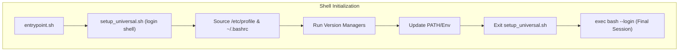

Sources: [entrypoint.sh:1-11](), [setup_universal.sh:1-4]()

## Optimization Strategy

The implementation prioritizes speed for common development scenarios:

| Strategy | Description | Implementation |
| :--- | :--- | :--- |
| **Tooling Consistency** | Python/Node always switch to ensure `poetry`/`npm` work. | [setup_universal.sh:16-17]() |
| **Boot Speed** | Skip `rustup`/`mise`/`swiftly` if version is already correct. | [setup_universal.sh:19-20]() |
| **Logging** | Clear output of what is being configured for debugging. | [setup_universal.sh:14, 23, 30]() |

Sources: [setup_universal.sh:14-91]()

---

# Page: Language Runtimes

# Language Runtimes

<details>
<summary>Relevant source files</summary>

The following files were used as context for generating this wiki page:

- [Dockerfile](Dockerfile)
- [setup_universal.sh](setup_universal.sh)
- [verify.sh](verify.sh)

</details>


## Purpose and Scope

This document details the language runtimes included in the codex-universal Docker environment, their configuration options, version management systems, and associated development tools. It covers the transition from `asdf` to `mise` for several runtimes and the specific version managers used for others. For information about runtime configuration at container startup, see [Runtime Configuration](2.2).

## Overview of Supported Language Runtimes

The codex-universal Docker image provides a comprehensive multi-language development environment. Runtimes are managed using a mix of specialized version managers (like `pyenv` and `nvm`) and the `mise` polyglot tool manager [Dockerfile:84-102]().

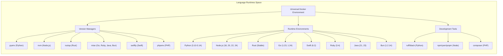

Sources: [Dockerfile:119-216](), [setup_universal.sh:5-13]()

## Supported Languages and Versions

The following table summarizes all language runtimes available and their configuration variables:

| Language | Version Manager | Available Versions | Default Version | Environment Variable |
|----------|----------------|-------------------|-----------------|---------------------|
| Python | `pyenv` | 3.10, 3.11, 3.12, 3.13, 3.14 | 3.12 | `CODEX_ENV_PYTHON_VERSION` |
| Node.js | `nvm` | 18, 20, 22, 24 | 22 | `CODEX_ENV_NODE_VERSION` |
| Rust | `rustup` | Stable | Latest | `CODEX_ENV_RUST_VERSION` |
| Go | `mise` | 1.23, 1.24 | 1.24 | `CODEX_ENV_GO_VERSION` |
| Swift | `swiftly` | 6.2 | 6.2 | `CODEX_ENV_SWIFT_VERSION` |
| Ruby | `mise` | 3.4 | 3.4 | `CODEX_ENV_RUBY_VERSION` |
| PHP | `phpenv` | 8.3, 8.4 | 8.4 | `CODEX_ENV_PHP_VERSION` |
| Java | `mise` | 21, 23 | 21 | `CODEX_ENV_JAVA_VERSION` |
| Bun | `mise` | 1.2.14 | 1.2.14 | N/A |
| Elixir | `mise` | 1.18 | 1.18 | N/A |

Sources: [Dockerfile:121-216](), [setup_universal.sh:5-13]()

## Runtime Configuration Mechanism

The container uses `setup_universal.sh` to reconcile the requested environment variables with the pre-installed versions.

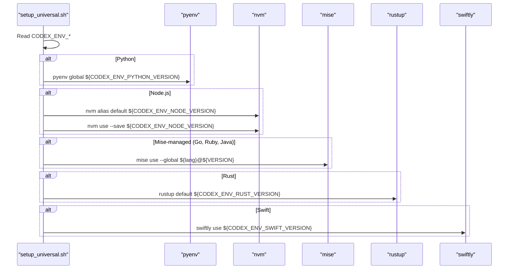

Sources: [setup_universal.sh:22-91]()

## Language Runtime Details

### Python Environment
Managed via `pyenv` [Dockerfile:123-134]().
- **Versions**: 3.10 through 3.14.
- **Global Tools**: `pipx` is used to install `poetry` and `uv` [Dockerfile:146]().
- **Pre-installed Libraries**: Every version includes `ruff`, `black`, `mypy`, `pyright`, `isort`, and `pytest` [Dockerfile:149]().
- **Optimization**: `UV_NO_PROGRESS=1` is set to improve performance of stdout buffering [Dockerfile:153]().

### Node.js Environment
Managed via `nvm` [Dockerfile:160-184]().
- **Versions**: 18, 20, 22, 24.
- **Corepack**: Enabled for `yarn` and `pnpm` management [Dockerfile:176-179]().
- **Default Packages**: `prettier`, `eslint`, and `typescript` are automatically installed for new Node versions [Dockerfile:173]().

### Mise-Managed Runtimes
The `mise` tool (a modern successor to `asdf`) manages several runtimes to ensure architecture-agnostic versioning [Dockerfile:84-102]().
- **Go**: Versions 1.23 and 1.24 [Dockerfile:198-201]().
- **Ruby**: Version 3.4 [Dockerfile:203-206]().
- **Java**: OpenJDK 21 and 23 via `mise` [Dockerfile:193-196]().
- **Bun**: Version 1.2.14 [Dockerfile:188-191]().
- **Elixir/Erlang**: Elixir 1.18 and Erlang 27 [Dockerfile:213-216]().

### PHP Environment
Managed via `phpenv` [Dockerfile:208-211]().
- **Versions**: 8.3 and 8.4.
- **Tooling**: Includes `composer` and `phpunit`.
- **Note**: Version switching in `setup_universal.sh` appends `snapshot` to the version string for `phpenv` compatibility [setup_universal.sh:79]().

### Swift Environment
Managed via `swiftly` [Dockerfile:218-223]().
- **Architecture Support**: Uses architecture-specific installation scripts (`aarch64` vs `x86_64`) [Dockerfile:220]().
- **Version**: 6.2.

## Verification and Testing
The `verify.sh` script iterates through all supported version combinations defined in the Dockerfile arguments to ensure `setup_universal.sh` can successfully switch between them without errors [verify.sh:27-42]().

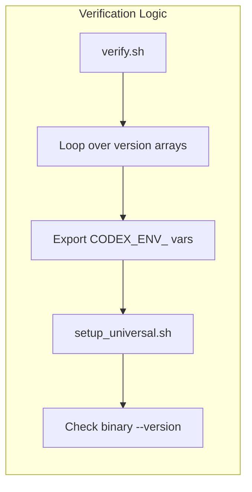

Sources: [verify.sh:5-86]()

## Shell Environment Integration
Runtimes are integrated into the system-wide shell via `/etc/profile`:
- **Mise**: `eval "$(mise activate bash)"` [Dockerfile:95]().
- **Pyenv**: `eval "$(pyenv init - bash)"` [Dockerfile:129]().
- **NVM**: `source $NVM_DIR/nvm.sh` [Dockerfile:172]().
- **Pathing**: `PATH` is updated to include `mise` shims [Dockerfile:102]() and `pipx` binaries [Dockerfile:138]().

Sources: [Dockerfile:95-138](), [Dockerfile:172]()

---

# Page: CI/CD Pipeline

# CI/CD Pipeline

<details>
<summary>Relevant source files</summary>

The following files were used as context for generating this wiki page:

- [.github/workflows/build-image.yml](.github/workflows/build-image.yml)

</details>


## Purpose and Scope

This document details the Continuous Integration/Continuous Deployment (CI/CD) pipeline used by the `codex-universal` repository. The pipeline automatically builds, manifests, and publishes a multi-architecture Docker image to the GitHub Container Registry (`ghcr.io`) whenever changes are pushed to the `main` branch. It utilizes dedicated runners to perform parallel builds for `amd64` and `arm64` architectures, ensuring high-performance execution and broad compatibility.

Sources: [.github/workflows/build-image.yml:1-18]()

## Pipeline Overview

The CI/CD pipeline is implemented using GitHub Actions and is defined in `.github/workflows/build-image.yml`. It employs a three-job strategy: two parallel architecture-specific build jobs and a final synchronization job to stitch the manifests together.

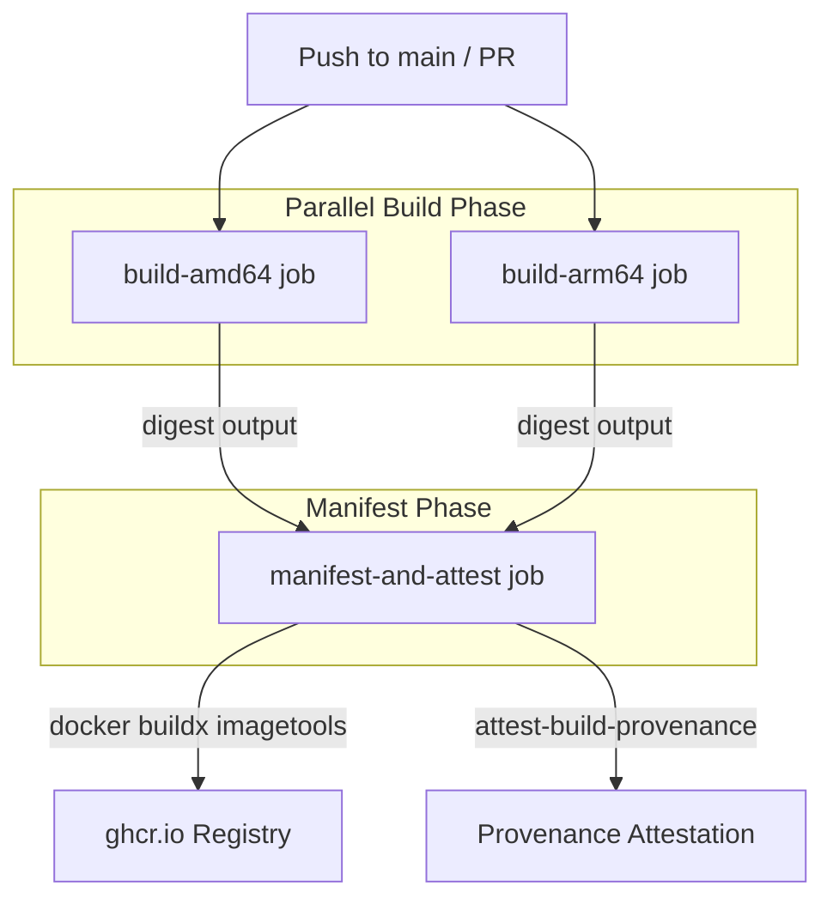

Sources: [.github/workflows/build-image.yml:19-111]()

## Workflow Configuration

### Trigger Conditions
The workflow is triggered on:
*   **Push**: Any push to the `main` branch [[.github/workflows/build-image.yml:4-5]()]
*   **Pull Request**: Any PR targeting the `main` branch [[.github/workflows/build-image.yml:6-7]()]

### Permissions
The workflow requires elevated permissions to interact with the GitHub Container Registry and security services:
*   `packages: write`: To upload Docker images [[.github/workflows/build-image.yml:11]()]
*   `id-token: write` & `attestations: write`: Required for generating build provenance [[.github/workflows/build-image.yml:12-13]()]

## Architecture-Specific Build Jobs

The pipeline splits the build into two distinct jobs: `build-amd64` [[.github/workflows/build-image.yml:20]()] and `build-arm64` [[.github/workflows/build-image.yml:49]()]. This allows the use of native hardware runners rather than slow emulation.

### Runner Selection
Jobs are assigned to specific runner groups and labels:
*   **AMD64**: Runs on `group: codex-runners` with label `codex-linux-x64` [[.github/workflows/build-image.yml:21-23]()]
*   **ARM64**: Runs on `group: codex-runners` with label `codex-linux-arm64` [[.github/workflows/build-image.yml:50-52]()]

### Build Implementation Details
Each job follows a standard sequence:
1.  **Environment Setup**: Uses `docker/setup-qemu-action` and `docker/setup-buildx-action` to initialize the BuildKit engine [[.github/workflows/build-image.yml:33-34](), [.github/workflows/build-image.yml:62-63]()].
2.  **Build and Push**: Executes `docker/build-push-action@v6` [[.github/workflows/build-image.yml:37](), [.github/workflows/build-image.yml:66]()].
    *   **Architecture Isolation**: `build-amd64` specifies `platforms: linux/amd64` [[.github/workflows/build-image.yml:39]()].
    *   **Architecture Isolation**: `build-arm64` specifies `platforms: linux/arm64` [[.github/workflows/build-image.yml:68]()].
3.  **Tagging**: Images are initially pushed with architecture-specific tags: `amd64-${{ github.sha }}` and `arm64-${{ github.sha }}` [[.github/workflows/build-image.yml:41](), [.github/workflows/build-image.yml:70]()].

### Caching Strategy
The pipeline uses an **inline caching strategy** combined with registry lookups:
*   `cache-from`: Points to the `:latest` image in the registry to pull existing layers [[.github/workflows/build-image.yml:42](), [.github/workflows/build-image.yml:71]()].
*   `cache-to`: Uses `type=inline`, which embeds build cache metadata directly into the pushed image [[.github/workflows/build-image.yml:43](), [.github/workflows/build-image.yml:72]()].

Sources: [.github/workflows/build-image.yml:20-77]()

## Multi-Arch Manifest and Attestation

The final job, `manifest-and-attest`, runs only after the parallel builds succeed and only on pushes to the `main` branch [[.github/workflows/build-image.yml:78-83]()].

### Manifest Stitching
Instead of rebuilding, this job uses `docker buildx imagetools` to create a multi-arch manifest. This links the previously uploaded `amd64` and `arm64` blobs under a single unified tag.

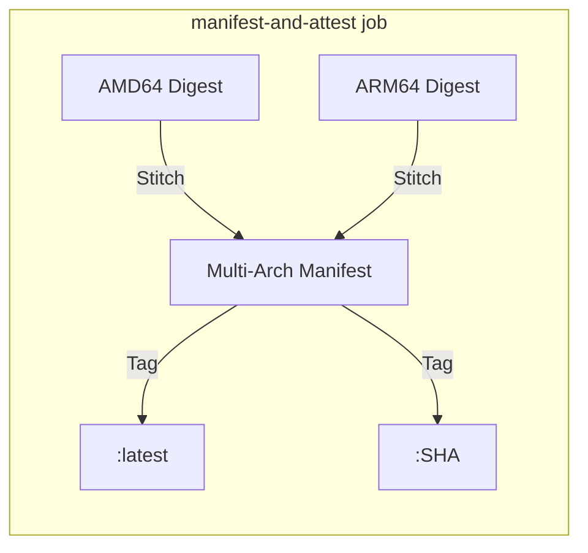

The command targets the digests produced by the previous jobs:
`docker buildx imagetools create -t ...:latest -t ...:${GITHUB_SHA} ...@${{ needs.build-amd64.outputs.digest }} ...@${{ needs.build-arm64.outputs.digest }}` [[.github/workflows/build-image.yml:93-97]()]

### Build Provenance
The pipeline enhances security by generating a **Build Provenance Attestation**. This uses the `actions/attest-build-provenance` action [[.github/workflows/build-image.yml:105-106]()].
*   **Subject**: The full image path in `ghcr.io` [[.github/workflows/build-image.yml:109]()].
*   **Digest**: The manifest digest extracted via `docker buildx imagetools inspect` [[.github/workflows/build-image.yml:102-103](), [.github/workflows/build-image.yml:110]()].

Sources: [.github/workflows/build-image.yml:78-111]()

## Tagging Strategy Summary

The pipeline applies a tiered tagging strategy to ensure both stability and traceability.

| Tag Pattern | Job Responsible | Purpose |
| :--- | :--- | :--- |
| `amd64-<SHA>` | `build-amd64` | Intermediate architecture-specific blob. |
| `arm64-<SHA>` | `build-arm64` | Intermediate architecture-specific blob. |
| `<SHA>` | `manifest-and-attest` | Immutable multi-arch reference for a specific commit. |
| `latest` | `manifest-and-attest` | Rolling reference for the most recent successful build on `main`. |

Sources: [.github/workflows/build-image.yml:41](), [.github/workflows/build-image.yml:70](), [.github/workflows/build-image.yml:94-95]()

## Data Flow: From Code to Registry

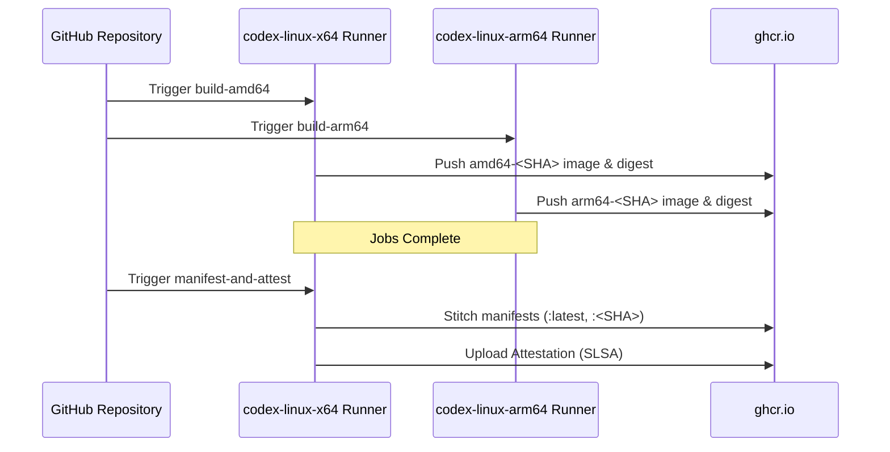

Sources: [.github/workflows/build-image.yml:19-111]()

---

# Page: Usage Guide

# Usage Guide

<details>
<summary>Relevant source files</summary>

The following files were used as context for generating this wiki page:

- [README.md](README.md)
- [setup_universal.sh](setup_universal.sh)

</details>


This guide provides comprehensive instructions for using the `codex-universal` Docker image in your development workflow. It covers how to pull and run the Docker image, configure language runtimes through environment variables, and set up a development environment that closely resembles the OpenAI Codex environment. For detailed information about environment variables, see [Environment Variables](#4.1).

## Getting Started

### Pulling the Docker Image

The `codex-universal` Docker image is hosted on GitHub Container Registry and can be pulled using the following command:

```bash
docker pull ghcr.io/openai/codex-universal:latest
```

Sources: [README.md:13-15]()

### Basic Usage

To run the container with default settings:

```bash
docker run --rm -it ghcr.io/openai/codex-universal:latest
```

This repository builds the image for both `linux/amd64` and `linux/arm64`. While the image is primarily run on `amd64`, your installed Docker may support `amd64` emulation on Apple Silicon or other ARM hardware by passing the `--platform linux/amd64` flag.

Sources: [README.md:17-18](), [README.md:29-39]()

## Container Environment Structure

The diagram below illustrates how the container environment is structured and initialized. The system uses `entrypoint.sh` to trigger the runtime configuration via `setup_universal.sh`.

### Initialization Workflow
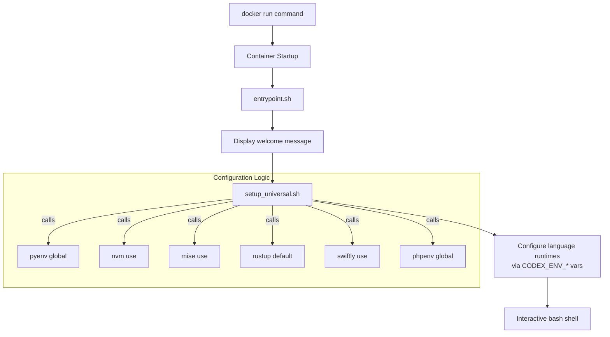

Sources: [setup_universal.sh:1-91](), [README.md:41-42]()

## Configuring Language Runtimes

The `codex-universal` image supports various programming languages and allows you to specify which version of each language to use through environment variables. The configuration is idempotent; for some languages like Rust, the script only installs/switches versions if the requested version differs from the current default to save boot time.

Sources: [setup_universal.sh:19-21]()

### Supported Language Versions

| Environment Variable | Description | Supported Versions | Additional Tools |
|----------------------|-------------|-------------------|------------------|
| `CODEX_ENV_PYTHON_VERSION` | Python version | `3.10`, `3.11.12`, `3.12`, `3.13`, `3.14.0` | `pyenv`, `poetry`, `uv`, `ruff`, `black`, `mypy`, `pyright`, `isort` |
| `CODEX_ENV_NODE_VERSION` | Node.js version | `18`, `20`, `22` | `corepack`, `yarn`, `pnpm`, `npm` |
| `CODEX_ENV_RUST_VERSION` | Rust version | `1.83.0` to `1.95.0` | `rustup` |
| `CODEX_ENV_GO_VERSION` | Go version | `1.22.12`, `1.23.8`, `1.24.3`, `1.25.1` | `mise` |
| `CODEX_ENV_SWIFT_VERSION` | Swift version | `5.10`, `6.1`, `6.2` | `swiftly` |
| `CODEX_ENV_RUBY_VERSION` | Ruby version | `3.2.3`, `3.3.8`, `3.4.4` | `mise` |
| `CODEX_ENV_PHP_VERSION` | PHP version | `8.2`, `8.3`, `8.4` | `phpenv` |
| `CODEX_ENV_JAVA_VERSION` | JDK version | `11`, `17`, `21` to `25` | `mise` |

Sources: [README.md:47-57](), [setup_universal.sh:5-12]()

### Runtime Configuration Process

The diagram below maps the Natural Language intent (setting a version) to the specific Code Entities (scripts and managers) responsible for the state change.

### Version Management Mapping
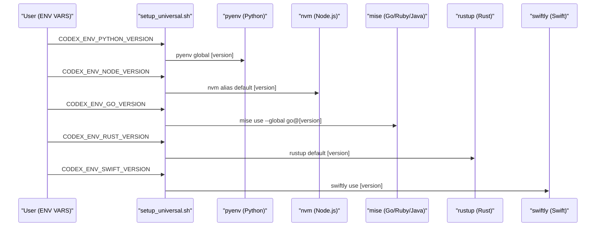

Sources: [setup_universal.sh:22-91]()

## Common Usage Patterns

### Development Workflow

The most common usage pattern is to mount your local codebase into the container and use the container as your development environment. This approximates the `setup` environment in Codex.

```bash
docker run --rm -it \
    -e CODEX_ENV_PYTHON_VERSION=3.12 \
    -e CODEX_ENV_NODE_VERSION=20 \
    -v $(pwd):/workspace/$(basename $(pwd)) -w /workspace/$(basename $(pwd)) \
    ghcr.io/openai/codex-universal:latest
```

Sources: [README.md:24-39]()

### Architecture Differences (amd64 vs arm64)

While the image supports both architectures, there are two key differences to note for `arm64` (e.g., Apple Silicon):
1. **OpenJDK 10** is not available on `amd64`.
2. **Swift** installation is currently skipped on `arm64` due to a known bug with the `mise` tool.

Sources: [README.md:20-22]()

## Additional Pre-installed Tools

Besides the configurable language runtimes, the `codex-universal` image includes several fixed-version tools:

- **Bun**: `1.2.10` [README.md:64]()
- **Erlang**: `27.1.2` [README.md:66]()
- **Elixir**: `1.18.3` [README.md:67]()
- **Bazelisk / Bazel** [README.md:65]()

## Summary

The `codex-universal` Docker image provides a configurable development environment that mirrors the OpenAI Codex environment. By using the appropriate `CODEX_ENV_*` environment variables and volume mounts, you can create a consistent development environment for your projects.

For detailed information about all available environment variables and their supported values, see [Environment Variables](#4.1).

---

# Page: Environment Variables

# Environment Variables

<details>
<summary>Relevant source files</summary>

The following files were used as context for generating this wiki page:

- [README.md](README.md)
- [setup_universal.sh](setup_universal.sh)
- [verify.sh](verify.sh)

</details>


This page documents the environment variables that can be used to configure the `codex-universal` Docker container at runtime. The container leverages these variables to set up specific language versions and development tools to match your desired environment.

## Overview

The `codex-universal` container uses environment variables prefixed with `CODEX_ENV_` to configure language runtimes during the container's initialization phase. These variables allow developers to specify which versions of programming languages should be activated in the container environment. The primary script responsible for processing these variables is `/opt/codex/setup_universal.sh` [setup_universal.sh:1-12]().

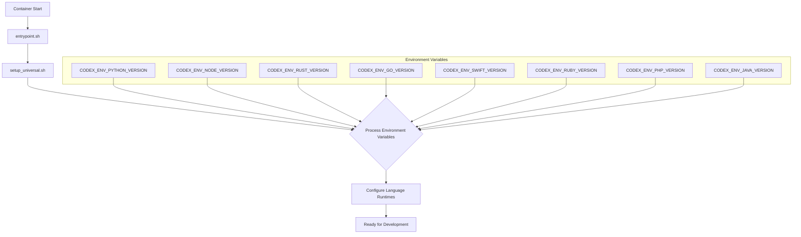

Sources: [setup_universal.sh:1-12](), [README.md:24-41]()

## Supported Environment Variables

The following table lists all supported environment variables, their purpose, and the versions that can be specified. Note that for Python and Node.js, global libraries are always re-evaluated to ensure linting and formatting tools are available [setup_universal.sh:16-17]().

| Environment Variable | Description | Supported Versions | Additional Packages |
|---------------------|-------------|-------------------|---------------------|
| `CODEX_ENV_PYTHON_VERSION` | Python version to install | `3.10`, `3.11.12`, `3.12`, `3.13`, `3.14.0` | `pyenv`, `poetry`, `uv`, `ruff`, `black`, `mypy`, `pyright`, `isort` |
| `CODEX_ENV_NODE_VERSION` | Node.js version to install | `18`, `20`, `22` | `corepack`, `yarn`, `pnpm`, `npm` |
| `CODEX_ENV_RUST_VERSION` | Rust version to install | `1.83.0` to `1.95.0` (see README) | |
| `CODEX_ENV_GO_VERSION` | Go version to install | `1.22.12`, `1.23.8`, `1.24.3`, `1.25.1` | |
| `CODEX_ENV_SWIFT_VERSION` | Swift version to install | `5.10`, `6.1`, `6.2` | |
| `CODEX_ENV_RUBY_VERSION` | Ruby version to install | `3.2.3`, `3.3.8`, `3.4.4` | |
| `CODEX_ENV_PHP_VERSION` | PHP version to install | `8.2`, `8.3`, `8.4` | |
| `CODEX_ENV_JAVA_VERSION` | JDK version to install | `11`, `17`, `21`, `22`, `23`, `24`, `25` | |

Sources: [README.md:47-57](), [setup_universal.sh:5-12]()

## Configuration Process

When a container starts, the `setup_universal.sh` script processes the environment variables. To optimize boot time, for languages like Rust, Go, Swift, Ruby, and Java, the script performs an idempotency check: it only invokes the version manager if the requested version differs from the currently active version [setup_universal.sh:19-20]().

```mermaid
flowchart TD
    start["setup_universal.sh"] --> check_vars{"Check Environment Variables"}
    
    check_vars --> python{"CODEX_ENV_PYTHON_VERSION set?"}
    check_vars --> node{"CODEX_ENV_NODE_VERSION set?"}
    check_vars --> rust{"CODEX_ENV_RUST_VERSION set?"}
    check_vars --> ruby{"CODEX_ENV_RUBY_VERSION set?"}
    
    python -->|Yes| py_config["pyenv global VERSION"]
    node -->|Yes| node_config["nvm alias default VERSION"]
    
    rust -->|Yes| rust_check{"rustc --version != target?"}
    ruby -->|Yes| ruby_check{"ruby -v != target?"}
    
    rust_check -->|Yes| rust_install["rustup default VERSION"]
    ruby_check -->|Yes| ruby_install["mise use --global ruby@VERSION"]
    
    py_config & node_config & rust_install & ruby_install --> done["Environment Configured"]
    rust_check -->|No| done
    ruby_check -->|No| done
```

Sources: [setup_universal.sh:22-91]()

### Python Configuration
When `CODEX_ENV_PYTHON_VERSION` is set, the script uses `pyenv global` to switch the active version [setup_universal.sh:22-26](). The container image includes pre-installed tools like `poetry`, `uv`, and `ruff` [README.md:49]().

### Node.js Configuration
When `CODEX_ENV_NODE_VERSION` is set, the script compares the current version using `node -v` [setup_universal.sh:29](). If it differs, it uses `nvm alias default` and `nvm use --save`, then executes `corepack enable` to prepare package managers [setup_universal.sh:32-34]().

### Rust Configuration
When `CODEX_ENV_RUST_VERSION` is set, the script extracts the current version from `rustc --version` [setup_universal.sh:48](). If a change is needed, it calls `rustup default` [setup_universal.sh:51]().

### Go & Java & Ruby Configuration
These runtimes are managed via `mise` (or `phpenv`/`swiftly`).
- **Go**: Uses `mise use --global go@${CODEX_ENV_GO_VERSION}` [setup_universal.sh:60]().
- **Ruby**: Uses `mise use --global ruby@${CODEX_ENV_RUBY_VERSION}` [setup_universal.sh:42]().
- **Java**: Uses `mise use --global java@${CODEX_ENV_JAVA_VERSION}` [setup_universal.sh:88]().
- **PHP**: Uses `phpenv global "${CODEX_ENV_PHP_VERSION}snapshot"` [setup_universal.sh:79]().

Sources: [setup_universal.sh:38-91]()

## Mapping Variables to Code Entities

The following diagram bridges the high-level environment variables to the specific CLI tools and version managers they interact with inside the codebase.

```mermaid
graph LR
    subgraph "Natural Language / User Input"
        V_PY["CODEX_ENV_PYTHON_VERSION"]
        V_JS["CODEX_ENV_NODE_VERSION"]
        V_RB["CODEX_ENV_RUBY_VERSION"]
        V_RS["CODEX_ENV_RUST_VERSION"]
        V_SW["CODEX_ENV_SWIFT_VERSION"]
    end

    subgraph "Code Entity Space (setup_universal.sh)"
        TOOL_PY["pyenv global"]
        TOOL_JS["nvm use"]
        TOOL_RB["mise use ruby@"]
        TOOL_RS["rustup default"]
        TOOL_SW["swiftly use"]
    end

    V_PY --> TOOL_PY
    V_JS --> TOOL_JS
    V_RB --> TOOL_RB
    V_RS --> TOOL_RS
    V_SW --> TOOL_SW

    subgraph "System Verification (verify.sh)"
        CHECK_PY["python3 --version"]
        CHECK_JS["node --version"]
        CHECK_RB["ruby --version"]
        CHECK_RS["rustc --version"]
    end

    TOOL_PY -.-> CHECK_PY
    TOOL_JS -.-> CHECK_JS
    TOOL_RB -.-> CHECK_RB
    TOOL_RS -.-> CHECK_RS
```

Sources: [setup_universal.sh:22-72](), [verify.sh:44-71]()

## Usage Examples

### Complete Configuration
To configure a full stack environment (Python 3.12, Node 20, Rust 1.87.0, Go 1.23.8, Swift 6.2, Ruby 3.4.4, PHP 8.4):

```bash
docker run --rm -it \
    -e CODEX_ENV_PYTHON_VERSION=3.12 \
    -e CODEX_ENV_NODE_VERSION=20 \
    -e CODEX_ENV_RUST_VERSION=1.87.0 \
    -e CODEX_ENV_GO_VERSION=1.23.8 \
    -e CODEX_ENV_SWIFT_VERSION=6.2 \
    -e CODEX_ENV_RUBY_VERSION=3.4.4 \
    -e CODEX_ENV_PHP_VERSION=8.4 \
    -v $(pwd):/workspace/$(basename $(pwd)) -w /workspace/$(basename $(pwd)) \
    ghcr.io/openai/codex-universal:latest
```

Sources: [README.md:29-39]()

## Verification and Testing
The repository includes a `verify.sh` script that iterates through combinations of these environment variables to ensure `setup_universal.sh` correctly configures the environment [verify.sh:27-42](). It verifies the resulting binaries by calling their respective `--version` commands [verify.sh:44-84]().

Sources: [verify.sh:1-87]()

---

# Page: Licensing and Compliance

# Licensing and Compliance

<details>
<summary>Relevant source files</summary>

The following files were used as context for generating this wiki page:

- [LICENSES/LICENSE](LICENSES/LICENSE)
- [LICENSES/codex-universal-image-sbom.md](LICENSES/codex-universal-image-sbom.md)
- [LICENSES/codex-universal-image-sbom.spdx.json](LICENSES/codex-universal-image-sbom.spdx.json)

</details>


This document provides information about the licensing and compliance aspects of the `codex-universal` repository. It covers the project's license, the various open-source components included in the Docker environment, and the Software Bill of Materials (SBOM) used for security and legal auditing.

## Repository License

The `codex-universal` repository is licensed under the MIT License, a permissive open-source license that allows for use, modification, and distribution with minimal restrictions.

```mermaid
flowchart TD
    A["codex-universal Repository"] --> B["MIT License"]
    B --> C["Use, modify, distribute"]
    B --> D["Include copyright notice"]
    B --> E["No warranty provided"]
```

Sources: [LICENSES/LICENSE:1-22]()

## Docker Image Components

The Docker image includes a wide variety of open-source components, from the base Ubuntu system to programming languages, development tools, and utilities. These components are governed by their respective upstream licenses.

```mermaid
flowchart TD
    subgraph "Docker Image: openai/dev-image"
        OS["Base: Ubuntu 24.04"]
        LANG["Languages"]
        TOOLS["Dev Tools"]
    end

    OS --- L_OS["Various (GPLv2, LGPL, BSD, MIT)"]
    
    LANG --- PY["Python (Python-2.0)"]
    LANG --- JS["Node.js (MIT)"]
    LANG --- JV["Java (GPL-2.0 + Classpath Exception)"]
    LANG --- RS["Rust (MIT OR Apache-2.0)"]
    LANG --- GO["Go (BSD-3-Clause)"]
    
    TOOLS --- BZ["Bazelisk (Apache-2.0)"]
    TOOLS --- BN["Bun (MIT)"]
    TOOLS --- LL["LLVM (Apache-2.0 + Exceptions)"]
```

Sources: [LICENSES/LICENSE:24-34](), [LICENSES/codex-universal-image-sbom.md:6-95]()

### License Categories

The components included in the Docker image fall into two primary categories: permissive and copyleft.

| License Category | License Types | Examples |
|-----------------|---------------|----------|
| **Permissive** | MIT, Apache-2.0, BSD, Python-2.0 | Python, Node.js, Rust, Go, Swift, Bun, Bazelisk |
| **Copyleft** | GPL-2.0, LGPL, Artistic-2.0 | OpenJDK, coreutils, binutils, bash |

Sources: [LICENSES/LICENSE:30-32](), [LICENSES/codex-universal-image-sbom.md:83-97]()

## Software Bill of Materials (SBOM)

To support transparency and legal auditing, the project provides a Software Bill of Materials (SBOM) in two distinct formats. These artifacts allow users to verify the provenance and security of the bundled software.

### SBOM Artifacts
1.  **Human-Readable**: `codex-universal-image-sbom.md` provides a tabular view of names, versions, and licenses.
2.  **Machine-Readable**: `codex-universal-image-sbom.spdx.json` follows the SPDX 2.2 standard for automated compliance scanning.

```mermaid
flowchart LR
    subgraph "Natural Language Space"
        MD["codex-universal-image-sbom.md"]
    end

    subgraph "Code Entity Space"
        SPDX["codex-universal-image-sbom.spdx.json"]
        ID["SPDXID: SPDXRef-DOCUMENT"]
        PKG["packages[]"]
    end

    MD -- "Describes" --> SPDX
    SPDX -- "Contains" --> ID
    SPDX -- "Defines" --> PKG
    PKG -- "Maps to" --> NAME["name: 'ubuntu'"]
    PKG -- "Maps to" --> LIC["licenseConcluded: 'GPLv2'"]
```

Sources: [LICENSES/LICENSE:36-42](), [LICENSES/codex-universal-image-sbom.md:1-5](), [LICENSES/codex-universal-image-sbom.spdx.json:1-24]()

## Security and Legal Auditing

The SBOM can be used by security teams to perform vulnerability scanning (e.g., matching package versions against CVE databases) and by legal teams to ensure license compatibility.

### Auditing Workflow
1.  **Ingestion**: Import `codex-universal-image-sbom.spdx.json` into a compliance tool.
2.  **Validation**: Verify the `documentNamespace` and `creationInfo` to ensure the document is authentic.
3.  **Scanning**: Cross-reference the `packages` list against known vulnerabilities.

```mermaid
flowchart TD
    START["Audit Start"] --> FETCH["Fetch 'codex-universal-image-sbom.spdx.json'"]
    FETCH --> PARSE["Parse 'packages' array"]
    PARSE --> CHECK_VULN["Check 'versionInfo' against CVEs"]
    PARSE --> CHECK_LIC["Check 'licenseDeclared' against Policy"]
    CHECK_VULN --> REPORT["Generate Compliance Report"]
    CHECK_LIC --> REPORT
```

Sources: [LICENSES/codex-universal-image-sbom.spdx.json:1-18](), [LICENSES/codex-universal-image-sbom.spdx.json:25-33]()

## License Compliance Considerations

The project adheres to the following principles to ensure compliance with the various licenses of its components:

*   **No Static Linking**: GPL-covered libraries are not statically linked with proprietary software [LICENSES/LICENSE:34-34]().
*   **Attribution**: License information and copyright notices are maintained within the image and repository [LICENSES/LICENSE:5-13]().
*   **Source Availability**: Instructions for obtaining source code for upstream components (Ubuntu, PyPI, npm, GitHub) are provided [LICENSES/LICENSE:43-51]().

## Key Component Licensing Summary

| Component | Version | Method | License |
|-----------|---------|--------|---------|
| `ubuntu` | 24.04 | base image | Various (GPLv2, LGPL, BSD, MIT) |
| `go` | 1.23.8 | curl+tar | BSD-3-Clause |
| `java` | OpenJDK 21 | apt | GPL-2.0 with Classpath Exception |
| `python` | 3.10-3.13 | pyenv | Python-2.0 |
| `rust` | stable | rustup | MIT OR Apache-2.0 |
| `bun` | 1.2.10 | curl+unzip | MIT |
| `bazelisk`| 1.26.0 | curl | Apache-2.0 |

Sources: [LICENSES/codex-universal-image-sbom.md:6-95]()

---

# Page: Glossary

# Glossary

<details>
<summary>Relevant source files</summary>

The following files were used as context for generating this wiki page:

- [.github/workflows/build-image.yml](.github/workflows/build-image.yml)
- [Dockerfile](Dockerfile)
- [LICENSES/codex-universal-image-sbom.md](LICENSES/codex-universal-image-sbom.md)
- [LICENSES/codex-universal-image-sbom.spdx.json](LICENSES/codex-universal-image-sbom.spdx.json)
- [README.md](README.md)
- [setup_universal.sh](setup_universal.sh)

</details>


This page provides definitions for codebase-specific terms, abbreviations, and domain concepts used within the `codex-universal` repository. It serves as a technical reference for onboarding engineers to understand the mapping between abstract environment concepts and their concrete implementations in the Docker and shell environments.

## Core Concepts

### Codex Environment Variables (`CODEX_ENV_*`)
A standardized set of environment variables used to declare desired language versions and runtime configurations. These variables are consumed by the `setup_universal.sh` script at container startup to dynamically reconfigure the environment [setup_universal.sh:5-12]().

| Variable | Purpose | Code Pointer |
| :--- | :--- | :--- |
| `CODEX_ENV_PYTHON_VERSION` | Sets the global Python version via `pyenv`. | [setup_universal.sh:22-26]() |
| `CODEX_ENV_NODE_VERSION` | Sets the Node.js version and default alias via `nvm`. | [setup_universal.sh:28-36]() |
| `CODEX_ENV_RUST_VERSION` | Configures the default toolchain via `rustup`. | [setup_universal.sh:47-54]() |
| `CODEX_ENV_JAVA_VERSION` | Selects the JDK version using `mise`. | [setup_universal.sh:84-91]() |

### Mise
A polyglot tool manager (formerly known as `rtx`) used in this codebase to manage versions for Bun, Go, Ruby, and Java [Dockerfile:84-101](). It is configured with experimental features enabled and specific backends (asdf, vfox) disabled to ensure deterministic behavior [Dockerfile:96-100]().

**Sources:** [Dockerfile:84-103](), [setup_universal.sh:42-63]()

---

## Tooling & Infrastructure Jargon

### BuildKit Cache Mounts
The Dockerfile utilizes `--mount=type=cache` to persist package manager caches (apt, pip, npm, mise) across builds, significantly reducing image build times [Dockerfile:13-14](), [Dockerfile:139-142](), [Dockerfile:168-170]().

### Multi-Arch Manifest Stitching
The process of combining separate `amd64` and `arm64` Docker images into a single multi-architecture manifest. This allows users to pull `ghcr.io/openai/codex-universal:latest` and receive the correct architecture for their host machine automatically [.github/workflows/build-image.yml:91-97]().

### Shims
Executables that intercept commands and redirect them to the appropriate version of a tool.
*   **Pyenv Shims:** Located at `/root/.pyenv/shims`, these manage multiple Python versions [Dockerfile:128]().
*   **Mise Shims:** Located at `$HOME/.local/share/mise/shims`, these manage Bun, Go, and others [Dockerfile:102]().

---

## System Architecture Mapping

The following diagrams bridge the gap between high-level system requirements (Natural Language Space) and the specific scripts or files that implement them (Code Entity Space).

### Language Initialization Flow
This diagram shows how a user's request for a specific language version (e.g., "I want Python 3.12") flows through the system to reach the underlying version manager.

```mermaid
graph TD
    subgraph "Natural Language Space"
        UserRequest["'Use Python 3.12'"]
    end

    subgraph "Code Entity Space"
        ENV_VAR["CODEX_ENV_PYTHON_VERSION"]
        SCRIPT["setup_universal.sh"]
        PYENV["pyenv global"]
        SHIMS["/root/.pyenv/shims"]

        UserRequest -.-> ENV_VAR
        ENV_VAR --> SCRIPT
        SCRIPT -- "pyenv global ${CODEX_ENV_PYTHON_VERSION}" --> PYENV
        PYENV --> SHIMS
    end
```
**Sources:** [setup_universal.sh:22-26](), [Dockerfile:124-129]()

### Multi-Arch Build Pipeline
This diagram maps the CI/CD pipeline steps to the specific GitHub Action jobs and Docker commands that produce the final universal image.

```mermaid
graph LR
    subgraph "Build Phase"
        AMD["job: build-amd64"]
        ARM["job: build-arm64"]
    end

    subgraph "Code Entity Space"
        DOCKERFILE["Dockerfile"]
        WORKFLOW[".github/workflows/build-image.yml"]
        BUILDX["docker buildx imagetools create"]
        MANIFEST["ghcr.io/openai/codex-universal:latest"]

        WORKFLOW -- "triggers" --> AMD
        WORKFLOW -- "triggers" --> ARM
        AMD -- "uses" --> DOCKERFILE
        ARM -- "uses" --> DOCKERFILE
        
        AMD --> BUILDX
        ARM --> BUILDX
        BUILDX --> MANIFEST
    end
```
**Sources:** [.github/workflows/build-image.yml:20-97]()

---

## Domain Terms Table

| Term | Definition | Relevant Code |
| :--- | :--- | :--- |
| **Corepack** | A zero-runtime-dependency Node.js tool used to manage package managers like `yarn` and `pnpm`. | [Dockerfile:161-179]() |
| **Pipx** | Used to install and run Python applications in isolated environments (e.g., `poetry`, `uv`). | [Dockerfile:137-146]() |
| **Swiftly** | A tool manager for the Swift programming language, used to switch versions. | [setup_universal.sh:69]() |
| **Phpenv** | A version manager for PHP, specifically used to set the global PHP version. | [setup_universal.sh:79]() |
| **SBOM** | Software Bill of Materials; a comprehensive list of all software components and licenses in the image. | [LICENSES/codex-universal-image-sbom.md:1-4]() |
| **Attestation** | A cryptographically signed record of the build process to ensure provenance. | [.github/workflows/build-image.yml:105-111]() |

**Sources:** [Dockerfile:137-179](), [setup_universal.sh:65-82](), [LICENSES/codex-universal-image-sbom.md:1-4](), [.github/workflows/build-image.yml:105-111]()