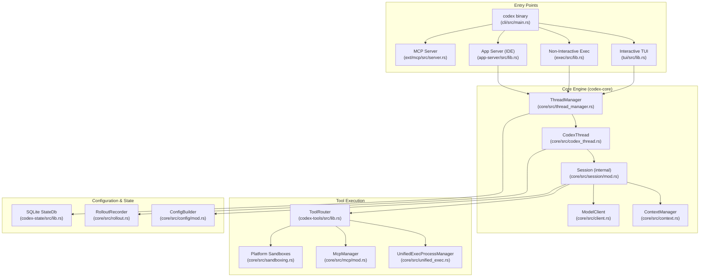
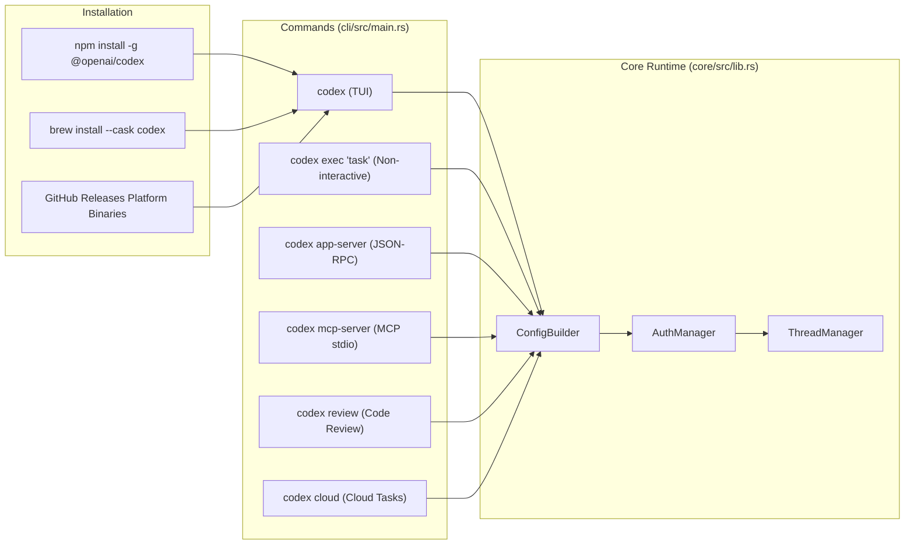
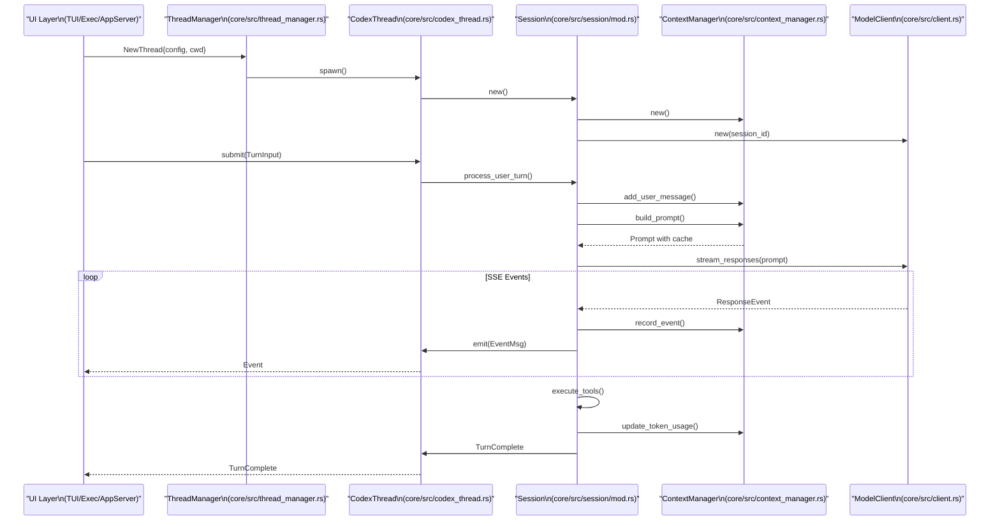
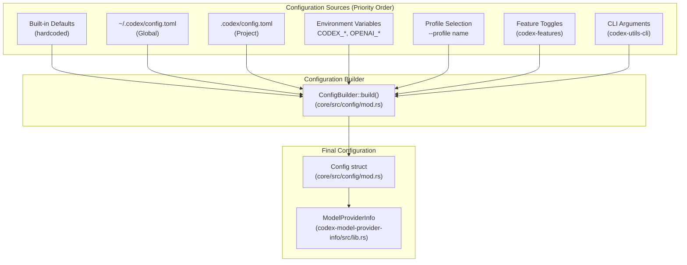

<!-- source: DeepWiki mcp.deepwiki.com · repo openai/codex · page 1 Overview · fetched 2026-10-26 -->

# Overview

Relevant source files

The following files were used as context for generating this wiki page:

- [MODULE.bazel](MODULE.bazel)
- [MODULE.bazel.lock](MODULE.bazel.lock)
- [codex-rs/Cargo.lock](codex-rs/Cargo.lock)
- [codex-rs/Cargo.toml](codex-rs/Cargo.toml)
- [codex-rs/app-server/Cargo.toml](codex-rs/app-server/Cargo.toml)
- [codex-rs/app-server/src/extensions.rs](codex-rs/app-server/src/extensions.rs)
- [codex-rs/app-server/src/mcp_refresh.rs](codex-rs/app-server/src/mcp_refresh.rs)
- [codex-rs/cli/Cargo.toml](codex-rs/cli/Cargo.toml)
- [codex-rs/cli/src/main.rs](codex-rs/cli/src/main.rs)
- [codex-rs/core/Cargo.toml](codex-rs/core/Cargo.toml)
- [codex-rs/core/src/lib.rs](codex-rs/core/src/lib.rs)
- [codex-rs/tui/Cargo.toml](codex-rs/tui/Cargo.toml)
- [patches/BUILD.bazel](patches/BUILD.bazel)
- [patches/mxc-sdk_utf8_resources.patch](patches/mxc-sdk_utf8_resources.patch)
- [patches/rules_rs_windows_msvc_linker.patch](patches/rules_rs_windows_msvc_linker.patch)
- [patches/rules_rust_windows_msvc_direct_link_args.patch](patches/rules_rust_windows_msvc_direct_link_args.patch)

Codex CLI is an AI coding agent developed by OpenAI that runs locally on your computer. It facilitates interactive terminal usage, non-interactive automation, and IDE integration for AI-assisted coding tasks. The system is implemented primarily in Rust as a comprehensive Cargo workspace and supports multiple execution modes, sandboxed tool execution, extensible tools via the Model Context Protocol (MCP), and multi-agent workflows. This page introduces the project's purpose, architecture, and main components at a high level.

For detailed technical information, see the child pages:
- [Installation and Setup](#1.1) — Installation options and initial authentication
- [Repository Structure](#1.2) — Cargo workspace and crates organization
- [Architecture Overview](#1.3) — Detailed system architecture diagrams and data flow

---

## Project Purpose and Architecture

Codex is designed as a native executable that manages conversation state, interacts with AI models, orchestrates tool execution within sandboxed environments, and supports multi-agent collaboration. The codebase is modular and organized as a Rust workspace, with a clear separation between core logic, user interfaces, and integration components.

The workspace is specified in `codex-rs/Cargo.toml` [codex-rs/Cargo.toml:1-160]() and includes over 150 crates. Key crates provide core agent functionality (`codex-core`), terminal UI (`codex-tui`), CLI dispatch (`codex-cli`), and app-server for IDE integration (`codex-app-server`) among others.

### High-Level System Architecture

The diagram below maps major system components to their concrete implementations in the source code. It clarifies component boundaries from entry points through core engine layers and tool execution to configuration and persistent state management.

Sources: [codex-rs/cli/src/main.rs:114-216](), [codex-rs/core/src/lib.rs:1-202](), [codex-rs/Cargo.toml:1-160]()

---

## Execution Modes

Codex supports several primary modes tailored for different workflows but sharing the same core thread management.

| Mode | Entry Point | Use Case | Session Persistence | User Interaction |
|:---|:---|:---|:---|:---|
| **TUI** | `codex` (default) | Interactive development | Yes (rollout files) | Full interactive terminal UI |
| **Exec** | `codex exec` | Automation and CI scripts | Yes (unless ephemeral) | Non-interactive, headless |
| **App Server** | `codex app-server` | IDE integration | Yes | Client-server JSON-RPC |
| **MCP Server** | `codex mcp-server` | Tool delegation protocol | Yes | Stdio-based MCP protocol |
| **Cloud** | `codex cloud` | Remote task/cloud management | Remote | CLI and TUI for Cloud Tasks |

### CLI Command Dispatch and Runtime Initialization

The multi-purpose `codex` CLI dispatches subcommands to appropriate modules and controls feature toggles and configuration layering.

Sources: [codex-rs/cli/src/main.rs:114-216](), [codex-rs/core/src/lib.rs:1-202]()

---

## Core Crate Organization

The Rust workspace under `codex-rs` contains many crates; key crates and their roles summarized below:

| Crate | Path | Purpose |
|:---|:---|:---|
| `codex-core` | `core/` | Core agent engine: conversation, model client, tool routing |
| `codex-tui` | `tui/` | Terminal User Interface based on Ratatui |
| `codex-exec` | `exec/` | Headless CLI mode for scripted runs |
| `codex-cli` | `cli/` | CLI dispatcher and subcommand routing |
| `codex-app-server` | `app-server/` | JSON-RPC server supporting IDE integrations |
| `codex-mcp` | `codex-mcp/` | Model Context Protocol support for external tool servers |
| `codex-config` | `config/` | Configuration loading and management |
| `codex-cloud-tasks` | `cloud-tasks/` | Client interface for Codex Cloud task submissions |

This modular architecture facilitates focused development and flexible deployment of components.

Sources: [codex-rs/Cargo.toml:1-160]()

---

## Core Architecture Components

The core execution engine is layered roughly as follows:

- **ThreadManager**: Manages lifecycle, state persistence, and threading of agent conversations.
- **CodexThread**: Controls the submission queue, event emission system, and task management per thread.
- **Session (internal)**: Coordinates prompt building, turn execution, event streaming, and tool invocations.
- **ContextManager**: Handles conversation history, normalization of messages, token budget management, and context compaction.
- **ModelClient**: Interfaces with AI model APIs, handles retries, streaming response events, and protocol communication.
- **RolloutRecorder**: Persists conversation events for replay and session resumption using rollout files.

### Interaction Flow from User to Core

Sources: [codex-rs/core/src/lib.rs:17-123]()

---

## Configuration System

Codex employs a layered configuration system. Starting from built-in defaults, multiple override sources are combined, including global and project config files, environment variables, feature toggles, profile selections, and finally CLI arguments, which take highest precedence.

The `ConfigBuilder` [codex-rs/core/src/config/mod.rs]() consolidates these sources into a unified runtime configuration structure used system-wide.

This design enables flexible management of runtime behavior, including model selection, authentication modes, and feature toggling.

Sources: [codex-rs/cli/src/main.rs:114-129](), [codex-rs/core/src/lib.rs:56]()

---

## Session Persistence and Replay

Agent conversations are recorded as **rollout files**, which serialize event streams containing user messages, model responses, agent actions, and tool invocations. This event sourcing approach allows robust session resumption, offline review, and replay capabilities.

The `RolloutRecorder` subsystem handles efficient saving, filtering, and incremental update of these logs. Active and archived sessions are stored under designated directory constants `SESSIONS_SUBDIR` and `ARCHIVED_SESSIONS_SUBDIR` in the core crate.

This persistent log model supports rehydrating conversation state faithfully across runs and provides traceability for debugging or auditing.

Sources: [codex-rs/core/src/lib.rs:159-182]()

---

# Summary and Next Steps

This page provided a high-level introduction to the Codex project, its purpose as an AI coding assistant, and its main architectural components. The focus was on mapping conceptual layers to concrete crates and files, and illustrating how execution modes and configurations integrate with the core engine.

To deepen your understanding, please consult these detailed child pages in the documentation:

- [Installation and Setup](#1.1) — Learn how to install Codex, set up authentication, and configure your environment.
- [Repository Structure](#1.2) — Explore the Cargo workspace organization, primary crates, and their roles.
- [Architecture Overview](#1.3) — Review comprehensive architecture diagrams explaining data flow and component interactions.

Sources:
[codex-rs/cli/src/main.rs:114-216](), [codex-rs/core/src/lib.rs:1-202](), [codex-rs/Cargo.toml:1-160]()

---

