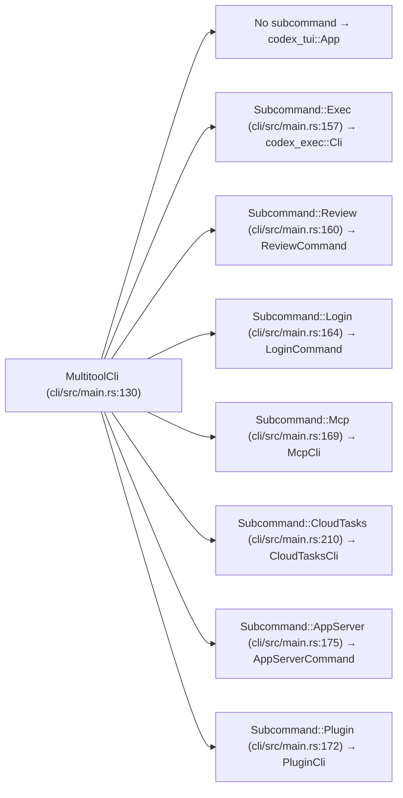
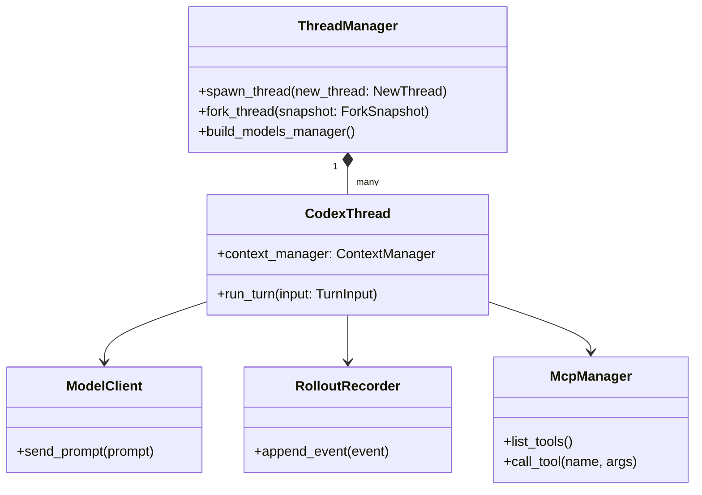
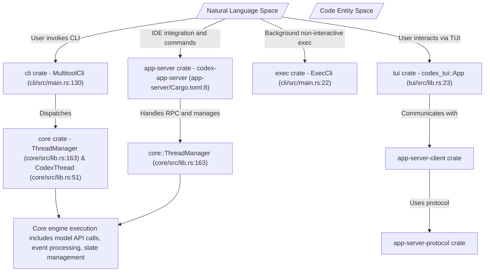
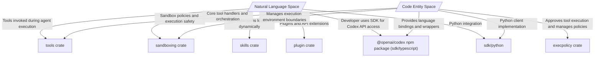

<!-- source: DeepWiki mcp.deepwiki.com · repo openai/codex · page 1.2 Repository Structure · fetched 2026-10-26 -->

# Repository Structure

Relevant source files

The following files were used as context for generating this wiki page:

- [BUILD.bazel](BUILD.bazel)
- [MODULE.bazel](MODULE.bazel)
- [MODULE.bazel.lock](MODULE.bazel.lock)
- [SECURITY.md](SECURITY.md)
- [codex-rs/.config/nextest.toml](codex-rs/.config/nextest.toml)
- [codex-rs/Cargo.lock](codex-rs/Cargo.lock)
- [codex-rs/Cargo.toml](codex-rs/Cargo.toml)
- [codex-rs/app-server-daemon/src/remote_control_client.rs](codex-rs/app-server-daemon/src/remote_control_client.rs)
- [codex-rs/app-server/BUILD.bazel](codex-rs/app-server/BUILD.bazel)
- [codex-rs/app-server/Cargo.toml](codex-rs/app-server/Cargo.toml)
- [codex-rs/app-server/src/extensions.rs](codex-rs/app-server/src/extensions.rs)
- [codex-rs/app-server/src/mcp_refresh.rs](codex-rs/app-server/src/mcp_refresh.rs)
- [codex-rs/cli/BUILD.bazel](codex-rs/cli/BUILD.bazel)
- [codex-rs/cli/Cargo.toml](codex-rs/cli/Cargo.toml)
- [codex-rs/cli/src/main.rs](codex-rs/cli/src/main.rs)
- [codex-rs/cli/src/remote_control_cmd.rs](codex-rs/cli/src/remote_control_cmd.rs)
- [codex-rs/cli/tests/app_server_daemon/package.rs](codex-rs/cli/tests/app_server_daemon/package.rs)
- [codex-rs/cli/tests/app_server_daemon/support.rs](codex-rs/cli/tests/app_server_daemon/support.rs)
- [codex-rs/core/BUILD.bazel](codex-rs/core/BUILD.bazel)
- [codex-rs/core/Cargo.toml](codex-rs/core/Cargo.toml)
- [codex-rs/core/src/lib.rs](codex-rs/core/src/lib.rs)
- [codex-rs/core/tests/windows_sandbox.rs](codex-rs/core/tests/windows_sandbox.rs)
- [codex-rs/tui/BUILD.bazel](codex-rs/tui/BUILD.bazel)
- [codex-rs/tui/Cargo.toml](codex-rs/tui/Cargo.toml)
- [codex-rs/utils/cargo-bin/BUILD.bazel](codex-rs/utils/cargo-bin/BUILD.bazel)
- [codex-rs/voice-host/BUILD.bazel](codex-rs/voice-host/BUILD.bazel)
- [codex-rs/windows-sandbox-rs/BUILD.bazel](codex-rs/windows-sandbox-rs/BUILD.bazel)
- [codex-rs/windows-sandbox-rs/Cargo.toml](codex-rs/windows-sandbox-rs/Cargo.toml)
- [codex-rs/windows-sandbox-rs/build.rs](codex-rs/windows-sandbox-rs/build.rs)
- [codex-rs/windows-sandbox-rs/codex-windows-sandbox-setup.manifest](codex-rs/windows-sandbox-rs/codex-windows-sandbox-setup.manifest)
- [codex-rs/windows-sandbox-rs/src/unified_exec/tests.rs](codex-rs/windows-sandbox-rs/src/unified_exec/tests.rs)
- [codex-rs/windows-sandbox-rs/tests/helper_manifest.rs](codex-rs/windows-sandbox-rs/tests/helper_manifest.rs)
- [defs.bzl](defs.bzl)
- [patches/BUILD.bazel](patches/BUILD.bazel)
- [patches/mxc-sdk_utf8_resources.patch](patches/mxc-sdk_utf8_resources.patch)
- [patches/rules_rs_windows_msvc_linker.patch](patches/rules_rs_windows_msvc_linker.patch)
- [patches/rules_rust_windows_msvc_direct_link_args.patch](patches/rules_rust_windows_msvc_direct_link_args.patch)
- [workspace_root_test_launcher.bat.tpl](workspace_root_test_launcher.bat.tpl)
- [workspace_root_test_launcher.sh.tpl](workspace_root_test_launcher.sh.tpl)

This page documents the Cargo workspace organization, key crates, and dependency relationships in the `codex-rs` repository. It also covers the top-level TypeScript package, the Rust workspace crates, and the top-level tooling.

## Scope and Organization

The `codex-rs` repository is organized as a Cargo workspace containing over 140 member crates and packages [codex-rs/Cargo.toml:2-160](). The workspace uses a monorepo structure where all crates share common tooling, dependency versions, and build configuration via a root `Cargo.toml` manifest [codex-rs/Cargo.toml:1-160]().

The project uses a dual-build system for flexibility:
- **Cargo** is the primary Rust package manager for local development.
- **Bazel** is used for hermetic builds, dependency patching, cross-platform integration, and CI/CD workflows [MODULE.bazel:1-201](), [MODULE.bazel.lock:1-56]().

---

## Workspace Structure

The Cargo workspace is declared in the root `codex-rs/Cargo.toml` under the `[workspace]` section. It standardizes the Rust edition to 2024 and the Apache-2.0 license across all workspace members, ensuring consistent build policies [codex-rs/Cargo.toml:1-160]().

### Primary Crates and Packages

The workspace bundles many crates organized by functional areas, including core engine, user interfaces, protocol and server, tools and policies, SDKs, configuration, and utilities:

| Category | Key Crates / Packages | Description |
|---|---|---|
| **Core Engine** | `core` (`codex-core`) | Core agent engine managing conversation threads, turns, state, and APIs. |
| **User Interfaces** | `tui` (`codex-tui`), `cli` (`codex-cli`), `exec` (`codex-exec`) | Terminal UI, CLI multitool, and non-interactive execution mode. |
| **App Server & Protocol** | `app-server` (`codex-app-server`), `app-server-client`, `app-server-protocol` | JSON-RPC app server daemon with protocol definitions for IDE integration. |
| **Tools and Extensibility** | `tools`, `skills`, `execpolicy`, `sandboxing`, `plugin` | Tool execution, sandbox policies, skills, and plugin infrastructure. |
| **SDKs and External Support** | `@openai/codex` (TypeScript), `sdk/python` (Python) | TypeScript and Python SDKs for external Codex embedding. |
| **Configuration & State** | `config`, `state`, `secrets` | Layered configuration system, persistent state storage, and secrets management. |
| **Infrastructure Utilities** | `utils/*` (40+ utility crates) | Various helper crates for path handling, CLI, sandbox summary, approval presets, etc. |

The root manifest acts as the single source of truth, tying these components together and specifying dependencies and versions centrally, facilitating broad code reuse and shared versions [codex-rs/Cargo.toml:2-160]().

---

### Workspace Component Overview Diagram

```mermaid
graph TB
    subgraph WorkspaceRoot["Workspace Root"]
        CargoToml["Cargo.toml<br/>(workspace manifest)"]
        CargoLock["Cargo.lock<br/>(dependency lock)"]
        Justfile["justfile<br/>(command recipes)"]
        Bazel["MODULE.bazel.lock<br/>(bazel dependency lock)"]
    end

    subgraph EntryPoints["Entry Point Binaries"]
        CLI["cli/<br/>codex (multitool)"]
        TUI["tui/<br/>codex-tui (terminal UI)"]
        EXEC["exec/<br/>codex-exec (headless exec mode)"]
        APPSERVER_BIN["app-server/<br/>codex-app-server"]
        EXECSERVER_BIN["app-server/<br/>exec-server"]
    end

    subgraph CoreEngine["Core Engine"]
        CORE["core/<br/>codex-core (business logic library)"]
    end

    subgraph ProtocolAndServer["Protocol & Communication"]
        PROTOCOL["protocol/<br/>codex-protocol"]
        APPPROTO["app-server-protocol/"]
        APPSERVER_LIB["app-server/<br/>codex_app_server (library)"]
        APPCLIENT["app-server-client/"]
    end

    subgraph ConfigurationAndState["Config & State"]
        CONFIG["config/"]
        STATE["state/"]
        SECRETS["secrets/"]
    end

    subgraph ToolsSandbox["Tool & Execution"]
        SHELLCMD["shell-command/"]
        TOOLS["tools/"]
        SKILLS["skills/"]
        EXECPOLICY["execpolicy/"]
        SANDBOX["sandboxing/"]
        MCP["codex-mcp/"]
        PLUGIN["plugin/"]
    end

    subgraph SDKs["SDKs & External Interfaces"]
        TS_SDK["@openai/codex<br/>TypeScript SDK (npm)"]
        PY_SDK["sdk/python<br/>Python SDK"]
    end

    subgraph Utilities["Utility Crates"]
        UTILS["utils/*<br/>(~40 utility crates)"]
    end

    CargoToml --> CLI
    CargoToml --> TUI
    CargoToml --> EXEC
    CargoToml --> APPSERVER_BIN
    CargoToml --> EXECSERVER_BIN
    CargoToml --> CORE
    CargoToml --> PROTOCOL
    CargoToml --> APPPROTO
    CargoToml --> APPSERVER_LIB
    CargoToml --> APPCLIENT
    CargoToml --> CONFIG
    CargoToml --> STATE
    CargoToml --> SECRETS
    CargoToml --> SHELLCMD
    CargoToml --> TOOLS
    CargoToml --> SKILLS
    CargoToml --> EXECPOLICY
    CargoToml --> SANDBOX
    CargoToml --> MCP
    CargoToml --> PLUGIN
    CargoToml --> TS_SDK
    CargoToml --> PY_SDK
    CargoToml --> UTILS

    CLI --> CORE
    CLI --> TUI
    CLI --> EXEC
    CLI --> APPSERVER_BIN

    TUI --> CORE
    TUI --> APPCLIENT
    TUI --> APPPROTO

    EXEC --> CORE

    APPSERVER_BIN --> APPSERVER_LIB
    EXECSERVER_BIN --> APPSERVER_LIB

    CORE --> PROTOCOL
    CORE --> CONFIG
    CORE --> STATE
    CORE --> SHELLCMD
    CORE --> SKILLS
    CORE --> TOOLS
    CORE --> SANDBOX
    CORE --> MCP
    CORE --> PLUGIN
```

This diagram depicts the workspace root manifests orchestrating the main Rust components, UI frontends, protocol definitions, tooling, SDKs, and utilities.

**Sources:** [codex-rs/Cargo.toml:1-160](), [MODULE.bazel:1-201](), [MODULE.bazel.lock:1-56]()

---

## Entry Point Crates

### CLI Multitool (`cli/`)

The `cli` crate provides the `codex` multitool binary, which supports many subcommands [codex-rs/cli/Cargo.toml:9-11](), [codex-rs/cli/src/main.rs:114-214]().

- Routes commands for interactive TUI, non-interactive exec, login/logout, plugin management, cloud tasks, and app-server control.
- Uses the `MultitoolCli` struct (from clap) to parse and dispatch subcommands [codex-rs/cli/src/main.rs:130]().
- Major subcommands include:
  - `exec`: invokes `codex-exec` headless mode [codex-rs/cli/src/main.rs:157]().
  - `mcp`: manages Model Context Protocol servers [codex-rs/cli/src/main.rs:169]().
  - `review`: code review flow [codex-rs/cli/src/main.rs:160]().
  - `app-server`: app server controls [codex-rs/cli/src/main.rs:175]().
  

**Sources:** [codex-rs/cli/Cargo.toml:9-11](), [codex-rs/cli/src/main.rs:114-214](), [codex-rs/cli/src/main.rs:130](), [codex-rs/cli/src/main.rs:157](), [codex-rs/cli/src/main.rs:169](), [codex-rs/cli/src/main.rs:160](), [codex-rs/cli/src/main.rs:175](), [codex-rs/cli/src/main.rs:172]()

---

### Interactive Terminal UI (`tui/`)

The terminal UI implemented in the `tui` crate (`codex-tui`) offers a fullscreen interface for Codex operations [codex-rs/tui/Cargo.toml:2-20](), [codex-rs/tui/src/lib.rs:23]().

- Built on `ratatui` terminal UI library [codex-rs/tui/Cargo.toml:93-98]().
- Provides conversation rendering, input handling, popups, status indicators, and overlays.
- Uses the main `App` struct to manage UI state and event loops.
- Communicates with the app server using `codex-app-server-client` [codex-rs/tui/Cargo.toml:32]().
- Supports session resumption, multiple threads, agent roles, and rich text markdown rendering.

**Sources:** [codex-rs/tui/Cargo.toml:2-20](), [codex-rs/tui/src/lib.rs:23](), [codex-rs/tui/Cargo.toml:93-98](), [codex-rs/tui/Cargo.toml:32]()

---

### Headless Execution Mode (`exec/`)

The `exec` crate implements a headless, non-interactive Codex mode focused on batch execution, event replay, and output formatting [codex-rs/cli/src/main.rs:22](), [codex-rs/exec/src/lib.rs:114]().

- Parses and processes event logs without user interface.
- Produces human-readable output in terminal or JSONL format.
- Responsible for approval handling and event serialization/deserialization.
- The CLI multitool's `exec` subcommand delegates here [codex-rs/cli/src/main.rs:22]().

**Sources:** [codex-rs/cli/src/main.rs:22](), [codex-rs/exec/src/lib.rs:114]()

---

### App Server (`app-server/`)

The `app-server` crate is the JSON-RPC daemon server for IDE integration and remote control [codex-rs/app-server/Cargo.toml:2-21]().

- Provides the `codex-app-server` binary and sub-bin `exec-server` for exec mode RPC [codex-rs/app-server/Cargo.toml:8-17]().
- Depends on related crates `app-server-protocol` and `app-server-client` for RPC protocols and client interfaces [codex-rs/app-server/Cargo.toml:88-89]().
- Implements request processors, authentication, threading APIs, event streaming, and extension management [codex-rs/app-server/src/extensions.rs:50-128]().
- Integrates tightly with core to manage session lifecycles.

**Sources:** [codex-rs/app-server/Cargo.toml:2-21](), [codex-rs/app-server/Cargo.toml:8-17](), [codex-rs/app-server/Cargo.toml:88-89](), [codex-rs/app-server/src/extensions.rs:50-128]()

---

## Core Engine (`codex-core` crate)

The `core` crate (`codex-core`) is the fundamental Rust library implementing the agent core engine [codex-rs/core/Cargo.toml:1-140](), [codex-rs/core/src/lib.rs:1-192]().

### Key Types and Responsibilities

| Type / Module | Role / Description | Location |
|---|---|---|
| `CodexThread` | Manages conversation threads, turn execution, turn context. | [codex-rs/core/src/lib.rs:51]() |
| `ThreadManager` | Controls spawning, forking, resuming threads and sessions. | [codex-rs/core/src/lib.rs:163]() |
| `ModelClient` | Handles interactions with language model APIs including retries. | [codex-rs/core/src/client.rs]() |
| `RolloutRecorder` | Records and persists event streams (conversation history). | [codex-rs/core/src/rollout.rs]() |
| `McpManager` | Manages Model Context Protocol (MCP) server connections. | [codex-rs/core/src/lib.rs:110]() |

The core crate additionally provides:
- Agent orchestration and multi-agent support for complex conversation trees.
- Turn context, prompt building with override support.
- Event processing and state synchronization including rollout and compaction.
- Plugin and skill management interfaces.
- Network proxy and sandbox enforcement integration.
- State database bridging and rollout persistence.

### Core Engine Class Diagram

This shows the runtime relationships: `ThreadManager` supervises multiple `CodexThread` instances, each engaging with the LLM API (`ModelClient`), recording events (`RolloutRecorder`), and interacting with MCP servers (`McpManager`).

**Sources:** [codex-rs/core/src/lib.rs:1-192](), [codex-rs/core/Cargo.toml:10-130](), [codex-rs/core/src/lib.rs:51](), [codex-rs/core/src/lib.rs:163](), [codex-rs/core/src/client.rs](), [codex-rs/core/src/rollout.rs](), [codex-rs/core/src/lib.rs:110]()

---

## TypeScript Package (`codex-cli` and `sdk/typescript`)

The repository also packages `codex-cli` as a TypeScript npm module `@openai/codex` to enable programmatic access to Codex features from Node.js environments.

- The `cli` crate exposes the Rust CLI interface as a native binary [codex-rs/cli/Cargo.toml:9-11]().
- The `sdk/typescript/` directory supplies a TypeScript SDK implementing APIs such as `Codex`, `Thread`, and `Turn`.
- This SDK supports event streaming, structured output parsing, and session resumption.
- It facilitates integration in web applications and tools without requiring Rust.

**Sources:** [codex-rs/cli/Cargo.toml:9-11]()

---

## Additional Workspace Directories

- **`sdk/` Directory:** Contains language-specific SDK implementations, including TypeScript and Python SDKs, providing idiomatic client libraries to consume Codex APIs.
- **`third_party/` Directory:** Houses vendored or patched external third-party dependencies crucial for build hermeticity and platform support, e.g., `third_party/v8/` contains the V8 JavaScript engine integration.
- **`tools/` Directory:** Implements Codex tools—standalone or extendable command handlers invoked during agent execution (shell commands, file searchers, oracles, etc.).
- **`bazel/` Directory:** Contains Bazel build rules, macros, and workspace initialization files, supporting cross-platform builds, sandboxed environments, and hermetic dependency resolution [MODULE.bazel:1-201](), [defs.bzl:1-175]().

**Sources:** [MODULE.bazel:1-201](), [defs.bzl:1-175]()

---

## Natural Language Concepts to Code Entities

The following diagrams map high-level system concepts (Natural Language Space) to key code entities (Code Entity Space) for better orientation.

### Diagram 1: Codex User Interfaces and Core Interaction

This diagram shows how the user-facing CLI and TUI interact with the core engine and how the app server and its protocol crates mediate IDE integrations.

**Sources:** [codex-rs/cli/src/main.rs:130](), [codex-rs/tui/src/lib.rs:23](), [codex-rs/cli/src/main.rs:22](), [codex-rs/app-server/Cargo.toml:8](), [codex-rs/core/src/lib.rs:163](), [codex-rs/core/src/lib.rs:51]()

---

### Diagram 2: Tooling and SDK Layers from Natural Language to Code

This diagram maps how tools, execution policies, sandboxing, and extensions are represented in the codebase and how SDKs provide interfaces for external consumers.

---

# Summary

The `codex-rs` repository is a comprehensive Cargo workspace meticulously organized for modularity, scalability, and extensibility in AI-assisted code generation:

- **Core Engine (`codex-core`)** manages conversation threads, model interaction, event processing, and nested multi-agent logic.
- **Multiple UI Frontends** include an interactive terminal UI (`tui`), a multitool CLI entry-point (`cli`), and a headless exec mode (`exec`).
- **App Server** (`app-server`) provides JSON-RPC daemon support facilitating IDE integrations and service orchestration.
- **Rich Tooling and Extension System** covers execution policies, sandboxing, tools, skills, and plugins, enabling safe and flexible code manipulation.
- **External SDKs** in TypeScript and Python enable embedding Codex in diverse environments.
- **Monorepo Build Configuration** uses both Cargo and Bazel with strict version controls, patches, and platform-specific defaults.
- **Utility Crates and Libraries** support shared needs like path handling, CLI helpers, sandbox summaries, and logging.

This structure enables Codex to operate robustly both as a local interactive agent and as a background service integrating tightly with editors and external services.

---

**All citations:**
- [codex-rs/Cargo.toml:2-160]()
- [codex-rs/Cargo.toml:1-160]()
- [MODULE.bazel:1-201]()
- [MODULE.bazel.lock:1-56]()
- [codex-rs/cli/Cargo.toml:9-11]()
- [codex-rs/cli/src/main.rs:114-214]()
- [codex-rs/cli/src/main.rs:130]()
- [codex-rs/cli/src/main.rs:157]()
- [codex-rs/cli/src/main.rs:169]()
- [codex-rs/cli/src/main.rs:160]()
- [codex-rs/cli/src/main.rs:175]()
- [codex-rs/cli/src/main.rs:172]()
- [codex-rs/tui/Cargo.toml:2-20]()
- [codex-rs/tui/src/lib.rs:23]()
- [codex-rs/tui/Cargo.toml:93-98]()
- [codex-rs/tui/Cargo.toml:32]()
- [codex-rs/cli/src/main.rs:22]()
- [codex-rs/exec/src/lib.rs:114]()
- [codex-rs/app-server/Cargo.toml:2-21]()
- [codex-rs/app-server/Cargo.toml:8-17]()
- [codex-rs/app-server/Cargo.toml:88-89]()
- [codex-rs/app-server/src/extensions.rs:50-128]()
- [codex-rs/core/Cargo.toml:1-140]()
- [codex-rs/core/src/lib.rs:1-192]()
- [codex-rs/core/src/lib.rs:51]()
- [codex-rs/core/src/lib.rs:163]()
- [codex-rs/core/src/client.rs]()
- [codex-rs/core/src/rollout.rs]()
- [codex-rs/core/src/lib.rs:110]()
- [defs.bzl:1-175]()

---

