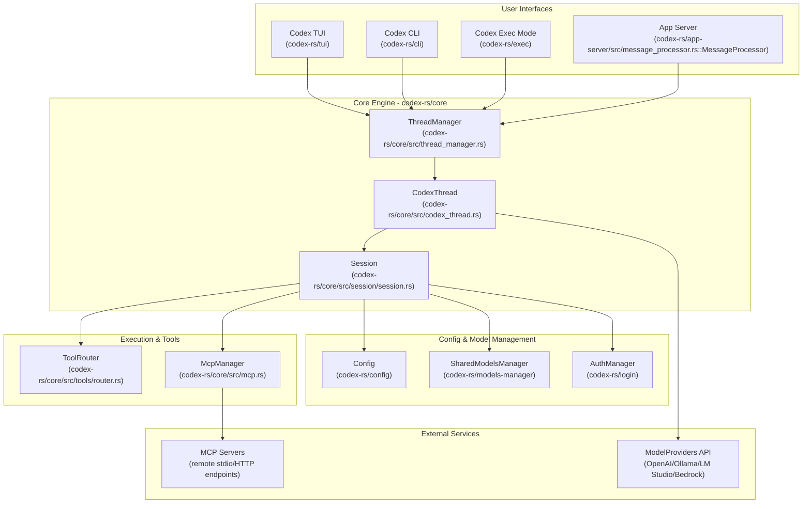
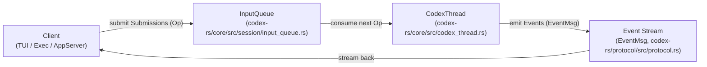
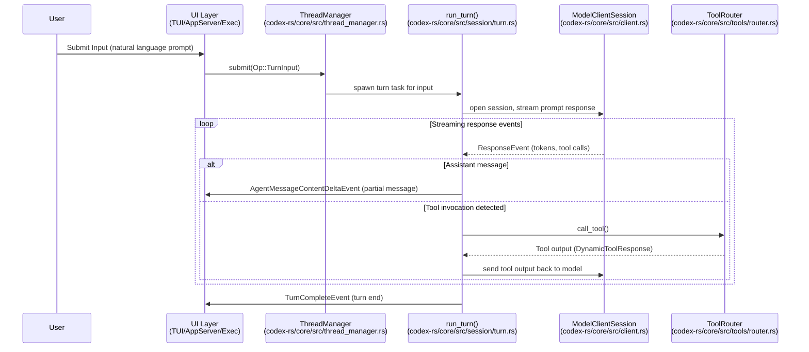
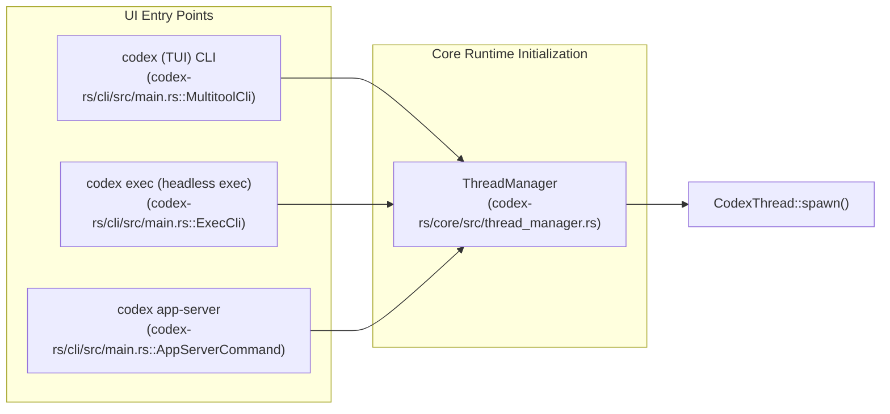
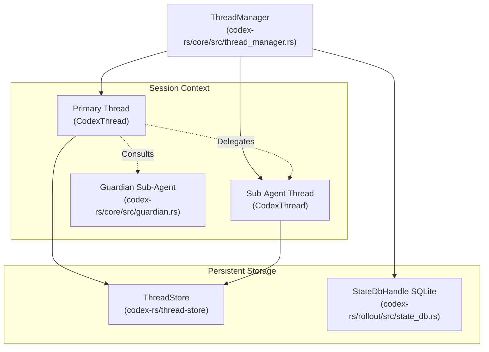
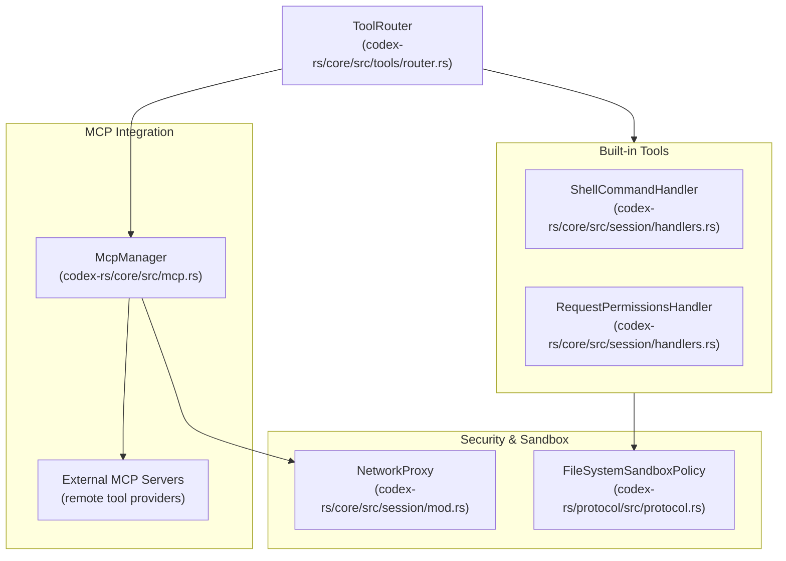

<!-- source: DeepWiki mcp.deepwiki.com · repo openai/codex · page 1.3 Architecture Overview · fetched 2026-10-26 -->

# Architecture Overview

Relevant source files

The following files were used as context for generating this wiki page:

- [codex-rs/app-server-protocol/schema/json/ClientRequest.json](codex-rs/app-server-protocol/schema/json/ClientRequest.json)
- [codex-rs/app-server-protocol/schema/json/ServerNotification.json](codex-rs/app-server-protocol/schema/json/ServerNotification.json)
- [codex-rs/app-server-protocol/schema/json/codex_app_server_protocol.schemas.json](codex-rs/app-server-protocol/schema/json/codex_app_server_protocol.schemas.json)
- [codex-rs/app-server-protocol/schema/json/codex_app_server_protocol.v2.schemas.json](codex-rs/app-server-protocol/schema/json/codex_app_server_protocol.v2.schemas.json)
- [codex-rs/app-server-protocol/schema/precomputed/app-server-exports-experimental.json.zst](codex-rs/app-server-protocol/schema/precomputed/app-server-exports-experimental.json.zst)
- [codex-rs/app-server-protocol/schema/precomputed/app-server-exports-stable.json.zst](codex-rs/app-server-protocol/schema/precomputed/app-server-exports-stable.json.zst)
- [codex-rs/app-server-protocol/schema/typescript/ClientRequest.ts](codex-rs/app-server-protocol/schema/typescript/ClientRequest.ts)
- [codex-rs/app-server-protocol/schema/typescript/v2/index.ts](codex-rs/app-server-protocol/schema/typescript/v2/index.ts)
- [codex-rs/app-server-protocol/src/protocol/common.rs](codex-rs/app-server-protocol/src/protocol/common.rs)
- [codex-rs/app-server-protocol/src/protocol/v2/tests.rs](codex-rs/app-server-protocol/src/protocol/v2/tests.rs)
- [codex-rs/app-server-protocol/src/protocol/v2/thread.rs](codex-rs/app-server-protocol/src/protocol/v2/thread.rs)
- [codex-rs/app-server/README.md](codex-rs/app-server/README.md)
- [codex-rs/app-server/src/bespoke_event_handling.rs](codex-rs/app-server/src/bespoke_event_handling.rs)
- [codex-rs/app-server/src/lib.rs](codex-rs/app-server/src/lib.rs)
- [codex-rs/app-server/src/message_processor.rs](codex-rs/app-server/src/message_processor.rs)
- [codex-rs/app-server/src/request_processors.rs](codex-rs/app-server/src/request_processors.rs)
- [codex-rs/app-server/src/request_processors/thread_lifecycle.rs](codex-rs/app-server/src/request_processors/thread_lifecycle.rs)
- [codex-rs/app-server/src/request_processors/thread_processor.rs](codex-rs/app-server/src/request_processors/thread_processor.rs)
- [codex-rs/app-server/src/thread_state.rs](codex-rs/app-server/src/thread_state.rs)
- [codex-rs/app-server/tests/suite/v2/mod.rs](codex-rs/app-server/tests/suite/v2/mod.rs)
- [codex-rs/app-server/tests/suite/v2/thread_fork.rs](codex-rs/app-server/tests/suite/v2/thread_fork.rs)
- [codex-rs/app-server/tests/suite/v2/thread_resume.rs](codex-rs/app-server/tests/suite/v2/thread_resume.rs)
- [codex-rs/app-server/tests/suite/v2/thread_start.rs](codex-rs/app-server/tests/suite/v2/thread_start.rs)
- [codex-rs/app-server/tests/suite/v2/thread_unsubscribe.rs](codex-rs/app-server/tests/suite/v2/thread_unsubscribe.rs)
- [codex-rs/app-server/tests/suite/v2/turn_start.rs](codex-rs/app-server/tests/suite/v2/turn_start.rs)
- [codex-rs/core/src/codex_delegate.rs](codex-rs/core/src/codex_delegate.rs)
- [codex-rs/core/src/codex_delegate_tests.rs](codex-rs/core/src/codex_delegate_tests.rs)
- [codex-rs/core/src/codex_thread.rs](codex-rs/core/src/codex_thread.rs)
- [codex-rs/core/src/compact.rs](codex-rs/core/src/compact.rs)
- [codex-rs/core/src/compact_remote_v2.rs](codex-rs/core/src/compact_remote_v2.rs)
- [codex-rs/core/src/compact_remote_v2_attempt.rs](codex-rs/core/src/compact_remote_v2_attempt.rs)
- [codex-rs/core/src/compact_tests.rs](codex-rs/core/src/compact_tests.rs)
- [codex-rs/core/src/environment_selection.rs](codex-rs/core/src/environment_selection.rs)
- [codex-rs/core/src/session/environment.rs](codex-rs/core/src/session/environment.rs)
- [codex-rs/core/src/session/handlers.rs](codex-rs/core/src/session/handlers.rs)
- [codex-rs/core/src/session/mod.rs](codex-rs/core/src/session/mod.rs)
- [codex-rs/core/src/session/session.rs](codex-rs/core/src/session/session.rs)
- [codex-rs/core/src/session/tests.rs](codex-rs/core/src/session/tests.rs)
- [codex-rs/core/src/session/tests/guardian_tests.rs](codex-rs/core/src/session/tests/guardian_tests.rs)
- [codex-rs/core/src/session/turn.rs](codex-rs/core/src/session/turn.rs)
- [codex-rs/core/src/session/turn_context.rs](codex-rs/core/src/session/turn_context.rs)
- [codex-rs/core/src/state/mod.rs](codex-rs/core/src/state/mod.rs)
- [codex-rs/core/src/state/turn.rs](codex-rs/core/src/state/turn.rs)
- [codex-rs/core/src/tasks/mod.rs](codex-rs/core/src/tasks/mod.rs)
- [codex-rs/core/src/thread_manager.rs](codex-rs/core/src/thread_manager.rs)
- [codex-rs/core/src/thread_manager_tests.rs](codex-rs/core/src/thread_manager_tests.rs)
- [codex-rs/core/tests/common/test_codex.rs](codex-rs/core/tests/common/test_codex.rs)
- [codex-rs/core/tests/suite/compact.rs](codex-rs/core/tests/suite/compact.rs)
- [codex-rs/core/tests/suite/compact_remote.rs](codex-rs/core/tests/suite/compact_remote.rs)
- [codex-rs/core/tests/suite/mod.rs](codex-rs/core/tests/suite/mod.rs)
- [codex-rs/core/tests/suite/remote_env.rs](codex-rs/core/tests/suite/remote_env.rs)
- [codex-rs/protocol/src/environment.rs](codex-rs/protocol/src/environment.rs)
- [codex-rs/protocol/src/protocol.rs](codex-rs/protocol/src/protocol.rs)
- [sdk/python/src/openai_codex/generated/v2_all.py](sdk/python/src/openai_codex/generated/v2_all.py)

Codex is an AI coding agent supporting multiple execution modes—including terminal UI, CLI multitool, integrated app server for IDEs, headless exec mode, and cloud tasks—all powered by a shared core runtime. The architecture is centered around an asynchronous submission-event queue protocol that enables interruptible, streaming workflows. These workflows coordinate input submission, conversation turns, model interactions, dynamic tool invocations, and multi-agent concurrency.

---

## System Organization

The overall system architecture is organized into the following major components:

- **User Interfaces:**
  - Terminal UI (`codex-rs/tui`)
  - CLI multitool with exec mode (`codex-rs/cli` and `codex-rs/exec`)
  - App Server for IDEs (`codex-rs/app-server`) providing a JSON-RPC protocol
  - Cloud tasks UI/CLI (`codex-rs/cloud-tasks`)

- **Core Engine** (`codex-rs/core`):
  - Manages sessions, conversation turns, and event flow.
  - Major components:
    - `ThreadManager`: manages lifecycle of active conversation threads.
    - `CodexThread`: represents a conversation thread/agent.
    - `Session`: manages state and logic for a running conversation turn.

- **Execution and Tools** (`codex-rs/tools`, `codex-rs/codex-mcp`):
  - Implements built-in tools (shell commands, permissions requests).
  - Orchestrates tool calls to remote Model Context Protocol (MCP) servers.
  - Enforces sandboxing and approval policies.

- **Configuration and Model Management** (`codex-rs/config`, `codex-rs/models-manager`, `codex-rs/login`):
  - Layered configuration loading, including profiles and overrides.
  - Model discovery and caching.
  - Authentication and access control.

- **External Services:**
  - Model provider APIs (OpenAI, Ollama, LM Studio, Bedrock).
  - MCP servers exposing remote tool execution services.

- **App Server Protocol** (`codex-rs/app-server-protocol`):
  - Defines JSON-RPC message and notification schema for IDE-integration.

This modular layered design embraces the **asynchronous submission/event queue** pattern facilitating interactive, extensible, and streaming agent workflows.

Sources: [codex-rs/app-server/README.md:1-127](), [codex-rs/core/src/session/mod.rs:1-155]()

---

## Complete System Architecture

**Explanation:**

- User Interfaces submit requests to the `ThreadManager`. The app server uses a `MessageProcessor` to handle incoming JSON-RPC requests and manages communication with clients.
- The core engine’s `ThreadManager` maintains active `CodexThread` instances, each representing an agent’s conversation thread. Each thread manages a `Session` that maintains conversation state and handles turn execution.
- During turn execution, the `Session` uses the `ToolRouter` to dispatch tool requests and the `McpManager` to interact with external MCP servers providing additional capabilities.
- Configuration, model information, and authentication data are centralized services accessed by the core engine.
- External model providers and MCP servers provide external compute and tool capabilities.

Sources: [codex-rs/core/src/session/mod.rs:1-155](), [codex-rs/core/src/session/session.rs:58-101](), [codex-rs/core/src/thread_manager.rs:1-167](), [codex-rs/app-server/src/message_processor.rs:143-158]()

---

## Submission/Event Queue Pattern

The core operational pattern uses asynchronous submission and event queues to decouple input from output streaming and support interrupts or approvals mid-turn.

- The client UI or interface constructs and submits `Submissions` representing operations (`Op`) with metadata, trace info, cancellation tokens, and expected input mode [codex-rs/core/src/session/mod.rs:116-120]().
- The `InputQueue` buffers and orders submissions asynchronously [codex-rs/core/src/session/session.rs:94]() and supplies them to the `CodexThread`.
- The `CodexThread` polls the queue, executes turns or other operations, and emits streaming partial or full response events (`EventMsg`) [codex-rs/core/src/codex_thread.rs]() that represent assistant messages, tool outputs, state updates, and approvals.
- The Events stream back through the protocol to the client, enabling real-time streaming chat or command responses.

This asynchronous pattern facilitates responsive interaction, turn cancellation, and extensibility across UI types.

Sources: [codex-rs/core/src/session/mod.rs:59-60](), [codex-rs/protocol/src/protocol.rs:1-151]()

---

## Request/Response Flow: From Natural Language to Code Execution

This section details the flow from user input (often natural language) through conversation turn execution involving model calls and tool invocations.

- Upon user input, the corresponding Op (`TurnInput`) is submitted.
- `ThreadManager` creates a turn task which calls the model API via a `ModelClientSession`.
- Model responses stream asynchronously as `ResponseEvent`s.
- If model requests tool invocation, `ToolRouter` routes it to internal or MCP tools.
- Tool outputs can be fed back to the model for further reasoning.
- Final turn completion event signals end of turn processing.

This pipeline effectively bridges user natural language input with structured code execution workflows.

Sources: [codex-rs/protocol/src/protocol.rs:33](), [codex-rs/core/src/thread_manager.rs:1-167](), [codex-rs/core/src/tools/router.rs](), [codex-rs/core/src/session/turn.rs:1-151]()

---

## Execution Modes and Entry Points

Codex supports multiple runtime modes, all initiated from the CLI multitool binary `codex`.

| Mode            | Entry Point                                    | Purpose                             | Notes                                                 |
|-----------------|------------------------------------------------|-----------------------------------|-------------------------------------------------------|
| **TUI**         | `MultitoolCli` (cli/src/main.rs)                | Interactive terminal UI            | Handles prompt, commands, event streaming             |
| **Exec**        | `ExecCli` (cli/src/main.rs)                      | Headless exec and review mode      | Processes event streams without interactive UI        |
| **App Server**  | `AppServerCommand` (cli/src/main.rs)             | IDE integration via JSON-RPC server| Remote control of threads and turns over stdio/websocket |
| **MCP Server**  | MCP CLI subcommands                               | Tool provider server mode           | Runs Codex as MCP server to external tool clients     |

All modes internally initialize a central `ThreadManager` which manages conversation threads and agent sessions.

Sources: [codex-rs/app-server/README.md:1-127](), [codex-rs/core/src/thread_manager.rs:1-167]()

---

## Multi-Agent and Persistence Architecture

Codex supports multi-agent concurrency with specialized sub-agent threads and persistent conversation storage.

- The `ThreadManager` manages multiple live conversation threads (`CodexThread` instances).
- Threads can spawn specialized sub-agent threads for delegated roles or forked conversations.
- A Guardian sub-agent performs safety assessments, policy enforcement, and approval handling.
- Persistent history and thread metadata storage is provided by `ThreadStore` backed by a SQLite `StateDbHandle`.
- Multi-agent orchestration supports workflows such as delegated review, concurrent reasoning, and multi-turn collaboration.

Sources: [codex-rs/core/src/session/mod.rs:14-18](), [codex-rs/core/src/thread_manager.rs:1-167](), [codex-rs/core/src/codex_thread.rs]()

---

## Tool System and MCP Integration

The Codex tool system is extensible, integrating both built-in tools and remote MCP-based tool providers.

- The `ToolRouter` dispatches tool calls invoked during turn execution either to internal built-in tool handlers or to injected MCP servers.
- Built-in handlers execute commands such as shell script execution and access permission requests with sandbox enforcement [codex-rs/core/src/session/handlers.rs]().
- `McpManager` forwards tool invocations to MCP servers, orchestrating remote execution and managing approval states.
- Network policies and sandboxing are enforced via `NetworkProxy` and sandbox policies defined by permission profiles.

This layered design enables safe, extensible tool execution with external server augmentation.

Sources: [codex-rs/core/src/session/mod.rs:99-100](), [codex-rs/core/src/session/tests.rs:127](), [codex-rs/core/src/tools/router.rs](), [codex-rs/protocol/src/protocol.rs:114]()

---

# Summary

Codex's architecture is a modular, asynchronous, and extensible framework comprising:

- Multiple user interface clients converging on a core runtime managing conversation threads.
- An asynchronous submission/event queue pattern enabling streaming responses, interruptions, and interactive approvals.
- A layered turn execution pipeline bridging natural language input to streaming model API calls and dynamic tool invocations.
- Support for multi-agent concurrency with specialized sub-agents, delegation, and guarded approval workflows.
- An extensible tool system integrating built-in sandboxed tooling and MCP protocol-based remote tool providers.
- Robust configuration layering, model management, and authentication abstractions.
- Persistent storage for history, approvals, and state recovery via SQLite-backed thread stores.

This design allows Codex to flexibly serve interactive terminals, IDE integrations, automated exec modes, and cloud deployments with consistent semantics.

---

Sources:

- [codex-rs/core/src/session/mod.rs:1-155]()
- [codex-rs/core/src/session/session.rs:58-101]()
- [codex-rs/core/src/thread_manager.rs:1-167]()
- [codex-rs/app-server/README.md:1-127]()
- [codex-rs/protocol/src/protocol.rs:1-151]()
- [codex-rs/core/src/codex_thread.rs]()
- [codex-rs/core/src/session/turn.rs:1-151]()
- [codex-rs/core/src/session/tests.rs:127]()
- [codex-rs/core/src/tools/router.rs]()

---

