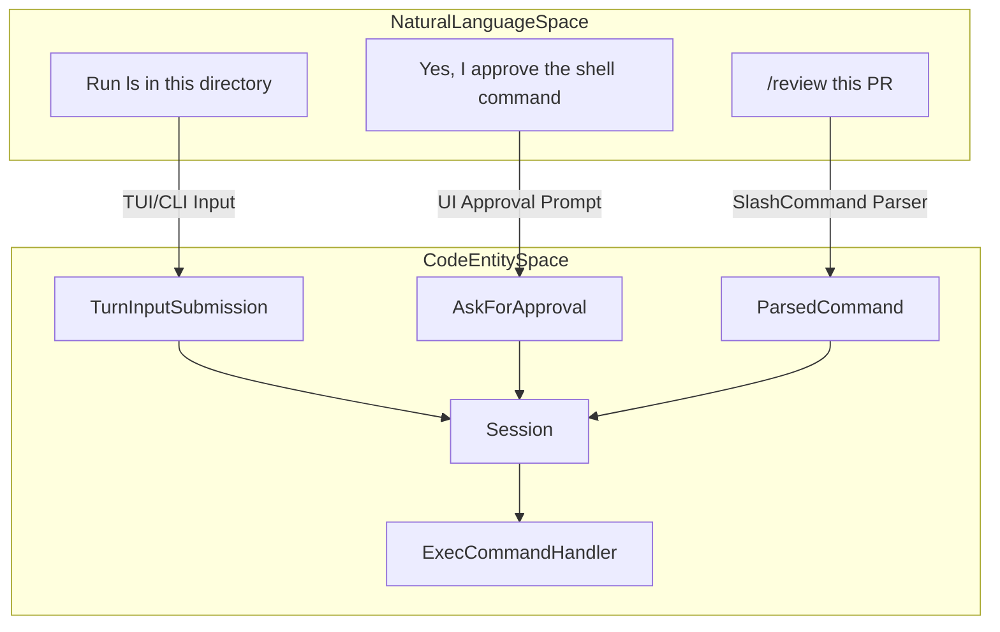
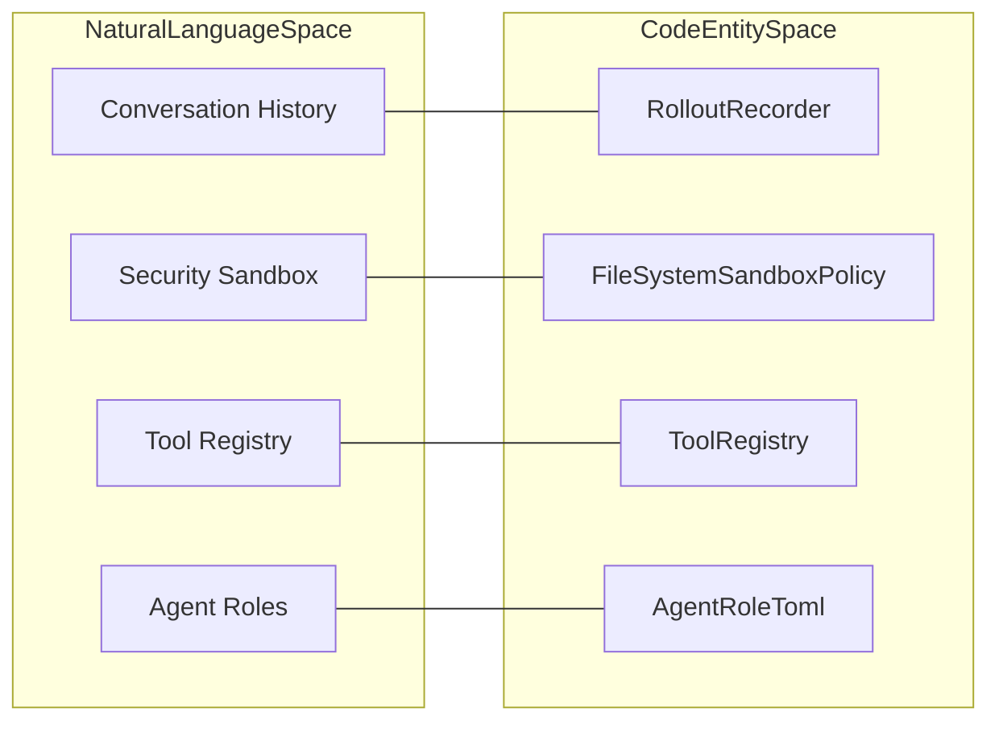
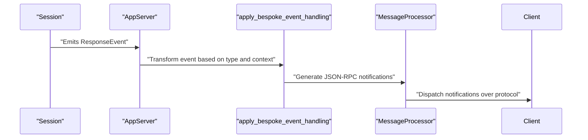

<!-- source: DeepWiki mcp.deepwiki.com · repo openai/codex · page 10 Glossary · fetched 2026-10-26 -->

# Glossary

Relevant source files

The following files were used as context for generating this wiki page:

- [codex-rs/app-server-protocol/schema/json/ClientRequest.json](codex-rs/app-server-protocol/schema/json/ClientRequest.json)
- [codex-rs/app-server-protocol/schema/json/ServerNotification.json](codex-rs/app-server-protocol/schema/json/ServerNotification.json)
- [codex-rs/app-server-protocol/schema/json/codex_app_server_protocol.schemas.json](codex-rs/app-server-protocol/schema/json/codex_app_server_protocol.schemas.json)
- [codex-rs/app-server-protocol/schema/json/codex_app_server_protocol.v2.schemas.json](codex-rs/app-server-protocol/schema/json/codex_app_server_protocol.v2.schemas.json)
- [codex-rs/app-server-protocol/schema/precomputed/app-server-exports-experimental.json.zst](codex-rs/app-server-protocol/schema/precomputed/app-server-exports-experimental.json.zst)
- [codex-rs/app-server-protocol/schema/precomputed/app-server-exports-stable.json.zst](codex-rs/app-server-protocol/schema/precomputed/app-server-exports-stable.json.zst)
- [codex-rs/app-server-protocol/schema/typescript/ClientRequest.ts](codex-rs/app-server-protocol/schema/typescript/ClientRequest.ts)
- [codex-rs/app-server-protocol/schema/typescript/v2/index.ts](codex-rs/app-server-protocol/schema/typescript/v2/index.ts)
- [codex-rs/app-server-protocol/src/protocol/common.rs](codex-rs/app-server-protocol/src/protocol/common.rs)
- [codex-rs/app-server-protocol/src/protocol/v2/tests.rs](codex-rs/app-server-protocol/src/protocol/v2/tests.rs)
- [codex-rs/app-server-protocol/src/protocol/v2/thread.rs](codex-rs/app-server-protocol/src/protocol/v2/thread.rs)
- [codex-rs/app-server/README.md](codex-rs/app-server/README.md)
- [codex-rs/app-server/src/bespoke_event_handling.rs](codex-rs/app-server/src/bespoke_event_handling.rs)
- [codex-rs/app-server/src/lib.rs](codex-rs/app-server/src/lib.rs)
- [codex-rs/app-server/src/message_processor.rs](codex-rs/app-server/src/message_processor.rs)
- [codex-rs/app-server/src/request_processors.rs](codex-rs/app-server/src/request_processors.rs)
- [codex-rs/app-server/src/request_processors/thread_lifecycle.rs](codex-rs/app-server/src/request_processors/thread_lifecycle.rs)
- [codex-rs/app-server/src/request_processors/thread_processor.rs](codex-rs/app-server/src/request_processors/thread_processor.rs)
- [codex-rs/app-server/src/thread_state.rs](codex-rs/app-server/src/thread_state.rs)
- [codex-rs/app-server/tests/suite/v2/mod.rs](codex-rs/app-server/tests/suite/v2/mod.rs)
- [codex-rs/app-server/tests/suite/v2/thread_fork.rs](codex-rs/app-server/tests/suite/v2/thread_fork.rs)
- [codex-rs/app-server/tests/suite/v2/thread_resume.rs](codex-rs/app-server/tests/suite/v2/thread_resume.rs)
- [codex-rs/app-server/tests/suite/v2/thread_start.rs](codex-rs/app-server/tests/suite/v2/thread_start.rs)
- [codex-rs/app-server/tests/suite/v2/thread_unsubscribe.rs](codex-rs/app-server/tests/suite/v2/thread_unsubscribe.rs)
- [codex-rs/app-server/tests/suite/v2/turn_start.rs](codex-rs/app-server/tests/suite/v2/turn_start.rs)
- [codex-rs/config/src/config_toml.rs](codex-rs/config/src/config_toml.rs)
- [codex-rs/config/src/profile_toml.rs](codex-rs/config/src/profile_toml.rs)
- [codex-rs/config/src/schema.rs](codex-rs/config/src/schema.rs)
- [codex-rs/config/src/types.rs](codex-rs/config/src/types.rs)
- [codex-rs/config/src/types_tests.rs](codex-rs/config/src/types_tests.rs)
- [codex-rs/core-api/src/lib.rs](codex-rs/core-api/src/lib.rs)
- [codex-rs/core/config.schema.json](codex-rs/core/config.schema.json)
- [codex-rs/core/src/codex_delegate.rs](codex-rs/core/src/codex_delegate.rs)
- [codex-rs/core/src/codex_delegate_tests.rs](codex-rs/core/src/codex_delegate_tests.rs)
- [codex-rs/core/src/codex_thread.rs](codex-rs/core/src/codex_thread.rs)
- [codex-rs/core/src/compact.rs](codex-rs/core/src/compact.rs)
- [codex-rs/core/src/compact_remote_v2.rs](codex-rs/core/src/compact_remote_v2.rs)
- [codex-rs/core/src/compact_remote_v2_attempt.rs](codex-rs/core/src/compact_remote_v2_attempt.rs)
- [codex-rs/core/src/compact_tests.rs](codex-rs/core/src/compact_tests.rs)
- [codex-rs/core/src/config/config_tests.rs](codex-rs/core/src/config/config_tests.rs)
- [codex-rs/core/src/config/mod.rs](codex-rs/core/src/config/mod.rs)
- [codex-rs/core/src/environment_selection.rs](codex-rs/core/src/environment_selection.rs)
- [codex-rs/core/src/session/environment.rs](codex-rs/core/src/session/environment.rs)
- [codex-rs/core/src/session/handlers.rs](codex-rs/core/src/session/handlers.rs)
- [codex-rs/core/src/session/mod.rs](codex-rs/core/src/session/mod.rs)
- [codex-rs/core/src/session/session.rs](codex-rs/core/src/session/session.rs)
- [codex-rs/core/src/session/tests.rs](codex-rs/core/src/session/tests.rs)
- [codex-rs/core/src/session/tests/guardian_tests.rs](codex-rs/core/src/session/tests/guardian_tests.rs)
- [codex-rs/core/src/session/turn.rs](codex-rs/core/src/session/turn.rs)
- [codex-rs/core/src/session/turn_context.rs](codex-rs/core/src/session/turn_context.rs)
- [codex-rs/core/src/state/mod.rs](codex-rs/core/src/state/mod.rs)
- [codex-rs/core/src/state/turn.rs](codex-rs/core/src/state/turn.rs)
- [codex-rs/core/src/tasks/mod.rs](codex-rs/core/src/tasks/mod.rs)
- [codex-rs/core/src/thread_manager.rs](codex-rs/core/src/thread_manager.rs)
- [codex-rs/core/src/thread_manager_tests.rs](codex-rs/core/src/thread_manager_tests.rs)
- [codex-rs/core/tests/common/test_codex.rs](codex-rs/core/tests/common/test_codex.rs)
- [codex-rs/core/tests/suite/compact.rs](codex-rs/core/tests/suite/compact.rs)
- [codex-rs/core/tests/suite/compact_remote.rs](codex-rs/core/tests/suite/compact_remote.rs)
- [codex-rs/core/tests/suite/mod.rs](codex-rs/core/tests/suite/mod.rs)
- [codex-rs/core/tests/suite/remote_env.rs](codex-rs/core/tests/suite/remote_env.rs)
- [codex-rs/core/tests/suite/scenarios.rs](codex-rs/core/tests/suite/scenarios.rs)
- [codex-rs/features/src/feature_configs.rs](codex-rs/features/src/feature_configs.rs)
- [codex-rs/features/src/lib.rs](codex-rs/features/src/lib.rs)
- [codex-rs/features/src/tests.rs](codex-rs/features/src/tests.rs)
- [codex-rs/protocol/src/environment.rs](codex-rs/protocol/src/environment.rs)
- [codex-rs/protocol/src/protocol.rs](codex-rs/protocol/src/protocol.rs)
- [codex-rs/thread-manager-sample/src/main.rs](codex-rs/thread-manager-sample/src/main.rs)
- [codex-rs/tui/src/local_settings.rs](codex-rs/tui/src/local_settings.rs)
- [codex-rs/tui/src/local_settings_tests.rs](codex-rs/tui/src/local_settings_tests.rs)
- [sdk/python/src/openai_codex/generated/v2_all.py](sdk/python/src/openai_codex/generated/v2_all.py)

## Purpose and Scope

This page defines codebase-specific terms, jargon, abbreviations, and architectural entities used throughout the Codex system. It serves as a technical reference for onboarding engineers to understand the mapping between conceptual system components and their concrete implementations in Rust.

Sources: [codex-rs/protocol/src/protocol.rs:1-4]()

---

## Core System Entities

### Codex / Session
The primary agent engine that manages the lifecycle of a session. It coordinates model interactions, tool execution, and state persistence.
- **Implementation**: `Session` is the primary handle for managing individual conversation logic, turn execution, and state transitions [codex-rs/core/src/session/session.rs:60-100]().
- **Data Flow**: It processes model interactions and manages the submission queue/event stream loop asynchronously [codex-rs/protocol/src/protocol.rs:3-4]().

Sources: [codex-rs/core/src/session/session.rs:60-100](), [codex-rs/protocol/src/protocol.rs:3-4]()

### Thread
A logical conversation container. A single Codex session can manage multiple threads, including a primary chat thread and sub-agent threads for specialized tasks like review or research.
- **Implementation**: Managed by thread infrastructure (`ThreadManager`), which handles spawning, resuming, and forking conversation branches [codex-rs/core/src/thread_manager.rs:1-1]().
- **Identification**: Referenced by `ThreadId`, a unique conversation branch identifier [codex-rs/protocol/src/protocol.rs:21-21]().

Sources: [codex-rs/core/src/thread_manager.rs:1-1](), [codex-rs/protocol/src/protocol.rs:21-21]()

### Turn
A single interaction in a conversation, usually composed of a user input followed by the agent's response.
- **Context Management**: Encapsulated in structures like `TurnEnvironment` and step settings, which manage the working directory, injected prompt fragments, and override metadata [codex-rs/core/src/session/turn_context.rs:1-1](), [codex-rs/core/src/session/mod.rs:51-54]().
- **Environment Selection**: Controlled by `TurnEnvironmentSelection`, enabling the agent to target different execution environments or sandboxes [codex-rs/protocol/src/protocol.rs:104-105]().

Sources: [codex-rs/core/src/session/turn_context.rs:1-1](), [codex-rs/core/src/session/mod.rs:51-54](), [codex-rs/protocol/src/protocol.rs:104-105]()

### Op (Operation) / Submission
An atomic command sent from frontend to the core engine, representing user intents or control commands.
- **Implementation**: Codex uses an asynchronous communication pattern via submission queues and event streams [codex-rs/protocol/src/protocol.rs:3-4]().
- **Turn Input**: `TurnInputSubmission` structures the payload for initiating or steering conversation turns [codex-rs/protocol/src/turn_input.rs:103-103]() (referenced in [codex-rs/protocol/src/protocol.rs:66-66]()).

Sources: [codex-rs/protocol/src/protocol.rs:3-4](), [codex-rs/protocol/src/turn_input.rs:103-103](), [codex-rs/protocol/src/protocol.rs:66-66]()

### EventMsg / ServerNotification
The communication mechanism from the core engine to clients. It streams granular updates like token generation, tool invocations, and error reports.
- **Implementation**: Core events are translated into JSON-RPC notifications via bespoke event handling and message processing in the App Server [codex-rs/app-server/src/bespoke_event_handling.rs:1-30](), [codex-rs/app-server-protocol/schema/json/ServerNotification.json:1-1]() (schema definition).

Sources: [codex-rs/app-server/src/bespoke_event_handling.rs:1-30](), [codex-rs/app-server-protocol/schema/json/ServerNotification.json:1-1]()

---

## Architectural Mapping: Natural Language to Code

These diagrams bridge user-facing concepts in natural language to the exact code entities responsible for them.

### User Interaction to Code Entity Mapping

**Explanation:**  
- Natural language inputs like user commands or approvals are parsed and wrapped as protocol operations (`TurnInputSubmission`, `AskForApproval`).  
- These operations enter the `Session` engine, which manages session state, model calls, and dispatch.  
- Inside the engine, specialized handlers like `ExecCommandHandler` execute the actual commands, e.g., running shell commands.

Sources: [codex-rs/protocol/src/turn_input.rs:103-103](), [codex-rs/protocol/src/protocol.rs:66-66](), [codex-rs/protocol/src/protocol.rs:127-127](), [codex-rs/core/src/session/session.rs:60-100](), [codex-rs/protocol/src/protocol.rs:57-57](), [codex-rs/core/src/session/tests.rs:126-128]()

### System Component to Code Entity Mapping

**Explanation:**  
- Conversation histories are persisted and managed by `RolloutRecorder` for replay and state recovery.  
- Sandbox enforcement for filesystem and network permissions is implemented via `FileSystemSandboxPolicy`.  
- Tools are registered and configured in `ToolRegistry`.  
- Agent roles governing agent capabilities and behavior are defined in TOML and parsed into `AgentRoleToml`.

Sources: [codex-rs/core/src/rollout/recorder.rs:1-1](), [codex-rs/core/src/session/tests.rs:115-115](), [codex-rs/protocol/src/protocol.rs:112-112](), [codex-rs/core/src/tools/registry.rs:1-1](), [codex-rs/core/src/session/tests.rs:37-37](), [codex-rs/core/config.schema.json:9-33]()

---

## Technical Terms & Jargon

| Term | Definition | Code Pointer |
| :--- | :--- | :--- |
| **Active Turn** | The turn currently in execution by the agent engine, managing the ongoing interaction. | [codex-rs/core/src/state/turn.rs:1-1]() (struct definition), [codex-rs/core/src/session/tests.rs:117-117]() (usage) |
| **Bespoke Event** | Specialized custom event transformations performed by the App Server to convert core events into frontend notifications. | [codex-rs/app-server/src/bespoke_event_handling.rs:1-30]() |
| **Compaction** | Process of summarizing conversation history to fit within token limits, performed both locally and remotely. | [codex-rs/core/src/compact.rs:1-1]() (module), [codex-rs/core/src/session/mod.rs:22-23]() (usage) |
| **Elicitation** | Request to the user for credentials or configuration to enable features or server access, e.g., MCP server login. | [codex-rs/protocol/src/protocol.rs:22-22]() (struct definition), [codex-rs/core/src/session/session.rs:85-86]() (usage) |
| **Guardian** | A risk-assessing sub-agent that intercepts tool calls to review for possible denial or approval before execution. | [codex-rs/protocol/src/protocol.rs:88-95]() |
| **MCP (Model Context Protocol)** | Protocol to integrate external servers exposing tools and resources, enabling richer model context and tooling. | [codex-rs/core/src/config/mod.rs:86-91]() |
| **Rollout** | An append-only event log capturing the entire history of a session for replay, analysis, and recovery. | [codex-rs/core/src/rollout/recorder.rs:1-1]() (module), [codex-rs/core/src/session/tests.rs:115-116]() (usage) |
| **Sandbox** | OS-level sandboxing/enforcement mechanisms (Landlock, Seatbelt, Windows Token) used to isolate tool execution environments. | [codex-rs/protocol/src/protocol.rs:112-112]() (policy definition), [codex-rs/core/src/sandboxing.rs:1-1]() (module) |
| **Skill** | Modular sets of tools and instructions developed under `.codex/skills` directory, injected into agent context. | [codex-rs/core/src/skills.rs:1-1]() (module), [codex-rs/core/src/session/session.rs:48-48]() (usage) |
| **App Server** | The JSON-RPC interface for IDE integration and remote session management. | [codex-rs/app-server/README.md:1-5]() |
| **Unified Exec** | System managing background execution processes and terminal sessions for tools requesting shell execution. | [codex-rs/features/src/lib.rs:147-147]() (feature flag), [codex-rs/core/src/unified_exec.rs:1-1]() (module) |
| **RolloutRecorder** | Component responsible for writing and managing the session’s rollout event log on disk. | [codex-rs/core/src/rollout/recorder.rs:1-1]() |

Sources: [codex-rs/core/src/state/turn.rs:1-1](), [codex-rs/core/src/session/tests.rs:117-117](), [codex-rs/app-server/src/bespoke_event_handling.rs:1-30](), [codex-rs/core/src/compact.rs:1-1](), [codex-rs/core/src/session/mod.rs:22-23](), [codex-rs/protocol/src/protocol.rs:22-22](), [codex-rs/core/src/session/session.rs:85-86](), [codex-rs/protocol/src/protocol.rs:88-95](), [codex-rs/core/src/config/mod.rs:86-91](), [codex-rs/core/src/rollout/recorder.rs:1-1](), [codex-rs/protocol/src/protocol.rs:112-112](), [codex-rs/core/src/sandboxing.rs:1-1](), [codex-rs/core/src/skills.rs:1-1](), [codex-rs/core/src/session/session.rs:48-48](), [codex-rs/app-server/README.md:1-5](), [codex-rs/features/src/lib.rs:147-147](), [codex-rs/core/src/unified_exec.rs:1-1]()

---

## Data Flow: Event Processing Pipeline

Codex adopts an asynchronous event-driven pattern with several stages translating core runtime events into frontend notifications.

### Event Processing Sequence

**Explanation:**  
- The core engine emits raw protocol events reflecting changes to conversation state.  
- AppServer applies bespoke translations converting internal events into domain-specific notifications.  
- Notifications are dispatched by `MessageProcessor` over JSON-RPC to clients for rendering or interaction.

Sources: [codex-rs/app-server/src/bespoke_event_handling.rs:1-30](), [codex-rs/core/src/session/session.rs:60-65](), [codex-rs/app-server/src/message_processor.rs:140-145]()

---

## Configuration Terms

| Term | Description | Code Pointer |
| :--- | :--- | :--- |
| **Config Layer** | A single configuration input source (CLI args, env vars, config files) combined into stacks managed by config loaders. | [codex-rs/core/src/config/mod.rs:11-15]() |
| **Managed Features** | Feature flags controlling capabilities at runtime; staged gradual rollout and toggling. | [codex-rs/core/src/session/session.rs:73-73]() |
| **Personality** | A model behavior modifier adjusting tone or style (e.g., "concise"). | [codex-rs/protocol/src/protocol.rs:28-28]() |
| **Permission Profile** | Defines granted permissions (filesystem, network) for sessions, restricting tool capabilities. | [codex-rs/protocol/src/protocol.rs:49-49]() |
| **Auth Mode** | Method of authentication with external providers (e.g., API key, ChatGPT OAuth). | [codex-rs/core/src/config/mod.rs:42-43]() |
| **Sourced** | Wrapper type capturing the origin information (file, env var) for configuration values. | [codex-rs/core/src/config/mod.rs:26-26]() |
| **Trust Level** | User or project trust categorization influencing allowed automations. | [codex-rs/protocol/src/protocol.rs:108-108]() |

Sources: [codex-rs/core/src/config/mod.rs:11-15](), [codex-rs/core/src/session/session.rs:73-73](), [codex-rs/protocol/src/protocol.rs:28-28](), [codex-rs/protocol/src/protocol.rs:49-49](), [codex-rs/core/src/config/mod.rs:42-43](), [codex-rs/core/src/config/mod.rs:26-26](), [codex-rs/protocol/src/protocol.rs:108-108]()