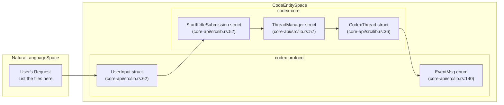
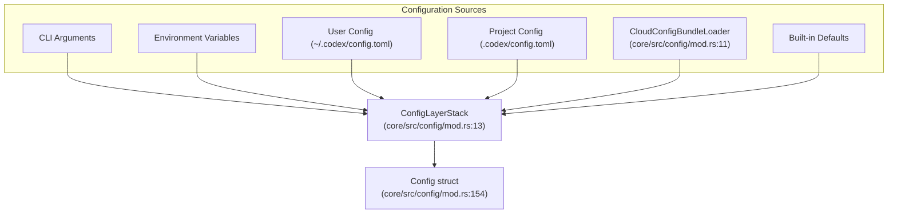
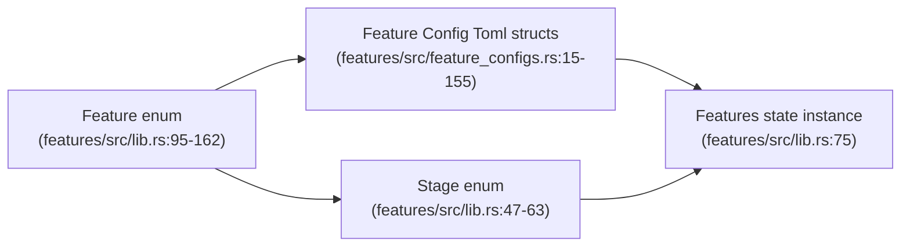
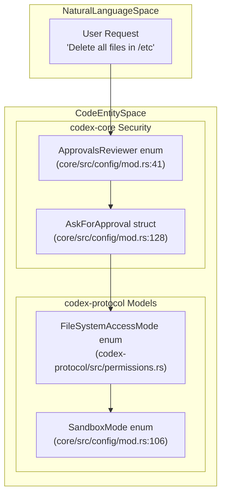

<!-- source: DeepWiki mcp.deepwiki.com · repo openai/codex · page 2 Core Concepts · fetched 2026-10-26 -->

# Core Concepts

Relevant source files

The following files were used as context for generating this wiki page:

- [codex-rs/config/src/config_toml.rs](codex-rs/config/src/config_toml.rs)
- [codex-rs/config/src/profile_toml.rs](codex-rs/config/src/profile_toml.rs)
- [codex-rs/config/src/schema.rs](codex-rs/config/src/schema.rs)
- [codex-rs/config/src/types.rs](codex-rs/config/src/types.rs)
- [codex-rs/config/src/types_tests.rs](codex-rs/config/src/types_tests.rs)
- [codex-rs/core-api/src/lib.rs](codex-rs/core-api/src/lib.rs)
- [codex-rs/core/config.schema.json](codex-rs/core/config.schema.json)
- [codex-rs/core/src/config/config_tests.rs](codex-rs/core/src/config/config_tests.rs)
- [codex-rs/core/src/config/mod.rs](codex-rs/core/src/config/mod.rs)
- [codex-rs/core/tests/suite/scenarios.rs](codex-rs/core/tests/suite/scenarios.rs)
- [codex-rs/features/src/feature_configs.rs](codex-rs/features/src/feature_configs.rs)
- [codex-rs/features/src/lib.rs](codex-rs/features/src/lib.rs)
- [codex-rs/features/src/tests.rs](codex-rs/features/src/tests.rs)
- [codex-rs/thread-manager-sample/src/main.rs](codex-rs/thread-manager-sample/src/main.rs)
- [codex-rs/tui/src/local_settings.rs](codex-rs/tui/src/local_settings.rs)
- [codex-rs/tui/src/local_settings_tests.rs](codex-rs/tui/src/local_settings_tests.rs)

This page documents the fundamental architectural patterns and systems that form the foundation of the Codex codebase. These core concepts are consistent across all execution modes (TUI, CLI, IDE integration, or MCP server) and provide essential abstractions for session management, configuration, security, and feature gating.

For detailed information about specific subsystems built on these concepts, see:  
- [Protocol Layer (Submission/Event System)](#2.1) — Document the `Op` submission queue and `Event` stream pattern that coordinates asynchronous communication between the core and frontends.  
- [Configuration System](#2.2) — Explain the layered configuration system (CLI args → env vars → `config.toml` → defaults), `ConfigBuilder`, profiles, and cloud requirements.  
- [Feature Flags](#2.3) — Document the feature flag system, lifecycle stages (`UnderDevelopment`/`Experimental`/`Stable`/`Deprecated`), and runtime toggles.  
- [Sandbox and Approval Policies](#2.4) — Explain sandbox modes (`ReadOnly`/`WorkspaceWrite`/`DangerFullAccess`), approval policies, permission profiles, and the execpolicy engine.

---

## 2.1 The Submission/Event Protocol

Codex employs a **Submission Queue (SQ) / Event Queue (EQ)** asynchronous messaging architecture to decouple UI clients from core agent logic. This design supports:

- Long-running model calls and interactions.  
- Interleaved calls to tools and subprocesses.  
- Multiplexing multiple threads and frontends observing live state.  

### Protocol Flow Overview

- **Frontend** submits user commands as **Operations (`Op`)** into a submission queue.  
- **Core** asynchronously consumes these `Op`s, driving conversation turns, model calls, and tool executions.  
- **Core** emits **Events (`EventMsg`)** streamed back to clients, reflecting turn progress, approvals, and results.  

### Natural Language to Code Entity Mapping: Submission Flow

In this flow, a user's natural language request is wrapped as a `UserInput` protocol message, converted into a submission (here `StartIfIdleSubmission`), managed by the `ThreadManager` which controls multiple `CodexThread` sessions, and finally processed to emit streaming `EventMsg`s consumed by the frontend.

**Sources:**  
[codex-rs/thread-manager-sample/src/main.rs:21-63](),  
[codex-rs/core-api/src/lib.rs:62-62](),  
[codex-rs/core-api/src/lib.rs:140-140](),  
[codex-rs/core-api/src/lib.rs:57-57](),  
[codex-rs/core-api/src/lib.rs:36-36](),  
[codex-rs/core-api/src/lib.rs:52-52]()

---

## 2.2 Configuration System

Codex features a **layered configuration system** that merges settings supplied via CLI arguments, environment variables, user and project config files, cloud bundles, and built-in defaults into a unified runtime configuration.

### Configuration Layer Hierarchy

Configuration layers are managed by the `ConfigLayerStack` abstraction and combined in priority order:

- **CLI arguments** (highest priority)  
- **Environment variables**  
- **User profile config files** (`~/.codex/config.toml`)  
- **Project-local config** (`.codex/config.toml`)  
- **Cloud-provided config bundles**  
- **Hardcoded defaults** (lowest priority)  

This layering supports flexible deployment scenarios such as local overrides, CI/CD-driven config, and cloud policy enforcement.

### Key Configuration Structures

| Symbol                 | Location                                | Purpose                                             |
|------------------------|---------------------------------------|-----------------------------------------------------|
| `ConfigToml`           | [config/src/config_toml.rs:164]()     | Defines schema for `config.toml` files used by users and projects. |
| `ConfigLayerStack`     | [core/src/config/mod.rs:13]()          | Manages multiple configuration sources and their priorities. |
| `ConfigEditsBuilder`   | [core/src/config/mod.rs:2]()           | Builder to apply programmatic edits to configurations. |
| `Config`               | [core/src/config/mod.rs:154]()     | The resolved runtime configuration used by core components. |

The system provides support for profiles, layered overrides, and requirement validations (e.g., cloud-managed settings, permissions).

**Sources:**  
[codex-rs/core/src/config/mod.rs:1-154](),  
[codex-rs/config/src/config_toml.rs:164-186](),  
[codex-rs/core/src/config/mod.rs:13-13](),  
[codex-rs/core/src/config/mod.rs:2-2]()

---

## 2.3 Feature Flag System

Codex governs feature accessibility using a centralized **feature flag system** that classifies features by lifecycle stage and enables runtime toggling.

### Feature Lifecycle Stages

Features have defined lifecycle stages modeled by the `Stage` enum:

- **UnderDevelopment**: Internal features not enabled externally.  
- **Experimental**: Opt-in features visible in experimental menus with metadata like announcements.  
- **Stable**: Fully supported features with standard enable/disable toggles.  
- **Deprecated**: Features marked for removal but still present for compatibility.  
- **Removed**: Flags kept only for backward compatibility with no effect.  

These stages are declared in `features/src/lib.rs` [lines 47-63]().

### Feature Definition and Resolution

Features are represented by the `Feature` enum [features/src/lib.rs:95-162]() and may include optional structured TOML configurations for granular control (e.g., `CodeModeConfigToml`).

At runtime, a `Features` instance merges feature flag states from configuration layers:

Feature toggles influence UI visibility, internal logic branching, experimental flags, and API behaviors.

**Sources:**  
[codex-rs/features/src/lib.rs:47-63](),  
[codex-rs/features/src/lib.rs:95-162](),  
[codex-rs/features/src/feature_configs.rs:15-155](),  
[codex-rs/features/src/lib.rs:75]()

---

## 2.4 Sandbox and Approval Policies

Codex enforces security and execution isolation using **sandbox modes**, **approval policies**, and **permission profiles**, regulating filesystem and network access, tool execution rights, and user confirmations.

### Sandbox Modes

Sandbox modes are defined in the `SandboxMode` enum and constrain the allowed level of filesystem and environment access during tool and command execution:

- **ReadOnly**: Prohibits all writable filesystem and environment mutations.  
- **WorkspaceWrite**: Allows writes only in designated workspace directories.  
- **DangerFullAccess**: Grants unrestricted access to the filesystem and environment; use with caution.

These modes are resolved per session or environment and help enforce least privilege execution.

### Permission Profiles and Enforcement

`PermissionProfile` structs (defined in Codex protocol models) specify fine-grained policies controlling:

- Allowed filesystem paths with granular access modes.  
- Network permissions and proxy enforcement.  
- Sandbox policies applied at runtime.  
- Approvals requirements for sensitive actions.

Profiles may be built-in (e.g., `read_only`, `workspace`) or user-defined in config.

### Approval Reviewers and Policies

Approval flows utilize the `ApprovalsReviewer` enum to designate who reviews approval requests for potentially sensitive operations:

- **user**: Requires explicit human approval.  
- **auto_review**: Delegates review to an internal automated sub-agent for streamlined flow.

This reviewer setting integrates into sandbox policies and controls how approval prompts are issued or suppressed.

---

### Natural Language to Code Entity Mapping: Security Enforcement Flow

This flow shows how a user's potentially dangerous request triggers permission checks via configured approval reviewers, which lead to approval requests (`AskForApproval`). These requests enforce restrictions on filesystem access modes, all confined within the chosen sandbox mode.

---

## Summary of Core Data Structures

| Symbol               | Location                                   | Role                                                                   |
|----------------------|--------------------------------------------|-------------------------------------------------------------------------|
| `CodexThread`        | [core-api/src/lib.rs:36]()                  | Manages a single agent thread handling conversation turns.              |
| `ThreadManager`      | [core-api/src/lib.rs:57]()                  | Coordinates multiple `CodexThread`s and session concurrency.             |
| `Op`                 | [core-api/src/lib.rs:141]()                 | Represents commands or requests submitted into the core.                 |
| `EventMsg`           | [core-api/src/lib.rs:140]()                 | Streamed events emitted by core to frontends, reflecting turn state.     |
| `ConfigLayerStack`   | [core/src/config/mod.rs:13]()               | Merges layered configuration sources into a unified runtime config.      |
| `ConfigToml`         | [config/src/config_toml.rs:164]()           | Defines configuration schema for user and project TOML files.            |
| `Feature`            | [features/src/lib.rs:95-162]()              | Enumeration of feature flags with lifecycle metadata.                    |
| `ApprovalsReviewer`  | [core/src/config/mod.rs:41]()               | Enum determining who reviews approval prompts.                          |
| `PermissionProfile`  | [core/src/config/mod.rs:116]()              | Policy struct defining filesystem, network, and sandbox permissions.     |

---

This page provides a high-level conceptual overview of Codex's foundational systems. For detailed explanations, implementation specifics, and usage examples, refer to the following child pages:

- [Protocol Layer (Submission/Event System)](#2.1)  
- [Configuration System](#2.2)  
- [Feature Flags](#2.3)  
- [Sandbox and Approval Policies](#2.4)  

**Sources:**  
[codex-rs/thread-manager-sample/src/main.rs:21-63](),  
[codex-rs/core-api/src/lib.rs:141-141](),  
[codex-rs/core-api/src/lib.rs:140-140](),  
[codex-rs/core/src/config/mod.rs:1-154](),  
[codex-rs/config/src/config_toml.rs:164-186](),  
[codex-rs/features/src/lib.rs:95-162](),  
[codex-rs/core/src/config/mod.rs:116-116](),  
[codex-rs/core/src/config/mod.rs:41-41]()

---

