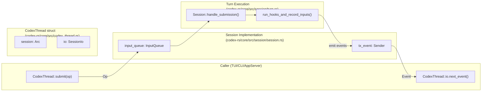
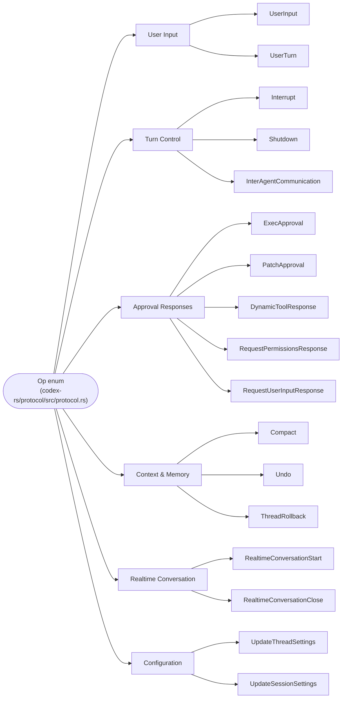
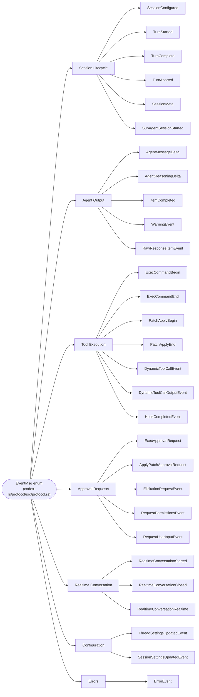
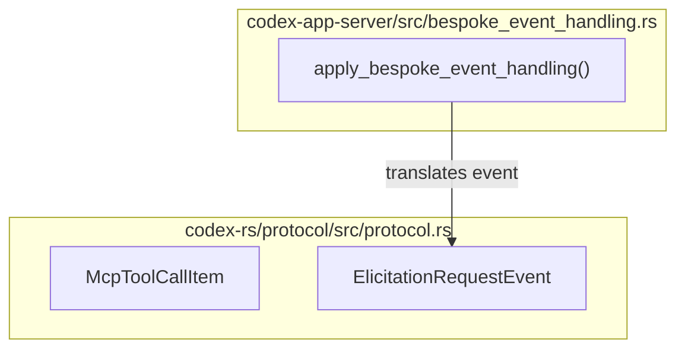

<!-- source: DeepWiki mcp.deepwiki.com · repo openai/codex · page 2.1 Protocol Layer (Submission/Event System) · fetched 2026-10-26 -->

# Protocol Layer (Submission/Event System)

<details>
<summary>Relevant source files</summary>

The following files were used as context for generating this wiki page:

- [codex-rs/app-server-protocol/schema/json/v2/RawResponseItemCompletedNotification.json](codex-rs/app-server-protocol/schema/json/v2/RawResponseItemCompletedNotification.json)
- [codex-rs/app-server-protocol/schema/json/v2/ThreadForkParams.json](codex-rs/app-server-protocol/schema/json/v2/ThreadForkParams.json)
- [codex-rs/app-server-protocol/schema/json/v2/ThreadResumeParams.json](codex-rs/app-server-protocol/schema/json/v2/ThreadResumeParams.json)
- [codex-rs/app-server-protocol/schema/json/v2/ThreadStartParams.json](codex-rs/app-server-protocol/schema/json/v2/ThreadStartParams.json)
- [codex-rs/app-server-protocol/schema/json/v2/TurnStartParams.json](codex-rs/app-server-protocol/schema/json/v2/TurnStartParams.json)
- [codex-rs/app-server-protocol/schema/typescript/ResponseItem.ts](codex-rs/app-server-protocol/schema/typescript/ResponseItem.ts)
- [codex-rs/app-server-protocol/schema/typescript/v2/ThreadForkParams.ts](codex-rs/app-server-protocol/schema/typescript/v2/ThreadForkParams.ts)
- [codex-rs/app-server-protocol/schema/typescript/v2/ThreadResumeParams.ts](codex-rs/app-server-protocol/schema/typescript/v2/ThreadResumeParams.ts)
- [codex-rs/app-server/src/bespoke_event_handling.rs](codex-rs/app-server/src/bespoke_event_handling.rs)
- [codex-rs/core/src/codex_delegate.rs](codex-rs/core/src/codex_delegate.rs)
- [codex-rs/core/src/codex_delegate_tests.rs](codex-rs/core/src/codex_delegate_tests.rs)
- [codex-rs/core/src/codex_thread.rs](codex-rs/core/src/codex_thread.rs)
- [codex-rs/core/src/compact.rs](codex-rs/core/src/compact.rs)
- [codex-rs/core/src/compact_remote_v2.rs](codex-rs/core/src/compact_remote_v2.rs)
- [codex-rs/core/src/compact_remote_v2_attempt.rs](codex-rs/core/src/compact_remote_v2_attempt.rs)
- [codex-rs/core/src/compact_tests.rs](codex-rs/core/src/compact_tests.rs)
- [codex-rs/core/src/environment_selection.rs](codex-rs/core/src/environment_selection.rs)
- [codex-rs/core/src/session/environment.rs](codex-rs/core/src/session/environment.rs)
- [codex-rs/core/src/session/handlers.rs](codex-rs/core/src/session/handlers.rs)
- [codex-rs/core/src/session/mod.rs](codex-rs/core/src/session/mod.rs)
- [codex-rs/core/src/session/session.rs](codex-rs/core/src/session/session.rs)
- [codex-rs/core/src/session/tests.rs](codex-rs/core/src/session/tests.rs)
- [codex-rs/core/src/session/tests/guardian_tests.rs](codex-rs/core/src/session/tests/guardian_tests.rs)
- [codex-rs/core/src/session/turn.rs](codex-rs/core/src/session/turn.rs)
- [codex-rs/core/src/session/turn_context.rs](codex-rs/core/src/session/turn_context.rs)
- [codex-rs/core/src/state/mod.rs](codex-rs/core/src/state/mod.rs)
- [codex-rs/core/src/state/turn.rs](codex-rs/core/src/state/turn.rs)
- [codex-rs/core/src/tasks/mod.rs](codex-rs/core/src/tasks/mod.rs)
- [codex-rs/core/src/thread_manager.rs](codex-rs/core/src/thread_manager.rs)
- [codex-rs/core/src/thread_manager_tests.rs](codex-rs/core/src/thread_manager_tests.rs)
- [codex-rs/core/tests/common/test_codex.rs](codex-rs/core/tests/common/test_codex.rs)
- [codex-rs/core/tests/suite/compact.rs](codex-rs/core/tests/suite/compact.rs)
- [codex-rs/core/tests/suite/compact_remote.rs](codex-rs/core/tests/suite/compact_remote.rs)
- [codex-rs/core/tests/suite/mod.rs](codex-rs/core/tests/suite/mod.rs)
- [codex-rs/core/tests/suite/remote_env.rs](codex-rs/core/tests/suite/remote_env.rs)
- [codex-rs/protocol/src/environment.rs](codex-rs/protocol/src/environment.rs)
- [codex-rs/protocol/src/models.rs](codex-rs/protocol/src/models.rs)
- [codex-rs/protocol/src/protocol.rs](codex-rs/protocol/src/protocol.rs)

</details>


## Purpose and Scope

This page documents the core asynchronous communication protocol used to coordinate the interaction between the core `codex-core` agent and all user-facing frontends, including the Terminal User Interface (TUI), headless exec mode, the App Server, and MCP servers. The protocol employs a **Submission Queue / Event Queue** (SQ/EQ) pattern enabling decoupled, async communication for requests and agent-generated events.

Key abstractions documented here include:

- The submission queue carrying client requests wrapped as `Submission` structs.
- The event queue streaming back notifications wrapped as `Event` structs.
- The `Op` enum defining all client-initiated operations.
- The `EventMsg` enum defining all agent-initiated notifications.
- How these abstractions are integrated into the `CodexThread` and `Session` structs.
- The role of the protocol layer in enabling tool calls, approvals, and turn lifecycle coordination.

For session lifecycle and turn execution details, see the sibling leaf pages under section 3. For protocol externalization in the App Server see section 4.5.

---

## Core Abstractions

### Submission and Op

A `Submission` represents a client request placed on the submission queue. It pairs a unique identifier with a payload operation (`Op`) and optional distributed tracing context for async handoff tracing.

```rust
pub struct Submission {
    /// Unique id for this Submission to correlate with Events
    pub id: String,
    /// Payload operation requested by client
    pub op: Op,
    /// Optional client-provided id for the user message represented by `Op::UserInput`.
    pub client_user_message_id: Option<String>,
    /// Optional W3C trace carrier propagated across async submission handoffs.
    pub trace: Option<W3cTraceContext>,
}
```

The optional `trace` field supports OpenTelemetry-style distributed tracing across async boundaries, carrying `traceparent` and `tracestate` context.

The `Op` enum describes all actionable commands clients may request from the agent, including starting turns, interrupting ongoing ones, approving exec commands, and managing configuration and context [codex-rs/protocol/src/protocol.rs:209-510]().

Key `Op` variants include:

- `UserInput`: Submit user messages and input commands to the agent, optionally updating thread settings.
- `Interrupt`: Cancel any currently running turn.
- `ExecApproval` / `PatchApproval`: Respond to pending tool or patch approval requests.
- `Compact`, `Undo`, `ThreadRollback`: Manage conversation history and context state.

Sources:
- [codex-rs/core/src/session/mod.rs:5124]()
- [codex-rs/protocol/src/protocol.rs:209-510]()

---

### Event and EventMsg

The `Event` struct packages agent notifications on the event queue:

```rust
pub struct Event {
    pub id: String,       // Echoes the Submission.id which triggered this event
    pub msg: EventMsg,    // Tagged union notification payload
}
```

`EventMsg` is a comprehensive enum encapsulating all agent event notifications, such as streaming assistant message deltas, tool execution starts/ends, approval requests, and turn lifecycle events [codex-rs/protocol/src/protocol.rs:586-1115]().

Notable `EventMsg` variants:

- `TurnStarted`: Signals the beginning of an agent turn.
- `AgentMessageDelta`: Contains streaming increments of assistant-generated text.
- `ItemCompleted`: Marks the completion of a response item.
- `ExecCommandBegin`/`ExecCommandEnd`: Notify start/end of shell command execution.
- `ExecApprovalRequest` / `ApplyPatchApprovalRequest`: Ask the user for approval before executing privileged operations.
- `TurnComplete`: Marks the end of a turn with summary data.

Sources:
- [codex-rs/protocol/src/protocol.rs:586-1115]()

---

## The Async Queue Model

The protocol communication implements a Submission Queue (SQ) and Event Queue (EQ) asynchronous pattern, backed by `async-channel` channels. This design enables decoupling between client threads submitting requests and the internal agent execution flow processing those requests, especially turn-level execution.

The key components and data flow of this model in the core codebase are illustrated in the following diagram:

### Queue Architecture: CodexThread, Session, and Turn Execution



- `CodexThread` exposes the public interface for submitting `Op` requests and retrieving `Event` notifications [codex-rs/core/src/codex_thread.rs:8]() (referring to `SessionIo` which contains the event receiver).
- Submitted ops enter the `InputQueue` managed by `Session` [codex-rs/core/src/session/session.rs:94]().
- The session asynchronously runs turns (`handle_submission()`) processing the ops, including executing hooks [codex-rs/core/src/session/turn.rs:34]().
- Hooks and turn execution emit `Event` messages on `tx_event` [codex-rs/core/src/session/session.rs:61]().
- Clients receive `Event`s asynchronously by polling `next_event()` [codex-rs/core/src/codex_thread.rs:8]() (via `SessionIo`).

This architecture provides efficient asynchronous agent communication across the diverse frontends while preserving turn granularity and event streaming fidelity.

Sources:
- [codex-rs/protocol/src/protocol.rs:3-4]()
- [codex-rs/core/src/codex_thread.rs:8]()
- [codex-rs/core/src/session/session.rs:61]()
- [codex-rs/core/src/session/session.rs:94]()
- [codex-rs/core/src/session/turn.rs:34]()

---

## App Server Protocol Bridge

The `codex-app-server` component translates the internal protocol into an external JSON-RPC interface enabling IDE and remote clients to communicate with the agent.

Key features:

- **Request Serialization Queues** ensure ordered handling of requests keyed by resources like `thread_id` or shell process, even with an asynchronous transport [codex-rs/app-server/src/bespoke_event_handling.rs:100-125]().
- The App Server converts internal `Event` items into JSON-RPC `ServerNotification` messages via bespoke event handling [codex-rs/app-server/src/bespoke_event_handling.rs:100-125]().

This bridge isolates the internal protocol from transport details while preserving the rich event semantics.

Sources:
- [codex-rs/app-server/src/bespoke_event_handling.rs:100-125]()

---

## Op Variants Reference

### Op Enum Taxonomy

The `Op` enum subdivides into categories of client requests:



### Key Op Variants

| Variant | Key Fields | Behavior |
|---------|------------|----------|
| `UserInput` | `items: Vec<ResponseItem>`, `thread_settings` | Submits user messages and commands to start or continue threads/turns. Supports updating thread config [codex-rs/protocol/src/protocol.rs:213-224](). |
| `Interrupt` | None | Requests immediate abortion of the active turn [codex-rs/protocol/src/protocol.rs:270](). |
| `ExecApproval` | `id: String`, `decision: ReviewDecision` | Responds to a pending exec (shell command) approval request [codex-rs/protocol/src/protocol.rs:288-292](). |
| `PatchApproval` | `id: String`, `decision: ReviewDecision` | Responds to a pending file patch approval request [codex-rs/protocol/src/protocol.rs:294-298](). |
| `Compact` | `input: Vec<UserInput>` | Triggers a manual compaction of the conversation history, summarizing it with the provided input [codex-rs/core/src/compact.rs:146-163](). |
| `RealtimeConversationStart` | `params: ConversationStartParams` | Initiates a real-time conversation session [codex-rs/protocol/src/protocol.rs:400-403](). |
| `RealtimeConversationClose` | None | Closes an active real-time conversation session [codex-rs/protocol/src/protocol.rs:405](). |
| `InterAgentCommunication` | `communication: InterAgentCommunication`, `start_options: TurnStartOptions` | Allows agents to communicate with each other, potentially starting new turns [codex-rs/protocol/src/protocol.rs:300-303](). |
| `UpdateThreadSettings` | `settings: ThreadSettingsOverrides` | Updates the settings for the current thread [codex-rs/protocol/src/protocol.rs:226-229](). |
| `UpdateSessionSettings` | `settings: SessionSettingsUpdate` | Updates session-wide settings [codex-rs/protocol/src/protocol.rs:231-234](). |

Sources:
- [codex-rs/protocol/src/protocol.rs:213-224]()
- [codex-rs/protocol/src/protocol.rs:270]()
- [codex-rs/protocol/src/protocol.rs:288-292]()
- [codex-rs/protocol/src/protocol.rs:294-298]()
- [codex-rs/core/src/compact.rs:146-163]()
- [codex-rs/protocol/src/protocol.rs:400-403]()
- [codex-rs/protocol/src/protocol.rs:405]()
- [codex-rs/protocol/src/protocol.rs:300-303]()
- [codex-rs/protocol/src/protocol.rs:226-229]()
- [codex-rs/protocol/src/protocol.rs:231-234]()

---

## EventMsg Variants Reference

### EventMsg Enum Taxonomy

The `EventMsg` enum organizes notifications into major groups:



### Key EventMsg Variants

| Variant | Key Fields | Description |
|---------|------------|-------------|
| `TurnStarted` | `TurnStartedEvent` | Signals start of a new turn [codex-rs/protocol/src/protocol.rs:608](). |
| `AgentMessageDelta` | `AgentMessageContentDeltaEvent` | Streaming incremental assistant message content [codex-rs/protocol/src/protocol.rs:639](). |
| `ExecCommandBegin` | `ExecCommandBeginEvent` | Indicates shell command execution has started [codex-rs/protocol/src/protocol.rs:695](). |
| `ExecApprovalRequest` | `ExecApprovalRequestEvent` | Requests user approval to execute a privileged command [codex-rs/protocol/src/protocol.rs:855](). |
| `TurnComplete` | `TurnCompleteEvent` | Marks the completion of a turn including final usage and response text [codex-rs/protocol/src/protocol.rs:620](). |
| `TurnAborted` | `TurnAbortedEvent` | Indicates that the current turn was aborted, potentially with a reason [codex-rs/protocol/src/protocol.rs:622](). |
| `Warning` | `WarningEvent` | Emits a warning message to the user, e.g., about long threads and compaction [codex-rs/protocol/src/protocol.rs:1000](). |
| `RealtimeConversationStarted` | `RealtimeConversationStartedEvent` | Notifies that a real-time conversation has successfully started [codex-rs/protocol/src/protocol.rs:970](). |
| `RealtimeConversationClosed` | `RealtimeConversationClosedEvent` | Notifies that a real-time conversation has been closed [codex-rs/protocol/src/protocol.rs:972](). |
| `RealtimeConversationRealtime` | `RealtimeConversationRealtimeEvent` | Carries real-time conversation events, such as session updates [codex-rs/protocol/src/protocol.rs:974](). |
| `SubAgentSessionStarted` | `SubAgentSessionStartedEvent` | Notifies that a sub-agent session has been started [codex-rs/protocol/src/protocol.rs:606](). |
| `ThreadSettingsUpdated` | `ThreadSettingsSnapshot` | Notifies that the thread settings have been updated [codex-rs/protocol/src/protocol.rs:624](). |
| `SessionSettingsUpdated` | `SessionSettingsSnapshot` | Notifies that session-wide settings have been updated [codex-rs/protocol/src/protocol.rs:626](). |
| `ElicitationRequest` | `ElicitationRequestEvent` | Requests user input for an elicitation, e.g., for an OAuth flow [codex-rs/protocol/src/protocol.rs:857](). |
| `RequestPermissions` | `RequestPermissionsEvent` | Requests user approval for specific permissions [codex-rs/protocol/src/protocol.rs:859](). |
| `RequestUserInput` | `RequestUserInputEvent` | Requests arbitrary user input [codex-rs/protocol/src/protocol.rs:861](). |

Sources:
- [codex-rs/protocol/src/protocol.rs:586-1115]()
- [codex-rs/protocol/src/protocol.rs:608]()
- [codex-rs/protocol/src/protocol.rs:639]()
- [codex-rs/protocol/src/protocol.rs:695]()
- [codex-rs/protocol/src/protocol.rs:855]()
- [codex-rs/protocol/src/protocol.rs:620]()
- [codex-rs/protocol/src/protocol.rs:622]()
- [codex-rs/protocol/src/protocol.rs:1000]()
- [codex-rs/protocol/src/protocol.rs:970]()
- [codex-rs/protocol/src/protocol.rs:972]()
- [codex-rs/protocol/src/protocol.rs:974]()
- [codex-rs/protocol/src/protocol.rs:606]()
- [codex-rs/protocol/src/protocol.rs:624]()
- [codex-rs/protocol/src/protocol.rs:626]()
- [codex-rs/protocol/src/protocol.rs:857]()
- [codex-rs/protocol/src/protocol.rs:859]()
- [codex-rs/protocol/src/protocol.rs:861]()

---

## Tool Execution and MCP Interaction

The protocol layer orchestrates complex asynchronous tool calls and approvals, particularly integrating with the Model Context Protocol (MCP) for external tool servers.

### MCP Tool Call Flow within the Protocol Layer



- The `apply_bespoke_event_handling` function in `codex-app-server` is responsible for translating internal `Event` messages into `ServerNotification` messages for the app server clients [codex-rs/app-server/src/bespoke_event_handling.rs:100-125]().
- Internal events like `ElicitationRequestEvent` are translated for frontend consumption.
- The `McpToolCallItem` encapsulates active MCP tool invocations within event streams.

### Approval Elicitation in MCP

Certain MCP tool calls require explicit user approvals (e.g., for access tokens or permission grants). The protocol utilizes `ElicitationRequestEvent` to signal these needs toward the frontend UI [codex-rs/protocol/src/protocol.rs:22]().

The frontend can then render an appropriate approval UI and respond via `Op` approval variants.

Sources:
- [codex-rs/protocol/src/protocol.rs:22]()
- [codex-rs/app-server/src/bespoke_event_handling.rs:100-125]()

---

# Summary

The protocol layer is the foundational asynchronous message bus between Codex's agent core and its frontends. Submissions encapsulate requested client operations (`Op`), which the agent consumes via an input queue and processes asynchronously. Agent-generated notifications (`EventMsg`) stream back through an event queue, enabling streaming UI updates and rich interaction feedback.

This design supports extensibility (new ops/events), natural concurrency, reliable event correlation, and observability via tracing contexts. It further underpins higher-level functionalities like turn management, sandboxing, approval workflows, and tool invocation orchestration.

---

## Sources

- [codex-rs/protocol/src/protocol.rs:209-1115]()
- [codex-rs/core/src/codex_thread.rs:8]()
- [codex-rs/core/src/session/session.rs:61]()
- [codex-rs/core/src/session/session.rs:94]()
- [codex-rs/core/src/session/turn.rs:34]()
- [codex-rs/app-server/src/bespoke_event_handling.rs:100-125]()
- [codex-rs/core/src/compact.rs:146-163]()
- [codex-rs/protocol/src/protocol.rs:22]()

---

