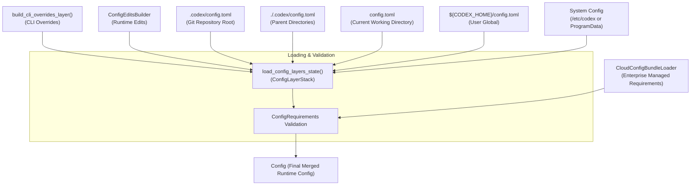
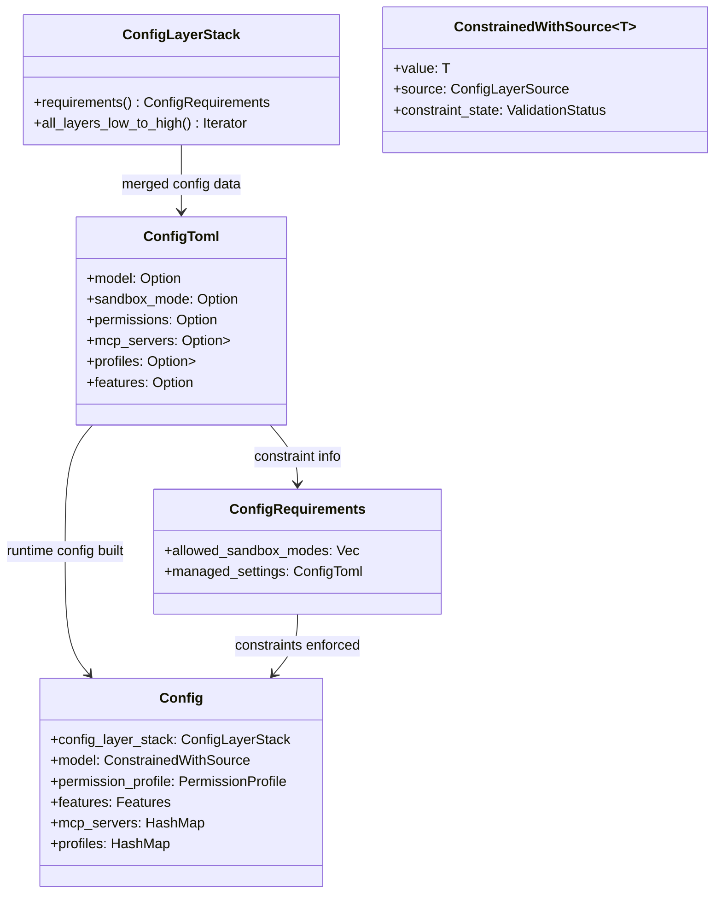
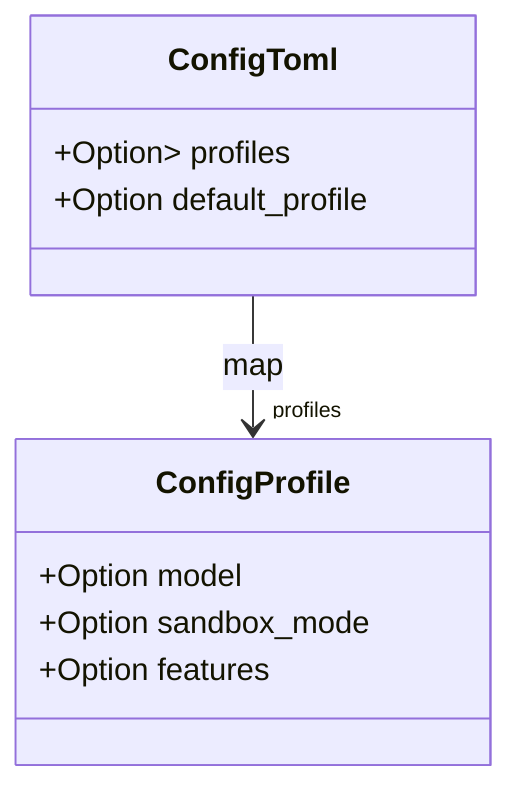
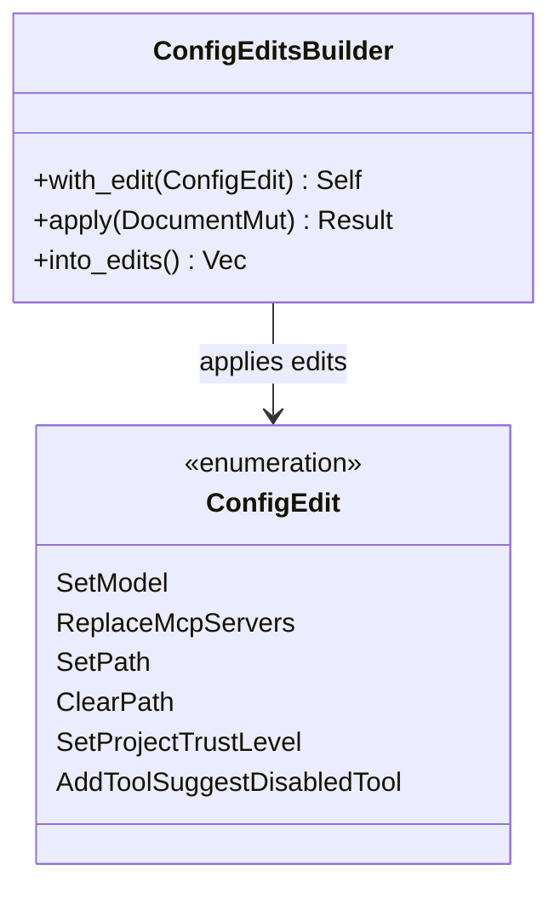
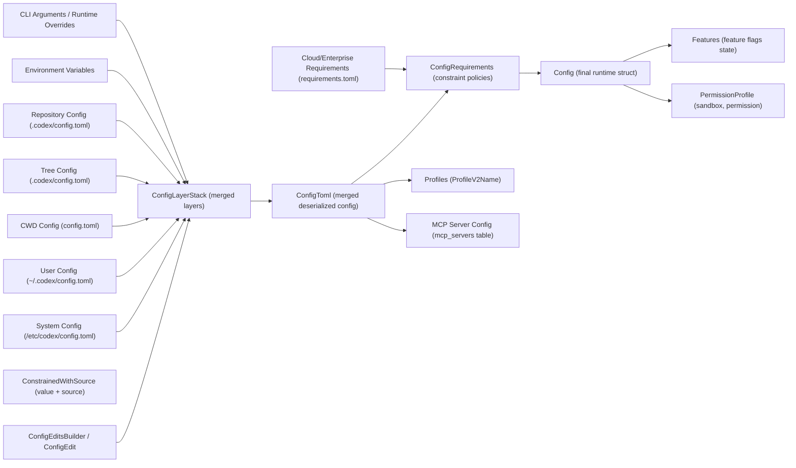

<!-- source: DeepWiki mcp.deepwiki.com · repo openai/codex · page 2.2 Configuration System · fetched 2026-10-26 -->

# Configuration System

<details>
<summary>Relevant source files</summary>

The following files were used as context for generating this wiki page:

- [codex-rs/app-server/src/config_manager.rs](codex-rs/app-server/src/config_manager.rs)
- [codex-rs/app-server/src/config_manager_service.rs](codex-rs/app-server/src/config_manager_service.rs)
- [codex-rs/app-server/src/config_manager_service_credential_edits.rs](codex-rs/app-server/src/config_manager_service_credential_edits.rs)
- [codex-rs/app-server/src/config_manager_service_tests.rs](codex-rs/app-server/src/config_manager_service_tests.rs)
- [codex-rs/app-server/src/request_processors/account_processor.rs](codex-rs/app-server/src/request_processors/account_processor.rs)
- [codex-rs/app-server/tests/suite/v2/account.rs](codex-rs/app-server/tests/suite/v2/account.rs)
- [codex-rs/config/src/config_toml.rs](codex-rs/config/src/config_toml.rs)
- [codex-rs/config/src/key_aliases.rs](codex-rs/config/src/key_aliases.rs)
- [codex-rs/config/src/loader/layer_io.rs](codex-rs/config/src/loader/layer_io.rs)
- [codex-rs/config/src/loader/local.rs](codex-rs/config/src/loader/local.rs)
- [codex-rs/config/src/loader/managed_project_discovery_tests.rs](codex-rs/config/src/loader/managed_project_discovery_tests.rs)
- [codex-rs/config/src/loader/mod.rs](codex-rs/config/src/loader/mod.rs)
- [codex-rs/config/src/loader/tests.rs](codex-rs/config/src/loader/tests.rs)
- [codex-rs/config/src/merge.rs](codex-rs/config/src/merge.rs)
- [codex-rs/config/src/merge_tests.rs](codex-rs/config/src/merge_tests.rs)
- [codex-rs/config/src/profile_toml.rs](codex-rs/config/src/profile_toml.rs)
- [codex-rs/config/src/schema.rs](codex-rs/config/src/schema.rs)
- [codex-rs/config/src/state.rs](codex-rs/config/src/state.rs)
- [codex-rs/config/src/state_tests.rs](codex-rs/config/src/state_tests.rs)
- [codex-rs/config/src/types.rs](codex-rs/config/src/types.rs)
- [codex-rs/config/src/types_tests.rs](codex-rs/config/src/types_tests.rs)
- [codex-rs/core-api/src/lib.rs](codex-rs/core-api/src/lib.rs)
- [codex-rs/core/config.schema.json](codex-rs/core/config.schema.json)
- [codex-rs/core/src/config/config_loader_tests.rs](codex-rs/core/src/config/config_loader_tests.rs)
- [codex-rs/core/src/config/config_tests.rs](codex-rs/core/src/config/config_tests.rs)
- [codex-rs/core/src/config/mod.rs](codex-rs/core/src/config/mod.rs)
- [codex-rs/core/src/config/runtime_refresh.rs](codex-rs/core/src/config/runtime_refresh.rs)
- [codex-rs/core/src/session/config_refresh.rs](codex-rs/core/src/session/config_refresh.rs)
- [codex-rs/core/tests/suite/scenarios.rs](codex-rs/core/tests/suite/scenarios.rs)
- [codex-rs/features/src/feature_configs.rs](codex-rs/features/src/feature_configs.rs)
- [codex-rs/features/src/lib.rs](codex-rs/features/src/lib.rs)
- [codex-rs/features/src/tests.rs](codex-rs/features/src/tests.rs)
- [codex-rs/thread-manager-sample/src/main.rs](codex-rs/thread-manager-sample/src/main.rs)
- [codex-rs/tui/src/local_settings.rs](codex-rs/tui/src/local_settings.rs)
- [codex-rs/tui/src/local_settings_tests.rs](codex-rs/tui/src/local_settings_tests.rs)

</details>


## Purpose and Scope

The Configuration System manages all runtime settings for Codex, including model selection, sandbox policies, permissions, feature flags, MCP server configurations, and profiles. It consolidates configuration data from multiple layered sources—command-line arguments, environment variables, `.toml` files at various scopes, and internal defaults—into a unified and authoritative runtime `Config` struct.

This page explains the layered configuration model, the main components (`ConfigBuilder`, `config_loader`), profile handling, and enforcement of cloud/enterprise requirements in detail. It covers the data flow, key structs/classes, and configuration sources with technical depth.

Sources: [codex-rs/core/src/config/mod.rs:1-154]()

---

## Configuration Architecture

### Configuration Sources and Precedence

Codex uses a **layered configuration system** with a strict precedence hierarchy, from highest priority to lowest:

| Priority | Layer                       | Source Description                            | Scope                          |
|----------|-----------------------------|----------------------------------------------|--------------------------------|
| 1        | CLI arguments & runtime edits | Command-line flags and runtime config edits | Per execution instance          |
| 2        | Repository config            | `.codex/config.toml` at git repository root | Per repository                  |
| 3        | Tree config                 | `.codex/config.toml` in parent directories  | Directory hierarchy             |
| 4        | CWD config                  | `config.toml` in current working directory  | Project-specific local config   |
| 5        | User config                 | `${CODEX_HOME}/config.toml`                   | User-global                    |
| 6        | System config               | E.g., `/etc/codex/config.toml`               | Machine-wide                   |
| 7        | Managed/admin preferences   | Device management or cloud-enforced policies | Enterprise-managed constraints |

Higher layers override lower ones, enabling flexible per-project and per-user customization, while also allowing managed enterprise control over security sensitive settings and features.

Sources: [codex-rs/config/src/loader/mod.rs:123-135](), [codex-rs/config/src/config_toml.rs:163-186]()

---

### Configuration Layer Merging

The merging of these configuration layers is orchestrated by the async function `load_config_layers_state()`, which loads and combines layers in correct precedence order into a `ConfigLayerStack`.



This process:

- Loads config files as TOML from each source.
- Applies CLI and runtime edits last.
- Validates merged config against enterprise restrictions.
- Produces a constrained, fully validated runtime `Config`.

Enterprise cloud bundles enforce constraints such as allowed sandbox modes, feature flags, and login policies via managed requirements.

Sources: [codex-rs/config/src/loader/mod.rs:145-171](), [codex-rs/core/src/config/mod.rs:11-26]()

---

## Config Loading Process and Data Flow

### Key Data Types and Relationships



- `ConfigLayerStack` holds the full stack of layered config sources with provenance.
- `ConfigToml` is the merged, deserialized representation of the config files.
- `ConfigRequirements` encodes system, cloud, and managed constraints for validation.
- `ConstrainedWithSource<T>` wraps config values with source provenance and validation status.
- `Config` is the final struct used at runtime, with all config resolved and validated.

Sources: [codex-rs/core/src/config/mod.rs:11-26](), [codex-rs/config/src/config_toml.rs:163-186](), [codex-rs/config/src/state.rs:40-44]()

---

### Step-by-Step Config Initialization

1.  **Normalize paths:** `codex_home` (user config root), `cwd` (current working directory), and other directories are normalized via helpers like `normalize_for_native_workdir()` [codex-rs/core/src/config/mod.rs:4]().

2.  **Load layered configs:** Layered config files are loaded asynchronously with `load_config_layers_state()`. These include system, user, repo, tree, cwd configs plus cloud-managed bundles and CLI/runtime overrides [codex-rs/config/src/loader/mod.rs:145-171]().

3.  **Merge layers:** The layers are merged bottom-up, treating later layers as overrides.

4.  **Deserialize:** The merged data is deserialized into `ConfigToml`, a strongly typed config struct.

5.  **Validate and constraint check:** Using `ConfigRequirements` derived from managed layers, constraints are enforced preventing disallowed config values.

6.  **Build `Config`:** Finally, a `Config` instance is built that tracks the layered config stack, feature flags, permission profiles, MCP server info, and active profiles.

Sources: [codex-rs/core/src/config/mod.rs:4-26](), [codex-rs/config/src/loader/mod.rs:145-171]()

---

## The `Config` Struct and Runtime Representation

The `Config` struct aggregates key runtime config state with provenance and constraint tracking.

| Category               | Important Fields                 | Purpose                                   |
|------------------------|--------------------------------|-------------------------------------------|
| **Provenance**         | `config_layer_stack`            | Merged layered config with source info    |
| **Model selection**    | `model`, `model_provider`       | Selected model ID and provider info       |
| **Sandbox & Permissions** | `permission_profile`           | Effective sandbox mode and permission profile |
| **Feature flags**      | `features`                     | Enabled/disabled runtime features          |
| **MCP Servers**        | `mcp_servers`                  | Config for external MCP tool servers       |
| **Profiles**           | `profiles`                    | Named profiles defined in config files      |

This struct offers traceability of each setting's source, aiding diagnostics and security enforcement.

Sources: [codex-rs/core/src/config/mod.rs:11-26](), [codex-rs/config/src/config_toml.rs:163-186]()

---

## Configuration Profiles

### Overview

Profiles are named sets of configuration overrides, enabling easy switching between environment-specific or task-specific configs.

- Defined under the `profiles` key in `config.toml` as a map from profile name to `ConfigProfile` objects [codex-rs/config/src/config_toml.rs:166](), [codex-rs/config/src/profile_toml.rs:13-15]().
- `ConfigProfile` may override model selection, sandbox mode, features, and other settings.
- Profiles are tracked internally as `ProfileV2Name` and integrated into final `Config`.
- Active profiles apply on top of base configuration, merging their settings.



Profiles simplify maintaining multiple configurations per user or project, e.g., a `dev` profile for development models and `prod` for production.

Sources: [codex-rs/config/src/config_toml.rs:163-186](), [codex-rs/config/src/profile_toml.rs:5-20](), [codex-rs/core/src/config/mod.rs:23]()

---

## MCP Server Configuration

Model Context Protocol (MCP) servers provide external tool integrations accessible to Codex sessions.

- Configured in `[mcp_servers]` table in config files [codex-rs/config/src/config_toml.rs:22]().
- Each named server maps to an `McpServerConfig` struct [codex-rs/config/src/types.rs:10-15](), specifying:
  - Transport mode:
    - `Stdio` (command plus args)
    - `StreamableHttp` (URL + bearer tokens)
  - Authorization method and OAuth credentials
  - Enabled and disabled tools per server
  - Approval modes per server and per individual tool

Example configuration snippet:

```toml
[mcp_servers.docs]
transport = { type = "stdio", command = "docs-server", args = [] }
supports_parallel_tool_calls = true
default_tools_approval_mode = "approve"

[mcp_servers.docs.tools.search]
approval_mode = "prompt"
```

These are loaded and merged as part of the config stack to yield runtime `McpServerConfig`s.

Sources: [codex-rs/core/src/config/config_tests.rs:127-159](), [codex-rs/config/src/config_toml.rs:170-186](), [codex-rs/config/src/types.rs:10-15]()

---

## Configuration Editing and Persistence

### `ConfigEditsBuilder` and `ConfigEdit`

Runtime and UI-driven configuration changes use:

- `ConfigEditsBuilder`: constructs a list of targeted, discrete config changes.
- `ConfigEdit`: enum describing atomic mutations such as `SetModel`, `ReplaceMcpServers`, `SetPath`, `ClearPath`, `SetProjectTrustLevel`, and `AddToolSuggestDisabledTool`.



The edits internally operate on `toml_edit::DocumentMut`, preserving formatting and comments. They respect managed layers and enforce allowed per-layer mutations.

This abstraction supports seamless updates from CLI, TUI, or app server config APIs.

Sources: [codex-rs/core/src/config/edit.rs:1-179]()

---

## Cloud and Managed Configuration Requirements

### Enterprise and Cloud Constraints

Enterprise administrations enforce security and policy constraints via:

- System profiles, `requirements.toml`, or cloud-managed config bundles loaded by `CloudConfigBundleLoader`.
- Managed requirements restrict config values:
  - Allowed sandbox modes
  - Forced feature flags
  - Login and authentication policies
  - Managed hooks enforcement active (`allow_managed_hooks_only`)

Config is validated with these rules using the `ConfigRequirements` abstraction.

Each config field is wrapped as `ConstrainedWithSource<T>`, tying values to origin layers and validation status, enabling denial of disallowed or conflicting settings.

Sources: [codex-rs/core/src/config/mod.rs:11-26](), [codex-rs/config/src/loader/mod.rs:108-130]()

---

## Configuration File Locations and Roles

| File Path                                      | Description                                    |
|------------------------------------------------|-----------------------------------------------|
| `${CODEX_HOME}/config.toml`                     | User's global config root                      |
| `.codex/config.toml` (at git repository root)  | Repository local configuration file            |
| `config.toml` (current working directory)      | Local project or directory config               |
| `/etc/codex/config.toml` (Unix) or `%ProgramData%\OpenAI\Codex\config.toml` (Windows) | System-wide config file |
| `requirements.toml`                            | Enterprise/Cloud-managed requirements file     |
| `config.schema.json`                           | JSON Schema defining config structure and validation |

The loader seeks these config files in precedence order, applying overrides and enforcing managed policy layers.

Sources: [codex-rs/config/src/config_toml.rs:163-186](), [codex-rs/core/config.schema.json:1-3](), [codex-rs/config/src/loader/mod.rs:79-83]()

---

## Summary Diagram: Natural Language Concepts to Code Entities



This diagram connects high-level configuration concepts from CLI args, environment vars, layered config files, and cloud policies to internal code entities and runtime structures, illustrating data flow and layering.

---

## References

- Layered config loading and validation: [codex-rs/core/src/config/mod.rs:1-154]()
- Config TOML schemas and profiles: [codex-rs/config/src/config_toml.rs:163-186](), [codex-rs/config/src/profile_toml.rs:5-20]()
- Config requirements and constraints: [codex-rs/core/src/config/mod.rs:11-26]()
- Feature flags integration: [codex-rs/features/src/lib.rs:1-90]()
- MCP Server configuration details: [codex-rs/config/src/types.rs:10-15]()
- Config editing abstractions: [codex-rs/core/src/config/edit.rs:1-179]()
- Cloud requirements and managed hooks: [codex-rs/core/src/config/mod.rs:11-26]()
- Config layering loader: [codex-rs/config/src/loader/mod.rs:145-171]()

---

Sources:
[codex-rs/core/src/config/mod.rs:1-154](),
[codex-rs/config/src/config_toml.rs:163-186](),
[codex-rs/config/src/profile_toml.rs:5-20](),
[codex-rs/config/src/loader/mod.rs:79-171](),
[codex-rs/core/src/config/config_tests.rs:127-159](),
[codex-rs/core/src/config/edit.rs:1-179](),
[codex-rs/features/src/lib.rs:1-90](),
[codex-rs/config/src/types.rs:10-15](),
[codex-rs/core/config.schema.json:1-3]()

---

