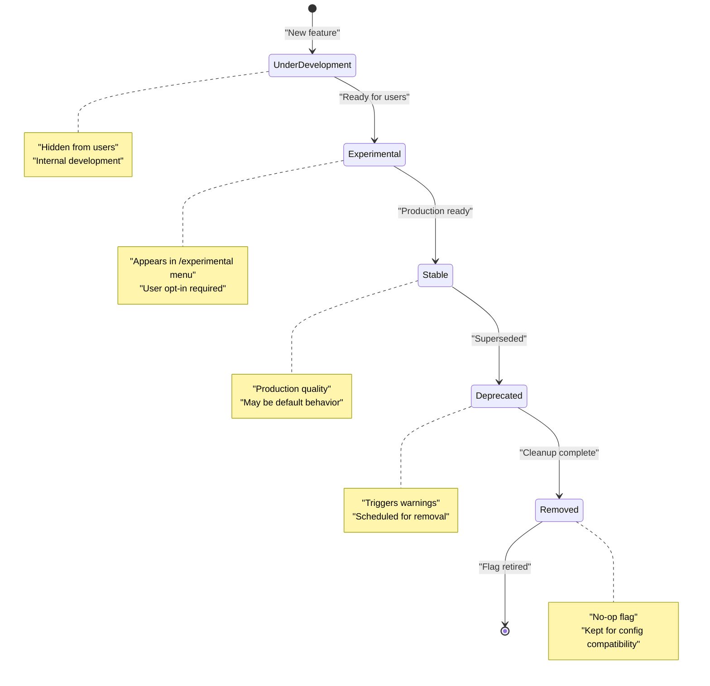
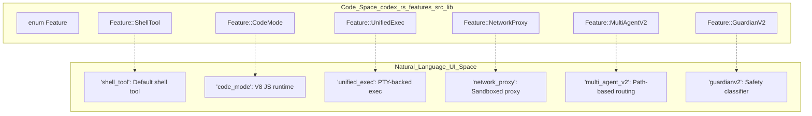
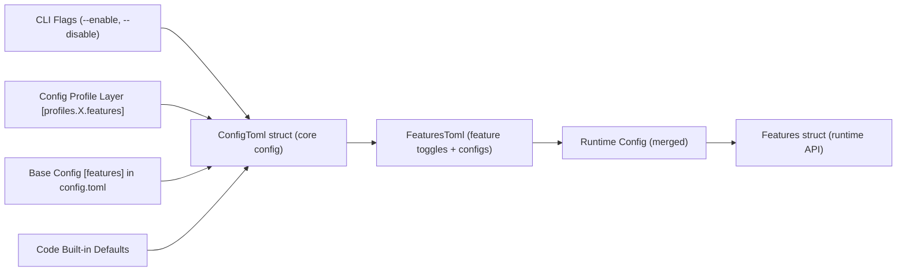
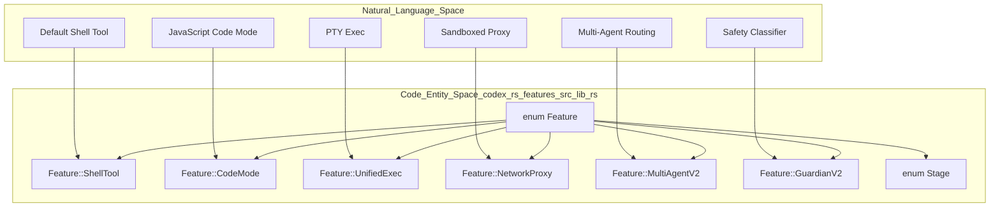
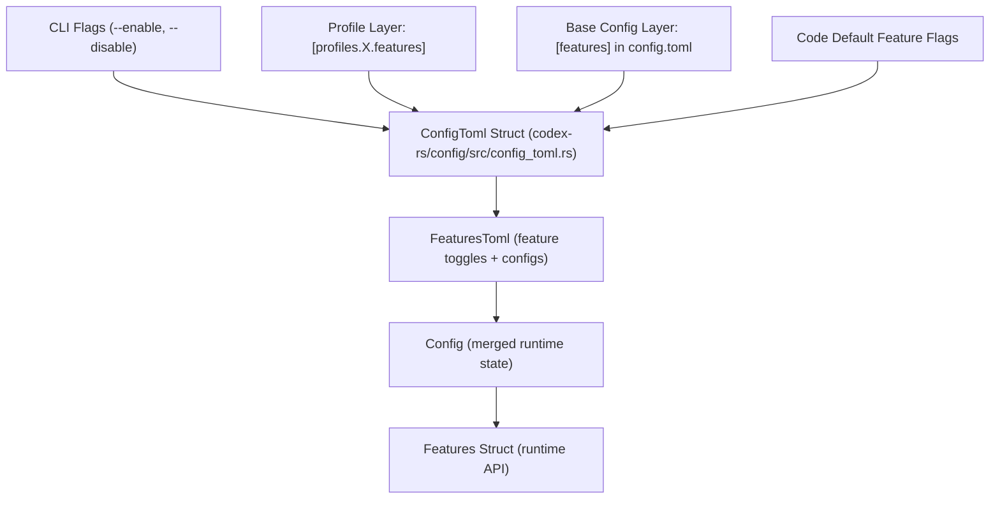

<!-- source: DeepWiki mcp.deepwiki.com · repo openai/codex · page 2.3 Feature Flags · fetched 2026-10-26 -->

# Feature Flags

Relevant source files

The following files were used as context for generating this wiki page:

- [codex-rs/config/src/config_toml.rs](codex-rs/config/src/config_toml.rs)
- [codex-rs/config/src/profile_toml.rs](codex-rs/config/src/profile_toml.rs)
- [codex-rs/config/src/schema.rs](codex-rs/config/src/schema.rs)
- [codex-rs/config/src/types.rs](codex-rs/config/src/types.rs)
- [codex-rs/config/src/types_tests.rs](codex-rs/config/src/types_tests.rs)
- [codex-rs/core-api/src/lib.rs](codex-rs/core-api/src/lib.rs)
- [codex-rs/core/config.schema.json](codex-rs/core/config.schema.json)
- [codex-rs/core/src/config/config_tests.rs](codex-rs/core/src/config/config_tests.rs)
- [codex-rs/core/src/config/mod.rs](codex-rs/core/src/config/mod.rs)
- [codex-rs/core/tests/suite/scenarios.rs](codex-rs/core/tests/suite/scenarios.rs)
- [codex-rs/features/src/feature_configs.rs](codex-rs/features/src/feature_configs.rs)
- [codex-rs/features/src/lib.rs](codex-rs/features/src/lib.rs)
- [codex-rs/features/src/tests.rs](codex-rs/features/src/tests.rs)
- [codex-rs/thread-manager-sample/src/main.rs](codex-rs/thread-manager-sample/src/main.rs)
- [codex-rs/tui/src/local_settings.rs](codex-rs/tui/src/local_settings.rs)
- [codex-rs/tui/src/local_settings_tests.rs](codex-rs/tui/src/local_settings_tests.rs)

This document describes the feature flag system employed in Codex to centralize toggling of experimental, optional, and platform-specific features. Feature flags facilitate gradual rollout, controlled exposure of functionality, and runtime configurability.

For related details on configuring features through config files and CLI, see the [Configuration System (2.2)]() page.

---

## Overview

Codex uses a centralized feature flag system that defines features with associated metadata (key names, lifecycle stages, defaults) within a uniform registry. Rather than ad-hoc boolean flags scattered across the codebase, features are encapsulated in an enum (`Feature`) and governed via the `Features` struct.

This approach supports:

- Lifecycle-aware feature management (under development, experimental, stable, deprecated, removed).
- Deterministic feature enablement using prioritized config sources and CLI flags.
- Support for legacy toggles and aliasing to ease migrations and backward compatibility.
- Structured per-feature configurations beyond simple booleans.

**Key code elements:**
- The `Feature` enum and lifecycle `Stage` enum in [codex-rs/features/src/lib.rs:45-91]().
- The `Features` struct for runtime enabled-state queries and dependency normalization.
- Support modules like `feature_configs.rs` for feature-specific TOML config structs.
- Legacy feature mapping in the `legacy` module.

Sources: [codex-rs/features/src/lib.rs:1-92]()

---

## Feature Lifecycle Stages

Each feature is assigned a lifecycle `Stage` describing its maturity and how it should be exposed or treated by the system.

| Stage             | Visibility           | Default State | Purpose                                                                                |
|-------------------|----------------------|---------------|----------------------------------------------------------------------------------------|
| `UnderDevelopment` | Internal only        | `false`       | Features under active development, not user exposed.                                  |
| `Experimental`     | `/experimental` menu | `false`       | Available for user opt-in in experimental menus.                                      |
| `Stable`           | Standard config      | Varies        | Production-ready features; kept enabled or togglable.                                 |
| `Deprecated`       | Standard config      | `false`       | Features slated for removal; warn on usage.                                           |
| `Removed`          | Config compatibility | `false`       | Retired flags preserved solely for backward compatibility.                            |

Sources: [codex-rs/features/src/lib.rs:45-89]()

---

## Feature Registry

The feature registry enumerates all feature toggles in the `Feature` enum. Each variant corresponds to a named toggle available in configuration and code.

### Code Entity to UI Mapping of Selected Features

The feature enum contains stable features like:

- `ShellTool` [codex-rs/features/src/lib.rs:108](): main shell tool integration.
- `CodexHooks` [codex-rs/features/src/lib.rs:113](): enables Claude-style lifecycle hooks.
- `ViewImage` [codex-rs/features/src/lib.rs:110](): embedded image viewer.
- `SleepTool` [codex-rs/features/src/lib.rs:112](): built-in sleep tool.

Execution and sandboxing features include:

- `CodeMode` [codex-rs/features/src/lib.rs:134](): JavaScript code mode using the V8 runtime.
- `UnifiedExec` [codex-rs/features/src/lib.rs:154](): PTY-backed unified exec system.
- `NetworkProxy` [codex-rs/features/src/lib.rs:173](): sandboxed network proxy.

Agent orchestration and security include:

- `MultiAgentV2` [codex-rs/features/src/lib.rs:170](): advanced path-based multi-agent routing.
- `GuardianV2` [codex-rs/features/src/lib.rs:167](): safety classifier for tool calls.

External integrations and extensions such as `Apps`, `Plugins`, and `ImageGeneration` are also feature-gated.

Each feature is annotated with a `Stage` for lifecycle and optionally fields for experimental menu descriptions.

Sources: [codex-rs/features/src/lib.rs:90-226](), [codex-rs/features/src/tests.rs:1-62]()

---

## Configuration Sources and Precedence

Feature flags can be configured via multiple configuration layers, which combine in a defined order of precedence:

- CLI Flags have the highest precedence allowing runtime enable/disable.
- Profile-specific config sections override the base config.
- The base configuration in `config.toml` holds default toggle values and structured feature configs.
- Code defaults supply fallback values when layers do not specify.

### Internal Representation

- The `ConfigToml` Rust struct (in [codex-rs/config/src/config_toml.rs:164-166]()) contains an optional `features` field typed to `FeaturesToml`.
- `FeaturesToml` maps feature keys to boolean toggles or nested TOML blocks (for features supporting structured config).
- JSON and TOML schemas validate and provide IDE hints for valid feature keys and config shape. For example, `features_schema` in [codex-rs/config/src/schema.rs:42-178]() defines the schema for the `[features]` map.
- Common updates and additions are centralized in feature configs (e.g. `CodeModeConfigToml` [codex-rs/features/src/feature_configs.rs:38-61]()).

Sources:  
[codex-rs/config/src/config_toml.rs:155-201](),  
[codex-rs/config/src/schema.rs:42-178](),  
[codex-rs/features/src/lib.rs:230-240]()

---

## Runtime Feature Detection and Toggles

At runtime, the `Features` struct encapsulates the effective enabled state and configuration of all features.

### Feature Query and Resolution

- Use the method `.enabled(feature: Feature) -> bool` to test if a feature is active.
- Enablement considers all config sources, CLI flags, feature dependencies, and applies normalization.
- For example, enabling `CodeModeOnly` also ensures `CodeMode` is enabled implicitly to maintain internal consistency [codex-rs/features/src/tests.rs:160-165]().
- Legacy feature keys mapped to current toggles are handled transparently to avoid breaking config files.

### Structured Feature Config Access

Several features offer complex configuration types accessible at runtime:

| Feature          | Config Struct                | Description                                         |
|------------------|-----------------------------|-----------------------------------------------------|
| `GuardianV2`     | `GuardianV2ConfigToml` [codex-rs/features/src/feature_configs.rs:151-155]()       | Settings for safety classifier prompts and scope.  |
| `CodeMode`       | `CodeModeConfigToml` [codex-rs/features/src/feature_configs.rs:38-61]()         | JS runtime yield timeouts, namespace exclusions.   |
| `TokenBudget`    | `TokenBudgetConfigToml` [codex-rs/features/src/lib.rs:80]()      | Limits and reminders for token consumption.        |
| `NetworkProxy`   | `NetworkProxyConfigToml` [codex-rs/features/src/lib.rs:78]()     | Proxy mode, domain permission rules.                |

These are deserialized from TOML and merged with the boolean toggle state.

Sources: [codex-rs/features/src/feature_configs.rs:9-284](), [codex-rs/features/src/tests.rs:130-165]()

---

## Legacy Feature Support

The feature flags system retains compatibility with legacy feature keys and aliases via the `LegacyFeatureToggles` subsystem.

### Common Legacy Aliases

| Legacy Key          | Current Feature          | Description / Context                    |
|---------------------|-------------------------|----------------------------------------|
| `telepathy`         | `Chronicle`             | Legacy sidecar alias                    |
| `collab`            | `Collab`                | Collaboration feature                   |
| `codex_hooks`       | `CodexHooks`            | Hooks lifecycle system                  |
| `imagegenext`       | `ImageGeneration`       | AI image generation extension           |

This layer supports gradual migration of old configs without disruption.

Sources: [codex-rs/features/src/lib.rs:41](), [codex-rs/features/src/legacy.rs:1-40]()

---

## Experimental Menu Integration

Features marked as `Experimental` in their lifecycle stage are surfaced in the TUI's `/experimental` menu, enabling user opt-in.

- `experimental_menu_name()` [codex-rs/features/src/lib.rs:66]() returns user-facing menu names.
- `experimental_menu_description()` [codex-rs/features/src/lib.rs:73]() gives brief explanatory help.
- `experimental_announcement()` [codex-rs/features/src/lib.rs:82]() optionally provides additional announcement text.

These APIs allow dynamic exposure of experimental capabilities to users in a controlled manner.

Sources: [codex-rs/features/src/lib.rs:62-88]()

---

## Summary Mermaid Diagrams

### Mapping Natural Language Feature Concepts to Code Entities

### Feature Flag Configuration and Runtime Data Flow

---

## Technical Summary

- Codex defines named features in a central `Feature` enum [codex-rs/features/src/lib.rs:94]().
- Each feature carries metadata including a lifecycle `Stage` [codex-rs/features/src/lib.rs:48](), default enablement, and descriptive strings for experimentation.
- Features can be simple boolean toggles or complex, structured configs (e.g., `CodeModeConfigToml` [codex-rs/features/src/feature_configs.rs:38-61]()).
- Configuration layers from CLI > profile > base > defaults merge into effective runtime settings.
- Features are queried at runtime through a `Features` struct exposing `.enabled()` and config accessors.
- Legacy feature aliases ensure backward compatibility.
- Experimental features appear in a dedicated menu for user opt-in.
- The system improves maintainability and visibility of feature rollout across the codebase.

---

Sources:  
[codex-rs/features/src/lib.rs:1-90](),  
[codex-rs/features/src/tests.rs:1-165](),  
[codex-rs/features/src/feature_configs.rs:1-284](),  
[codex-rs/config/src/config_toml.rs:155-201](),  
[codex-rs/config/src/schema.rs:42-178](),  
[codex-rs/features/src/legacy.rs:1-40]()

---

