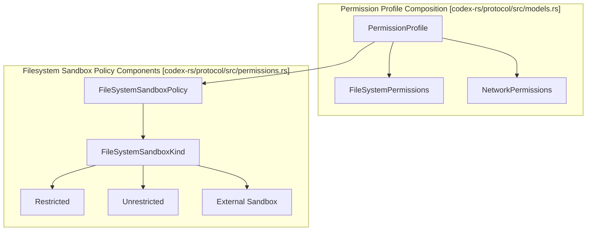
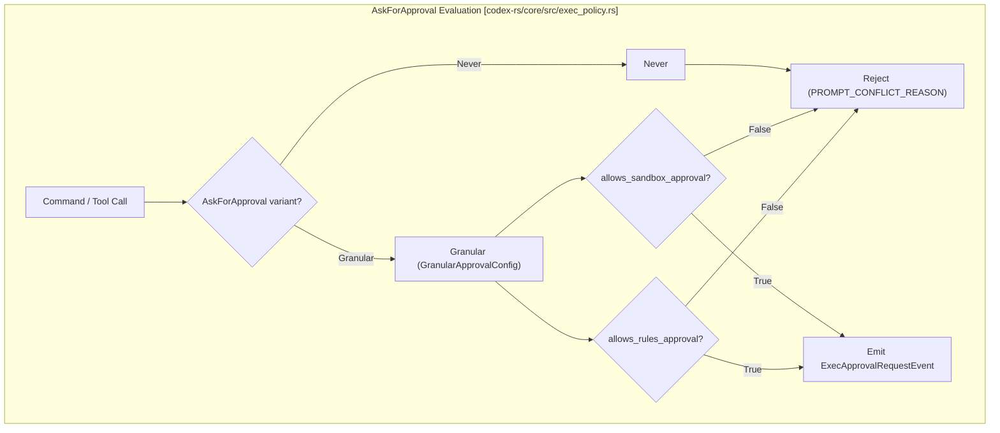
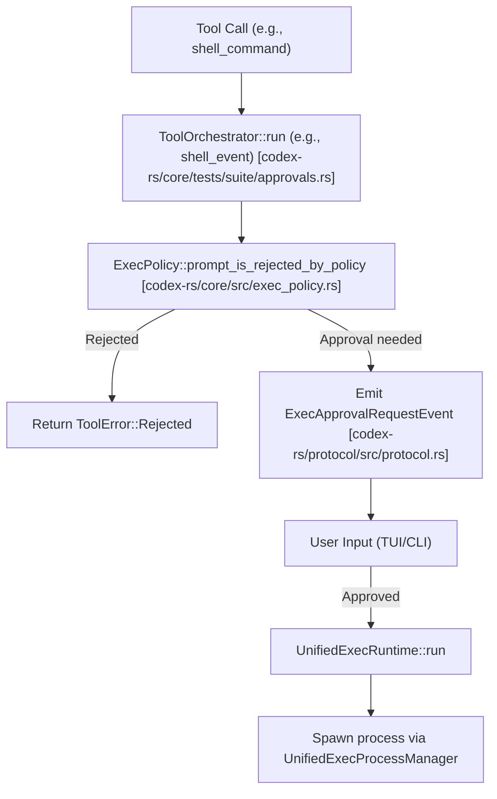
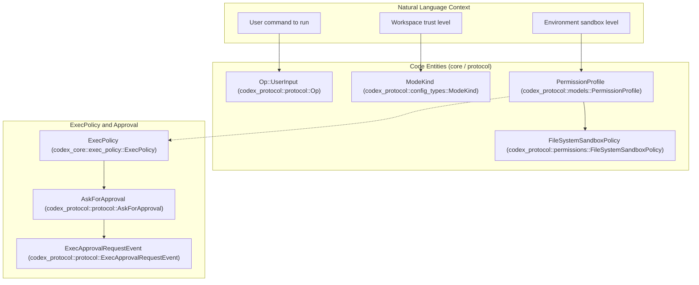

<!-- source: DeepWiki mcp.deepwiki.com · repo openai/codex · page 2.4 Sandbox and Approval Policies · fetched 2026-10-26 -->

# Sandbox and Approval Policies

Relevant source files

The following files were used as context for generating this wiki page:

- [codex-rs/app-server-protocol/src/protocol/v2/permissions.rs](codex-rs/app-server-protocol/src/protocol/v2/permissions.rs)
- [codex-rs/config/src/permissions_toml.rs](codex-rs/config/src/permissions_toml.rs)
- [codex-rs/core-plugins/src/plugin_metrics.rs](codex-rs/core-plugins/src/plugin_metrics.rs)
- [codex-rs/core-plugins/src/script_attribution.rs](codex-rs/core-plugins/src/script_attribution.rs)
- [codex-rs/core-plugins/src/script_attribution_tests.rs](codex-rs/core-plugins/src/script_attribution_tests.rs)
- [codex-rs/core/src/config/permissions.rs](codex-rs/core/src/config/permissions.rs)
- [codex-rs/core/src/config/permissions_tests.rs](codex-rs/core/src/config/permissions_tests.rs)
- [codex-rs/core/src/context/environment_context.rs](codex-rs/core/src/context/environment_context.rs)
- [codex-rs/core/src/exec_policy.rs](codex-rs/core/src/exec_policy.rs)
- [codex-rs/core/src/exec_policy/executable_identity.rs](codex-rs/core/src/exec_policy/executable_identity.rs)
- [codex-rs/core/src/exec_policy/executable_identity_tests.rs](codex-rs/core/src/exec_policy/executable_identity_tests.rs)
- [codex-rs/core/src/exec_policy_tests.rs](codex-rs/core/src/exec_policy_tests.rs)
- [codex-rs/core/src/exec_policy_windows_tests.rs](codex-rs/core/src/exec_policy_windows_tests.rs)
- [codex-rs/core/tests/suite/approvals.rs](codex-rs/core/tests/suite/approvals.rs)
- [codex-rs/core/tests/suite/exec_policy.rs](codex-rs/core/tests/suite/exec_policy.rs)
- [codex-rs/core/tests/suite/request_permissions.rs](codex-rs/core/tests/suite/request_permissions.rs)
- [codex-rs/core/tests/suite/request_permissions_tool.rs](codex-rs/core/tests/suite/request_permissions_tool.rs)
- [codex-rs/protocol/src/permissions.rs](codex-rs/protocol/src/permissions.rs)
- [codex-rs/sandboxing/src/policy_transforms.rs](codex-rs/sandboxing/src/policy_transforms.rs)
- [codex-rs/sandboxing/src/policy_transforms_tests.rs](codex-rs/sandboxing/src/policy_transforms_tests.rs)
- [codex-rs/shell-command/BUILD.bazel](codex-rs/shell-command/BUILD.bazel)
- [codex-rs/shell-command/Cargo.toml](codex-rs/shell-command/Cargo.toml)
- [codex-rs/shell-command/src/bash.rs](codex-rs/shell-command/src/bash.rs)
- [codex-rs/shell-command/src/command_safety/fixtures/powershell_lowering.json](codex-rs/shell-command/src/command_safety/fixtures/powershell_lowering.json)
- [codex-rs/shell-command/src/command_safety/is_dangerous_command.rs](codex-rs/shell-command/src/command_safety/is_dangerous_command.rs)
- [codex-rs/shell-command/src/command_safety/mod.rs](codex-rs/shell-command/src/command_safety/mod.rs)
- [codex-rs/shell-command/src/command_safety/powershell_parser.ps1](codex-rs/shell-command/src/command_safety/powershell_parser.ps1)
- [codex-rs/shell-command/src/command_safety/powershell_parser.rs](codex-rs/shell-command/src/command_safety/powershell_parser.rs)
- [codex-rs/shell-command/src/command_safety/powershell_tree_sitter.rs](codex-rs/shell-command/src/command_safety/powershell_tree_sitter.rs)
- [codex-rs/shell-command/src/command_safety/powershell_tree_sitter_tests.rs](codex-rs/shell-command/src/command_safety/powershell_tree_sitter_tests.rs)
- [codex-rs/shell-command/src/command_safety/windows_dangerous_commands.rs](codex-rs/shell-command/src/command_safety/windows_dangerous_commands.rs)
- [codex-rs/shell-command/src/lib.rs](codex-rs/shell-command/src/lib.rs)
- [codex-rs/shell-command/src/parse_command.rs](codex-rs/shell-command/src/parse_command.rs)
- [codex-rs/shell-command/src/powershell.rs](codex-rs/shell-command/src/powershell.rs)
- [codex-rs/shell-command/src/startup.rs](codex-rs/shell-command/src/startup.rs)

This page documents the sandbox and approval policy systems in Codex that govern how code execution and tool invocations are controlled for security and trust. It covers sandbox modes (ReadOnly, WorkspaceWrite, DangerFullAccess), approval policies, permission profiles, and the execpolicy engine’s prefix-rule language. It explains metadata such as `host_executable`, runtime policy evaluation, and the data flow of approval enforcement.

---

## Overview of Security Policies

Codex enforces tool execution security via two complementary policy systems:

| Policy Type | Purpose | Code Entity |
| :---------- | :------ | :---------- |
| **PermissionProfile** | Determines filesystem write access, network access, and sandbox execution mode | `codex_protocol::models::PermissionProfile` [codex-rs/protocol/src/models.rs:21-24]() |
| **AskForApproval** | Specifies when user approval is required before executing commands | `codex_protocol::protocol::AskForApproval` [codex-rs/protocol/src/protocol.rs:26-40]() |

At runtime, the current session’s configured permission profile and approval policy govern whether commands run immediately, get sandboxed, or require explicit user consent. This state is communicated explicitly via events like `SessionConfigured` and `ExecApprovalRequest`.

Sources: [codex-rs/protocol/src/models.rs:21-24](), [codex-rs/protocol/src/protocol.rs:26-40]()

---

## Sandbox Policy System

### Sandbox Modes and Permission Profiles

Codex implements multiple sandbox modes by selecting appropriate permission profiles that define allowed filesystem and network capabilities. There are built-in profiles representing canonical levels of trust and access:

| Profile Name (`&str`) | Description | Reference |
| :-------------------- | :---------- | :-------- |
| `:read_only` | Pure read-only sandbox, no write access | Returns `PermissionProfile::read_only()` [codex-rs/core/src/config/permissions.rs:99]() |
| `:workspace` | Workspace write access with restricted network (optional) | Workspace profile allowing writes only within workspace roots [codex-rs/core/src/config/permissions.rs:100-115]() |
| `:danger_full_access` | Fully disables sandbox, unrestricted filesystem and network | Represents `PermissionProfile::Disabled` [codex-rs/core/src/config/permissions.rs:116-118]() |

The function `builtin_permission_profile` maps these profile names into concrete `PermissionProfile` instances, influenced by optional workspace write settings.

Permissions combine restrictions on filesystem entries, network access, and sandboxing mode. Profiles may be extended or overridden via configuration files.

Sources: [codex-rs/core/src/config/permissions.rs:94-120]()

---

### PermissionProfile and Composition Diagram

Permission profiles consist primarily of:

- **Filesystem permissions** specifying allowed paths and access modes.
- **Network permissions** controlling outbound connectivity.
- Sandbox kind (e.g., Restricted, Unrestricted).

Sources: [codex-rs/protocol/src/models.rs:21-24](), [codex-rs/protocol/src/permissions.rs:180-186]()

---

### Filesystem Access Control

The `FileSystemSandboxPolicy` provides a list of `FileSystemSandboxEntry` elements; each specifies a path and an access mode (`Read`, `Write`, `Deny`):

- `FileSystemAccessMode` enum defines these modes [codex-rs/protocol/src/permissions.rs:120-126]().
- Special paths like `:project_roots`, `:tmpdir`, and `:slash_tmp` allow the sandbox to specify portable paths relative to the environment [codex-rs/protocol/src/permissions.rs:141-165]().
- The sandbox system protects workspace metadata directories (e.g., `.git`, `.agents`, `.codex`) by denying unauthorized writes [codex-rs/protocol/src/permissions.rs:46-78]().

This policy enforces restricting write capabilities to authorized paths and preventing accidental modification of critical project files inside the sandbox.

Sources: [codex-rs/protocol/src/permissions.rs:46-78](), [codex-rs/protocol/src/permissions.rs:120-126](), [codex-rs/protocol/src/permissions.rs:141-165]()

---

### Managed Network and Proxy Controls

Network sandboxing is managed by the `NetworkSandboxPolicy` enum controlling whether network access is `Restricted` or `Enabled` [codex-rs/protocol/src/permissions.rs:87-97](). At runtime, network permissions are represented by `NetworkPermissions` which include enabled domains, proxy configuration, and other details.

Codex integrates with the `codex-network-proxy` crate for dynamic enforcement of network permissions inside sandboxed subprocesses, configuring proxy settings without enabling the proxy automatically [codex-rs/core/src/config/permissions.rs:144-155]() (specifically, `network_proxy_config_from_profile_network` sets `config.enabled = false`).

Sources: [codex-rs/protocol/src/permissions.rs:87-97](), [codex-rs/core/src/config/permissions.rs:144-155]()

---

## Approval Policy System

### AskForApproval Enum

`AskForApproval` configures when user approval is required before command execution. Its variants govern interactive approval prompting in scenarios including automation, trust, or enforced rule-based approvals.

Variants include [codex-rs/protocol/src/protocol.rs:26-40]():

- `Never`: No approval prompts allowed; commands requiring approval are blocked.
- `OnRequest`: Always prompt when approval is requested.
- `UnlessTrusted`: Automatically approve commands within trusted workspace contexts; prompt otherwise.
- `Granular`: Fine-grained controls indicating whether rule-based or sandbox-based approvals are enabled (flags `rules` and `sandbox_approval`).

### Approval Evaluation Flow

Approval evaluation examines a command or tool call to determine if it requires approval based on configured rules and policy context. If approval is required but disabled (`Never`), the prompt is rejected with a predefined reason.

If approval is granted or not required, the command progresses toward execution.

Sources: [codex-rs/core/src/exec_policy.rs:48-55](), [codex-rs/core/src/exec_policy.rs:210-230](), [codex-rs/protocol/src/protocol.rs:26-40]()

---

### ExecPolicy Prefix Rules and Dangerous Commands

Codex uses the `execpolicy` crate to parse and evaluate execution policies expressed in `.rules` files, such as `default.rules` which reside in config folders and project config layers [codex-rs/core/src/exec_policy.rs:10-22]().

- Policies define allowed, forbidden, or approval-required command prefixes.
- There is a curated list of banned or suspicious command prefixes (`BANNED_PREFIX_SUGGESTIONS`), such as shell invocations with `-c` or `-lc` options, which circumvent sandbox controls or security guidelines [codex-rs/core/src/exec_policy.rs:57-146]().
- The `ExecPolicyCommandOrigin` enum distinguishes whether a command is a generic shell command or lowered PowerShell command to apply appropriate heuristic checks [codex-rs/core/src/exec_policy.rs:157-165](). This is further detailed in `shell-command/src/command_safety/is_dangerous_command.rs` which defines `DangerousCommandPlatform` and `dangerous_command_match_for_platform` [codex-rs/shell-command/src/command_safety/is_dangerous_command.rs:8-13]().

Runtime uses the `PolicyParser` to combine layered policy sources into an effective `Policy` instance, handling amendments dynamically with `ExecPolicyAmendment`.

Sources: [codex-rs/core/src/exec_policy.rs:10-22](), [codex-rs/core/src/exec_policy.rs:57-146](), [codex-rs/core/src/exec_policy.rs:157-165](), [codex-rs/shell-command/src/command_safety/is_dangerous_command.rs:8-13]()

---

## Permission Profiles and Sandbox Modes Summary

| Sandbox Mode | Profile Name | Permissions | Description |
| :----------- | :----------- | :---------- | :---------- |
| **ReadOnly** | `:read_only` | Filesystem: read-only; Network: blocked | Minimal permissions; safest sandbox. |
| **WorkspaceWrite** | `:workspace` | Workspace-only write; restricted network | Permits writes inside workspace roots; limited network access. |
| **DangerFullAccess** | `:danger_full_access` | Full filesystem & network access | Disabled sandbox for unsafe or trusted runs. |

These profiles are selected depending on project trust levels and configured sandbox enforcement. The effective profile is used to derive capabilities for sandbox runners on Linux, macOS, and Windows.

---

## Platform-Specific Sandboxing

- **Linux (Landlock):** Codex applies Landlock sandbox policies, restricting filesystem and network access for commands running under the Linux sandbox environment [codex-rs/cli/src/debug_sandbox.rs:96-130]().

- **macOS (Seatbelt):** Execution is wrapped inside Seatbelt sandbox profiles that restrict capabilities based on permission profiles [codex-rs/cli/src/debug_sandbox.rs:49-85]().

- **Windows (Restricted Token Sandbox):** Uses Windows sandbox levelling with restricted token levels or elevated mode, applying policies and provisioning via the Windows sandbox backend [codex-rs/core/src/exec_policy_windows_tests.rs](). The `WindowsSandboxLevel` enum defines the different levels of sandboxing on Windows [codex-rs/protocol/src/config_types.rs:17]().

Sources: [codex-rs/cli/src/debug_sandbox.rs:49-85](), [codex-rs/cli/src/debug_sandbox.rs:96-130](), [codex-rs/core/src/exec_policy_windows_tests.rs](), [codex-rs/protocol/src/config_types.rs:17]()

---

## Implementation and Data Flow

### Unified Execution Flow and Approval Handling

The high-level tool execution orchestration involves:

1. Receiving a tool call such as a shell command.
2. The `ToolOrchestrator::run()` method executes [codex-rs/core/tests/suite/approvals.rs:160-181]() (example of a shell event).
3. The `ExecPolicy` engine checks if the command is rejected or requires approval using `prompt_is_rejected_by_policy()` [codex-rs/core/src/exec_policy.rs:210-230]().
4. If rejected, an immediate error is returned.
5. If approval is required, an `ExecApprovalRequestEvent` is emitted [codex-rs/protocol/src/protocol.rs:31]() (part of `AskForApproval`).
6. The CLI/TUI frontend prompts for user input.
7. Upon approval, execution proceeds via `UnifiedExecRuntime::run()` (not shown in provided files).
8. The process is spawned and managed by `UnifiedExecProcessManager` (not shown in provided files).

Sources: [codex-rs/core/tests/suite/approvals.rs:160-181](), [codex-rs/core/src/exec_policy.rs:210-230](), [codex-rs/protocol/src/protocol.rs:31]()

---

### Patch Safety Assessment in ApplyPatch

The `apply_patch` tool uses an assessment method `assess_patch_safety` (not shown in provided files) to decide if a patch:

- Is fully contained within writable workspace roots.
- Avoids forbidden metadata paths.
- Respects current sandbox permissions.

Patches not meeting criteria require explicit approval; safe patches can be auto-applied. The assessment result informs the runtime whether to request user consent before executing the patch [codex-rs/protocol/src/protocol.rs:31]() (ApplyPatchApprovalRequestEvent).

Sources: [codex-rs/protocol/src/protocol.rs:31]()

---

## Mapping Natural Language Concepts to Code Entities

This diagram maps user-level concepts, configuration, and commands down to code implementation objects and policy enforcement layers.

Sources: [codex-rs/protocol/src/protocol.rs:26-40](), [codex-rs/protocol/src/models.rs:21-24](), [codex-rs/protocol/src/permissions.rs:181-186](), [codex-rs/core/src/exec_policy.rs:150-230]()

---

## Key Implementation Classes and Functions

| Symbol | File (Lines) | Description |
| :----- | :----------- | :---------- |
| `PermissionProfile` | `codex-rs/protocol/src/models.rs:21-24` | Represents comprehensive permissions including filesystem and network access |
| `AskForApproval` | `codex-rs/protocol/src/protocol.rs:26-40` | Approval settings enum and related approval event structs |
| `builtin_permission_profile()` | `codex-rs/core/src/config/permissions.rs:94-120` | Maps permission profile names to built-in PermissionProfile instances |
| `ExecPolicy::prompt_is_rejected_by_policy()` | `codex-rs/core/src/exec_policy.rs:210-230` | Checks if a command is rejected or requires approval |
| `child_uses_parent_exec_policy()` | `codex-rs/core/src/exec_policy.rs:185-203` | Checks if child process can reuse parent's exec policy configuration |
| `normalize_additional_permissions()` | `codex-rs/sandboxing/src/policy_transforms.rs:19-53` | Normalizes additional permissions, ensuring glob patterns are deny-only for filesystem. |
| `materialize_additional_permissions_with_context()` | `codex-rs/sandboxing/src/policy_transforms.rs:82-91` | Resolves context-dependent permission entries without filtering their authority. |
| `intersect_permission_profiles_with_context()` | `codex-rs/sandboxing/src/policy_transforms.rs:147-163` | Intersects requested and granted permissions, ensuring the effective permissions are the most restrictive. |
| `ToolOrchestrator::run()` | `codex-rs/core/tests/suite/approvals.rs:160-181` | Top-level orchestrator for tool execution with approval checks |

Sources: [codex-rs/protocol/src/models.rs:21-24](), [codex-rs/protocol/src/protocol.rs:26-40](), [codex-rs/core/src/config/permissions.rs:94-120](), [codex-rs/core/src/exec_policy.rs:185-203](), [codex-rs/core/src/exec_policy.rs:210-230](), [codex-rs/core/tests/suite/approvals.rs:160-181](), [codex-rs/sandboxing/src/policy_transforms.rs:19-53](), [codex-rs/sandboxing/src/policy_transforms.rs:82-91](), [codex-rs/sandboxing/src/policy_transforms.rs:147-163]()

---

## ExecPolicy Crate and `.rules` Files

The `execpolicy` engine processes `.rules` files that declare execution policy rules using a prefix-rule DSL:

- `.rules` files may be placed in `$CODEX_HOME/config_layer/*.rules` or project config folders.
- `PolicyParser` aggregates these sources into a combined `Policy`.
- Policies define allowed, forbidden, or approval-required command prefixes [codex-rs/core/src/exec_policy.rs:17-22]().
- The runtime supports dynamic amendments of policies via `ExecPolicyAmendment` [codex-rs/core/src/exec_policy.rs:22]().
- Commands are identified by metadata including their executable path and command-line arguments.
- The eval returns decisions like `Allowed`, `Forbidden`, or `RequiresApproval`, which drive downstream behavior.

The global banned prefix suggestions reduce risk from invoking executable shells with direct command flags.

Sources: [codex-rs/core/src/exec_policy.rs:10-22](), [codex-rs/core/src/exec_policy.rs:22]()

---

## Summary

Codex employs a robust sandbox and approval system integrating:

- **Sandbox modes** (ReadOnly, WorkspaceWrite, DangerFullAccess) via `PermissionProfile`, shaping filesystem and network permissions.
- **Approval policies** controlled by the `AskForApproval` enum and fine-grained approval rules in execpolicy.
- **Prefix-rule execpolicy files** enabling layered, declarative command execution control.
- **Runtime policy evaluation** rejecting unsafe commands or requesting user approval before execution.
- **Cross-platform sandboxes**: Landlock (Linux), Seatbelt (macOS), and Windows restricted tokens.
- **Integrated approval eventing**: TUI/CLI prompts triggered by `ExecApprovalRequestEvent`.
- **Tool orchestration** ensuring that every exec passes through policy checks before actual execution.

This system provides strong guarantees of safe, auditable, and user-controllable code execution within Codex workflows.

---

# References

| File Path | Lines |
| :-------- | :---- |
| `codex-rs/protocol/src/models.rs` | 21-24 |
| `codex-rs/protocol/src/permissions.rs` | 46-78; 87-97; 120-126; 141-165; 181-186 |
| `codex-rs/protocol/src/protocol.rs` | 26-40; 31 |
| `codex-rs/protocol/src/config_types.rs` | 17 |
| `codex-rs/core/src/config/permissions.rs` | 94-120; 144-155 |
| `codex-rs/core/src/exec_policy.rs` | 10-22; 48-55; 57-146; 157-165; 185-203; 210-230 |
| `codex-rs/core/src/exec_policy_windows_tests.rs` | |
| `codex-rs/core/tests/suite/approvals.rs` | 160-181 |
| `codex-rs/cli/src/debug_sandbox.rs` | 49-85; 96-130 |
| `codex-rs/sandboxing/src/policy_transforms.rs` | 19-53; 82-91; 147-163 |
| `codex-rs/shell-command/src/command_safety/is_dangerous_command.rs` | 8-13 |

Sources:
[codex-rs/protocol/src/models.rs:21-24](), [codex-rs/protocol/src/permissions.rs:46-78](), [codex-rs/protocol/src/permissions.rs:87-97](), [codex-rs/protocol/src/permissions.rs:120-126](), [codex-rs/protocol/src/permissions.rs:141-165](), [codex-rs/protocol/src/permissions.rs:181-186](), [codex-rs/protocol/src/protocol.rs:26-40](), [codex-rs/protocol/src/protocol.rs:31](), [codex-rs/protocol/src/config_types.rs:17](), [codex-rs/core/src/config/permissions.rs:94-120](), [codex-rs/core/src/config/permissions.rs:144-155](), [codex-rs/core/src/exec_policy.rs:10-22](), [codex-rs/core/src/exec_policy.rs:48-55](), [codex-rs/core/src/exec_policy.rs:57-146](), [codex-rs/core/src/exec_policy.rs:157-165](), [codex-rs/core/src/exec_policy.rs:185-203](), [codex-rs/core/src/exec_policy.rs:210-230](), [codex-rs/core/src/exec_policy_windows_tests.rs](), [codex-rs/core/tests/suite/approvals.rs:160-181](), [codex-rs/cli/src/debug_sandbox.rs:49-85](), [codex-rs/cli/src/debug_sandbox.rs:96-130](), [codex-rs/sandboxing/src/policy_transforms.rs:19-53](), [codex-rs/sandboxing/src/policy_transforms.rs:82-91](), [codex-rs/sandboxing/src/policy_transforms.rs:147-163](), [codex-rs/shell-command/src/command_safety/is_dangerous_command.rs:8-13]()

---

