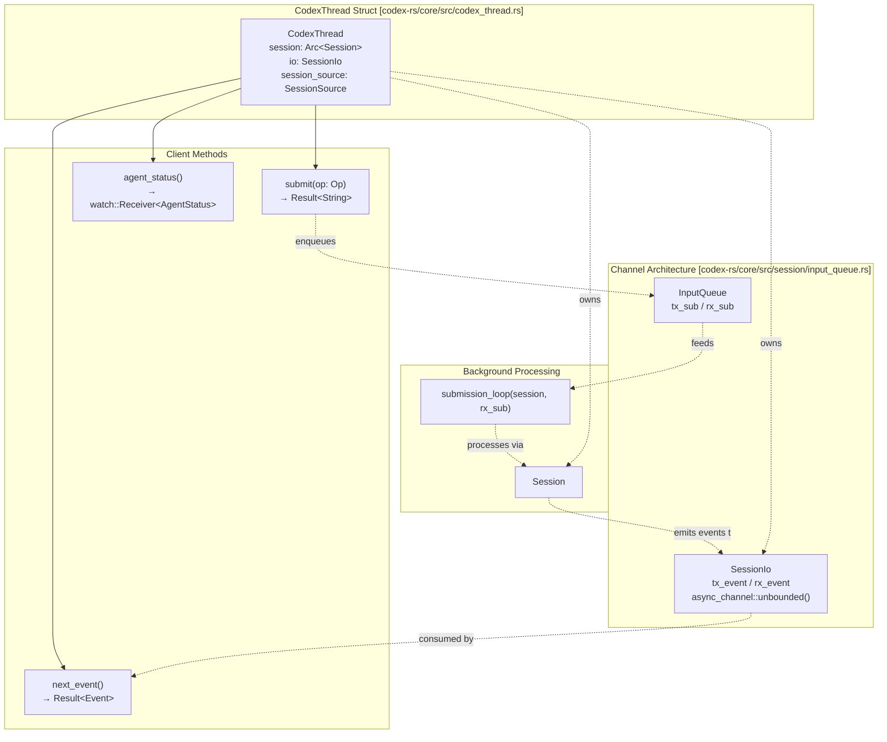
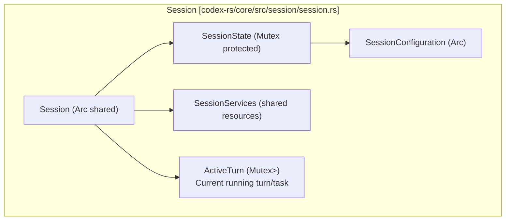
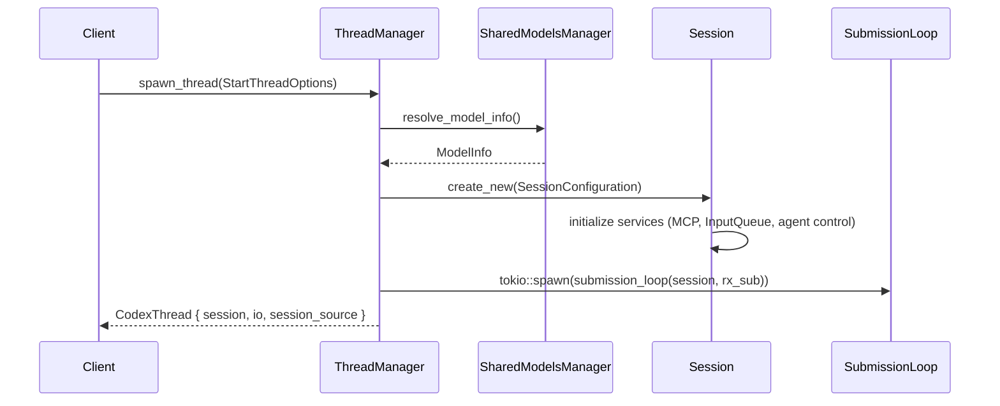
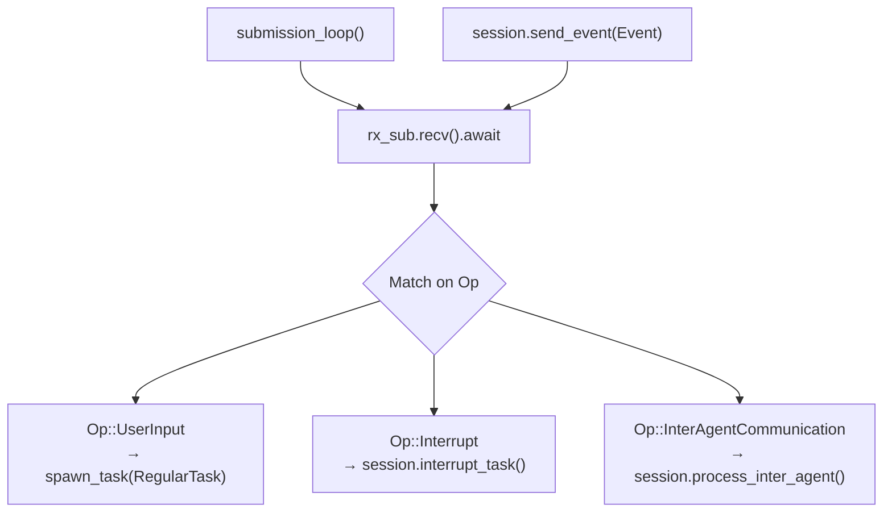
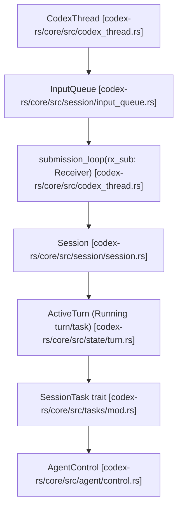

<!-- source: DeepWiki mcp.deepwiki.com · repo openai/codex · page 3.1 Codex Interface and Session Lifecycle · fetched 2026-10-26 -->

# Codex Interface and Session Lifecycle

<details>
<summary>Relevant source files</summary>

The following files were used as context for generating this wiki page:

- [codex-rs/app-server/src/bespoke_event_handling.rs](codex-rs/app-server/src/bespoke_event_handling.rs)
- [codex-rs/core/src/codex_delegate.rs](codex-rs/core/src/codex_delegate.rs)
- [codex-rs/core/src/codex_delegate_tests.rs](codex-rs/core/src/codex_delegate_tests.rs)
- [codex-rs/core/src/codex_thread.rs](codex-rs/core/src/codex_thread.rs)
- [codex-rs/core/src/compact.rs](codex-rs/core/src/compact.rs)
- [codex-rs/core/src/compact_remote_v2.rs](codex-rs/core/src/compact_remote_v2.rs)
- [codex-rs/core/src/compact_remote_v2_attempt.rs](codex-rs/core/src/compact_remote_v2_attempt.rs)
- [codex-rs/core/src/compact_tests.rs](codex-rs/core/src/compact_tests.rs)
- [codex-rs/core/src/environment_selection.rs](codex-rs/core/src/environment_selection.rs)
- [codex-rs/core/src/session/environment.rs](codex-rs/core/src/session/environment.rs)
- [codex-rs/core/src/session/handlers.rs](codex-rs/core/src/session/handlers.rs)
- [codex-rs/core/src/session/mod.rs](codex-rs/core/src/session/mod.rs)
- [codex-rs/core/src/session/session.rs](codex-rs/core/src/session/session.rs)
- [codex-rs/core/src/session/tests.rs](codex-rs/core/src/session/tests.rs)
- [codex-rs/core/src/session/tests/guardian_tests.rs](codex-rs/core/src/session/tests/guardian_tests.rs)
- [codex-rs/core/src/session/turn.rs](codex-rs/core/src/session/turn.rs)
- [codex-rs/core/src/session/turn_context.rs](codex-rs/core/src/session/turn_context.rs)
- [codex-rs/core/src/state/mod.rs](codex-rs/core/src/state/mod.rs)
- [codex-rs/core/src/state/turn.rs](codex-rs/core/src/state/turn.rs)
- [codex-rs/core/src/tasks/mod.rs](codex-rs/core/src/tasks/mod.rs)
- [codex-rs/core/src/thread_manager.rs](codex-rs/core/src/thread_manager.rs)
- [codex-rs/core/src/thread_manager_tests.rs](codex-rs/core/src/thread_manager_tests.rs)
- [codex-rs/core/tests/common/test_codex.rs](codex-rs/core/tests/common/test_codex.rs)
- [codex-rs/core/tests/suite/compact.rs](codex-rs/core/tests/suite/compact.rs)
- [codex-rs/core/tests/suite/compact_remote.rs](codex-rs/core/tests/suite/compact_remote.rs)
- [codex-rs/core/tests/suite/mod.rs](codex-rs/core/tests/suite/mod.rs)
- [codex-rs/core/tests/suite/remote_env.rs](codex-rs/core/tests/suite/remote_env.rs)
- [codex-rs/protocol/src/environment.rs](codex-rs/protocol/src/environment.rs)
- [codex-rs/protocol/src/protocol.rs](codex-rs/protocol/src/protocol.rs)

</details>


This document describes the core interface for interacting with the Codex agent system and the complete lifecycle of a session from initialization through execution to shutdown. The `CodexThread` struct provides the public API for all user interfaces, while the `Session` manages the agent's execution context, state, and services.

## Core Components

### The Codex Public API

The `CodexThread` struct serves as the high-level interface to the Codex system, implementing a queue-pair pattern where clients submit operations (`Op`) asynchronously and receive event notifications (`Event`) asynchronously. It encapsulates the communication channels and shared session state.

### Codex Public API Structure



**Key Responsibilities:**

- **Operation Submission:** Clients call `CodexThread::submit(Op)` which enqueues operations via `InputQueue` and returns a submission ID to track the request lifecycle. Internally, this involves creating a unique submission ID tied to the operation and sending it through a bounded channel for processing. This process can include operations such as user inputs, inter-agent communication, or control commands [codex-rs/core/src/codex_thread.rs:190-205]().
- **Event Consumption:** Clients consume events asynchronously from a receiver that delivers fully processed `Event`s coming from the background `Session` context. Events represent lifecycle states, model responses, approvals, and other session updates [codex-rs/core/src/codex_thread.rs:222-224]().
- **Status Tracking:** The current state of the agent (Idle, Busy, etc.) is exposed as a `watch::Receiver<AgentStatus>` that updates whenever the session's status changes, offering clients a means to monitor agent activity and readiness [codex-rs/core/src/session/session.rs:61-63]().

Sources:
- [codex-rs/core/src/codex_thread.rs:190-205]()
- [codex-rs/core/src/codex_thread.rs:222-224]()
- [codex-rs/core/src/session/session.rs:61-63]()

### Session Architecture

The `Session` struct represents the core agent context maintaining conversation state, execution environment, and service handles required for a single conversation thread.

### Session Structure



- **SessionState:** Holds all mutable data such as conversation history, configuration, and thread settings. This is protected by a mutex to allow safe concurrent access and mutation during asynchronous operations [codex-rs/core/src/session/session.rs:63-63]().
- **SessionConfiguration:** Contains immutable configuration snapshots for the session's lifetime, such as model provider info, environment selections, and permission profiles. It is reference-counted (`Arc`) for efficient sharing [codex-rs/core/src/session/session.rs:101-137]().
- **SessionServices:** A collection of shared infrastructure components needed for the session, including the model client manager, MCP manager, agent control, analytics, environment manager, and more [codex-rs/core/src/session/session.rs:95-95]().
- **ActiveTurn:** Represents the currently executing turn/task state, allowing interruption and monitoring of ongoing interactions [codex-rs/core/src/session/session.rs:90-91]().

Sources:
- [codex-rs/core/src/session/session.rs:63-63]()
- [codex-rs/core/src/session/session.rs:101-137]()
- [codex-rs/core/src/session/session.rs:95-95]()
- [codex-rs/core/src/session/session.rs:90-91]()

## Session Lifecycle Management

### Thread Lifecycle: Spawn, Resume, and Fork

The lifecycle of a Codex thread (conversation) is managed primarily by the `ThreadManager`, which oversees the creation, restoration, and forking of sessions:

- **Spawn:** The session is initialized fresh, given a configuration and optional startup instructions. This process resolves model metadata, environment states, and permission profiles before creating the `Session` instance and starting the submission loop. The spawn handles constructing the session, initializing environment managers, permissions, and launching background management for MCP, extensions, etc. [codex-rs/core/src/thread_manager.rs:32-35]().
- **Resume:** A previously persisted session is restored from its stored history and settings. This includes replaying prior events, rebuilding thread state, reinitializing histories, and reconstructing conversation context [codex-rs/core/src/thread_manager.rs:62-62]().
- **Fork:** New threads may be created branching from existing session state (history). Forking enables concurrent experimental branches or sub-agent interactions, preserving the parent's context and optionally sharing some state. Forking involves creating a snapshot of the current thread state for duplication and divergence [codex-rs/core/src/thread_manager.rs:103-103]().

### Initialization Sequence Diagram



Key details:

- `ThreadManager` uses `SharedModelsManager` to resolve the selected AI model metadata needed for the session [codex-rs/core/src/thread_manager.rs:73-73]().
- The `Session` is set up with a fresh or resumed context, its services initialized including MPC extensions, turn environment manager, and agent control [codex-rs/core/src/session/session.rs:95-95]().
- The asynchronous `submission_loop` task is spawned to drive the processing of submitted operations [codex-rs/core/src/codex_thread.rs:206-206]().
- The `CodexThread` public interface is returned to the client, granting access to submit ops and receive events.

Sources:
- [codex-rs/core/src/thread_manager.rs:32-35]()
- [codex-rs/core/src/thread_manager.rs:62-62]()
- [codex-rs/core/src/thread_manager.rs:103-103]()
- [codex-rs/core/src/thread_manager.rs:73-73]()
- [codex-rs/core/src/session/session.rs:95-95]()
- [codex-rs/core/src/codex_thread.rs:206-206]()

## The Op/Event Communication Pattern

Codex implements a Submission Queue / Event Queue pattern for asynchronous communication between the user-facing client and internal agent processing.

### Operations (`Op`)

Operations are the commands or requests submitted by clients which the session consumes and acts upon asynchronously. Common operation types include:

- **UserInput:** Submitting a user message, instruction, or query to the agent, triggering turn execution and response generation [codex-rs/protocol/src/protocol.rs:66-66]().
- **InterAgentCommunication:** For multi-agent scenarios, messages exchanged between sub-agents or the agent message board facilitating multi-agent workflows [codex-rs/protocol/src/protocol.rs:147-151]().
- **Interrupt:** Requests to cancel the current turn or running task, handled gracefully by the session [codex-rs/core/src/thread_manager.rs:150-150]().
- **RealtimeConversationControl:** Operations to start or stop realtime interactive sessions with streaming capabilities [codex-rs/protocol/src/protocol.rs:142-143]().

### Events (`EventMsg`)

Events broadcast outcomes from session processing and agent state updates back to clients. Key event types include:

- **AgentMessageContentDelta:** Streaming partial content updates from the AI model output to the client as it is generated [codex-rs/core/src/session/turn.rs:104-104]().
- **TurnStartedEvent:** Signals that a new turn of processing has started, updating status and initializing context [codex-rs/app-server/src/bespoke_event_handling.rs:84-84]().
- **TurnCompleteEvent:** The completion of a turn reporting token usage, success or failure, and results [codex-rs/core/src/tasks/mod.rs:58-58]().

Sources:
- [codex-rs/protocol/src/protocol.rs:66-66]()
- [codex-rs/protocol/src/protocol.rs:147-151]()
- [codex-rs/core/src/thread_manager.rs:150-150]()
- [codex-rs/protocol/src/protocol.rs:142-143]()
- [codex-rs/core/src/session/turn.rs:104-104]()
- [codex-rs/app-server/src/bespoke_event_handling.rs:84-84]()
- [codex-rs/core/src/tasks/mod.rs:58-58]()

## Session Execution Runtime

### The Submission Loop

The `submission_loop` is the core asynchronous function that processes incoming operations sequentially and manages the lifecycle of turn execution tasks.



Behavior details:

- The loop continuously awaits the next operation from the submission queue (`rx_sub`).
- Each operation is matched on its variant and dispatched accordingly:
  - `UserInput` leads to spawning a new asynchronous task implementing the conversation turn (commonly using the `RegularTask`).
  - `Interrupt` triggers interruption and cancellation of any running tasks [codex-rs/core/src/thread_manager.rs:150-150]().
  - `InterAgentCommunication` handles passing messages between sub-agents [codex-rs/core/src/thread_manager.rs:151-157]().
- Events generated by these tasks are emitted back to the clients via the session's event sender.
- Sequential processing enforced here maintains consistent and stateful interaction ordering [codex-rs/core/src/codex_thread.rs:50-105]().

Sources:
- [codex-rs/core/src/thread_manager.rs:150-150]()
- [codex-rs/core/src/thread_manager.rs:151-157]()
- [codex-rs/core/src/codex_thread.rs:50-105]()

### Task Management and Sub-Agents

Turns are executed via implementations of the `SessionTask` trait, representing discrete asynchronous units of work within a session:

- **Task Lifecycle:** Tasks announce their kind, manage a tracing span, and implement async `run()` methods that perform interaction logic to completion or cancellation [codex-rs/core/src/tasks/mod.rs:181-195]().
- **RegularTask:** Handles standard conversational user turns, submitting prompts to the AI model and processing streaming responses [codex-rs/core/src/tasks/regular.rs]()
- **ReviewTask:** Implements specialized sub-agent tasks for code review or analysis [codex-rs/core/src/tasks/review.rs]().
- **CompactTask:** Runs background conversation history compaction and summarization to maintain state size and token budgets [codex-rs/core/src/tasks/compact.rs]().
- **UserShellCommandTask:** Executes user shell commands in sandboxed environments [codex-rs/core/src/tasks/user_shell.rs]().
- **AgentControl:** A subsystem managing agent state, spawn/wait of sub-agents, multi-agent synchronization, and turn interruption [codex-rs/core/src/agent/control.rs:15-17]().

Multiple concurrent sub-agents (threads) may run within a session, typically coordinated by `AgentControl`, each with isolated execution but sharing the session's underlying state and resources.

Sources:
- [codex-rs/core/src/tasks/mod.rs:181-195]()
- [codex-rs/core/src/tasks/regular.rs]()
- [codex-rs/core/src/tasks/review.rs]()
- [codex-rs/core/src/tasks/compact.rs]()
- [codex-rs/core/src/tasks/user_shell.rs]()
- [codex-rs/core/src/agent/control.rs:15-17]()

## Bridging Natural Language Interfaces and Code Entities

### Natural Language to CodexThread Architecture

This diagram relates the user interaction model (natural language messages and commands) to the code entities managing requests and responses:

```mermaid
graph LR
    Client["User / Client Interface"]
    CodexThread["CodexThread [codex-rs/core/src/codex_thread.rs]"]
    InputQueue["InputQueue (Tx/Rx Submissions) [codex-rs/core/src/session/input_queue.rs]"]
    SubmissionLoop["submission_loop() [codex-rs/core/src/codex_thread.rs]"]
    Session["Session [codex-rs/core/src/session/session.rs]"]
    EventStream["SessionIo (Tx/Rx Events) [codex-rs/core/src/session/input_queue.rs]"]
    Client <--event-- EventStream
    Client --submit(op)-- > CodexThread
    CodexThread --queue op--> InputQueue
    InputQueue --ops--> SubmissionLoop
    SubmissionLoop --runs--> Session
    Session --emits event--> EventStream
```

- Users submit commands or chat messages wrapped in `Op` types asynchronously through the `CodexThread`.
- `InputQueue` provides backpressure and controlled sequencing of operations.
- `submission_loop` processes these operations by invoking logic within the `Session`.
- The `Session` encapsulates turn execution, agent coordination, model interaction, and state mutation.
- Processed `Event` messages are emitted back to clients via an event channel for UI consumption or automation.

Sources:
- [codex-rs/core/src/codex_thread.rs]()
- [codex-rs/core/src/session/input_queue.rs]()
- [codex-rs/core/src/session/session.rs]()

### Interactions and Session Lifecycle Entities

This diagram shows key struct interactions involved in session lifecycle and operation processing:



- `CodexThread` exposes the public interface for submitting operations and receiving events.
- `InputQueue` buffers and orders submitted `Op`s.
- `submission_loop` drives turn/task execution and event propagation asynchronously.
- `Session` maintains shared conversation state, configurations, and service runtimes.
- `ActiveTurn` tracks the current Turn or Task in progress [codex-rs/core/src/state/turn.rs]().
- `SessionTask` implementations perform work specific to chat turns, reviews, compactions, or shell commands [codex-rs/core/src/tasks/mod.rs:181-195]().
- `AgentControl` manages agent coordination, including spawning sub-agents and interrupt handling [codex-rs/core/src/agent/control.rs:15-17]().

Sources:
- [codex-rs/core/src/codex_thread.rs]()
- [codex-rs/core/src/session/input_queue.rs]()
- [codex-rs/core/src/codex_thread.rs]()
- [codex-rs/core/src/session/session.rs]()
- [codex-rs/core/src/state/turn.rs]()
- [codex-rs/core/src/tasks/mod.rs:181-195]()
- [codex-rs/core/src/agent/control.rs:15-17]()

This page details the `CodexThread` API and the underpinning session lifecycle and processing structures that drive Codex's agent behavior from user input to model response, thread management, and multi-agent coordination.

---

**Sources:**
- [codex-rs/core/src/session/mod.rs:1-155]()
- [codex-rs/core/src/session/tests.rs:1-157]()
- [codex-rs/protocol/src/protocol.rs:1-151]()
- [codex-rs/core/src/session/turn.rs:1-151]()
- [codex-rs/core/src/session/session.rs:1-138]()
- [codex-rs/core/src/codex_thread.rs:1-164]()
- [codex-rs/core/src/tasks/mod.rs:1-196]()
- [codex-rs/app-server/src/bespoke_event_handling.rs:1-117]()
- [codex-rs/core/src/compact.rs:1-188]()
- [codex-rs/core/tests/suite/mod.rs:1-227]()
- [codex-rs/core/src/thread_manager.rs:1-167]()
- [codex-rs/core/src/session/turn_context.rs:1-168]()

---

