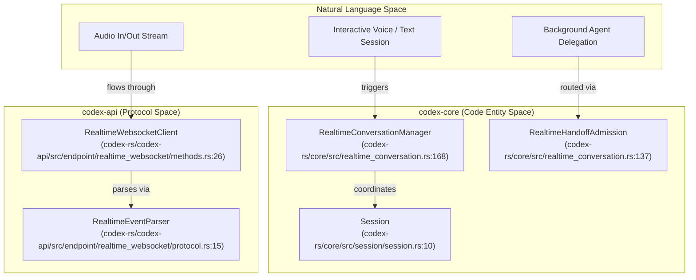
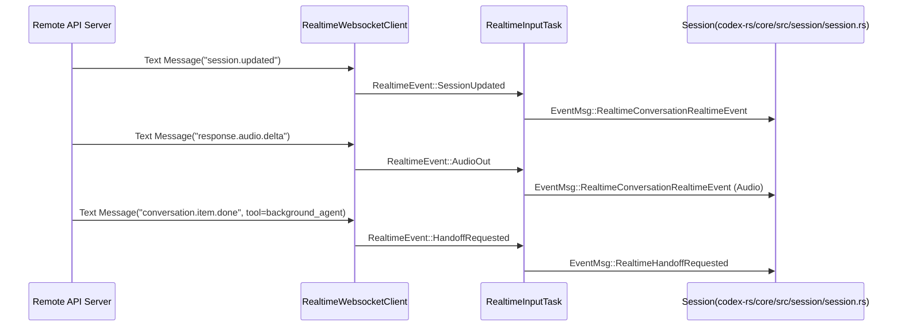
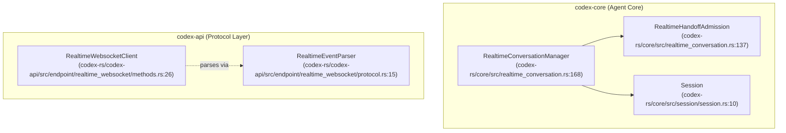

<!-- source: DeepWiki mcp.deepwiki.com · repo openai/codex · page 3.10 Realtime Conversation · fetched 2026-10-26 -->

# Realtime Conversation

Relevant source files

The following files were used as context for generating this wiki page:

- [codex-rs/app-server-protocol/src/protocol/v2/realtime.rs](codex-rs/app-server-protocol/src/protocol/v2/realtime.rs)
- [codex-rs/app-server/src/request_processors/turn_processor.rs](codex-rs/app-server/src/request_processors/turn_processor.rs)
- [codex-rs/app-server/tests/suite/v2/experimental_api.rs](codex-rs/app-server/tests/suite/v2/experimental_api.rs)
- [codex-rs/app-server/tests/suite/v2/realtime_conversation.rs](codex-rs/app-server/tests/suite/v2/realtime_conversation.rs)
- [codex-rs/codex-api/src/endpoint/realtime_websocket/methods.rs](codex-rs/codex-api/src/endpoint/realtime_websocket/methods.rs)
- [codex-rs/codex-api/src/endpoint/realtime_websocket/methods_common.rs](codex-rs/codex-api/src/endpoint/realtime_websocket/methods_common.rs)
- [codex-rs/codex-api/src/endpoint/realtime_websocket/methods_v1.rs](codex-rs/codex-api/src/endpoint/realtime_websocket/methods_v1.rs)
- [codex-rs/codex-api/src/endpoint/realtime_websocket/methods_v2.rs](codex-rs/codex-api/src/endpoint/realtime_websocket/methods_v2.rs)
- [codex-rs/codex-api/src/endpoint/realtime_websocket/mod.rs](codex-rs/codex-api/src/endpoint/realtime_websocket/mod.rs)
- [codex-rs/codex-api/src/endpoint/realtime_websocket/protocol.rs](codex-rs/codex-api/src/endpoint/realtime_websocket/protocol.rs)
- [codex-rs/codex-api/src/endpoint/realtime_websocket/protocol_v2.rs](codex-rs/codex-api/src/endpoint/realtime_websocket/protocol_v2.rs)
- [codex-rs/codex-api/tests/realtime_websocket_e2e.rs](codex-rs/codex-api/tests/realtime_websocket_e2e.rs)
- [codex-rs/core/src/realtime_conversation.rs](codex-rs/core/src/realtime_conversation.rs)
- [codex-rs/core/src/realtime_conversation_tests.rs](codex-rs/core/src/realtime_conversation_tests.rs)
- [codex-rs/core/tests/suite/realtime_conversation.rs](codex-rs/core/tests/suite/realtime_conversation.rs)
- [codex-rs/realtime-webrtc/src/session.rs](codex-rs/realtime-webrtc/src/session.rs)
- [codex-rs/realtime-webrtc/src/session_tests.rs](codex-rs/realtime-webrtc/src/session_tests.rs)
- [codex-rs/realtime-webrtc/tests/session_actor.rs](codex-rs/realtime-webrtc/tests/session_actor.rs)
- [codex-rs/tui/src/app/tests/realtime_requests.rs](codex-rs/tui/src/app/tests/realtime_requests.rs)
- [codex-rs/tui/src/bottom_pane/chat_composer/composer_layout.rs](codex-rs/tui/src/bottom_pane/chat_composer/composer_layout.rs)
- [codex-rs/tui/src/bottom_pane/voice_strip.rs](codex-rs/tui/src/bottom_pane/voice_strip.rs)
- [codex-rs/tui/src/bottom_pane/voice_strip_tests.rs](codex-rs/tui/src/bottom_pane/voice_strip_tests.rs)
- [codex-rs/tui/src/chatwidget/realtime.rs](codex-rs/tui/src/chatwidget/realtime.rs)
- [codex-rs/tui/src/chatwidget/realtime/recording_controls.rs](codex-rs/tui/src/chatwidget/realtime/recording_controls.rs)
- [codex-rs/tui/src/chatwidget/realtime/recording_controls_tests.rs](codex-rs/tui/src/chatwidget/realtime/recording_controls_tests.rs)
- [codex-rs/tui/src/chatwidget/realtime/session_metrics_tests.rs](codex-rs/tui/src/chatwidget/realtime/session_metrics_tests.rs)
- [codex-rs/tui/src/chatwidget/realtime/snapshots/codex_tui__chatwidget__realtime__tests__recording_controls_tests__voice_footer_renders_the_main_conversation_states.snap](codex-rs/tui/src/chatwidget/realtime/snapshots/codex_tui__chatwidget__realtime__tests__recording_controls_tests__voice_footer_renders_the_main_conversation_states.snap)
- [codex-rs/tui/src/chatwidget/realtime/snapshots/codex_tui__chatwidget__realtime__tests__recording_controls_tests__voice_meters_do_not_sample_again_on_early_redraws.snap](codex-rs/tui/src/chatwidget/realtime/snapshots/codex_tui__chatwidget__realtime__tests__recording_controls_tests__voice_meters_do_not_sample_again_on_early_redraws.snap)
- [codex-rs/tui/src/chatwidget/realtime_split_flap.rs](codex-rs/tui/src/chatwidget/realtime_split_flap.rs)
- [codex-rs/tui/src/chatwidget/realtime_split_flap_tests.rs](codex-rs/tui/src/chatwidget/realtime_split_flap_tests.rs)
- [codex-rs/tui/src/chatwidget/realtime_tests.rs](codex-rs/tui/src/chatwidget/realtime_tests.rs)
- [codex-rs/tui/src/chatwidget/realtime_tests/caption_replay.rs](codex-rs/tui/src/chatwidget/realtime_tests/caption_replay.rs)
- [codex-rs/tui/src/chatwidget/realtime_tests/handoffs.rs](codex-rs/tui/src/chatwidget/realtime_tests/handoffs.rs)
- [codex-rs/tui/src/chatwidget/realtime_tests/lifecycle.rs](codex-rs/tui/src/chatwidget/realtime_tests/lifecycle.rs)
- [codex-rs/tui/src/chatwidget/realtime_tests/transcripts.rs](codex-rs/tui/src/chatwidget/realtime_tests/transcripts.rs)
- [codex-rs/tui/src/chatwidget/reconnect.rs](codex-rs/tui/src/chatwidget/reconnect.rs)
- [codex-rs/tui/src/chatwidget/snapshots/codex_tui__chatwidget__tests__voice_live_transcript_and_stream.snap](codex-rs/tui/src/chatwidget/snapshots/codex_tui__chatwidget__tests__voice_live_transcript_and_stream.snap)
- [codex-rs/tui/src/chatwidget/snapshots/codex_tui__chatwidget__tests__voice_partial_transcript_hidden.snap](codex-rs/tui/src/chatwidget/snapshots/codex_tui__chatwidget__tests__voice_partial_transcript_hidden.snap)
- [codex-rs/tui/src/motion.rs](codex-rs/tui/src/motion.rs)
- [codex-rs/tui/src/shimmer.rs](codex-rs/tui/src/shimmer.rs)

The Realtime Conversation subsystem provides a low-latency bidirectional interface enabling Codex AI agents to engage in interactive voice and text sessions. It supports streaming audio input and output, server-side voice activity detection (VAD), tool-based delegation, and coordination for handing off conversations to specialized realtime voice models or the main core reasoning engine.

The communication mechanisms supported include both WebSocket and WebRTC transports, allowing for flexible deployments across desktop, server, and macOS-native low-latency channels.

---

## System Architecture

The subsystem bridges transport layers (WebSocket/WebRTC) with internal session state logic using asynchronous Rust tasks and message channels.

- The primary coordinator is `RealtimeConversationManager`, which manages session state, task orchestration, and event parsing [codex-rs/core/src/realtime_conversation.rs:168-170]().
- The `RealtimeInputTask` manages the WebSocket connection lifecycle, user text/audio submission, and incoming event parsing [codex-rs/core/src/realtime_conversation.rs:660-690]().
- A fanout task broadcasts incoming WebSocket events to subscribed consumers and translates these events into internal `EventMsg` variants consumed by the core session.

### Realtime Architecture: Natural Language to Code Entity Mapping

**Sources:** [codex-rs/core/src/realtime_conversation.rs:137-170](), [codex-rs/codex-api/src/endpoint/realtime_websocket/methods.rs:26-29](), [codex-rs/codex-api/src/endpoint/realtime_websocket/protocol.rs:15-21]()

---

## Protocol Versions

Codex supports three realtime conversation protocol versions, encapsulated by the `RealtimeEventParser` enum [codex-rs/codex-api/src/endpoint/realtime_websocket/protocol.rs:15-21]():

| Feature | V1 (Quicksilver) | V2 (Realtime) | FramelessBidi |
| :-------------------------------- | :------------------------------------------- | :---------------------------------------------------- | :-------------------------------- |
| **Session Type** | `Quicksilver` | `Realtime` | Frameless Bidirectional |
| **Default Model** | `gpt-realtime-1.5` | `gpt-realtime-1.5` | Varies |
| **Turn Detection** | Client-side only | Server-side VAD | Not applicable |
| **Tool Support** | None | Supports tool `background_agent` for handoffs | Specialized context-append model |
| **Output Modality** | Audio only | Audio & Text | Audio & Text |

- **V1 (Quicksilver)** protocol supports simple audio streaming and basic conversational flow [codex-rs/codex-api/src/endpoint/realtime_websocket/protocol.rs:121-125]().
- **V2 (Realtime)** adds server-side voice activity detection, multi-modality response (text + audio), and tool-based background agent handoffs via `background_agent` and `remain_silent` tools [codex-rs/codex-api/src/endpoint/realtime_websocket/methods_v2.rs:30-36]().
- **FramelessBidi** protocol offers an efficient bidirectional streaming model optimized for dynamic context appends [codex-rs/codex-api/src/endpoint/realtime_websocket/protocol.rs:17-17]().

**Sources:** [codex-rs/codex-api/src/endpoint/realtime_websocket/protocol.rs:15-21](), [codex-rs/codex-api/src/endpoint/realtime_websocket/methods_v2.rs:30-36]()

---

## Session Lifecycle

The lifecycle of a realtime conversation session progresses across several distinct phases:

### 1. Initialization
- Initiated via app-server requests using `ThreadRealtimeStartParams` [codex-rs/app-server/tests/suite/v2/experimental_api.rs:134-155]().
- Startup context is constructed from thread history and user/environment context using `build_realtime_startup_context` [codex-rs/core/src/realtime_conversation.rs:6]().
- Context is bounded by `REALTIME_STARTUP_CONTEXT_TOKEN_BUDGET` (5,300 tokens) to optimize latency [codex-rs/core/src/realtime_conversation.rs:102]().

### 2. Connection Handling
- Establishes a WebSocket connection using `RealtimeWebsocketClient` [codex-rs/codex-api/src/endpoint/realtime_websocket/methods.rs:26]().
- `WsStream` multiplexes commands, ping/pong health checks, and incoming messages [codex-rs/codex-api/src/endpoint/realtime_websocket/methods.rs:83-140]().

### 3. Audio & Text Streaming
- Client audio frames are encoded in Base64 and sent using `input_audio_buffer.append` or `input_audio.append` messages [codex-rs/codex-api/src/endpoint/realtime_websocket/protocol.rs:53-61]().
- Incoming server audio frames arrive as `RealtimeAudioFrame` structures [codex-rs/codex-api/src/endpoint/realtime_websocket/protocol.rs:6]().

### 4. Interactive Handoff (V2 Protocol)
- Requests are delegated to background agents via the `background_agent` function tool call [codex-rs/codex-api/src/endpoint/realtime_websocket/methods_v2.rs:33-34]().
- `RealtimeHandoffAdmission` serializes turn admission and safely routes text inputs into the core session [codex-rs/core/src/realtime_conversation.rs:137-158]().

**Sources:** [codex-rs/core/src/realtime_conversation.rs:6-158](), [codex-rs/codex-api/src/endpoint/realtime_websocket/methods.rs:26-140](), [codex-rs/codex-api/src/endpoint/realtime_websocket/protocol.rs:53-61]()

---

## Event Translation Pipeline

Incoming WebSocket messages are parsed into `RealtimeEvent` variants and translated into internal `EventMsg` items processed by the core `Session`.

### Event Flow Sequence Diagram

**Sources:** [codex-rs/codex-api/src/endpoint/realtime_websocket/protocol_v2.rs:24-79](), [codex-rs/core/src/realtime_conversation.rs:660-681]()

---

## WebRTC Integration

In addition to WebSockets, Codex supports native realtime conversations over WebRTC transports, targeting low-latency audio/text interactions on platforms like macOS [codex-rs/app-server-protocol/src/protocol/v2/realtime.rs:193-193]().

- Requested via the `ThreadRealtimeStartTransport::Webrtc` variant [codex-rs/app-server-protocol/src/protocol/v2/realtime.rs:193-193]().
- Requires the `experimental_api` capability flag enabled during initialization [codex-rs/app-server/tests/suite/v2/experimental_api.rs:108-164]().

**Sources:** [codex-rs/app-server-protocol/src/protocol/v2/realtime.rs:193-193](), [codex-rs/app-server/tests/suite/v2/experimental_api.rs:108-164]()

---

## Implementation Details and Token Limits

Key constants govern resource usage and prompt bounds:

| Constant | Value | Purpose |
| :--------------------------------------- | :---------------- | :--------------------------------------- |
| `REALTIME_STARTUP_CONTEXT_TOKEN_BUDGET` | 5,300 tokens | Max tokens in startup prompt context |
| `REALTIME_ASSISTANT_OUTPUT_TOKEN_BUDGET` | 1,000 tokens | Max tokens recommended for assistant output |
| `REALTIME_INITIAL_ITEMS_MAX_COUNT` | 128 items | Max initial conversation items |
| `REALTIME_INITIAL_ITEMS_MAX_TOKENS` | 8,192 tokens | Max tokens across initial conversation items |

**Sources:** [codex-rs/core/src/realtime_conversation.rs:101-107]()

---

## Code Entity Map

- **RealtimeConversationManager**: Coordinates active session state and event loops [codex-rs/core/src/realtime_conversation.rs:168-170]().
- **RealtimeHandoffAdmission**: Serializes turn admission for voice sessions [codex-rs/core/src/realtime_conversation.rs:137-140]().
- **RealtimeWebsocketClient**: Handles transport-level WebSocket connectivity [codex-rs/codex-api/src/endpoint/realtime_websocket/methods.rs:26-29]().

**Sources:** [codex-rs/core/src/realtime_conversation.rs:137-170](), [codex-rs/codex-api/src/endpoint/realtime_websocket/methods.rs:26-29]()

---

