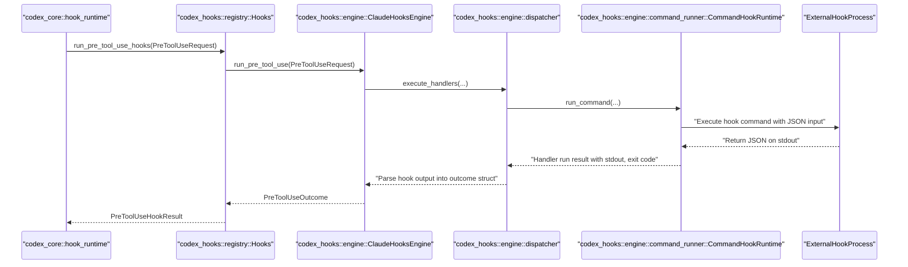
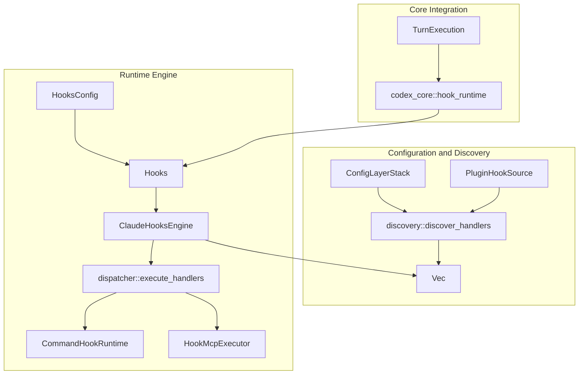

<!-- source: DeepWiki mcp.deepwiki.com · repo openai/codex · page 3.11 Hooks System · fetched 2026-10-26 -->

# Hooks System

<details>
<summary>Relevant source files</summary>

The following files were used as context for generating this wiki page:

- [codex-rs/config/src/hook_config.rs](codex-rs/config/src/hook_config.rs)
- [codex-rs/config/src/hooks_tests.rs](codex-rs/config/src/hooks_tests.rs)
- [codex-rs/core/src/hook_runtime.rs](codex-rs/core/src/hook_runtime.rs)
- [codex-rs/core/tests/suite/hooks.rs](codex-rs/core/tests/suite/hooks.rs)
- [codex-rs/hooks/src/engine/command_runner.rs](codex-rs/hooks/src/engine/command_runner.rs)
- [codex-rs/hooks/src/engine/command_runner_tests.rs](codex-rs/hooks/src/engine/command_runner_tests.rs)
- [codex-rs/hooks/src/engine/discovery.rs](codex-rs/hooks/src/engine/discovery.rs)
- [codex-rs/hooks/src/engine/dispatcher.rs](codex-rs/hooks/src/engine/dispatcher.rs)
- [codex-rs/hooks/src/engine/mod.rs](codex-rs/hooks/src/engine/mod.rs)
- [codex-rs/hooks/src/engine/mod_tests.rs](codex-rs/hooks/src/engine/mod_tests.rs)
- [codex-rs/hooks/src/events/common.rs](codex-rs/hooks/src/events/common.rs)
- [codex-rs/hooks/src/events/compact.rs](codex-rs/hooks/src/events/compact.rs)
- [codex-rs/hooks/src/events/post_tool_use.rs](codex-rs/hooks/src/events/post_tool_use.rs)
- [codex-rs/hooks/src/events/pre_tool_use.rs](codex-rs/hooks/src/events/pre_tool_use.rs)
- [codex-rs/hooks/src/events/session_end_tests.rs](codex-rs/hooks/src/events/session_end_tests.rs)
- [codex-rs/hooks/src/events/session_start.rs](codex-rs/hooks/src/events/session_start.rs)
- [codex-rs/hooks/src/events/stop.rs](codex-rs/hooks/src/events/stop.rs)
- [codex-rs/hooks/src/events/user_prompt_submit.rs](codex-rs/hooks/src/events/user_prompt_submit.rs)
- [codex-rs/hooks/src/legacy_notify.rs](codex-rs/hooks/src/legacy_notify.rs)
- [codex-rs/hooks/src/lib.rs](codex-rs/hooks/src/lib.rs)
- [codex-rs/hooks/src/registry.rs](codex-rs/hooks/src/registry.rs)
- [codex-rs/hooks/src/schema.rs](codex-rs/hooks/src/schema.rs)
- [codex-rs/hooks/src/types.rs](codex-rs/hooks/src/types.rs)

</details>


The Hooks System is a Claude-style engine designed to intercept and augment the agent's lifecycle. It provides a structured way to execute custom logic at critical boundaries, such as before and after tool use, at session start and stop, or upon user prompt submission. While the hooks engine handles lifecycle interception, it works closely with the core agent system to enforce safety, manage side effects, and provide contextual feedback.

Sources: [codex-rs/hooks/src/registry.rs:70-178](), [codex-rs/hooks/src/engine/mod.rs:181-189](), [codex-rs/hooks/src/engine/discovery.rs:94-189]().

---

## Overview and Purpose

The Hooks System allows the Codex core to decouple side-effects and external notifications from the primary execution loop. This extensibility point enables:

- **Interception:** Hooks run at defined event boundaries to inspect or modify the operation before or after execution (e.g., `run_pre_tool_use_hooks` runs before tool dispatch) [codex-rs/core/src/hook_runtime.rs:183-189]().
- **Augmentation:** Hooks can inject additional context or data stored into the session history using a spill mechanism managed by `HookOutputSpiller` [codex-rs/hooks/src/engine/command_runner.rs:62-63]().
- **Control:** Hooks can return blocking or stopping signals, affecting the logical flow or preventing an operation from running [codex-rs/hooks/src/events/pre_tool_use.rs:39-46](), [codex-rs/hooks/src/events/permission_request.rs:11-18]().
- **Discovery:** The system discovers hooks automatically from layered configurations (user, project, system) and from installed plugins [codex-rs/hooks/src/engine/discovery.rs:94-189]().
- **Integration:** The hook runtime is integrated into the core session lifecycle and turn execution, coordinating asynchronous and synchronous execution modes.

This is implemented mainly within the `codex-rs/hooks` crate, interacting with core components through the `Hooks` wrapper and the `ClaudeHooksEngine` internal dispatcher [codex-rs/hooks/src/registry.rs:60-142]().

Sources: [codex-rs/hooks/src/registry.rs:70-178](), [codex-rs/hooks/src/engine/mod.rs:181-189](), [codex-rs/hooks/src/engine/discovery.rs:94-189](), [codex-rs/hooks/src/registry.rs:60-142](), [codex-rs/core/src/hook_runtime.rs:183-189](), [codex-rs/hooks/src/engine/command_runner.rs:62-63](), [codex-rs/hooks/src/events/pre_tool_use.rs:39-46](), [codex-rs/hooks/src/events/permission_request.rs:11-18]().

---

## Hook Event Types

Hooks trigger at discrete named events during session and tool lifecycle. These event names are used in configuration files and JSON payloads [codex-rs/hooks/src/lib.rs:23-39]().

| Event Type          | Description                                                                                              |
|---------------------|----------------------------------------------------------------------------------------------------------|
| `PreModelRequest`   | Triggered before a model request is made.                                                                |
| `PostModelRequest`  | Triggered after a model request is completed.                                                            |
| `PreToolUse`        | Triggered before tool execution; can block or modify input [codex-rs/hooks/src/lib.rs:26]()                                  |
| `PermissionRequest` | Triggered when a tool requires explicit user or approval decision [codex-rs/hooks/src/lib.rs:27]()                           |
| `PostToolUse`       | Triggered after tool completion; can provide feedback or additional data [codex-rs/hooks/src/lib.rs:28]()                    |
| `PreCompact`        | Triggered during conversation history compaction workflows [codex-rs/hooks/src/lib.rs:29]()                        |
| `PostCompact`       | Triggered during conversation history compaction workflows [codex-rs/hooks/src/lib.rs:30]()                        |
| `SessionStart`      | Triggered when a new session or thread is initialized, e.g., thread spawning or session fork [codex-rs/hooks/src/lib.rs:31]() |
| `SessionEnd`        | Triggered when a session ends.                                                                           |
| `UserPromptSubmit`  | Triggered immediately after the user submits a prompt but before model processing [codex-rs/hooks/src/lib.rs:33]()          |
| `SubagentStart`     | Triggered when sub-agents like reviewers start [codex-rs/hooks/src/lib.rs:34]()                        |
| `SubagentStop`      | Triggered when sub-agents like reviewers stop [codex-rs/hooks/src/lib.rs:35]()                        |
| `Stop`              | Triggered when agent finishes a turn, or when an interrupt occurs [codex-rs/hooks/src/lib.rs:36]()                           |
| `Interrupt`         | Triggered when an operation is interrupted by a user [codex-rs/hooks/src/lib.rs:37]()                                        |

Some hook events, such as those involving tool use, have meaningful `matcher` fields that filter which hooks fire depending on context (e.g., tool name) [codex-rs/hooks/src/lib.rs:41-56]().

Sources: [codex-rs/hooks/src/lib.rs:23-56](), [codex-rs/hooks/src/engine/mod.rs:170-183]().

---

## Architecture and Discovery

The central component orchestrating the hook system is `ClaudeHooksEngine`, which manages discovered hook handlers, executes them, and interprets their outcomes [codex-rs/hooks/src/engine/mod.rs:59-189](). 

`HooksConfig` captures the feature enabling flags, layered configuration, shell execution settings, and plugin hook metadata used to configure the engine [codex-rs/hooks/src/registry.rs:46-55]().

### Discovery Pipeline

The engine discovers available hooks by scanning configuration layers in priority order—such as user config, project `.codex` folders, system config—and plugins exporting hooks [codex-rs/hooks/src/engine/discovery.rs:106-191]().

- Hooks are discovered either from JSON files (`hooks.json`) or TOML (`config.toml`) representations [codex-rs/hooks/src/engine/discovery.rs:164-170]().
- Each discovered hook is parsed into a `ConfiguredHandler` that contains its command, event association, timeout, matcher regex, and execution mode [codex-rs/hooks/src/engine/mod.rs:64-78]().
- Discovery applies filtering rules like managed-only mode and hook trust policies [codex-rs/hooks/src/engine/discovery.rs:120-131]().
- Conflicts or loading errors generate warnings or fatal errors if required hooks fail to load [codex-rs/hooks/src/engine/discovery.rs:69-75]().

Sources: [codex-rs/hooks/src/engine/discovery.rs:106-191](), [codex-rs/hooks/src/engine/mod.rs:64-78](), [codex-rs/hooks/src/registry.rs:46-55](), [codex-rs/hooks/src/engine/discovery.rs:120-131](), [codex-rs/hooks/src/engine/discovery.rs:69-75]().

### Hook Execution Sequence

When a hook event occurs, the engine executes handlers for that event.

Title: Hook Execution Sequence Dispatch Flow

Sources: [codex-rs/core/src/hook_runtime.rs:183-189](), [codex-rs/hooks/src/registry.rs:167-177](), [codex-rs/hooks/src/engine/dispatcher.rs:101-113](), [codex-rs/hooks/src/engine/command_runner.rs:130-169]().

### Discovery-to-Dispatch Mapping

This diagram maps natural language discovery and dispatch components to concrete code entities in the hook system:

Title: Discovery To Dispatch Code Mapping
```mermaid
graph TD
    subgraph "codex-rs/hooks/src/registry.rs"
        HooksConfig["HooksConfig"]
        Hooks["Hooks"]
    end

    subgraph "codex-rs/hooks/src/engine"
        Engine["ClaudeHooksEngine"]
        ConfiguredHandler["ConfiguredHandler"]
        Discovery["discovery::discover_handlers"]
        Dispatcher["dispatcher::execute_handlers"]
        Runner["command_runner::CommandHookRuntime"]
    end

    subgraph "codex-rs/hooks/src/events"
        PreToolUseRequest["PreToolUseRequest"]
        PreToolUseOutcome["PreToolUseOutcome"]
    end

    HooksConfig-->"initializes"-->Hooks
    Hooks-->"wraps"-->Engine
    Discovery-->"populates handlers"-->Engine
    Engine-->"contains"-->ConfiguredHandler
    Hooks-->"dispatches events"-->PreToolUseRequest
    Engine-->"calls dispatcher"-->Dispatcher
    Dispatcher-->"executes commands"-->Runner
    Runner-->"produces outcomes"-->PreToolUseOutcome
```
Sources: [codex-rs/hooks/src/registry.rs:46-142](), [codex-rs/hooks/src/engine/mod.rs:59-78](), [codex-rs/hooks/src/engine/discovery.rs:106-191](), [codex-rs/hooks/src/engine/dispatcher.rs:101-113]().

---

## Configuration and Trust

Hook definitions live primarily in layered configuration files (`hooks.json` or `config.toml`) [codex-rs/config/src/hook_config.rs:10-193]().

### Matcher Logic

Each hook event type may have multiple match groups, with optional regex matcher patterns controlling when the hook runs, based on context such as tool name:

- For `PreToolUse` hooks, the matcher commonly matches the canonical tool name or aliases (e.g., `^Bash$`) [codex-rs/hooks/src/engine/dispatcher.rs:53-71]().
- Matchers filter both synchronous and asynchronous hooks, enabling fine-grained dispatch [codex-rs/hooks/src/engine/dispatcher.rs:53-78]().
- Commands to run are specified either directly as shell commands or MCP tools [codex-rs/hooks/src/engine/mod.rs:123-134]().

The hooks spawn external processes (shell or MCP tool invocations) with input JSON piped to stdin, environment variables configured, and stdout/stderr captured safely [codex-rs/hooks/src/engine/command_runner_tests.rs:105-130]().

Sources: [codex-rs/hooks/src/engine/dispatcher.rs:53-78](), [codex-rs/hooks/src/engine/mod.rs:123-134](), [codex-rs/hooks/src/engine/command_runner_tests.rs:105-130](), [codex-rs/config/src/hook_config.rs:10-193]().

### Trust and Security

The engine enforces a trust model to restrict execution of untrusted hooks:

- Hooks include configuration and trust verification handled during discovery [codex-rs/hooks/src/engine/discovery.rs:106-131]().
- Users or system policies may enable `bypass_hook_trust` to skip strict trust constraints [codex-rs/hooks/src/registry.rs:48]().
- Failing to load or trust required managed hooks aborts session startup to prevent untrusted execution [codex-rs/hooks/src/registry.rs:87-93]().
- Hooks generate unique keys for persistence and trust management based on source path and event label [codex-rs/hooks/src/lib.rs:121-130]().

Sources: [codex-rs/hooks/src/engine/discovery.rs:106-131](), [codex-rs/hooks/src/registry.rs:48-93](), [codex-rs/hooks/src/lib.rs:121-130]().

---

## Implementation Details

### Hook Outcomes and Event Handling

Each hook event type has a dedicated request and outcome struct encapsulating inputs and aggregated results from all handlers:

- Outcomes communicate control signals such as block, stop, or continue, reasons, and any additional context fragments to inject back into the session [codex-rs/hooks/src/events/pre_tool_use.rs:39-45](), [codex-rs/hooks/src/events/stop.rs:87-95]().
- The system handles partial failure and serialization errors by generating synthetic hook events explaining the error [codex-rs/hooks/src/events/post_tool_use.rs:92-100]().
- Handler runs produce `HookCompletedEvent` messages that summarize execution and are sent asynchronously [codex-rs/hooks/src/engine/command_runner.rs:130-169]().
- Preview methods exist to show which handlers will run for a given event request [codex-rs/hooks/src/events/pre_tool_use.rs:55-70]().

Sources: [codex-rs/hooks/src/events/pre_tool_use.rs:39-45](), [codex-rs/hooks/src/events/stop.rs:87-95](), [codex-rs/hooks/src/events/post_tool_use.rs:92-100](), [codex-rs/hooks/src/engine/command_runner.rs:130-169](), [codex-rs/hooks/src/events/pre_tool_use.rs:55-70]().

### Command Hook Runtime

The `CommandHookRuntime` owns process spawning and async task management for hook workflows [codex-rs/hooks/src/engine/command_runner.rs:57-65]():

- Manages concurrent asynchronous hook executions with a semaphore limiting concurrency (`MAX_CONCURRENT_ASYNC_HOOKS`) [codex-rs/hooks/src/engine/command_runner.rs:53-77]().
- Supports both synchronous and asynchronous hook command execution modes [codex-rs/hooks/src/engine/mod.rs:147-158]().
- Runs external commands with JSON input piped to stdin, captures stdout/stderr, and collects exit codes [codex-rs/hooks/src/engine/command_runner.rs:130-141]().
- Uses a spill mechanism (`HookOutputSpiller`) to offload large output contexts safely [codex-rs/hooks/src/engine/command_runner.rs:111-113]().
- Allows scheduling async tasks with congestion control and graceful shutdown on session termination [codex-rs/hooks/src/engine/command_runner.rs:172-191]().

Sources: [codex-rs/hooks/src/engine/command_runner.rs:53-191](), [codex-rs/hooks/src/engine/mod.rs:147-158]().

### Registry API

The `Hooks` struct serves as the primary API for core subsystems to interact with the hooks runtime [codex-rs/hooks/src/registry.rs:64-72]():

- `new()` creates a fully configured hook runtime for a thread with an async channel to receive hook completion events [codex-rs/hooks/src/registry.rs:77-94]().
- `reconfigured()` refreshes configuration while maintaining in-flight async hooks [codex-rs/hooks/src/registry.rs:98-105]().
- `hooks_for_event()` runs arbitrary hook events, like after-agent notifications [codex-rs/hooks/src/registry.rs:172-175]().
- Supports shutdown by aborting async hook tasks cleanly [codex-rs/hooks/src/registry.rs:163-165]().

Sources: [codex-rs/hooks/src/registry.rs:64-175]().

---

# Summary Diagram: Hooks System Flow

Title: Hooks System Flow Architecture

Sources: [codex-rs/hooks/src/registry.rs:46-142](), [codex-rs/hooks/src/engine/discovery.rs:106-191](), [codex-rs/hooks/src/engine/dispatcher.rs:101-113](), [codex-rs/core/src/hook_runtime.rs:127-181]().

---

## Detailed Technical References

- `HooksConfig` represents feature flags, layered config, and plugin hook metadata used to configure the hooks runtime [codex-rs/hooks/src/registry.rs:46-55]().
- `Hooks` owns the engine and dispatch channel; exposes `new()`, `hooks_for_event()`, and `shutdown()` APIs [codex-rs/hooks/src/registry.rs:64-175]().
- `ClaudeHooksEngine` manages the list of `ConfiguredHandler`s discovered and exposes methods to run hooks for specific events [codex-rs/hooks/src/engine/mod.rs:59-189]().
- `ConfiguredHandler` holds metadata about each hook command/tool, including command line, matcher regex, timeouts, and execution mode [codex-rs/hooks/src/engine/mod.rs:64-78]().
- `discovery::discover_handlers` parses layered hook definitions from config layers and plugins [codex-rs/hooks/src/engine/discovery.rs:106-117]().
- `dispatcher::execute_handlers` runs matched handlers for an event, branching on execution mode and collecting results [codex-rs/hooks/src/engine/dispatcher.rs:111-125]().
- `CommandHookRuntime` encapsulates process-based hook invocation, concurrency control, environment configuration, I/O, and result emission [codex-rs/hooks/src/engine/command_runner.rs:57-93]().

Sources: [codex-rs/hooks/src/registry.rs:46-175](), [codex-rs/hooks/src/engine/mod.rs:59-189](), [codex-rs/hooks/src/engine/discovery.rs:106-117](), [codex-rs/hooks/src/engine/dispatcher.rs:111-125](), [codex-rs/hooks/src/engine/command_runner.rs:57-93]().

---

