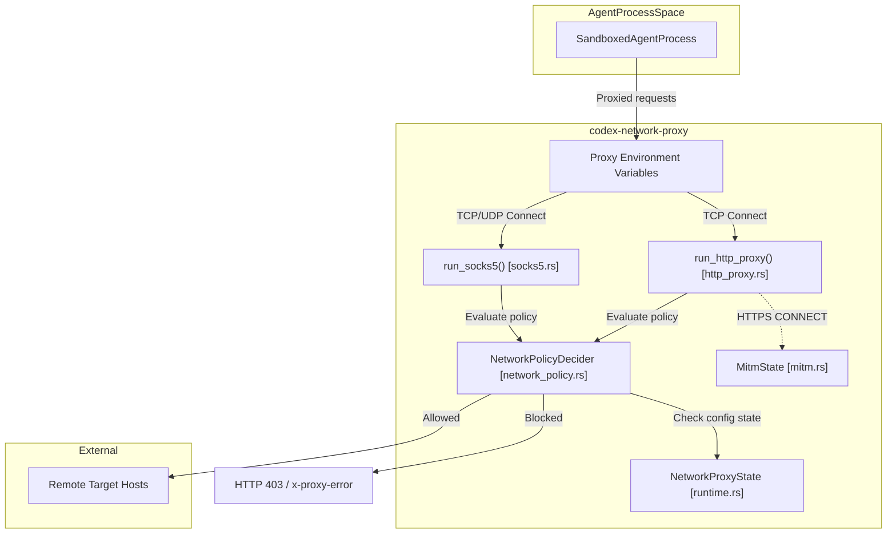
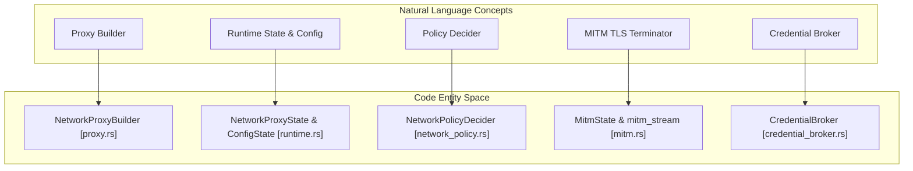

<!-- source: DeepWiki mcp.deepwiki.com · repo openai/codex · page 3.12 Network Proxy · fetched 2026-10-26 -->

# Network Proxy

Relevant source files

The following files were used as context for generating this wiki page:

- [codex-rs/network-proxy/Cargo.toml](codex-rs/network-proxy/Cargo.toml)
- [codex-rs/network-proxy/README.md](codex-rs/network-proxy/README.md)
- [codex-rs/network-proxy/src/config.rs](codex-rs/network-proxy/src/config.rs)
- [codex-rs/network-proxy/src/credential_broker.rs](codex-rs/network-proxy/src/credential_broker.rs)
- [codex-rs/network-proxy/src/credential_broker/configured_tests.rs](codex-rs/network-proxy/src/credential_broker/configured_tests.rs)
- [codex-rs/network-proxy/src/credential_broker/destination.rs](codex-rs/network-proxy/src/credential_broker/destination.rs)
- [codex-rs/network-proxy/src/credential_broker/environment.rs](codex-rs/network-proxy/src/credential_broker/environment.rs)
- [codex-rs/network-proxy/src/credential_broker/matching.rs](codex-rs/network-proxy/src/credential_broker/matching.rs)
- [codex-rs/network-proxy/src/credential_broker/providers.rs](codex-rs/network-proxy/src/credential_broker/providers.rs)
- [codex-rs/network-proxy/src/credential_broker/providers/github.rs](codex-rs/network-proxy/src/credential_broker/providers/github.rs)
- [codex-rs/network-proxy/src/credential_broker/providers/openai.rs](codex-rs/network-proxy/src/credential_broker/providers/openai.rs)
- [codex-rs/network-proxy/src/credential_broker/registry.rs](codex-rs/network-proxy/src/credential_broker/registry.rs)
- [codex-rs/network-proxy/src/credential_broker_tests.rs](codex-rs/network-proxy/src/credential_broker_tests.rs)
- [codex-rs/network-proxy/src/http_proxy.rs](codex-rs/network-proxy/src/http_proxy.rs)
- [codex-rs/network-proxy/src/lib.rs](codex-rs/network-proxy/src/lib.rs)
- [codex-rs/network-proxy/src/mitm.rs](codex-rs/network-proxy/src/mitm.rs)
- [codex-rs/network-proxy/src/mitm_tests.rs](codex-rs/network-proxy/src/mitm_tests.rs)
- [codex-rs/network-proxy/src/network_policy.rs](codex-rs/network-proxy/src/network_policy.rs)
- [codex-rs/network-proxy/src/proxy.rs](codex-rs/network-proxy/src/proxy.rs)
- [codex-rs/network-proxy/src/reasons.rs](codex-rs/network-proxy/src/reasons.rs)
- [codex-rs/network-proxy/src/responses.rs](codex-rs/network-proxy/src/responses.rs)
- [codex-rs/network-proxy/src/runtime.rs](codex-rs/network-proxy/src/runtime.rs)
- [codex-rs/network-proxy/src/socks5.rs](codex-rs/network-proxy/src/socks5.rs)
- [codex-rs/network-proxy/src/state.rs](codex-rs/network-proxy/src/state.rs)

The `codex-network-proxy` crate provides Codex's local network policy enforcement proxy for sandboxed agent processes [codex-rs/network-proxy/README.md:1-3](). It manages outbound network traffic by enforcing fine-grained security policies, selectively allowing or denying connections through concurrent HTTP and SOCKS5 proxy listeners [codex-rs/network-proxy/README.md:3-7]().

---

## Architecture and Data Flow

The network proxy intercepts outbound TCP and UDP traffic from sandboxed agent processes, which are configured via environment variables like `HTTP_PROXY`, `HTTPS_PROXY`, and `ALL_PROXY` [codex-rs/network-proxy/README.md:118-131](). Incoming connections are evaluated against compiled domain allow/deny patterns, network mode constraints, and optional policy deciders before being relayed upstream or terminated via man-in-the-middle (MITM) inspection [codex-rs/network-proxy/src/http_proxy.rs:95-177](), [codex-rs/network-proxy/src/socks5.rs:66-152]().

### Title: High-Level System Architecture and Data Flow

Sources: [codex-rs/network-proxy/src/proxy.rs:128-218](), [codex-rs/network-proxy/src/http_proxy.rs:95-177](), [codex-rs/network-proxy/src/socks5.rs:66-152](), [codex-rs/network-proxy/src/runtime.rs:175-188]()

---

## Proxy Modes and Policy Enforcement

### HTTP and SOCKS5 Modes
The proxy binds both an HTTP proxy listener (defaulting to `127.0.0.1:3128`) and a SOCKS5 proxy listener (defaulting to `127.0.0.1:8081`, enabled by default) [codex-rs/network-proxy/README.md:1-7](). On Windows, managed HTTP listeners prefer ports `3128..=3159` and SOCKS5 prefers `8081..=8112` [codex-rs/network-proxy/src/proxy.rs:47-50](). An explicitly configured port is attempted first, falling back to ephemeral loopback if occupied [codex-rs/network-proxy/README.md:9-10](). SOCKS5 UDP association is also supported when `enable_socks5_udp` is true [codex-rs/network-proxy/src/config.rs:138]().

### Allow/Deny Policy & Domain Matching
Policies are driven by `NetworkProxyConfig` and compiled into `ConfigState` [codex-rs/network-proxy/src/config.rs:130-175](), [codex-rs/network-proxy/src/state.rs:62-116](). Domain permissions use `NetworkDomainPermission` variants (`None`, `Allow`, `Deny`), where deny rules take precedence over allow rules [codex-rs/network-proxy/src/config.rs:21-29](). Wildcard patterns like `*.openai.com` are supported, but global wildcards (`*`) are disallowed for domains unless created by fallback contexts [codex-rs/network-proxy/README.md:57-59](), [codex-rs/network-proxy/src/state.rs:70-79]().

### Limited Mode
When `mode = NetworkMode::Limited` is configured, network access is restricted to read-only semantics (`GET`, `HEAD`, `OPTIONS`) [codex-rs/network-proxy/README.md:39-40](), [codex-rs/network-proxy/README.md:143-145](). HTTPS `CONNECT` tunnels and SOCKS5 TCP targets on port 443 require MITM inspection to enforce method policies on inner payloads [codex-rs/network-proxy/README.md:143-145](). SOCKS5 UDP and non-HTTPS SOCKS5 TCP are blocked entirely in limited mode [codex-rs/network-proxy/src/socks5.rs:128-133]().

### MITM HTTPS Inspection
MITM inspection is automatically enabled when `mode = "limited"`, when `mitm_hooks` are configured, or when explicitly requested via `network.mitm = true` [codex-rs/network-proxy/README.md:40-42](), [codex-rs/network-proxy/src/state.rs:96-103](). `MitmState` manages a process-local certificate authority (`ManagedMitmCa`) that generates per-host TLS leaf certificates dynamically [codex-rs/network-proxy/src/mitm.rs:58-64](), [codex-rs/network-proxy/src/mitm.rs:116-140](). This allows the proxy to terminate TLS on `CONNECT` tunnels, inspect inner HTTP request methods and paths, and apply `mitm_hooks` (such as header stripping or credential injection) [codex-rs/network-proxy/README.md:68-78](), [codex-rs/network-proxy/src/mitm.rs:155-203]().

Sources: [codex-rs/network-proxy/README.md:1-149](), [codex-rs/network-proxy/src/config.rs:21-29](), [codex-rs/network-proxy/src/state.rs:62-116](), [codex-rs/network-proxy/src/mitm.rs:58-140]()

---

## Core Implementation Structures

The `codex-network-proxy` codebase is organized around modular runtime components:

| Component | Role / Responsibility | File Location |
|---|---|---|
| `NetworkProxyBuilder` | Fluent builder pattern for assembling listeners, policy deciders, and state observers. | `codex-rs/network-proxy/src/proxy.rs` [140-218]() |
| `NetworkProxyState` | Shared async state container holding active configurations, audit buffers, and block counters. | `codex-rs/network-proxy/src/runtime.rs` [175-188]() |
| `ConfigState` | Immutable snapshot of compiled allow/deny domain sets, MITM state, and constraints. | `codex-rs/network-proxy/src/runtime.rs` [175-188]() |
| `NetworkPolicyDecider` | Async trait invoked to render allow/deny decisions for individual proxy requests. | `codex-rs/network-proxy/src/network_policy.rs` [76-79]() |
| `MitmState` | Manages CA cert generation, root trust stores, and TLS acceptance data for host MITM. | `codex-rs/network-proxy/src/mitm.rs` [58-64]() |
| `CredentialBroker` | Manages secure credential injection and rewriting rules across upstream proxy sessions. | `codex-rs/network-proxy/src/credential_broker.rs` [48-51]() |

Sources: [codex-rs/network-proxy/src/proxy.rs:140-218](), [codex-rs/network-proxy/src/runtime.rs:175-188](), [codex-rs/network-proxy/src/network_policy.rs:76-79](), [codex-rs/network-proxy/src/mitm.rs:58-64](), [codex-rs/network-proxy/src/credential_broker.rs:48-51]()

---

## Code Entity Mapping

### Title: Natural Language to Code Entity Space

Sources: [codex-rs/network-proxy/src/proxy.rs:140-218](), [codex-rs/network-proxy/src/runtime.rs:175-188](), [codex-rs/network-proxy/src/network_policy.rs:76-79](), [codex-rs/network-proxy/src/mitm.rs:58-64](), [codex-rs/network-proxy/src/credential_broker.rs:48-51]()

---

## The `responses-api-proxy` Binary

The `codex-network-proxy` crate includes a binary named `codex-network-proxy` [codex-rs/network-proxy/Cargo.toml:12-13](). This binary serves as the main entry point for running the network proxy as a standalone process. It parses command-line arguments, initializes the proxy with the configured network policies, and starts the HTTP and SOCKS5 listeners [codex-rs/network-proxy/src/proxy.rs:52-54]().

Sources: [codex-rs/network-proxy/Cargo.toml:12-13](), [codex-rs/network-proxy/src/proxy.rs:52-54]()

---

