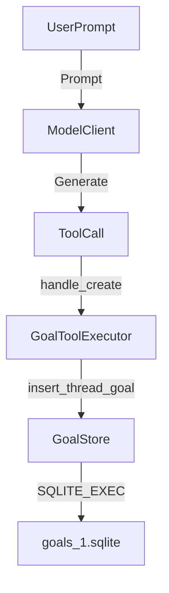
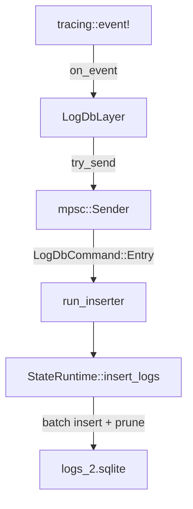

<!-- source: DeepWiki mcp.deepwiki.com · repo openai/codex · page 3.13 Goal Extension and State Runtime · fetched 2026-10-26 -->

# Goal Extension and State Runtime

<details>
<summary>Relevant source files</summary>

The following files were used as context for generating this wiki page:

- [codex-rs/app-server/src/request_processors/thread_goal_processor.rs](codex-rs/app-server/src/request_processors/thread_goal_processor.rs)
- [codex-rs/app-server/tests/suite/v2/thread_goal_empty_responses.rs](codex-rs/app-server/tests/suite/v2/thread_goal_empty_responses.rs)
- [codex-rs/cli/src/doctor/thread_inventory.rs](codex-rs/cli/src/doctor/thread_inventory.rs)
- [codex-rs/cli/tests/debug_clear_memories.rs](codex-rs/cli/tests/debug_clear_memories.rs)
- [codex-rs/core/src/session/inject.rs](codex-rs/core/src/session/inject.rs)
- [codex-rs/core/src/session/input_queue.rs](codex-rs/core/src/session/input_queue.rs)
- [codex-rs/core/tests/suite/image_rollout.rs](codex-rs/core/tests/suite/image_rollout.rs)
- [codex-rs/core/tests/suite/pending_input.rs](codex-rs/core/tests/suite/pending_input.rs)
- [codex-rs/ext/goal/BUILD.bazel](codex-rs/ext/goal/BUILD.bazel)
- [codex-rs/ext/goal/Cargo.toml](codex-rs/ext/goal/Cargo.toml)
- [codex-rs/ext/goal/src/accounting.rs](codex-rs/ext/goal/src/accounting.rs)
- [codex-rs/ext/goal/src/api.rs](codex-rs/ext/goal/src/api.rs)
- [codex-rs/ext/goal/src/extension.rs](codex-rs/ext/goal/src/extension.rs)
- [codex-rs/ext/goal/src/lib.rs](codex-rs/ext/goal/src/lib.rs)
- [codex-rs/ext/goal/src/runtime.rs](codex-rs/ext/goal/src/runtime.rs)
- [codex-rs/ext/goal/src/spec.rs](codex-rs/ext/goal/src/spec.rs)
- [codex-rs/ext/goal/src/steering.rs](codex-rs/ext/goal/src/steering.rs)
- [codex-rs/ext/goal/src/tool.rs](codex-rs/ext/goal/src/tool.rs)
- [codex-rs/ext/goal/templates/goals/budget_limit.md](codex-rs/ext/goal/templates/goals/budget_limit.md)
- [codex-rs/ext/goal/templates/goals/continuation.md](codex-rs/ext/goal/templates/goals/continuation.md)
- [codex-rs/ext/goal/templates/goals/objective_updated.md](codex-rs/ext/goal/templates/goals/objective_updated.md)
- [codex-rs/ext/goal/tests/accounting.rs](codex-rs/ext/goal/tests/accounting.rs)
- [codex-rs/ext/goal/tests/goal_extension_backend.rs](codex-rs/ext/goal/tests/goal_extension_backend.rs)
- [codex-rs/state/BUILD.bazel](codex-rs/state/BUILD.bazel)
- [codex-rs/state/migrations/0002_logs.sql](codex-rs/state/migrations/0002_logs.sql)
- [codex-rs/state/migrations/0010_logs_process_id.sql](codex-rs/state/migrations/0010_logs_process_id.sql)
- [codex-rs/state/migrations/0059_thread_attachment_reverse_lookup.sql](codex-rs/state/migrations/0059_thread_attachment_reverse_lookup.sql)
- [codex-rs/state/src/lib.rs](codex-rs/state/src/lib.rs)
- [codex-rs/state/src/log_db.rs](codex-rs/state/src/log_db.rs)
- [codex-rs/state/src/log_db_filter_tests.rs](codex-rs/state/src/log_db_filter_tests.rs)
- [codex-rs/state/src/migrations.rs](codex-rs/state/src/migrations.rs)
- [codex-rs/state/src/model/log.rs](codex-rs/state/src/model/log.rs)
- [codex-rs/state/src/model/mod.rs](codex-rs/state/src/model/mod.rs)
- [codex-rs/state/src/model/thread_attachment.rs](codex-rs/state/src/model/thread_attachment.rs)
- [codex-rs/state/src/runtime.rs](codex-rs/state/src/runtime.rs)
- [codex-rs/state/src/runtime/backfill.rs](codex-rs/state/src/runtime/backfill.rs)
- [codex-rs/state/src/runtime/goals.rs](codex-rs/state/src/runtime/goals.rs)
- [codex-rs/state/src/runtime/logs.rs](codex-rs/state/src/runtime/logs.rs)
- [codex-rs/state/src/runtime/remote_control.rs](codex-rs/state/src/runtime/remote_control.rs)
- [codex-rs/state/src/runtime/thread_attachments.rs](codex-rs/state/src/runtime/thread_attachments.rs)
- [codex-rs/state/src/runtime/thread_attachments_tests.rs](codex-rs/state/src/runtime/thread_attachments_tests.rs)
- [codex-rs/state/src/telemetry.rs](codex-rs/state/src/telemetry.rs)

</details>


The Goal Extension and State Runtime systems provide a persistent mechanism for tracking high-level objectives, token budgets, and long-term state across Codex sessions. The `ext/goal` crate manages goal logic, accounting, steering, and tool invocation, while the `codex-state` crate offers a SQLite-backed runtime for storing goals, logs, memories, threads, queues, and remote control records.

Sources:
- [codex-rs/state/src/runtime.rs:100-112]()
- [codex-rs/ext/goal/src/extension.rs:53-68]()

---

## State Runtime (`codex-state`)

The `StateRuntime` struct is the centralized interface for persistent state storage, managing multiple dedicated SQLite databases. Each database focuses on a specific domain to improve concurrency and organization, minimizing lock contention.

```rust
#[derive(Clone)]
pub struct StateRuntime {
    sqlite: SqliteConfig,
    default_provider: String,
    pool: Arc<sqlx::SqlitePool>,
    logs_pool: Arc<sqlx::SqlitePool>,
    thread_goals: GoalStore,
    memories: MemoryStore,
    memories_v2: Arc<tokio::sync::OnceCell<MemoryStore>>,
    thread_queue: SqliteQueueStore,
    thread_updated_at_millis: Arc<AtomicI64>,
    thread_recency_at_millis: Arc<AtomicI64>,
    reclamation: Arc<reclamation::SqliteReclamationWorker>,
}
```

Sources:
- [codex-rs/state/src/runtime.rs:100-112]()

### Database Components and Responsibilities

| Database        | Filename          | Role                                                                                       |
|-----------------|-------------------|--------------------------------------------------------------------------------------------|
| State DB        | `state_5.sqlite`  | Stores thread metadata, agent job states, rollout migration state, thread sections, configs |
| Logs DB         | `logs_2.sqlite`   | Captures diagnostic tracing logs and app events, with partitioned pruning for retention    |
| Goals DB        | `goals_1.sqlite`  | Persists thread goals: objectives, statuses, and token usage                               |
| Memories DB     | `memories_1.sqlite` | Stores extracted memory fragments and consolidation state                                 |
| Queue DB        | `queue_1.sqlite`  | Manages queued user submission records for async input handling per thread                 |

Sources:
- [codex-rs/state/src/runtime.rs:145-150]()
- [codex-rs/state/src/lib.rs:1-166]()

### Initialization and Migration

Initialization uses `SqliteConfig` to create the SQLite home directory and open all databases asynchronously, applying migrations scoped per DB using:

- `runtime_state_migrator()` for the main state DB
- `runtime_logs_migrator()` for logs DB
- `runtime_goals_migrator()` for goals DB
- `runtime_memories_migrator()` for memories DB
- `runtime_queue_migrator()` for queue DB

This modular separation allows independent schema evolution and minimal interference between domains.

Sources:
- [codex-rs/state/src/runtime.rs:134-182]()

### Log Partitioning and Pruning

Logs are partitioned to bound the database size and control retention:
- Logs with `thread_id IS NOT NULL` are partitioned by `thread_id`.
- Logs with `thread_id IS NULL` ("threadless") are partitioned by `process_uuid`, including `NULL` as its own category.

Each partition is capped at 10 MiB of estimated log content or 1,000 rows. After batch inserts (`insert_logs`), a pruning query within the same transaction deletes oldest rows whose cumulative size or counts exceed the limits, ensuring the log DB remains bounded and performant.

Sources:
- [codex-rs/state/src/runtime.rs:90-97]()
- [codex-rs/state/src/runtime/logs.rs:4-60]()

### Other Runtime Features

- **Memory Store:** Provides APIs to persist memory fragments used by the multi-phase memory system.
- **Queue Store:** Manages per-thread queues of pending user submissions, enabling asynchronous turn inputs.
- **External Agent Import Tracking:** Logs import histories (success/failure) for imported configurations and state from external agents such as Claude or Cursor.
- **Remote Control Enrollment:** Stores enrollment records for remote control usage in threads.

Sources:
- [codex-rs/state/src/runtime.rs:65-88]()
- [codex-rs/state/src/lib.rs:90-98]()

---

## Goal Extension (`ext/goal`)

The Goal Extension allows Codex threads to manage explicit goals — objectives with token budgets and statuses. It hooks into thread and turn lifecycles to maintain persistent goal state, track token accounting, steer LLM outputs, and expose tools for goal creation and updates.

Sources:
- [codex-rs/ext/goal/src/extension.rs:53-96]()

### Thread Lifecycle Integration

The extension implements `ThreadLifecycleContributor` and `TurnLifecycleContributor`, responding to thread start, resume, turn start, and turn stop events.

#### Thread Start Handling

- Reads the per-thread configuration (`GoalExtensionConfig`), which controls if goal features are enabled and the max token budget limit.
- Persists the config into thread storage to make it accessible in session continuations.
- Initializes or reuses `GoalAccountingState` to track tokens, start time, and the current turn ID.
- Creates a `GoalRuntimeHandle` associating the thread ID with the shared `StateRuntime`, analytics, event emitters, metrics collector, and strong or weak references to the thread manager.
- Registers the runtime handle globally via a `GoalService` registry.
- Uses context like session source and persistent thread state availability to determine tool visibility and availability.

Sources:
- [codex-rs/ext/goal/src/extension.rs:98-163]()

#### Thread Resume Handling

- Looks up the runtime handle if exists and attempts to restore saved goal state from storage asynchronously.
- Logs warnings if restore operations fail but does not abort.

Sources:
- [codex-rs/ext/goal/src/extension.rs:164-173]()

### Turn Lifecycle and Token Accounting

- On turn start, registers steering signal items to potentially continue or abort goal progress based on usage and inputs.
- On turn stop, accounts token usage from turn metadata and updates persistent goal state.
- Enforces token and time budgets by conditionally applying steering instructions, e.g., "budget limit reached".
- Tracks current active goals and updates their status, tracking previous snapshots for comparison.
- Processes external goal mutations and updates through dedicated async state mutation methods to maintain consistency.

Sources:
- [codex-rs/ext/goal/src/runtime.rs:27-204]()
- [codex-rs/ext/goal/src/accounting.rs:90-132]()

### Tools Provided by the Extension

The extension provides a set of model-invokable tools for goal management exposed via `GoalToolExecutor`:

| Tool Name      | Purpose                                        | Implementation Notes                                                                                     |
|----------------|------------------------------------------------|----------------------------------------------------------------------------------------------------------|
| `create_goal`  | Creates a new goal with an objective and optional token budget | Validates inputs and budget limits, inserts goal state in DB, and updates metadata previews |
| `get_goal`     | Fetches the current goal state for the thread | Returns latest persisted snapshot including remaining token budget |
| `update_goal`  | Updates a goal's status, objective, or budget  | Supports marking goal completion and modifying budgets |

These tools perform permission checks ensuring they only act on persistent threads (not ephemeral subagents) and hide from threads running as review subagents to maintain security and clarity.

Sources:
- [codex-rs/ext/goal/src/tool.rs:30-216]()
- [codex-rs/ext/goal/tests/goal_extension_backend.rs:152-198]()

---

## Data Flow Diagrams

### Diagram 1: Natural Language Goal Creation Flow to DB Persistence

This diagram depicts how a user prompt leads to goal creation via the Model Client, invoking the `create_goal` tool, which then updates the Goals database in SQLite through `GoalStore`.



Sources:
- [codex-rs/ext/goal/tests/goal_extension_backend.rs:61-88]()
- [codex-rs/ext/goal/src/tool.rs:204-249]()

### Diagram 2: Log Ingestion from Tracing to SQLite Log DB

Illustrates how runtime trace events flow through the `LogDbLayer`, enqueued and batch-inserted asynchronously into the separate Logs DB, where pruning enforces retention policies.



Sources:
- [codex-rs/state/src/log_db.rs:145-179]()
- [codex-rs/state/src/runtime/logs.rs:9-40]()

---

## Key Structures and Functions

### Goal Management (`ext/goal`)

| Entity                    | Location                                   | Role                                                               |
|---------------------------|--------------------------------------------|--------------------------------------------------------------------|
| `GoalAccountingState`     | [codex-rs/ext/goal/src/accounting.rs:17-28]()      | Tracks usage baselines, ongoing token accounting, and turn IDs.    |
| `GoalRuntimeHandle`       | [codex-rs/ext/goal/src/runtime.rs:28-30]()         | Runtime handle for managing goal lifecycle and coordination.       |
| `GoalService`             | [codex-rs/ext/goal/src/api.rs:1-15]()                | Registry managing runtime instances per thread.                    |
| `GoalUpdate`              | [codex-rs/state/src/runtime.rs:72]()       | Defines patches for goal changes persistent in storage.            |
| `GoalStore`               | [codex-rs/state/src/runtime.rs:71]()       | SQLite wrapper layer for querying and mutating thread goals.       |

Sources:
- [codex-rs/ext/goal/src/accounting.rs:17-28]()
- [codex-rs/ext/goal/src/runtime.rs:28-30]()
- [codex-rs/state/src/runtime.rs:71-72]()

### Storage Models (`codex-state`)

| Struct        | Location                        | Description                                    |
|---------------|---------------------------------|------------------------------------------------|
| `ThreadGoal`  | [codex-rs/state/src/lib.rs:75]() | Represents stored goal metadata per thread.   |
| `LogEntry`   | [codex-rs/state/src/lib.rs:25]() | In-memory representation of a log record.     |
| `LogRow`      | [codex-rs/state/src/lib.rs:27]() | DB row representation for retrieved logs.     |
| `LogQuery`    | [codex-rs/state/src/lib.rs:26]() | Parameters describing filtering for retrieval.|

Sources:
- [codex-rs/state/src/lib.rs:25-75]()

### Important Functions

| Function                                  | Location                                   | Description                                           |
|-------------------------------------------|--------------------------------------------|-------------------------------------------------------|
| `StateRuntime::init`                      | [codex-rs/state/src/runtime.rs:121-124]()  | Initializes all DB pools with proper migration.       |
| `StateRuntime::insert_logs`               | [codex-rs/state/src/runtime/logs.rs:9-40]()| Batch inserts logs and prunes them per partition.     |
| `LogDbLayer::start`                       | [codex-rs/state/src/log_db.rs:149-154]()   | Starts the background async log inserter layer.       |
| `GoalRuntimeHandle::prepare_external_goal_mutation` | [codex-rs/ext/goal/src/runtime.rs:164-189]() | Prepares for external mutations invalidating old state.|

Sources:
- [codex-rs/state/src/runtime.rs:121-124]()
- [codex-rs/state/src/runtime/logs.rs:9-40]()
- [codex-rs/state/src/log_db.rs:149-154]()
- [codex-rs/ext/goal/src/runtime.rs:164-189]()

---

## Summary

The **Goal Extension and State Runtime** form the backbone for persistent goal tracking within Codex. The `codex-state` crate orchestrates multiple SQLite databases segregated for goals, logs, memories, thread metadata, and input queues. It supports robust schema migration and prunes logs efficiently. The `ext/goal` crate integrates tightly with these stores and the core thread lifecycle, providing runtime goal accounting, model steering integration, and API-accessible tools for goal management. Together, these components ensure consistent, durable, and extendable goal state across sessions and agents.

Sources:
- [codex-rs/state/src/runtime.rs:114-193]()
- [codex-rs/ext/goal/src/extension.rs:98-163]()

---

