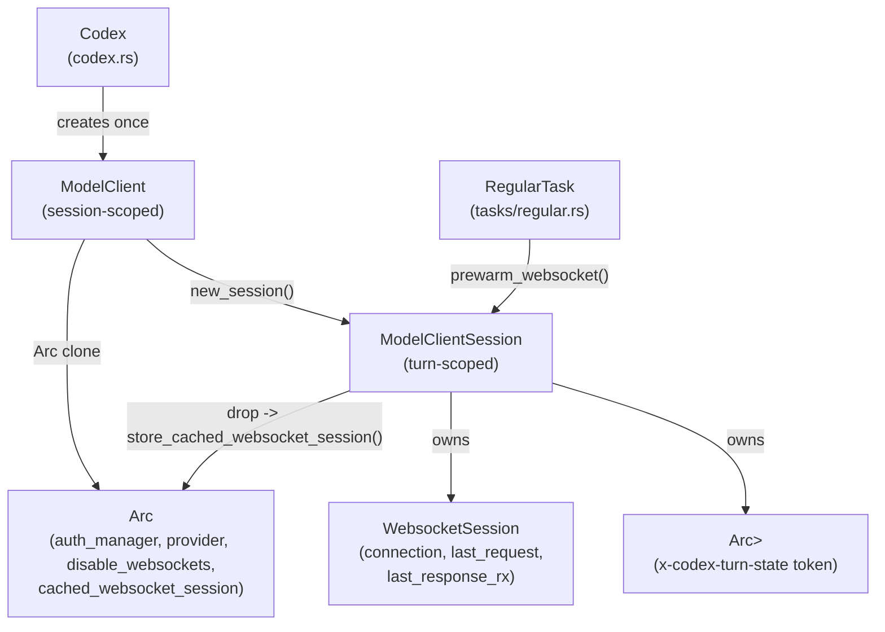
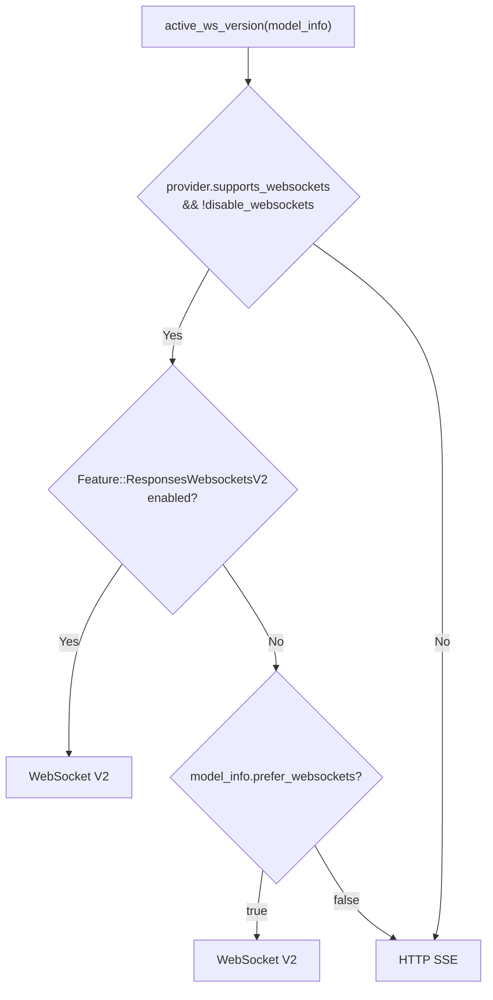
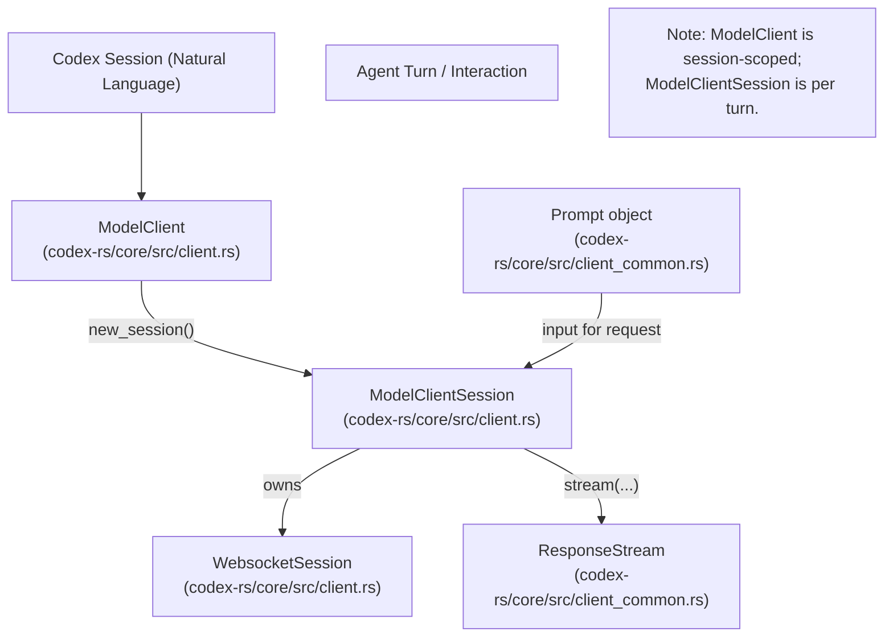
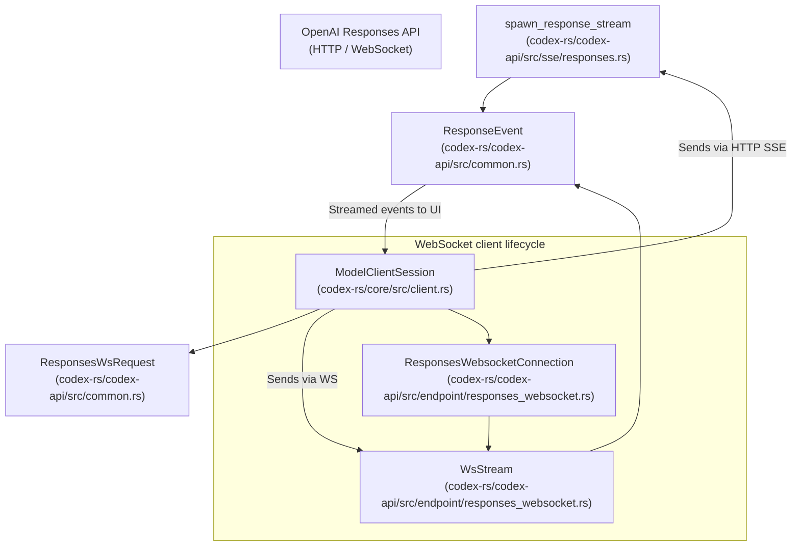

<!-- source: DeepWiki mcp.deepwiki.com · repo openai/codex · page 3.2 Model Client and API Communication · fetched 2026-10-26 -->

# Model Client and API Communication

Relevant source files

The following files were used as context for generating this wiki page:

- [codex-rs/app-server-protocol/schema/json/v2/ModelProviderCapabilitiesReadResponse.json](codex-rs/app-server-protocol/schema/json/v2/ModelProviderCapabilitiesReadResponse.json)
- [codex-rs/app-server-protocol/schema/typescript/v2/ModelProviderCapabilitiesReadResponse.ts](codex-rs/app-server-protocol/schema/typescript/v2/ModelProviderCapabilitiesReadResponse.ts)
- [codex-rs/app-server/tests/suite/v2/model_provider_capabilities_read.rs](codex-rs/app-server/tests/suite/v2/model_provider_capabilities_read.rs)
- [codex-rs/app-server/tests/suite/v2/web_search.rs](codex-rs/app-server/tests/suite/v2/web_search.rs)
- [codex-rs/aws-auth/Cargo.toml](codex-rs/aws-auth/Cargo.toml)
- [codex-rs/aws-auth/src/config.rs](codex-rs/aws-auth/src/config.rs)
- [codex-rs/codex-api/src/auth.rs](codex-rs/codex-api/src/auth.rs)
- [codex-rs/codex-api/src/common.rs](codex-rs/codex-api/src/common.rs)
- [codex-rs/codex-api/src/endpoint/images.rs](codex-rs/codex-api/src/endpoint/images.rs)
- [codex-rs/codex-api/src/endpoint/mod.rs](codex-rs/codex-api/src/endpoint/mod.rs)
- [codex-rs/codex-api/src/endpoint/models.rs](codex-rs/codex-api/src/endpoint/models.rs)
- [codex-rs/codex-api/src/endpoint/responses.rs](codex-rs/codex-api/src/endpoint/responses.rs)
- [codex-rs/codex-api/src/endpoint/responses_websocket.rs](codex-rs/codex-api/src/endpoint/responses_websocket.rs)
- [codex-rs/codex-api/src/endpoint/search.rs](codex-rs/codex-api/src/endpoint/search.rs)
- [codex-rs/codex-api/src/endpoint/session.rs](codex-rs/codex-api/src/endpoint/session.rs)
- [codex-rs/codex-api/src/images.rs](codex-rs/codex-api/src/images.rs)
- [codex-rs/codex-api/src/lib.rs](codex-rs/codex-api/src/lib.rs)
- [codex-rs/codex-api/src/requests/headers.rs](codex-rs/codex-api/src/requests/headers.rs)
- [codex-rs/codex-api/src/requests/responses.rs](codex-rs/codex-api/src/requests/responses.rs)
- [codex-rs/codex-api/src/search.rs](codex-rs/codex-api/src/search.rs)
- [codex-rs/codex-api/src/sse/responses.rs](codex-rs/codex-api/src/sse/responses.rs)
- [codex-rs/codex-api/tests/clients.rs](codex-rs/codex-api/tests/clients.rs)
- [codex-rs/codex-api/tests/sse_end_to_end.rs](codex-rs/codex-api/tests/sse_end_to_end.rs)
- [codex-rs/core/src/client.rs](codex-rs/core/src/client.rs)
- [codex-rs/core/src/client_common.rs](codex-rs/core/src/client_common.rs)
- [codex-rs/core/src/client_common_tests.rs](codex-rs/core/src/client_common_tests.rs)
- [codex-rs/core/src/client_tests.rs](codex-rs/core/src/client_tests.rs)
- [codex-rs/core/tests/common/responses.rs](codex-rs/core/tests/common/responses.rs)
- [codex-rs/core/tests/responses_headers.rs](codex-rs/core/tests/responses_headers.rs)
- [codex-rs/core/tests/suite/agent_websocket.rs](codex-rs/core/tests/suite/agent_websocket.rs)
- [codex-rs/core/tests/suite/bedrock_multi_agent_tests.rs](codex-rs/core/tests/suite/bedrock_multi_agent_tests.rs)
- [codex-rs/core/tests/suite/client.rs](codex-rs/core/tests/suite/client.rs)
- [codex-rs/core/tests/suite/client_websockets.rs](codex-rs/core/tests/suite/client_websockets.rs)
- [codex-rs/core/tests/suite/web_search.rs](codex-rs/core/tests/suite/web_search.rs)
- [codex-rs/core/tests/suite/web_search_system_proxy_tests.rs](codex-rs/core/tests/suite/web_search_system_proxy_tests.rs)
- [codex-rs/ext/web-search/Cargo.toml](codex-rs/ext/web-search/Cargo.toml)
- [codex-rs/ext/web-search/src/extension.rs](codex-rs/ext/web-search/src/extension.rs)
- [codex-rs/ext/web-search/src/output.rs](codex-rs/ext/web-search/src/output.rs)
- [codex-rs/ext/web-search/src/tool.rs](codex-rs/ext/web-search/src/tool.rs)
- [codex-rs/model-provider-info/src/lib.rs](codex-rs/model-provider-info/src/lib.rs)
- [codex-rs/model-provider-info/src/model_provider_info_tests.rs](codex-rs/model-provider-info/src/model_provider_info_tests.rs)
- [codex-rs/model-provider/Cargo.toml](codex-rs/model-provider/Cargo.toml)
- [codex-rs/model-provider/src/amazon_bedrock/auth.rs](codex-rs/model-provider/src/amazon_bedrock/auth.rs)
- [codex-rs/model-provider/src/amazon_bedrock/catalog.rs](codex-rs/model-provider/src/amazon_bedrock/catalog.rs)
- [codex-rs/model-provider/src/amazon_bedrock/mantle.rs](codex-rs/model-provider/src/amazon_bedrock/mantle.rs)
- [codex-rs/model-provider/src/amazon_bedrock/mod.rs](codex-rs/model-provider/src/amazon_bedrock/mod.rs)
- [codex-rs/model-provider/src/amazon_bedrock/runtime_catalog.rs](codex-rs/model-provider/src/amazon_bedrock/runtime_catalog.rs)
- [codex-rs/model-provider/src/amazon_bedrock/runtime_catalog_tests.rs](codex-rs/model-provider/src/amazon_bedrock/runtime_catalog_tests.rs)
- [codex-rs/model-provider/src/lib.rs](codex-rs/model-provider/src/lib.rs)
- [codex-rs/model-provider/src/provider.rs](codex-rs/model-provider/src/provider.rs)
- [codex-rs/model-provider/src/shared_state.rs](codex-rs/model-provider/src/shared_state.rs)
- [codex-rs/tools/src/tool_output.rs](codex-rs/tools/src/tool_output.rs)
- [codex-rs/tui/src/chatwidget/snapshots/codex_tui__chatwidget__tests__bedrock_mantle_astra_advanced_reasoning.snap](codex-rs/tui/src/chatwidget/snapshots/codex_tui__chatwidget__tests__bedrock_mantle_astra_advanced_reasoning.snap)
- [codex-rs/tui/src/chatwidget/snapshots/codex_tui__chatwidget__tests__bedrock_mantle_astra_reasoning.snap](codex-rs/tui/src/chatwidget/snapshots/codex_tui__chatwidget__tests__bedrock_mantle_astra_reasoning.snap)
- [codex-rs/tui/src/chatwidget/snapshots/codex_tui__chatwidget__tests__bedrock_mantle_models.snap](codex-rs/tui/src/chatwidget/snapshots/codex_tui__chatwidget__tests__bedrock_mantle_models.snap)
- [codex-rs/tui/src/chatwidget/snapshots/codex_tui__chatwidget__tests__bedrock_runtime_astra_reasoning.snap](codex-rs/tui/src/chatwidget/snapshots/codex_tui__chatwidget__tests__bedrock_runtime_astra_reasoning.snap)
- [codex-rs/tui/src/chatwidget/snapshots/codex_tui__chatwidget__tests__bedrock_runtime_models.snap](codex-rs/tui/src/chatwidget/snapshots/codex_tui__chatwidget__tests__bedrock_runtime_models.snap)
- [codex-rs/tui/src/chatwidget/tests/bedrock_catalog_tests.rs](codex-rs/tui/src/chatwidget/tests/bedrock_catalog_tests.rs)

This page documents how the `codex-core` crate constructs and sends requests to model provider APIs. It covers the design and implementation of `ModelClient` (session-scoped) and `ModelClientSession` (turn-scoped), discusses transport selection between WebSocket and HTTP SSE, connection reuse strategies, sticky-routing tokens, prewarm mechanisms, and fallback retry logic. This also covers integration with local model providers like LM Studio and Ollama, as well as managed providers like Amazon Bedrock.

For complementary information on prompt construction and event processing, see the pages [Turn Execution and Prompt Construction (3.3)]() and [Event Processing and State Management (3.4)]().

---

## Key Types

| Type | Scope | File | Role |
|---|---|---|---|
| `ModelClient` | Session | `core/src/client.rs` | Shared config, auth, transport fallback state |
| `ModelClientState` | Session (inner) | `core/src/client.rs` | `Arc`-shared internal state behind `ModelClient` |
| `ModelClientSession` | Turn | `core/src/client.rs` | Streaming client per turn, manages WS connection and sticky token |
| `WebsocketSession` | Turn (inner) | `core/src/client.rs` | Live WS connection state and last request for append operations |
| `Prompt` | Turn | `core/src/client_common.rs` | API request payload assembled each turn |
| `ResponsesApiRequest` | Wire (HTTP/WS) | `codex-api/src/common.rs` | Serialized JSON request format for Responses API |
| `ResponseEvent` | Stream item | `codex-api/src/common.rs` | Parsed incremental events from SSE or WS stream |
| `ResponseStream` | Stream | `core/src/client_common.rs` | Wrapped asynchronous stream of `ResponseEvent` |

Sources: [codex-rs/core/src/client.rs:1-15](), [codex-rs/core/src/client_common.rs:18-36](), [codex-rs/codex-api/src/common.rs:81-132]()

---

## Ownership and Lifetime Diagram

**Type lifetimes and ownership relationships**

This diagram shows that the `ModelClient` is created once per Codex session and internally shares `ModelClientState` via an `Arc`. Each turn creates a `ModelClientSession`, which has ownership over both the active WebSocket session and turn-scoped sticky-routing state. The session drop returns the WebSocket connection back to the shared cache for reuse in later turns.

Sources: [codex-rs/core/src/client.rs:1-15]()

---

## `ModelClient`: Session-Scoped State

`ModelClient` is the top-level API client holding configuration and state stable across the entire Codex session. It is cheap to clone because it internally wraps `Arc<ModelClientState>`.

Key fields inside `ModelClientState`:

- **`auth_manager: Option<Arc<AuthManager>>`**
  Handles authentication flow and token management for the selected model provider, e.g., OpenAI, Azure, or local providers. [codex-rs/core/src/client.rs:204]()

- **`conversation_id: ThreadId`**
  Uniquely identifies the conversation, included in the `session_id` header and other metadata headers on API requests. [codex-rs/core/src/client.rs:205]()

- **`provider: SharedModelProvider`**
  Contains provider metadata such as base URL, supported wire API (Responses API vs Legacy Chat Completions), retry limits, and headers. [codex-rs/core/src/client.rs:206]()

- **`session_source: SessionSource`**
  Encodes the source of the session (e.g., "review" subagent), used for the `x-openai-subagent` HTTP header. [codex-rs/core/src/client.rs:207]()

- **`disable_websockets: AtomicBool`**
  Controls permanent fallback to HTTP SSE transport when WebSocket fails or is disabled. [codex-rs/core/src/client.rs:210]()

- **`cached_websocket_session: StdMutex<Option<WebsocketSession>>`**
  A pool of size 1 caching an open WebSocket connection to be reused across turns and reduce handshake overhead. [codex-rs/core/src/client.rs:211]()

The constructor `ModelClient::new()` creates `ModelClientState` by assembling these fields from session configuration and authentication. [codex-rs/core/src/client.rs:213-283]()

Sources: [codex-rs/core/src/client.rs:204-211](), [codex-rs/core/src/client.rs:213-283]()

---

## Local and Cloud Model Providers

Codex supports local inference and various cloud backends via a unified provider abstraction.

### Local Providers: LM Studio and Ollama

Local providers are identified via `ModelProviderInfo`. For example, Ollama and LM Studio are identified via their distinct base URLs typically targeting local host addresses (such as `http://localhost:11434` for Ollama and `http://localhost:1234` for LM Studio). [codex-rs/model-provider-info/src/lib.rs:23-92]()

Local providers have specific capability profiles, with some features disabled such as image generation or web search depending on their implementation.

### Amazon Bedrock Integration

Amazon Bedrock is integrated via a dedicated `AmazonBedrockModelProvider` offering special handling:

- Supports both Mantle and Runtime endpoints for Bedrock models. [codex-rs/model-provider/src/amazon_bedrock/mod.rs:1-101]()
- Implements AWS SDK-based authentication mechanisms. [codex-rs/model-provider/src/amazon_bedrock/auth.rs:1-100]()
- Applies capabilities that might restrict certain features like multimodal tool usage. [codex-rs/model-provider/src/amazon_bedrock/catalog.rs:120-133]()

This integration enables Codex to interact with Bedrock as a managed cloud provider within the same provider abstraction as other backends.

Sources: [codex-rs/model-provider-info/src/lib.rs:23-92](), [codex-rs/model-provider/src/provider.rs:29](), [codex-rs/model-provider/src/amazon_bedrock/mod.rs:1-101](), [codex-rs/model-provider/src/amazon_bedrock/auth.rs:1-100](), [codex-rs/model-provider/src/amazon_bedrock/catalog.rs:120-133]()

---

## Transport Selection Logic

The transport method for streaming requests depends on the provider capabilities, enabled feature flags, and client-side configuration.

This decision logic is implemented in `ModelClient::active_ws_version()` [codex-rs/core/src/client.rs:430-442](). It checks if the provider supports WebSockets and if WebSockets are not disabled due to previous failures. It then considers feature gating based on flags like `ResponsesWebsocketsV2` or if the model strongly prefers WebSockets.

The logic flow is:

The client prefers WebSocket V2 when supported and enabled, otherwise falls back to HTTP SSE streaming.

Sources: [codex-rs/core/src/client.rs:430-442](), [codex-rs/core/src/client.rs:210]()

---

## Sticky Routing with `x-codex-turn-state`

To support sticky backend routing for conversation consistency, Codex uses the `x-codex-turn-state` HTTP header:

- The server sends a sticky routing token in the `x-codex-turn-state` header of streaming response chunks. [codex-rs/codex-api/src/sse/responses.rs:66-73]()

- This token is cached in an `Arc<OnceLock<String>>` inside `ModelClientSession` for the current turn. [codex-rs/core/src/client.rs:11-14]()

- Subsequent requests within the same turn send this token in the `x-codex-turn-state` request header. [codex-rs/codex-api/src/endpoint/responses_websocket.rs:162]()

- This enables sticky routing to the same backend service instance, improving consistency and performance.

Headers of note:

| Constant | Header Value | Defined In |
|---|---|---|
| `X_CODEX_TURN_STATE_HEADER` | `"x-codex-turn-state"` | `codex-rs/codex-api/src/endpoint/responses_websocket.rs:162` |
| `X_CODEX_ROUTING_HINT_HEADER` | `"x-codex-routing-hint"` | `codex-rs/core/tests/suite/client.rs:10` |
| `OPENAI_BETA_HEADER` | `"OpenAI-Beta"` | `codex-rs/core/tests/suite/client_websockets.rs:81` |

Sources: [codex-rs/core/src/client.rs:11-14](), [codex-rs/core/tests/suite/client.rs:10](), [codex-rs/core/tests/suite/client_websockets.rs:81](), [codex-rs/codex-api/src/endpoint/responses_websocket.rs:162](), [codex-rs/codex-api/src/sse/responses.rs:66-73]()

---

## Incremental Append of Input Items within a Turn

`ModelClientSession` supports sending multiple incremental requests during a single Codex turn:

- The first request in a turn is a full `response.create` request to the Responses API. [codex-rs/core/src/client.rs:1-15]()

- Subsequent requests in that turn can append inputs by referencing the `previous_response_id`, enabling incremental conversation updates (e.g., appending tool call outputs or reasoning content). [codex-rs/core/src/client.rs:1-15]()

- The active cached WebSocket connection (`WebsocketSession`) and prior request are used to append inputs efficiently. [codex-rs/core/src/client.rs:1-15]()

This allows rich interleaving of model generation and tool executions within one turn.

Sources: [codex-rs/core/src/client.rs:1-15]()

---

## Bridging Natural Language Space to Code Entity Space

### Model Client and Turn Interaction Mapping

This diagram illustrates the flow from a natural language conversation session and turn to the code entities managing API communication, notably that the `ModelClient` spans the whole session, while the `ModelClientSession` and `WebsocketSession` relate to individual turns.

Sources: [codex-rs/core/src/client.rs:1-15](), [codex-rs/core/src/client_common.rs:18-36]()

---

### Transport Layer and API Wire Format Mapping

This diagram maps the transport layer and wire API request/response entities and their relationships to the model client code.

Sources: [codex-rs/core/src/client.rs:1-15](), [codex-rs/codex-api/src/common.rs:81-132](), [codex-rs/codex-api/src/endpoint/responses_websocket.rs:52-154](), [codex-rs/codex-api/src/sse/responses.rs:38-105]()

---

# Summary

- `ModelClient` encapsulates stable per-session state, including provider config and auth.
- `ModelClientSession` manages per-turn artifacts like WebSocket sessions and sticky routing tokens.
- The client chooses WebSocket or HTTP SSE transport dynamically, falling back on failures.
- Sticky routing via `x-codex-turn-state` ensures backend affinity.
- Amazon Bedrock, LM Studio, Ollama and other providers are supported via the unified model provider interface.
- Incremental append of inputs within a turn allows rich interactive conversations with tool calls.

This comprehensive mechanism tightly integrates model provider APIs with Codex's conversational architecture for robust and efficient AI code agent operation.

Sources:
[codex-rs/core/src/client.rs]()
[codex-rs/core/src/client_common.rs]()
[codex-rs/codex-api/src/common.rs]()
[codex-rs/codex-api/src/endpoint/responses_websocket.rs]()
[codex-rs/codex-api/src/sse/responses.rs]()
[codex-rs/model-provider/src/provider.rs]()
[codex-rs/model-provider/src/amazon_bedrock/mod.rs]()
[codex-rs/model-provider-info/src/lib.rs]()

---

