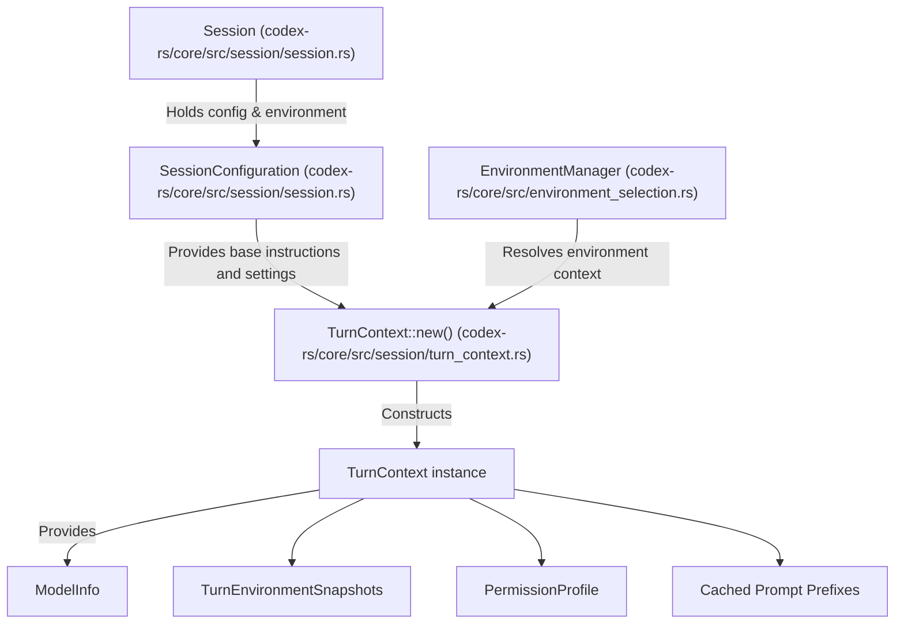
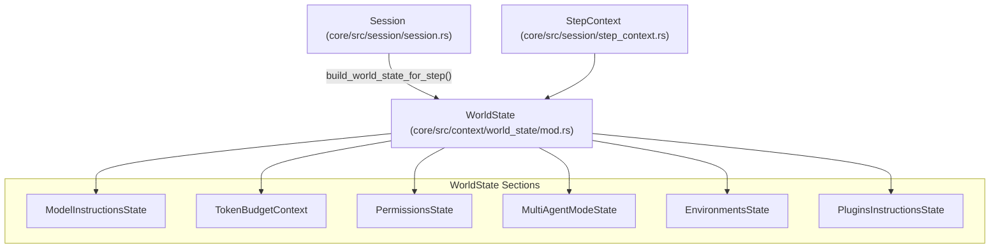

<!-- source: DeepWiki mcp.deepwiki.com · repo openai/codex · page 3.3 Turn Execution and Prompt Construction · fetched 2026-10-26 -->

# Turn Execution and Prompt Construction

<details>
<summary>Relevant source files</summary>

The following files were used as context for generating this wiki page:

- [codex-rs/app-server/tests/suite/v2/client_metadata.rs](codex-rs/app-server/tests/suite/v2/client_metadata.rs)
- [codex-rs/app-server/tests/suite/v2/turn_steer.rs](codex-rs/app-server/tests/suite/v2/turn_steer.rs)
- [codex-rs/context-fragments/src/annotated_content.rs](codex-rs/context-fragments/src/annotated_content.rs)
- [codex-rs/context-fragments/src/fragment.rs](codex-rs/context-fragments/src/fragment.rs)
- [codex-rs/context-fragments/src/lib.rs](codex-rs/context-fragments/src/lib.rs)
- [codex-rs/core/src/context/compaction_summary.rs](codex-rs/core/src/context/compaction_summary.rs)
- [codex-rs/core/src/context/contextual_user_message.rs](codex-rs/core/src/context/contextual_user_message.rs)
- [codex-rs/core/src/context/contextual_user_message_tests.rs](codex-rs/core/src/context/contextual_user_message_tests.rs)
- [codex-rs/core/src/context/guardian_approved_action.rs](codex-rs/core/src/context/guardian_approved_action.rs)
- [codex-rs/core/src/context/hook_additional_context.rs](codex-rs/core/src/context/hook_additional_context.rs)
- [codex-rs/core/src/context/internal_model_context.rs](codex-rs/core/src/context/internal_model_context.rs)
- [codex-rs/core/src/context/memory.rs](codex-rs/core/src/context/memory.rs)
- [codex-rs/core/src/context/mod.rs](codex-rs/core/src/context/mod.rs)
- [codex-rs/core/src/context/multi_agent_usage_hint.rs](codex-rs/core/src/context/multi_agent_usage_hint.rs)
- [codex-rs/core/src/context/unsupported_media.rs](codex-rs/core/src/context/unsupported_media.rs)
- [codex-rs/core/src/context/user_goal.rs](codex-rs/core/src/context/user_goal.rs)
- [codex-rs/core/src/context/user_instructions.rs](codex-rs/core/src/context/user_instructions.rs)
- [codex-rs/core/src/context/world_state/environment.rs](codex-rs/core/src/context/world_state/environment.rs)
- [codex-rs/core/src/context/world_state/environment_render_tests.rs](codex-rs/core/src/context/world_state/environment_render_tests.rs)
- [codex-rs/core/src/context/world_state/environment_tests.rs](codex-rs/core/src/context/world_state/environment_tests.rs)
- [codex-rs/core/src/context/world_state/mod.rs](codex-rs/core/src/context/world_state/mod.rs)
- [codex-rs/core/src/context_manager/updates.rs](codex-rs/core/src/context_manager/updates.rs)
- [codex-rs/core/src/responses_metadata.rs](codex-rs/core/src/responses_metadata.rs)
- [codex-rs/core/src/session/review.rs](codex-rs/core/src/session/review.rs)
- [codex-rs/core/src/session/step_context.rs](codex-rs/core/src/session/step_context.rs)
- [codex-rs/core/src/session/world_state.rs](codex-rs/core/src/session/world_state.rs)
- [codex-rs/core/src/tasks/compact.rs](codex-rs/core/src/tasks/compact.rs)
- [codex-rs/core/src/tasks/regular.rs](codex-rs/core/src/tasks/regular.rs)
- [codex-rs/core/src/tasks/review.rs](codex-rs/core/src/tasks/review.rs)
- [codex-rs/core/src/turn_metadata.rs](codex-rs/core/src/turn_metadata.rs)
- [codex-rs/core/src/turn_metadata_tests.rs](codex-rs/core/src/turn_metadata_tests.rs)
- [codex-rs/core/tests/suite/collaboration_instructions.rs](codex-rs/core/tests/suite/collaboration_instructions.rs)
- [codex-rs/core/tests/suite/override_updates.rs](codex-rs/core/tests/suite/override_updates.rs)
- [codex-rs/core/tests/suite/permissions_messages.rs](codex-rs/core/tests/suite/permissions_messages.rs)
- [codex-rs/core/tests/suite/prompt_caching.rs](codex-rs/core/tests/suite/prompt_caching.rs)
- [codex-rs/core/tests/suite/review.rs](codex-rs/core/tests/suite/review.rs)
- [codex-rs/ext/extension-api/examples/enabled_extensions.rs](codex-rs/ext/extension-api/examples/enabled_extensions.rs)
- [codex-rs/ext/extension-api/examples/enabled_extensions/shared_state_extension.rs](codex-rs/ext/extension-api/examples/enabled_extensions/shared_state_extension.rs)
- [codex-rs/ext/extension-api/src/contributors/prompt.rs](codex-rs/ext/extension-api/src/contributors/prompt.rs)
- [codex-rs/ext/extension-api/src/state.rs](codex-rs/ext/extension-api/src/state.rs)
- [codex-rs/prompts/src/multi_agent_instructions.rs](codex-rs/prompts/src/multi_agent_instructions.rs)
- [codex-rs/tools/src/tool_config.rs](codex-rs/tools/src/tool_config.rs)
- [codex-rs/tools/src/tool_config_tests.rs](codex-rs/tools/src/tool_config_tests.rs)

</details>


This document provides a comprehensive overview of how Codex manages the execution of a single conversational turn. It covers the creation and role of the `TurnContext` struct which encapsulates per-turn configuration and state, the process of constructing prompts using cached prefixes, the injection of the dynamic "World State" context, the application of overrides, and the use of structured templates from the `prompts` crate. This page is a deep dive into the data flow, key structs and functions, and integration with the model and environment subsystems to orchestrate effective turn executions.

For a broader understanding of Codex’s session lifecycle and model interactions, see also [3.1 Codex Interface and Session Lifecycle](), [3.2 Model Client and API Communication](), and [3.4 Event Processing and State Management]().

---

## TurnContext: Per-Turn Configuration and State

Every conversational turn in Codex is associated with a **`TurnContext`** object, which acts as the canonical source of truth for all configuration, environmental context, policies, and metadata valid during that turn. This encapsulation supports safe concurrent execution of turns, turn retries, and guarantees isolation of per-turn settings.

The `TurnContext` is constructed early in the turn execution pipeline, synthesizing global session configuration with per-turn overrides and environment selections.

### Key Fields in `TurnContext`

| Category                  | Fields                                      | Description                                                                                     |
|---------------------------|---------------------------------------------|------------------------------------------------------------------------------------------------|
| **Identity and Routing**   | `sub_id`, `session_source`, `trace_id`     | Unique per-turn identifier; origin of turn (CLI, TUI, etc.); W3C trace context for distributed tracing. [source](codex-rs/core/src/session/turn_context.rs:18-19) |
| **Model and Provider**     | `model_info`, `provider`, `reasoning_effort`| Metadata and capabilities of the selected LLM; provider details; reasoning effort level settings. [source](codex-rs/core/src/session/turn_context.rs:23-24)     |
| **Environment Context**    | `environments`, `cwd`                        | Multiple environment attachments for execution (local, SSH, containers); current working directory. [source](codex-rs/core/src/session/turn_context.rs:47-60)       |
| **Contextual Data**        | `cached_prompt_prefixes`, `world_state_cache`| Cached prompt prefix templates and rendered world state sections for prompt building efficiency. [source](codex-rs/core/src/session/turn_context.rs:70-130)          |
| **Permissions and Policies** | `permission_profile`, `approval_policy`, `sandbox_policy` | Sandbox and permission profiles controlling API and tool access for the turn’s environment. [source](codex-rs/core/src/session/turn_context.rs:120-150)              |
| **Overrides**              | `overrides`                                  | Thread-level or turn-level setting overrides applied selectively for this turn. [source](codex-rs/core/src/session/turn_context.rs)                                 |

### TurnContext Construction Data Flow



The `TurnContext` creation involves merging base instructions, model info, environment snapshots, permission profiles, and cached prefix fragments. This structured approach reduces redundant prompt computation by caching prefix fragments per environment and per turn settings, improving responsiveness and throughput.

Sources: [codex-rs/core/src/session/turn_context.rs:10-165](), [codex-rs/core/src/session/session.rs:40-132](), [codex-rs/core/src/environment_selection.rs:39-150]()

---

## Turn Execution and Sampling Loop

The core logic to process a conversational turn resides in the function typically called `run_turn` in the core session module. This function orchestrates a sampling loop that interacts with the model API, handles tool calls requested by the model, and manages turn completion.

### High-Level Turn Sampling Process

1. **Pre-Sampling Compaction:**  
   Before issuing a model request, Codex may trigger history compaction if needed to reduce the conversation history to fit within token constraints. This uses inline or remote compaction mechanisms to compress old conversation into summarized fragments. The compaction functions like `run_inline_auto_compact_task` can be called prior to turn start to ensure efficient prompt sizes.  
   [source: codex-rs/core/src/session/turn.rs:10-13, codex-rs/core/src/tasks/compact.rs:100-180]

2. **Model Client Session Initialization:**  
   Codex creates or reuses a `ModelClientSession` instance that manages the underlying streaming connection to the model API for the current turn, maintaining session parameters and retry state.  
   [source: codex-rs/core/src/session/turn.rs:160-210]

3. **Prompt Assembly:**  
   The prompt is assembled by combining:  
   - Cached prompt prefixes and base instructions, reused across turns.  
   - Conversation history and tool descriptions available for this session.  
   - Dynamically injected **World State** fragments representing environment, plugins, tool availability, permissions, etc.  
   This prompt construction uses cached prefixes for performance and is templated using the `codex_prompts` crate.  
   [source: codex-rs/core/src/session/turn.rs:1-165]

4. **Model Interaction & Streaming Responses:**  
   Codex streams responses from the model, concurrently handling:  
   - Assistant messages, appending them to the turn output and emitting UI events.  
   - Tool call requests invoked by model completions, which are then executed and their output inserted into the prompt for continuation.  
   The sampling loop continues until the turn is complete or an error/cancellation occurs.  
   [source: codex-rs/core/src/session/turn.rs:140-210]

5. **Turn Completion:**  
   The turn finishes upon stable assistant response completion without further tool calls. Completion events are emitted, and metrics are recorded.  
   [source: codex-rs/core/src/session/turn.rs:140-160]

### The `SessionTask` Abstraction

Turn workflows conform to the `SessionTask` trait which abstracts specific behaviors per task type such as regular chat or special review tasks.

| Method           | Purpose                                                              |
|------------------|----------------------------------------------------------------------|
| `kind()`         | Returns the type of task, e.g., `Regular`, `Review`, or `Compact`. [source](codex-rs/core/src/tasks/mod.rs:179-198) |
| `span_name()`    | Provides the tracing span name for telemetry instrumentation.        |
| `run()`          | Executes the turn logic asynchronously with support for cancellation and event streaming. [source](codex-rs/core/src/tasks/mod.rs:187-197) |
| `abort()`        | Optional task abortion logic, cleaning up resources if needed.       |

This interface promotes modularity and separation of concerns in turn execution.

Sources: [codex-rs/core/src/session/turn.rs:8-165](), [codex-rs/core/src/tasks/mod.rs:175-210]()

---

## Prompt Construction and World State Injection

Codex constructs the text prompt sent to the LLM using a composition of:

- **Static and Cached Prompt Prefixes:**  
  Base instructions, user instructions, personality text, and other stable context injected early to reduce token waste. These are cached to avoid redundant rendering.  

- **Dynamic World State Fragments:**  
  Contextual information collected on each turn such as environment info, token budgets, permissions, multi-agent collaboration states, plugins instructions, and API capabilities.

- **Overrides and Configuration Variables:**  
  Per-thread or per-turn overrides that can replace or append base instruction sections, allowing user or deployment-specific customizations.

- **Structured Templates from the `codex_prompts` crate:**  
  A crate that manages string templates, interpolation, rendering, and conditional inclusion of instruction fragments and policy texts.

### Protocol Tags and Prompt Sections

Codex uses special tags to segment injected context in prompts, improving organization and parsing:

| Tag                         | Purpose                                                               |
|-----------------------------|-----------------------------------------------------------------------|
| `<environment_context>`      | Contains current working directory, shell info, and execution environments. |
| `<tools>`                   | Lists available tools and usage instructions.                        |
| `<user_instructions>`        | Project or user-added instructions or overrides.                      |
| `<permissions_instructions>` | Describes sandbox and approval policies affecting this turn.         |

These facilitate reliable context injection and modular prompt construction.

### How World State is Built

World state assembly happens in the method `build_world_state_for_step` on the `Session` object. It aggregates multiple context providers into the `WorldState` data structure ([source](codex-rs/core/src/session/world_state.rs:33-154)).

#### Components of WorldState:

- **Model Instructions:**  
  Cached system/personal instructions tied to the model's metadata, combined with any custom or overridden instructions. They ensure consistent initial guidance for the LLM.

- **Token Budget Context:**  
  Injects prompt token usage monitoring and advisory messages to prevent exceeding model context limits.

- **Permissions and Approval Context:**  
  Human-readable explanations of sandboxing, approval and permission policies active on this turn.

- **Multi-Agent and Plugin Instructions:**  
  Context describing collaborating agents, multi-agent modes, and installed plugins to enable sophisticated orchestration.

- **Environment Context:**  
  Structured details about execution environments, paths, shells, and environment variables aggregated from multiple environment attachments.



The world state sections produce text fragments that are merged with the conversation history and cached prefixes into the final prompt.

### Cached Prompt Prefixes

To optimize prompt construction, stable segments such as base instructions, environment context, and tool prompts are cached in `TurnContext.cached_prompt_prefixes`. This avoids recomputing these static portions every turn. Cache keys depend on environment state and configuration so prefix invalidation is deterministic.

Sources: [codex-rs/core/src/session/turn_context.rs:70-130](), [codex-rs/core/src/session/world_state.rs:38-155](), [codex-rs/prompts/src/model_messages.rs]()

---

## Overrides and Prompt Templates (`codex_prompts` crate)

Codex supports flexible per-thread and per-turn overrides encapsulated in `ThreadSettingsOverrides`. These can modify:

- Base instructions,
- Developer instructions,
- Permissions and sandbox overrides,
- Approval policies,
- Other configuration that influences prompt shaping.

The override mechanism merges user or workload-specific changes with base settings to yield the final prompt components.

The `codex_prompts` crate provides:

- Template definitions for model prompts and instruction fragments,
- Helpers for rendering conditionally included instructions (e.g., disabling update plan instructions),
- Utilities for multi-agent role instructions and approval prompt contexts,
- Standardized instruction rendering ensuring consistent formatting and style.

This crate is core to prompt construction, allowing reusable templates and textual instructions that represent complex policy or environment configurations succinctly.

Sources: [codex-rs/core/src/session/world_state.rs:45-57](), [codex-rs/prompts/src/model_messages.rs:5-120]()

---

## Data Flow Summary: From Natural Language Input to Prompt Construction

```mermaid
flowchart TD
    subgraph NaturalLanguageSpace ["Natural Language Space (User / UI)"]
        UserInput ["User Input / Message"]
        ConversationHistory ["Conversation History"]
        PromptView ["Prompt View (Cached Prefixes + History)"]
        AssistantResponse ["Assistant's Response"]
    end

    subgraph CodeEntitySpace ["Code Entity Space"]
        TurnContext ["TurnContext (core/src/session/turn_context.rs)"]
        WorldStateBuild ["build_world_state_for_step() (core/src/session/world_state.rs)"]
        PromptBuild ["Prompt Building Logic (core/src/session/turn.rs)"]
        ModelClient ["ModelClientSession (core/src/session/turn.rs)"]
        ModelAPI ["Language Model API (OpenAI/Bedrock/etc)"]
        EnvironmentManager ["EnvironmentManager (core/src/environment_selection.rs)"]
        Policies ["PermissionProfile and Policies (core/src/session/turn_context.rs)"]
        Overrides ["ThreadSettingsOverrides"]
        PromptsCrate ["codex_prompts crate templates"]
    end

    UserInput --> TurnContext
    ConversationHistory --> PromptView
    TurnContext -->|Holds| EnvironmentManager
    TurnContext -->|Holds| Policies
    TurnContext -->|Has| Overrides
    TurnContext --> WorldStateBuild
    WorldStateBuild --> PromptBuild
    PromptView --> PromptBuild
    Overrides --> PromptBuild
    PromptsCrate --> PromptBuild
    PromptBuild --> ModelClient
    ModelClient --> ModelAPI
    ModelAPI --> AssistantResponse
```

This diagram illustrates how natural language inputs and conversation history flow through the Codex system, with the `TurnContext` as a central hub that binds environmental states, permissions, and configuration overrides. The world state construction and cached prefixes feed into prompt construction, which is then submitted to the model client to interact with the LLM API.

Sources:  
- [codex-rs/core/src/session/turn_context.rs:18-165]()  
- [codex-rs/core/src/session/world_state.rs:33-154]()  
- [codex-rs/core/src/session/turn.rs:1-165]()  
- [codex-rs/prompts/src/model_messages.rs]()  
- [codex-rs/core/src/environment_selection.rs:39-150]()

---

## Summary

- **`TurnContext`** acts as the per-turn encapsulation for configuration, environment snapshots, permissions, and cached prompt elements.
- Prompt construction is a compositional process merging cached prefixes, injected dynamic **World State** context, conversation history, and overrides, using templates from the `codex_prompts` crate.
- The turn execution loop (`run_turn`) streams model outputs, handles tool calls, and manages turn lifecycle events.
- The **World State** injection embeds rich context like environment details, policy instructions, tools, plugins, and multi-agent information transparently into the prompt.
- Caching of prompt fragments and world state sub-sections reduces prompt building latency and improves response time on successive turns.
- The modular `SessionTask` trait abstracts different conversational workflows such as regular chat and review tasks, enabling extensibility.

This architecture provides a flexible, extensible, and efficient foundation for prompt engineering and conversational turn execution within the Codex AI agent.

---

# References

- `TurnContext` implementation and data flow: [codex-rs/core/src/session/turn_context.rs:10-165]()
- Turn execution loop and sampling: [codex-rs/core/src/session/turn.rs:1-165]()
- World state construction and injection: [codex-rs/core/src/session/world_state.rs:33-154]()
- Environment context and environment selection: [codex-rs/core/src/environment_selection.rs:39-150]()
- Session tasks and turn lifecycle: [codex-rs/core/src/tasks/mod.rs:175-210]()
- Prompts crate templates and model instructions: [codex-rs/prompts/src/model_messages.rs:5-120]()

---

